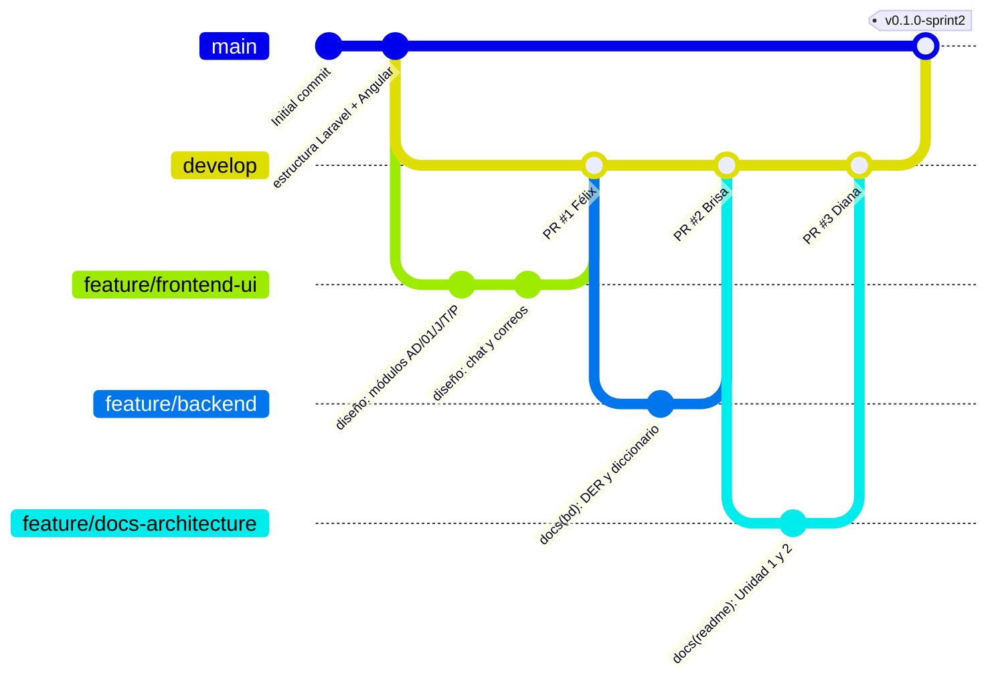
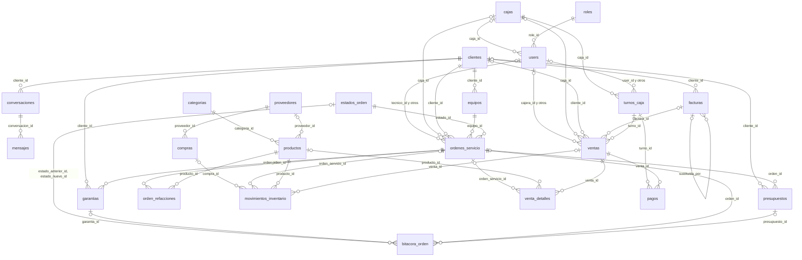
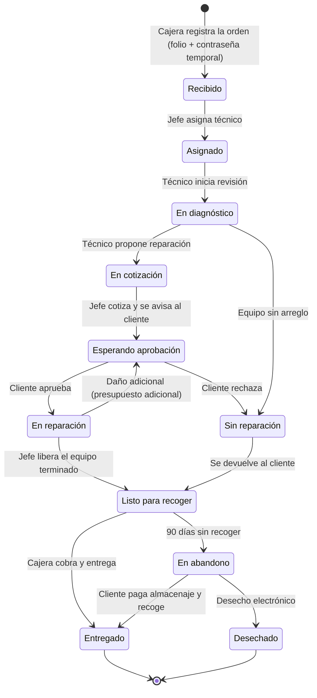

<div align="center">

# 🛠️ SHURI — Sistema Integral de Reparaciones y Ventas

**Plataforma web unificada para taller de reparación de electrónicos, inventario y punto de venta**


| | |
|---|---|
| **Universidad** | Universidad Tecnológica de Torreón |
| **Programa educativo** | Ingeniería en Desarrollo y Gestión de Software |
| **Asignatura** | Desarrollo Web Integral — 9° "A" |
| **Profesor** | Jesús Del Toro Robledo |
| **Prototipo (Figma)** | [Ver diseño en Figma](https://www.figma.com/design/wUFXid6RcC3a6H9iEdokWi/Untitled?node-id=62-22047&t=5qUdxVh60Zgiw0Ah-0) |

</div>

---

## 📑 Índice

**Unidad 1 — Análisis y planeación**
1. [Equipo de desarrollo](#-1-equipo-de-desarrollo)
2. [Planteamiento del problema](#-2-planteamiento-del-problema)
3. [Justificación](#-3-justificación)
4. [Objetivos](#-4-objetivos)
5. [Alcances, limitaciones y MVP](#-5-alcances-limitaciones-y-mvp)
6. [Requisitos funcionales y no funcionales](#-6-requisitos-funcionales-y-no-funcionales)
7. [Metodología, roles y plan de trabajo](#-7-metodología-roles-y-plan-de-trabajo)
8. [Arquitectura, stack tecnológico y patrones de diseño](#-8-arquitectura-stack-tecnológico-y-patrones-de-diseño)
9. [Prototipado y wireframes](#-9-prototipado-y-wireframes)
10. [Contenido y tono de comunicación](#-10-contenido-y-tono-de-comunicación)

**Unidad 2 — Control de versiones, diagramas y diccionario de datos**

11. [Justificación de la herramienta y plataforma de versionamiento](#-11-justificación-de-la-herramienta-y-plataforma-de-versionamiento)
12. [Flujo de trabajo (Workflow)](#-12-flujo-de-trabajo-workflow)
13. [Configuración del entorno de versiones](#-13-configuración-del-entorno-de-versiones)
14. [Diagramas del sistema](#-14-diagramas-del-sistema)
15. [Diccionario de datos](#-15-diccionario-de-datos)
16. [Instalación y ejecución local](#-16-instalación-y-ejecución-local)
17. [Estructura del repositorio](#-17-estructura-del-repositorio)

---

# 📘 UNIDAD 1 — Análisis y Planeación

## 👥 1. Equipo de desarrollo

| Integrante | Rol | Responsabilidades principales |
|---|---|---|
| **Diana Paola Ochoa Altamirano** | Líder de Proyecto · Scrum Master · Arquitecta Fullstack · QA | Coordinación del equipo, diseño de la arquitectura, revisión y aprobación de Pull Requests, integración Frontend/Backend, seguridad (RBAC) y pruebas. |
| **Brisa Daniela Luna Castañeda** | Desarrolladora Backend & DBA | Modelo entidad-relación, migraciones MySQL, API RESTful en Laravel, transacciones de inventario y autenticación con Sanctum. |
| **Félix Gael Martínez Saldívar** | Desarrollador Frontend & UX/UI | Prototipo en Figma, maquetación adaptativa en Angular, vistas de Taller, Punto de Venta y Portal del Cliente. |

---

## 📌 2. Planteamiento del problema

En la actualidad, los negocios dedicados a la reparación de equipos electrónicos (computadoras, dispositivos móviles y electrónica general) y a la venta física de refacciones y accesorios (audífonos, cables, mouses, entre otros) operan frecuentemente con sistemas fragmentados, hojas de cálculo aisladas o registros manuales en papel. Esta desconexión operativa genera tres problemas críticos en la sucursal:

- **Incertidumbre y saturación en la atención al cliente:** existe una carencia total de trazabilidad en los procesos de servicio técnico. El usuario final desconoce el estado actual de su equipo, qué refacciones adicionales se requieren o la fecha estimada de entrega, lo que satura el mostrador y los canales telefónicos con consultas repetitivas de seguimiento.
- **Caos operativo y descontrol en el taller de reparación:** los técnicos carecen de un sistema centralizado para registrar diagnósticos, solicitar autorizaciones de presupuesto ante fallas secundarias detectadas o gestionar el resguardo de equipos abandonados por periodos prolongados. Estos equipos ocupan espacio físico valioso y representan un pasivo legal y operativo para el negocio.
- **Descontrol de inventario físico y fugas en el punto de venta:** las existencias de refacciones para taller y los accesorios para venta al público no están sincronizadas en tiempo real. Esta falta de integración dificulta el cobro preciso en mostrador, favorece la discrepancia entre el inventario teórico y el real (merma o "inventario fantasma") y complica el cobro unificado de servicios de reparación junto con la venta de productos físicos.

---

## 💡 3. Justificación

El desarrollo de este sistema unificado es fundamental para modernizar, estructurar y optimizar tanto el flujo operativo del taller como la gestión comercial en el mostrador de la sucursal.

- **Justificación práctica:** centralizar la administración de inventarios, las ventas físicas y el flujo de reparaciones en una sola plataforma web elimina la redundancia de datos y agiliza los tiempos de respuesta. Permite controlar el ciclo de vida completo de un equipo y, mediante un módulo de auditoría global, brinda visibilidad total sobre las acciones de cada empleado, mitigando el error humano y previniendo fugas financieras.
- **Justificación teórica:** el proyecto se fundamenta en los principios de los sistemas de planificación de recursos (ERP) y de gestión de relaciones con clientes (CRM) adaptados a la escala de una PyME. Se aplica la teoría de la trazabilidad de la información: al poner los datos al alcance del cliente mediante un portal web se reduce la fricción comunicativa, se eleva su confianza y se agiliza la autorización de presupuestos.
- **Justificación metodológica:** se aplica un enfoque iterativo y ágil basado en Sprints, que permite priorizar la entrega de módulos críticos (Punto de Venta e inventario base) en fases tempranas, asegurando que la sucursal perciba valor operativo antes de la implementación total de las herramientas de comunicación técnico-cliente.

---

## 🎯 4. Objetivos

### 4.1 Objetivo general

**Desarrollar** un sistema web unificado de gestión interna para la sucursal que conecte de forma directa el área de taller, el control de inventario y el punto de venta (POS), permitiendo la comercialización de refacciones y accesorios, la recepción y cobro de servicios técnicos en mostrador, y ofreciendo al cliente un portal web de seguimiento transparente para monitorear el estado de su reparación, cuya recepción y entrega se realizará estrictamente en la sucursal física.

### 4.2 Objetivos específicos funcionales

1. **Desarrollar** un Módulo de Inventario Dinámico Unificado que controle en tiempo real las existencias de refacciones y accesorios, descontando automáticamente el stock por ventas en caja o por asignación de piezas a órdenes de servicio.
2. **Crear** el Punto de Venta y Gestión de Recepción/Entrega (Módulo Cajera) para cobrar productos, aplicar ajustes mediante clave de autorización, registrar nuevas órdenes de ingreso a taller y procesar la entrega de reparaciones concluidas.
3. **Programar** el Sistema de Asignación y Control de Taller (Módulo Jefe de Técnicos) para recibir órdenes de servicio, evaluar cargas de trabajo y asignar reparaciones a técnicos específicos.
4. **Construir** el Entorno Operativo y Bitácora de Comunicación (Módulo Técnico) para actualizar el estado del dispositivo, descontar refacciones del inventario y solicitar autorizaciones de presupuesto al cliente ante fallas extras.
5. **Configurar** el Panel de Supervisión, Auditoría y Seguridad (Módulo Administrador) con gestión de usuarios, catálogo maestro de productos y un registro de auditoría inmutable.
6. **Implementar** el Portal del Cliente, al que se entra con **correo y contraseña** (temporal en el primer acceso), para monitorear el avance de sus equipos, aprobar o rechazar presupuestos, solicitar garantías y comunicarse con el Jefe de Técnicos por chat.
7. **Integrar** la gestión de caja y compras: apertura y corte de caja por turno, pedidos y compras a proveedores, facturación electrónica (CFDI) y avisos automáticos al cliente por correo.

---

## 📏 5. Alcances, limitaciones y MVP

### 5.1 Alcance

- **Funciones principales:**
  - **Mostrador:** Punto de Venta, apertura y corte de caja, recepción y entrega de equipos, devoluciones, notas de crédito y facturación (CFDI).
  - **Taller:** asignación de órdenes, banco de trabajo del técnico con cronómetro, bitácora, cotizaciones, solicitudes de refacciones y garantías.
  - **Inventario y compras:** catálogo unificado (refacciones y accesorios), movimientos de stock, proveedores, pedidos y compras.
  - **Administración:** usuarios y permisos, reportes, cortes de caja, configuración del negocio y auditoría global.
  - **Portal del cliente:** seguimiento de reparaciones, aprobación de presupuestos, solicitud de garantía, chat con el Jefe de Técnicos y avisos por correo.
- **Usuarios contemplados:** 5 perfiles con distintos niveles de acceso: **Administrador, Jefe de Técnicos, Técnico, Cajera y Cliente Final**.
- **Plazo de ejecución:** 8 semanas organizadas en 4 Sprints de 2 semanas (28 de septiembre – 22 de noviembre de 2026).

### 5.2 Limitaciones

| Limitación | Descripción |
|---|---|
| Venta exclusivamente en sucursal | No se incluye e-commerce, carrito web ni pasarelas de pago digitales. Todo cobro es presencial. |
| Logística exclusiva en sucursal | Sin integración con paqueterías ni gestión de rutas. Recepción y entrega físicas en el local. |
| Diagnóstico manual | El software documenta estados; no realiza diagnósticos de hardware automatizados. |
| Comunicación solo por portal y correo | No se envían SMS ni mensajes de WhatsApp ni se hacen llamadas. Los avisos al cliente llegan al portal y a su correo, y sus dudas se atienden por el chat del portal. |
| Una sola sucursal | El sistema administra un único negocio con una sucursal (puede tener varias cajas). |

### 5.3 Producto Mínimo Viable (MVP)

El MVP resuelve la operatividad crítica del mostrador y el flujo básico del taller, y se entrega al cierre del **Sprint 2 (semana 4)**:

1. **Prioridad 1 (Core):** recepción de equipo con generación de folio único y alta de clientes.
2. **Prioridad 2 (Operación):** asignación a técnico, actualización de estatus y registro manual de diagnóstico.
3. **Prioridad 3 (Comercio):** cobro de reparaciones y accesorios en el Punto de Venta y entrega final.
4. **Prioridad 4 (Transparencia):** portal del cliente con acceso por correo y contraseña temporal, y consulta del estatus de sus equipos.

Garantías, chat, compras a proveedores y facturación se entregan en los Sprints 3 y 4.

---

## 📋 6. Requisitos funcionales y no funcionales

### 6.1 Requisitos funcionales (historias de usuario)

| ID | Prioridad (MoSCoW) | Historia de usuario | Criterios de aceptación verificables |
|---|---|---|---|
| RF-01 | Must have | Como **Administrador**, quiero crear, editar y desactivar usuarios asignando roles (Admin, Jefe, Técnico, Cajera) para controlar la seguridad. | Un usuario "Técnico" no puede acceder al Punto de Venta. Se guardan logs de los cambios. |
| RF-02 | Must have | Como **Sistema**, quiero actualizar el inventario en tiempo real tras ventas en caja o uso en taller para mantener la centralización. | El stock disminuye al instante. Se bloquea la transacción si la cantidad es 0. |
| RF-03 | Must have | Como **Cajera**, quiero registrar la entrada de equipos a taller asociando datos del cliente para llevar el control. | Se genera un folio alfanumérico único, imprimible y consultable. |
| RF-04 | Must have | Como **Jefe de Técnicos**, quiero un panel para asignar solicitudes de reparación a mi personal para equilibrar cargas. | La orden cambia a "Asignado" y aparece solo en la lista del técnico correspondiente. |
| RF-05 | Must have | Como **Técnico**, quiero actualizar el estado del servicio y descontar refacciones utilizadas para mantener la bitácora al día. | Las refacciones se descuentan del stock y se vinculan al costo final de la orden. |
| RF-06 | Must have | Como **Cliente Final**, quiero entrar al portal con mi correo y contraseña para ver el avance de mis equipos. | Al registrar la orden se envía una contraseña temporal al correo (y se imprime en la hoja de recepción). En el primer acceso el sistema obliga a crear una contraseña propia. Tras varios intentos fallidos, la cuenta se bloquea temporalmente. |
| RF-07 | Should have | Como **Cliente Final**, quiero aceptar o rechazar un presupuesto desde el portal para agilizar la reparación. | La decisión queda en la bitácora de la orden y el técnico la ve de inmediato en su panel. |
| RF-08 | Must have | Como **Cajera**, quiero usar el POS para cobrar accesorios y liquidar órdenes de taller terminadas. | Se genera un ticket, la orden queda pagada y cambia a "Entregado". |
| RF-09 | Could have | Como **Administrador**, quiero que los equipos con más de 90 días sin recoger pasen a "En Abandono" para liberar espacio. | Tras 7 días de gracia se cobra almacenaje diario (configurable). A los 90 días el estado cambia a "En Abandono" y se bloquean acciones técnicas. |
| RF-10 | Must have | Como **Jefe de Técnicos**, quiero cotizar el diagnóstico que propone el técnico para enviar el presupuesto al cliente. | El presupuesto pasa de "por cotizar" a "pendiente" y el cliente recibe un aviso en el portal y por correo. |
| RF-11 | Should have | Como **Cliente Final**, quiero solicitar una garantía desde el portal para que revisen mi equipo reparado. | Solo se permite mientras la garantía de la orden siga vigente. El técnico revisa el equipo y el Jefe de Técnicos dictamina si procede, si no procede o si procede con costo. |
| RF-12 | Should have | Como **Cliente Final**, quiero chatear con el Jefe de Técnicos desde el portal para resolver dudas sin ir a la sucursal. | Los mensajes aparecen en la bandeja del jefe (J11). Si el jefe se marcó "no disponible hoy", el portal se lo indica al cliente. |
| RF-13 | Must have | Como **Cajera**, quiero abrir y cerrar mi turno de caja para cuadrar el efectivo. | Solo puede haber un turno abierto por caja. Al cerrar se calcula la diferencia entre el efectivo esperado y el contado, y el administrador revisa el corte. |
| RF-14 | Must have | Como **Administrador**, quiero definir el descuento máximo de cada usuario para evitar fugas. | Un descuento mayor al permitido (tope de 20 %) requiere la clave de autorización de un superior y queda en la auditoría. |
| RF-15 | Should have | Como **Jefe de Técnicos**, quiero hacer pedidos de refacciones a proveedores cuando no hay stock. | Las solicitudes de refacción del técnico se agrupan en un pedido. Al recibir la mercancía, el stock aumenta. |
| RF-16 | Could have | Como **Administrador**, quiero emitir facturas electrónicas (CFDI) de las ventas. | La factura usa los datos fiscales del cliente y se puede cancelar o sustituir. |
| RF-17 | Must have | Como **Sistema**, quiero avisar al cliente por correo cuando cambie algo importante de su orden. | Se envían correos cuando la orden se registra, tiene presupuesto por aprobar o está lista para recoger, y antes del abandono. Cada envío queda registrado. |

### 6.2 Requisitos no funcionales

| ID | Categoría | Descripción | Criterios de aceptación verificables |
|---|---|---|---|
| RNF-01 | Seguridad | Contraseñas cifradas con hash seguro (Bcrypt) y autenticación por tokens (Laravel Sanctum). | Comprobación en BD de que no existen contraseñas en texto plano. |
| RNF-02 | Rendimiento | Las actualizaciones de inventario y la consulta de folios deben ser ágiles. | Tiempo de respuesta < 2 s con 50 peticiones concurrentes. |
| RNF-03 | Usabilidad | Interfaz adaptativa (Responsive Web Design) para mostrador y celulares de clientes. | Ajuste visual correcto de 360 px (móvil) a 1920 px (escritorio). |
| RNF-04 | Integridad | Transacciones de base de datos (ACID) para evitar inconsistencias financieras. | Si falla un cobro, el descuento de stock se revierte automáticamente (rollback). |

---

## 🗓️ 7. Metodología, roles y plan de trabajo

### 7.1 Metodología

Se adopta **Scrum** con **4 Sprints de 2 semanas**. Cada Sprint termina con una entrega incremental integrada en la rama `main` y una revisión del equipo.

### 7.2 Plan de contingencia

1. **Ausencia de un integrante:** redistribución temporal de tareas mediante *Pair Programming*, coordinada por Diana Ochoa.
2. **Retraso en un módulo crítico:** se suspenden tareas secundarias (como el pulido visual) para reasignar esfuerzo a las funciones del MVP.

### 7.3 Definition of Done

Una tarea se considera terminada cuando:

1. Su código fue integrado a `develop` mediante un **Pull Request aprobado por Diana** (ver [sección 12](#-12-flujo-de-trabajo-workflow)).
2. Pasa las pruebas funcionales sin errores críticos.
3. La interfaz es adaptativa y funciona correctamente en móvil y escritorio.

### 7.4 Desglose de tareas

| ID | Tarea | Dependencia | Estimación | Asignado |
|---|---|---|---|---|
| T-01 | Modelado e implementación del esquema de base de datos en MySQL (migraciones y seeders). | — | 8 h | Brisa |
| T-02 | Autenticación con Sanctum y roles de usuario (RBAC). | T-01 | 8 h | Brisa / Diana |
| T-03 | API REST de inventario y refacciones. | T-01 | 1 día | Brisa |
| T-04 | Maquetación y flujo del módulo de Taller (Recepción y Asignación). | T-02 | 2 días | Félix |
| T-05 | Bitácora técnica de reparación y consumo de piezas. | T-04 | 8 h | Diana |
| T-06 | Módulo de Punto de Venta (POS) para Cajera. | T-03 | 1 día | Félix / Brisa |
| T-07 | Portal del cliente: acceso con correo y contraseña temporal, y seguimiento de órdenes. | T-04 | 2 días | Félix |
| T-08 | Aprobación de presupuestos en el Portal del Cliente. | T-07 | 1 día | Félix / Brisa |
| T-09 | Caja: apertura, corte por turno, devoluciones y notas de crédito. | T-06 | 1 día | Félix / Brisa |
| T-10 | Garantías y solicitudes de refacción con pedidos y compras a proveedores. | T-05 | 2 días | Brisa / Diana |
| T-11 | Chat cliente ↔ Jefe de Técnicos y correos automáticos (cola de Laravel). | T-07 | 2 días | Diana / Félix |
| T-12 | Facturación electrónica (CFDI) y configuración del negocio. | T-09 | 1 día | Brisa |
| T-13 | Pruebas de integración, validación de seguridad y corrección de errores. | Todas | 1 día | Diana |

### 7.5 Cronograma de Sprints e hitos

| Sprint | Fechas | Hitos y entregables verificables | Responsables |
|---|---|---|---|
| **Sprint 1** | 28 sep – 11 oct | Estructura del repositorio, base de datos MySQL funcional, autenticación y permisos por rol (RBAC). | Brisa, Diana |
| **Sprint 2** | 12 oct – 25 oct | Inventario centralizado, panel de Recepción/Asignación de Taller y Bitácora del Técnico (**MVP operativo**). | Diana, Félix, Brisa |
| **Sprint 3** | 26 oct – 08 nov | Punto de Venta con liquidación de servicios, caja con cortes, cotizaciones, garantías y compras a proveedores. | Félix, Brisa |
| **Sprint 4** | 09 nov – 22 nov | Portal del cliente (aprobación de presupuestos, garantía, chat), correos automáticos, facturación, pruebas de integración y cierre. | Félix, Diana, Brisa |

### 7.6 Avance del proyecto (corte: 20 de octubre de 2026)

| Entregable | Estado | Evidencia | Responsable |
|---|---|---|---|
| Estructura del proyecto (Laravel 10 + Angular 17) | ✅ Terminado | [`backend/`](backend/), [`frontend/`](frontend/) | Diana |
| Repositorio, flujo de trabajo y plantillas de PR | ✅ Terminado | [Sección 12](#-12-flujo-de-trabajo-workflow), [`.github/`](.github/) | Diana |
| Prototipo de alta fidelidad (6 módulos + sistema de diseño) | ✅ Terminado | [Sección 9](#-9-prototipado-y-wireframes), [`docs/diseno/`](docs/diseno/) | Félix |
| Diagrama de casos de uso | ✅ Terminado | [Sección 14.2](#142-diagrama-de-casos-de-uso-uml) | Félix |
| Modelo de datos: DER y diccionario (51 tablas) | ✅ Terminado | [Sección 14.3](#143-diagrama-entidad-relación-der), [Sección 15](#-15-diccionario-de-datos) | Brisa |
| `.gitignore` y configuración de seguridad del repositorio | ✅ Terminado | [Sección 13](#-13-configuración-del-entorno-de-versiones) | Brisa, Diana |
| Migraciones y seeders en Laravel | 🔄 En curso | `backend/database/migrations/` | Brisa |
| Maquetación de vistas en Angular | 🔄 En curso | `frontend/src/app/` | Félix |
| API REST, autenticación y RBAC | ⏳ Pendiente (Sprint 2–3) | — | Brisa, Diana |

---

## 🏛️ 8. Arquitectura, stack tecnológico y patrones de diseño

### 8.1 Estructura web

Se implementa una **arquitectura monolítica modular basada en API REST**, con frontend y backend desacoplados:

- **Capa de presentación (Frontend):** SPA en Angular que consume la API sin recargar la página.
- **Capa de aplicación y negocio (Backend):** controladores y servicios en Laravel que aplican las reglas de negocio (descuento atómico de existencias, cálculo de importes, cambios de estado).
- **Capa de datos:** MySQL con motor InnoDB y transacciones ACID.

El diagrama de arquitectura está en la [sección 14.1](#141-diagrama-de-arquitectura).

### 8.2 Stack tecnológico justificado

| Tecnología | Rol | Justificación técnica |
|---|---|---|
| **Angular 17** | Frontend (SPA) | Arquitectura modular y tipado fuerte con TypeScript; guardias de navegación (`CanActivate`) para restringir rutas por rol; servicios inyectables y RxJS para el estado del POS y la comunicación con la API. |
| **Laravel 10** | Backend (API REST) | Controladores de recursos y *API Resources* para respuestas JSON; **Laravel Sanctum** para tokens seguros en SPA; Eloquent ORM con transacciones y bloqueos para concurrencia. |
| **MySQL 8** | Base de datos | InnoDB transaccional (ACID) para que una venta o descuento de refacción sea atómica; integridad referencial entre folios, clientes, usuarios e inventario; *pessimistic locking* cuando técnico y cajera usan el mismo insumo a la vez. |
| **Tailwind CSS / Angular Material** | Estilos y componentes | Diseño *mobile-first* adaptable a monitores de mostrador y celulares de técnicos y clientes. |

### 8.3 Patrones de diseño

Además del patrón arquitectónico **MVC**, se aplican tres patrones de diseño:

| Patrón | Tipo | Dónde se aplica | Beneficio |
|---|---|---|---|
| **Repository** | Estructural | `InventoryRepository`, `OrderRepository` | Separa los controladores de las consultas Eloquent; facilita cambios en la BD y pruebas unitarias con *mocks*. |
| **Observer** | Comportamiento | `RepairOrderObserver`, `StockObserver` | Al cambiar el estado de una orden o el stock, registra automáticamente la bitácora, la auditoría y las alertas de stock mínimo sin cargar el controlador. |
| **Singleton** | Creacional | Administrador de conexiones de Laravel (`DatabaseManager`, registrado como *singleton* en el contenedor) | Una sola conexión a MySQL por petición HTTP; menor consumo de memoria y CPU. |

---

## 🎨 9. Prototipado y wireframes

El prototipo de alta fidelidad fue diseñado en **Figma** por **Félix Martínez** (Frontend & UX/UI), con principios de diseño centrado en el usuario, arquitectura de información clara y navegación intuitiva. Distingue los entornos de escritorio con mucha información (personal de sucursal) de la experiencia móvil simplificada (cliente final).

🔗 **Prototipo completo:** [Abrir en Figma](https://www.figma.com/design/wUFXid6RcC3a6H9iEdokWi/Untitled?node-id=62-22047&t=5qUdxVh60Zgiw0Ah-0) · 📁 **Exportación del diseño:** [`docs/diseno/`](docs/diseno/)

**Tamaños base:** escritorio 1440×900 (menú lateral de 184 px) · compacto 1366×768 (riel de 72 px) · tablet 1180×820 · celular 390×844.

### 9.1 Mapa de navegación por rol

```mermaid
flowchart TD
    Login["🔐 Acceso del personal<br/>(usuario + contraseña;<br/>temporal la primera vez)"] --> RBAC{"¿Rol?"}

    RBAC -->|Administrador| AD1["AD1 Inicio"]
    AD1 --> AD2["AD2 Reportes"] & AD3["AD3 Cortes de caja"] & AD4["AD4 Catálogo y precios"]
    AD1 --> AD5["AD5 Proveedores"] & AD6["AD6 Facturación"] & AD7["AD7 Usuarios y permisos"]
    AD1 --> AD8["AD8 Bitácora"] & AD9["AD9 Configuración"]

    RBAC -->|Cajera| C1["01 Inicio y apertura de caja"]
    C1 --> C2["02 Punto de venta"] & C3["03 Ventas"] & C4["04 Órdenes de servicio"]
    C4 --> C5["05 Nueva orden"] & C6["06 Entrega de equipo"]
    C1 --> C7["07 Inventario"] & C8["08 Clientes"] & C9["09 Estadísticas"]
    C1 --> C10["10 Corte de caja"] --> C11["11 Documentos impresos"]

    RBAC -->|Jefe de Técnicos| J1["J1 Inicio"]
    J1 --> J2["J2 Tablero de órdenes"] --> J3["J3 Cotizar"]
    J1 --> J4["J4 Garantías"] & J5["J5 Refacciones"] & J6["J6 Inventario"]
    J1 --> J7["J7 Técnicos"] & J8["J8 Equipos terminados"] & J11["J11 Mensajes de clientes"]

    RBAC -->|Técnico| T1["T1 Inicio"]
    T1 --> T2["T2 Equipos asignados"] --> T3["T3 Banco de trabajo"]
    T1 --> T4["T4 Garantías"] & T5["T5 Refacciones"] & T6["T6 Mi historial"]

    Portal["🌐 Portal del cliente<br/>(correo + contraseña)"] --> P1["P1 Acceso y mis equipos"]
    P1 --> P2["P2 Seguimiento de la reparación"]
    P1 --> P3["P3 Garantía"] & P4["P4 Información"] & P5["P5 Chat con el jefe"]
    J11 -. chat .- P5
```



### 9.2 Pantallas del prototipo

| Entorno | Pantallas | Versiones |
|---|---|---|
| **Acceso** | A.1–A.6: inicio de sesión, datos incorrectos, olvidé mi contraseña, crear y cambiar contraseña. | Escritorio |
| **Administrador** | AD1 Inicio · AD2 Reportes · AD3 Cortes de caja · AD4 Catálogo y precios · AD5 Proveedores · AD6 Facturación · AD7 Usuarios y permisos (asignar contraseña temporal) · AD8 Bitácora · AD9 Configuración (negocio, marca y correo). | Escritorio |
| **Cajera** | 01 Inicio y apertura de caja · 02 Punto de venta · 03 Ventas · 04 Órdenes de servicio · 05 Nueva orden · 06 Entrega de equipo · 07 Inventario · 08 Clientes · 09 Estadísticas · 10 Corte de caja · 11 Documentos impresos. | Escritorio |
| **Jefe de Técnicos** | J1 Inicio · J2 Tablero de órdenes · J3 Cotizar · J4 Garantías · J5 Refacciones · J6 Inventario · J7 Técnicos · J8 Equipos terminados · J9 Configuración · J11 Mensajes de clientes. | Escritorio + J10 celular |
| **Técnico** | T1 Inicio · T2 Equipos asignados · T3 Banco de trabajo · T4 Garantías · T5 Refacciones · T6 Mi historial. | Escritorio + T7 tablet |
| **Portal del cliente** | P1 Acceso y mis equipos · P2 Seguimiento de la reparación · P3 Garantía (solo si se solicita) · P4 Información · P5 Chat con el Jefe de Técnicos · P6 Correos que recibe el cliente. | Celular |
| **Sistema de diseño** | Componentes, tokens (color, espaciado, radios, sombras), iconos, reglas de comportamiento y versión a 1366 px. | — |

### 9.3 Capturas del prototipo

Cada imagen es una sección completa de Figma con todas sus pantallas en orden.

| Acceso del personal | Punto de venta (Cajera) |
|---|---|
|  |  |

| Tablero de órdenes (Jefe) | Banco de trabajo (Técnico) |
|---|---|
|  |  |

| Seguimiento (Portal) | Usuarios y permisos (Admin) |
|---|---|
|  |  |

El detalle de **todas las pantallas** (49 secciones de Figma), el sistema de diseño y las reglas de comportamiento está en la [documentación del frontend](frontend/README.md).

---

## 💬 10. Contenido y tono de comunicación

### 10.1 Tono

- **Interfaz interna (personal):** lenguaje técnico, conciso y funcional. Identificadores visuales, códigos de color por estatus y tablas optimizadas.
- **Portal externo (cliente):** lenguaje claro, transparente y empático, sin tecnicismos. Su objetivo es transmitir tranquilidad e informar con exactitud el estado del equipo.

### 10.2 Mensajes de estado para el cliente

| Estado | Mensaje en el portal | Color |
|---|---|---|
| Recibido en sucursal | "Tu equipo ha sido ingresado correctamente en nuestras instalaciones y está en cola para evaluación." | 🔵 Azul |
| En diagnóstico | "Nuestros técnicos especializados están revisando tu dispositivo para determinar la causa de la falla y los repuestos requeridos." | 🟡 Amarillo |
| Presupuesto pendiente | "Hemos determinado el diagnóstico de tu equipo. Por favor, revisa el desglose del costo y presiona 'Aprobar' para iniciar la reparación." | 🟠 Naranja |
| En reparación | "Presupuesto autorizado. Nuestro equipo técnico se encuentra trabajando en la reparación de tu dispositivo." | 🟡 Amarillo |
| Listo para recoger | "¡Tu equipo está listo! Puedes acudir a nuestra sucursal dentro del horario de atención para realizar tu pago y recolección." | 🟢 Verde |
| Entregado | "El servicio ha sido completado y el equipo ha sido entregado al cliente." | 🟢 Verde |
| Rechazado / En abandono | — (uso interno) | 🔴 Rojo / ⚪ Gris |

Cada mensaje se guarda en `estados_orden.mensaje_cliente`, y su color en `estados_orden.color_hex`. El campo `paso_portal` (1 a 6) indica qué paso se ilumina en la barra de avance de la pantalla P2.

**Tipografía:** fuentes sans-serif modernas (Inter / Roboto) para lectura óptima en paneles densos y pantallas móviles.

---

# 📗 UNIDAD 2 — Control de Versiones, Diagramas y Diccionario de Datos

## 🧰 11. Justificación de la herramienta y plataforma de versionamiento

### 11.1 Sistema de control de versiones: Git

| Necesidad del proyecto | Cómo la resuelve Git |
|---|---|
| Tres integrantes trabajan al mismo tiempo en backend, frontend y documentación. | Es **distribuido**: cada integrante tiene una copia completa del repositorio y trabaja sin depender de un servidor central. |
| Los módulos (Inventario, Taller, POS, Portal) se desarrollan en paralelo. | Las **ramas** son ligeras y baratas; cada funcionalidad se aísla en su propia rama sin afectar el código estable. |
| Debemos poder volver a una versión funcional si algo se rompe antes de una entrega. | Cada *commit* es un punto de restauración; `git revert` y las etiquetas (`tags`) permiten regresar a versiones de Sprint. |
| Laravel, Angular y Composer/npm ya están integrados con Git. | Es el estándar de la industria; los *frameworks* incluyen sus propios `.gitignore` y las herramientas de CI lo soportan de forma nativa. |

### 11.2 Plataforma remota: GitHub

| Criterio | GitHub | GitLab | Bitbucket |
|---|---|---|---|
| Pull Requests con revisión obligatoria | ✅ | ✅ | ✅ |
| Protección de ramas en repos gratuitos públicos | ✅ | ✅ | ⚠️ Limitada |
| Renderizado de diagramas **Mermaid** en Markdown | ✅ | ✅ | ❌ |
| GitHub Projects (tablero Kanban para Sprints) | ✅ integrado | ✅ | ⚠️ Requiere Jira |
| Integración con VS Code y GitHub Desktop | ✅ nativa | Parcial | Parcial |
| Experiencia previa del equipo | ✅ | ❌ | ❌ |

**Decisión:** usamos **GitHub** porque permite revisar el código con Pull Requests obligatorios (requisito de nuestra *Definition of Done*), proteger la rama `main`, documentar todo el proyecto en este README con diagramas Mermaid que se muestran directamente, y llevar el tablero de Sprints en GitHub Projects sin herramientas externas. Además, el equipo ya lo conoce, lo que reduce la curva de aprendizaje en un proyecto de 8 semanas.

🔗 **Repositorio:** https://github.com/dianaaochoa/SHURI-Sistema-Gestion

---

## 🔀 12. Flujo de trabajo (Workflow)

### 12.1 Modelo elegido: Git Flow simplificado

Adoptamos **Git Flow simplificado** porque se ajusta a nuestra metodología Scrum: `develop` acumula el trabajo del Sprint y `main` solo recibe versiones estables al cierre de cada Sprint. Descartamos *GitHub Flow* puro porque integrar directamente en `main` no nos deja un punto de integración donde probar backend y frontend juntos antes de entregar.

**Flujo aplicado en los Sprints 1–2** (cada rama entra a `develop` por Pull Request; `develop` pasa a `main` al cierre del Sprint):



### 12.2 Ramas y nomenclatura

| Rama | Propósito | Se crea desde | Se integra en | Vida |
|---|---|---|---|---|
| `main` | Código estable, entregado al final de cada Sprint. **Protegida.** | — | — | Permanente |
| `develop` | Integración del Sprint en curso. **Protegida.** | `main` | `main` | Permanente |
| `feature/<modulo>-<descripcion>` | Nueva funcionalidad. | `develop` | `develop` | Temporal |
| `fix/<modulo>-<descripcion>` | Corrección de un error detectado en `develop`. | `develop` | `develop` | Temporal |
| `hotfix/<descripcion>` | Corrección urgente sobre una versión entregada. | `main` | `main` **y** `develop` | Temporal |
| `docs/<descripcion>` | Cambios solo de documentación. | `develop` | `develop` | Temporal |

**Reglas de nombre:** minúsculas, palabras separadas por guiones, sin acentos ni espacios.

| ✅ Correcto | ❌ Incorrecto |
|---|---|
| `feature/inventario-api` | `Feature/Inventario API` |
| `feature/pos-carrito` | `rama-felix` |
| `fix/taller-folio-duplicado` | `arreglo` |

**Ramas actuales del Sprint 1–2** (creadas al inicializar el proyecto):

| Rama | Responsable | Contenido |
|---|---|---|
| `feature/backend` | Brisa | Modelo de datos (DER, diccionario) y `.gitignore`; después, migraciones, modelos, autenticación y API REST. |
| `feature/frontend-ui` | Félix | Prototipo exportado de Figma y casos de uso; después, maquetación de vistas en Angular. |
| `feature/docs-architecture` | Diana | Documentación, diagramas y diccionario de datos. |

A partir del Sprint 3 cada funcionalidad tendrá su propia rama corta (por ejemplo `feature/pos-carrito`, `feature/portal-consulta-folio`).

### 12.3 Convención de commits

Usamos **Conventional Commits** en español:

```
<tipo>(<módulo>): <descripción corta en imperativo>
```

| Tipo | Uso | Ejemplo |
|---|---|---|
| `feat` | Nueva funcionalidad | `feat(inventario): agregar endpoint de descuento de stock` |
| `fix` | Corrección de error | `fix(pos): corregir cálculo de total con descuento` |
| `docs` | Documentación | `docs(readme): agregar diccionario de datos` |
| `style` | Formato, sin cambiar lógica | `style(taller): aplicar formato a componente de asignación` |
| `refactor` | Reestructurar código sin cambiar comportamiento | `refactor(ordenes): mover consultas a OrderRepository` |
| `test` | Pruebas | `test(auth): probar acceso denegado de técnico al POS` |
| `chore` | Configuración y dependencias | `chore: actualizar .gitignore` |

**Módulos válidos:** `auth`, `usuarios`, `inventario`, `taller`, `bitacora`, `pos`, `caja`, `garantias`, `compras`, `chat`, `portal`, `auditoria`, `bd`, `ui`, `diseno`, `readme`.

Los cambios de diseño se registran como `docs(diseno): ...` (por ejemplo, `docs(diseno): agregar pantallas del portal`).

### 12.4 Políticas de combinación (merge)

1. **Nadie hace `push` directo a `main` ni a `develop`.** Todo cambio entra por Pull Request.
2. Antes de abrir un PR, la rama se actualiza con lo último de `develop`:
   ```bash
   git switch develop && git pull
   git switch feature/mi-rama && git merge develop
   ```
3. Un PR solo se combina si:
   - Tiene **al menos 1 aprobación** (Diana revisa todo; los PR de Diana los revisa Brisa o Félix).
   - No tiene conflictos.
   - El proyecto compila (`ng build` y `php artisan test` sin errores).
4. **`feature/*` → `develop`:** *Create a merge commit*. Se conserva cada commit con su autor, como evidencia de la participación de cada integrante.
5. **`develop` → `main`:** *Create a merge commit* al cierre de cada Sprint, seguido de una etiqueta de versión (`v0.1.0-sprint1`, `v0.2.0-sprint2`, …).
6. Las ramas temporales se eliminan después de combinarse.

### 12.5 Gestión de Pull Requests


- **Título:** igual que un commit convencional, por ejemplo `feat(pos): carrito de compras`.
- **Descripción:** se llena la [plantilla de PR](.github/pull_request_template.md) (qué cambia, cómo probarlo, requisito relacionado y checklist).
- **Revisor:** asignado automáticamente por [CODEOWNERS](.github/CODEOWNERS).
- **Relación con tareas:** cada PR menciona su tarea (`T-03`) o historia de usuario (`RF-02`).

---

## ⚙️ 13. Configuración del entorno de versiones

### 13.1 Configuración inicial de cada integrante

```bash
# Identidad (una sola vez por computadora)
git config --global user.name  "Nombre Apellido"
git config --global user.email "correo-de-github@ejemplo.com"

# Rama por defecto y saltos de línea (equipo en Windows)
git config --global init.defaultBranch main
git config --global core.autocrlf true

# Clonar el repositorio y traer todas las ramas
git clone https://github.com/dianaaochoa/SHURI-Sistema-Gestion.git
cd SHURI-Sistema-Gestion
git fetch origin
git switch develop
```

### 13.2 Control de accesos

| Integrante | Usuario de GitHub | Permiso | Puede |
|---|---|---|---|
| Diana Ochoa | `@dianaaochoa` | **Admin** (propietaria) | Configurar el repositorio, proteger ramas, aprobar y combinar PRs, crear *releases*. |
| Brisa Luna | `@LunaBrisa` | **Write** (colaboradora) | Crear ramas, hacer *push* a sus ramas, abrir y revisar PRs. |
| Félix Martínez | `@GaelSaldivar` | **Write** (colaborador) | Crear ramas, hacer *push* a sus ramas, abrir y revisar PRs. |
| Profesor | — | **Lectura** (repositorio público) | Consultar código, historial y PRs. |

**Reglas de protección** (*Settings → Branches → Branch protection rules*) aplicadas a `main` y `develop`:

- ✅ *Require a pull request before merging*
- ✅ *Require approvals* (1): Diana aprueba los PR de Brisa y Félix; Brisa o Félix aprueban los de Diana.
- ✅ *Dismiss stale pull request approvals when new commits are pushed*
- ✅ *Require conversation resolution before merging*
- ✅ *Do not allow bypassing the above settings*
- ❌ *Allow force pushes* / *Allow deletions*

### 13.3 Archivos de exclusión (`.gitignore`)

El [`.gitignore`](.gitignore) de la raíz, mantenido por Brisa, está organizado en 7 bloques. Se complementa con los propios de [`backend/.gitignore`](backend/.gitignore) y [`frontend/.gitignore`](frontend/.gitignore):

| Bloque | Se excluye | Motivo |
|---|---|---|
| 1. Contraseñas y llaves | `.env`, `.env.*` (excepto `.env.example`), `*.key`, `*.pem`, `*.p12`, `*.pfx`, `*.cer`, `auth.json`, `credentials.json`, `secrets.json` | Credenciales de BD, `APP_KEY`, tokens y certificados de facturación (CSD). **Nunca se suben.** |
| 2. Base de datos | `*.sql`, `*.dump`, `*.sqlite`, `*.db`, `dumps/` | Los respaldos pueden contener datos personales de clientes. La estructura se versiona con **migraciones**, no con respaldos. |
| 3. Dependencias | `vendor/`, `node_modules/` | Se reinstalan con `composer install` / `npm install`. |
| 4. Backend | `bootstrap/cache/*`, `storage/*.key`, `public/storage`, `public/build`, `.phpunit.result.cache` | Caché, llaves y archivos que genera Laravel. |
| 5. Frontend | `dist/`, `.angular/`, `coverage/`, `out-tsc/` | Archivos generados por la compilación y las pruebas de Angular. |
| 6. Logs y temporales | `*.log`, `*.tmp`, `*.cache` | Se generan al ejecutar el proyecto. |
| 7. Sistema y editores | `.DS_Store`, `Thumbs.db`, `desktop.ini`, `.vscode/`, `.idea/`, `*.swp` | Archivos personales del sistema operativo y del editor. |

El archivo [`backend/.env.example`](backend/.env.example) **sí** se versiona: es la plantilla sin contraseñas que cada integrante copia como `.env`.

### 13.4 Llaves y credenciales de seguridad

| Credencial | Manejo |
|---|---|
| **Acceso a GitHub** | HTTPS con *Git Credential Manager* (incluido en Git para Windows), que guarda el token de forma cifrada. Alternativa: llave **SSH ed25519** (`ssh-keygen -t ed25519 -C "correo"`) registrada en *GitHub → Settings → SSH keys*. Nunca se comparten contraseñas. |
| **`APP_KEY` de Laravel** | Cada integrante la genera localmente con `php artisan key:generate`; vive solo en su `.env`. |
| **Credenciales de MySQL** | Locales a cada computadora, dentro de `.env`. |
| **Tokens de API** | Emitidos por **Laravel Sanctum** al iniciar sesión, guardados con hash en `personal_access_tokens`. |
| **Contraseñas de usuarios** | Cifradas con **Bcrypt** (`Hash::make`), cumpliendo RNF-01. |

Si una credencial se sube por error, se **cambia de inmediato** (borrarla en un nuevo commit no basta, porque sigue en el historial).

---

## 📐 14. Diagramas del sistema

### 14.1 Diagrama de arquitectura

```mermaid
flowchart LR
    subgraph Clientes["👥 Clientes"]
        direction TB
        PC["🖥️ Navegador de escritorio<br/>(Admin, Jefe, Técnico, Cajera)"]
        Movil["📱 Navegador móvil<br/>(Cliente final)"]
    end

    subgraph Front["Capa de presentación — Angular 17 (SPA)"]
        direction TB
        Guards["Guards por rol<br/>(CanActivate)"]
        Modulos["Módulos: Admin · Taller · Técnico<br/>POS · Portal público"]
        Servicios["Servicios HTTP + Interceptor<br/>(token Bearer)"]
        Guards --> Modulos --> Servicios
    end

    subgraph Back["Capa de negocio — Laravel 10 (API REST)"]
        direction TB
        Rutas["routes/api.php"]
        MW["Middleware<br/>auth:sanctum + rol"]
        Ctrl["Controllers + Form Requests"]
        Svc["Services<br/>(reglas de negocio, DB::transaction)"]
        Repo["Repositories<br/>(InventoryRepository, OrderRepository)"]
        Obs["Observers<br/>(RepairOrderObserver, StockObserver)"]
        Rutas --> MW --> Ctrl --> Svc --> Repo
        Repo -. eventos .-> Obs
    end

    subgraph Datos["Capa de datos"]
        DB[("MySQL 8<br/>InnoDB · ACID")]
    end

    PC --> Front
    Movil --> Front
    Servicios -- "HTTPS · JSON" --> Rutas
    Repo -- "Eloquent ORM" --> DB
    Obs -- "bitácora · auditoría" --> DB
    Obs -- "avisos" --> Cola["Cola de trabajos<br/>(jobs)"]
    Cola -- "SMTP" --> Correo["📧 Correo del cliente"]
```



### 14.2 Diagrama de casos de uso (UML)

Diagrama elaborado por **Félix Martínez** a partir del prototipo ([SVG](docs/diseno/08-casos-de-uso/casos-de-uso.svg) · [PNG](docs/diseno/08-casos-de-uso/casos-de-uso.png)).


**Actores y casos de uso**

| Actor | Casos de uso | Requisitos |
|---|---|---|
| **Cliente** (portal) | Entrar con correo y crear su contraseña · Recuperar contraseña por correo · Consultar su folio · Ver estado y etapas del equipo · Autorizar o rechazar cotización · Aprobar costo adicional · Solicitar garantía · Chatear con el Jefe de Técnicos | RF-06, RF-07, RF-11, RF-12 |
| **Cajera** | Abrir caja y hacer corte · Cobrar venta · Aplicar descuento (hasta el límite) · Registrar orden de servicio · Entregar equipo y cobrar saldo · Registrar cliente · Generar contraseña temporal del cliente · Recibir mercancía del pedido | RF-03, RF-08, RF-13, RF-14 |
| **Técnico** | Ver equipos asignados · Registrar diagnóstico · Cambiar estado del equipo · Solicitar refacciones · Pausar y pedir dato al jefe · Reportar revisión de garantía · Consultar su historial | RF-05, RF-11 |
| **Jefe de Técnicos** | Asignar equipos a técnicos · Cotizar reparación · Decidir si aplica la garantía · Hacer pedido de refacciones · Consultar inventario · Supervisar a los técnicos · Liberar equipos terminados · Responder el chat de clientes · Marcar «no disponible hoy» | RF-04, RF-10, RF-11, RF-12, RF-15 |
| **Administrador** | Ver reportes y estadísticas · Revisar cortes de caja · Gestionar catálogo y precios · Gestionar proveedores · Gestionar facturación · Gestionar usuarios y permisos · Asignar contraseña temporal · Definir descuento máximo (≤ 20 %) · Consultar bitácora · Configurar negocio y marca · Configurar correo de avisos | RF-01, RF-09, RF-14, RF-16, RF-17 |

**Relaciones:** «include»: *Entregar equipo y cobrar saldo* siempre incluye *Cobrar venta*. «extend»: *Aplicar descuento* extiende a *Cobrar venta* solo cuando hay descuento, limitado por el administrador.
### 14.3 Diagrama Entidad-Relación (DER)

Modelo de datos diseñado por **Brisa Luna** (Backend & DBA): **51 tablas** en 7 módulos. Aquí se muestra el mapa general con las tablas principales. Los **7 diagramas por módulo con todas sus columnas** están en la [documentación del backend](backend/README.md#1-diagrama-entidad-relación).

**Cómo leer las líneas:**

| Símbolo | Significado |
|---|---|
| `\|\|--o{` | Uno a muchos **obligatorio**: el registro hijo siempre pertenece a uno del padre (ej. todo equipo tiene un cliente dueño). |
| `\|o--o{` | Uno a muchos **opcional**: el hijo puede o no estar ligado al padre (ej. una venta puede no tener cliente). |

El texto sobre cada línea es la columna (llave foránea) que hace la conexión. **PK** = llave primaria, **FK** = llave foránea, **UK** = valor único.

#### Mapa general

Vista simplificada con las tablas principales y cómo se conectan.



### 14.4 Diagrama de estados de una orden de servicio

Los estados viven en la tabla catálogo `estados_orden`. Cada cambio queda en `bitacora_orden` y actualiza su fecha en `ordenes_servicio` (`fecha_asignacion`, `fecha_cotizacion`, `fecha_aprobacion`, `fecha_listo`, `fecha_entrega`, `fecha_abandono`, `fecha_desecho`). La **pausa** no es un estado: el técnico la marca con `en_pausa` sin perder el estado actual.



Una orden **entregada** puede abrir una **garantía** (tabla `garantias`), que sigue su propio flujo: solicitada → recibida → en revisión → por dictaminar → aprobada / rechazada → en reparación → terminada → entregada.

---

## 🗄️ 15. Diccionario de datos

**Motor:** MySQL 8.0 · **Engine:** InnoDB · **Charset:** `utf8mb4` · **Base de datos:** `shuri_db` · **51 tablas**

El diccionario **columna por columna** (tipo de dato, obligatoriedad, valor por defecto, llaves y descripción de cada campo) está en la [documentación del backend](backend/README.md#2-diccionario-de-datos). A continuación, el catálogo de las 51 tablas y las reglas de integridad del modelo.

### 15.1 Catálogo de tablas

| Tabla | Módulo | Propósito |
|---|---|---|
| [`roles`](backend/README.md#roles) | Seguridad y personal | Catálogo de los 4 roles internos del sistema. |
| [`permisos`](backend/README.md#permisos) | Seguridad y personal | Acciones que se pueden permitir o negar (ej. "Aplicar descuentos"). |
| [`rol_permiso`](backend/README.md#rol_permiso) | Seguridad y personal | Qué permisos tiene cada rol (relación muchos a muchos). |
| [`users`](backend/README.md#users) | Seguridad y personal | Personal interno que inicia sesión en el sistema. |
| [`password_reset_tokens`](backend/README.md#password_reset_tokens) | Seguridad y personal | Tokens de Laravel para que el personal restablezca su contraseña. |
| [`personal_access_tokens`](backend/README.md#personal_access_tokens) | Seguridad y personal | Tokens de sesión de Laravel Sanctum (personal y clientes). |
| [`clientes`](backend/README.md#clientes) | Clientes y portal | Clientes finales. El **correo** es su usuario del portal. |
| [`cliente_password_reset_tokens`](backend/README.md#cliente_password_reset_tokens) | Clientes y portal | Solicitudes de "Recuperar contraseña" del portal del cliente. |
| [`cliente_datos_fiscales`](backend/README.md#cliente_datos_fiscales) | Clientes y portal | Datos para facturar a un cliente (RFC, razón social, etc.). |
| [`equipos`](backend/README.md#equipos) | Clientes y portal | Dispositivos de los clientes (celulares, laptops, etc.). |
| [`conversaciones`](backend/README.md#conversaciones) | Clientes y portal | Chat del portal entre el cliente y el Jefe de Técnicos (pantallas P5 y J11). |
| [`mensajes`](backend/README.md#mensajes) | Clientes y portal | Cada mensaje escrito en una conversación. Solo inserción: los mensajes no se editan ni se borran. |
| [`estados_orden`](backend/README.md#estados_orden) | Taller (órdenes de servicio) | Catálogo de estados por los que pasa una orden de servicio. |
| [`ordenes_servicio`](backend/README.md#ordenes_servicio) | Taller (órdenes de servicio) | Cada equipo recibido para reparación (orden con folio único). |
| [`orden_tiempos`](backend/README.md#orden_tiempos) | Taller (órdenes de servicio) | Cronómetro de trabajo del técnico por orden, incluidas las pausas. |
| [`orden_archivos`](backend/README.md#orden_archivos) | Taller (órdenes de servicio) | Fotos y archivos de una orden (recepción, evidencia, entrega, garantía). |
| [`bitacora_orden`](backend/README.md#bitacora_orden) | Taller (órdenes de servicio) | Historial inmutable de todo lo que pasa en una orden. Alimenta la línea de tiempo del portal. |
| [`garantias`](backend/README.md#garantias) | Taller (órdenes de servicio) | Solicitudes de garantía sobre una reparación ya entregada. |
| [`presupuestos`](backend/README.md#presupuestos) | Cotización y presupuestos | Cotizaciones: las que propone el técnico, las que cotiza el jefe y las de mostrador. |
| [`presupuesto_detalles`](backend/README.md#presupuesto_detalles) | Cotización y presupuestos | Renglones de un presupuesto (refacciones y mano de obra). |
| [`servicios`](backend/README.md#servicios) | Cotización y presupuestos | Tabulador de mano de obra y servicios con su precio. |
| [`categorias`](backend/README.md#categorias) | Inventario, refacciones y compras | Agrupación de productos (Pantallas, Baterías, Audífonos…). |
| [`productos`](backend/README.md#productos) | Inventario, refacciones y compras | Catálogo maestro de refacciones, accesorios y consumibles con su existencia. |
| [`historial_precios`](backend/README.md#historial_precios) | Inventario, refacciones y compras | Registro de cada cambio de costo o precio de un producto. |
| [`movimientos_inventario`](backend/README.md#movimientos_inventario) | Inventario, refacciones y compras | Kardex: cada entrada o salida de stock con existencia antes y después. |
| [`orden_refacciones`](backend/README.md#orden_refacciones) | Inventario, refacciones y compras | Refacciones usadas en una orden de servicio (descuentan stock). |
| [`solicitudes_refaccion`](backend/README.md#solicitudes_refaccion) | Inventario, refacciones y compras | Piezas que el técnico le pide al Jefe de Técnicos. |
| [`devoluciones_refaccion`](backend/README.md#devoluciones_refaccion) | Inventario, refacciones y compras | Piezas que el técnico regresa al almacén. |
| [`proveedores`](backend/README.md#proveedores) | Inventario, refacciones y compras | Empresas a las que se les compra mercancía. |
| [`pedidos_proveedor`](backend/README.md#pedidos_proveedor) | Inventario, refacciones y compras | Pedidos de mercancía hechos a un proveedor. |
| [`pedido_detalles`](backend/README.md#pedido_detalles) | Inventario, refacciones y compras | Renglones de un pedido a proveedor. |
| [`compras`](backend/README.md#compras) | Inventario, refacciones y compras | Entradas de mercancía con factura del proveedor (cuentas por pagar). |
| [`compra_detalles`](backend/README.md#compra_detalles) | Inventario, refacciones y compras | Productos y cantidades de cada compra. |
| [`pagos_proveedor`](backend/README.md#pagos_proveedor) | Inventario, refacciones y compras | Pagos realizados a proveedores por una compra. |
| [`cajas`](backend/README.md#cajas) | Caja y punto de venta | Cajas registradoras físicas de la sucursal. |
| [`turnos_caja`](backend/README.md#turnos_caja) | Caja y punto de venta | Apertura y corte de cada turno de caja. |
| [`movimientos_caja`](backend/README.md#movimientos_caja) | Caja y punto de venta | Retiros o ingresos de efectivo durante un turno. |
| [`ventas`](backend/README.md#ventas) | Caja y punto de venta | Cada cobro en mostrador (ticket): productos, reparaciones, anticipos, almacenaje. |
| [`venta_detalles`](backend/README.md#venta_detalles) | Caja y punto de venta | Renglones de una venta. |
| [`pagos`](backend/README.md#pagos) | Caja y punto de venta | Formas de pago de una venta (puede haber varias = pago mixto). |
| [`devoluciones_venta`](backend/README.md#devoluciones_venta) | Caja y punto de venta | Devoluciones de mercancía vendida. |
| [`devolucion_detalles`](backend/README.md#devolucion_detalles) | Caja y punto de venta | Qué renglones y cantidades se devolvieron. |
| [`notas_credito`](backend/README.md#notas_credito) | Caja y punto de venta | Saldo a favor del cliente generado por una devolución. |
| [`facturas`](backend/README.md#facturas) | Caja y punto de venta | Facturas electrónicas (CFDI) individuales o globales. |
| [`configuracion`](backend/README.md#configuracion) | Sistema, notificaciones y auditoría | Parámetros del sistema editables por el administrador (clave = valor). |
| [`secuencias`](backend/README.md#secuencias) | Sistema, notificaciones y auditoría | Contadores para generar folios consecutivos por año. |
| [`correos_enviados`](backend/README.md#correos_enviados) | Sistema, notificaciones y auditoría | Registro de cada correo enviado a clientes o personal. Nunca guarda contraseñas. |
| [`notifications`](backend/README.md#notifications) | Sistema, notificaciones y auditoría | Notificaciones internas (campanita) de Laravel. |
| [`jobs`](backend/README.md#jobs) | Sistema, notificaciones y auditoría | Cola de trabajos de Laravel (envío de correos en segundo plano). |
| [`failed_jobs`](backend/README.md#failed_jobs) | Sistema, notificaciones y auditoría | Trabajos de la cola que fallaron. |
| [`auditoria`](backend/README.md#auditoria) | Sistema, notificaciones y auditoría | Registro inmutable de las acciones del personal (no se puede editar ni borrar). |

### 15.2 Reglas de integridad

| Regla | Implementación |
|---|---|
| El stock nunca queda negativo (RF-02). | Validación en el servicio + `lockForUpdate()` sobre `productos` antes de descontar. |
| Cobro y descuento de stock son atómicos (RNF-04). | `DB::transaction()` sobre `ventas`, `venta_detalles`, `pagos` y `movimientos_inventario`; si algo falla se hace *rollback*. |
| No se borran registros con historial. | Usuarios, clientes y productos se desactivan (`activo = 0`); las llaves foráneas usan `RESTRICT`. |
| Totales siempre correctos. | `ordenes_servicio.total`, `presupuestos.total` y `orden_tiempos.minutos` son columnas calculadas por MySQL. |
| Un técnico no trabaja dos órdenes a la vez. | `orden_tiempos.tecnico_en_curso` es UNIQUE. |
| Una caja solo tiene un turno abierto. | `turnos_caja.caja_abierta` es UNIQUE. |
| Folios consecutivos sin huecos. | Tabla `secuencias` (contador por tipo de folio y año). |
| Bitácora, mensajes y auditoría inmutables. | `bitacora_orden`, `mensajes` y `auditoria` son de solo inserción. |
| Acceso seguro al portal (RF-06, RNF-01). | `clientes.email` UNIQUE + contraseña Bcrypt + `intentos_fallidos` / `bloqueado_hasta`. |
| Datos sensibles protegidos. | `ordenes_servicio.pin_equipo` y `users.clave_autorizacion` se guardan cifrados. |

---

## 🚀 16. Instalación y ejecución local

Instrucciones detalladas en [`backend/README.md`](backend/README.md#4-instalación) y [`frontend/README.md`](frontend/README.md#5-instalación). Resumen:

**Requisitos:** PHP 8.1+, Composer 2, Node.js 18+, Angular CLI 17, MySQL 8.

```bash
# 1. Clonar
git clone https://github.com/dianaaochoa/SHURI-Sistema-Gestion.git
cd SHURI-Sistema-Gestion
```

**Backend (Laravel)**

```bash
cd backend
composer install
cp .env.example .env          # en PowerShell: copy .env.example .env
php artisan key:generate
# Editar .env: DB_DATABASE=shuri_db, DB_USERNAME, DB_PASSWORD
php artisan migrate --seed
php artisan serve             # http://localhost:8000
```

**Frontend (Angular)**

```bash
cd frontend
npm install
ng serve                      # http://localhost:4200
```

---

## 📂 17. Estructura del repositorio

```
SHURI-Sistema-Gestion/
├── .github/
│   ├── CODEOWNERS                   # Revisor obligatorio de los PR
│   └── pull_request_template.md     # Plantilla de Pull Request
├── backend/                         # API REST — Laravel 10
│   ├── app/
│   │   ├── Http/Controllers/
│   │   ├── Models/
│   │   ├── Observers/               # RepairOrderObserver, StockObserver   (Sprint 2–3)
│   │   ├── Repositories/            # InventoryRepository, OrderRepository (Sprint 2–3)
│   │   └── Services/                # Reglas de negocio                    (Sprint 2–3)
│   ├── database/migrations/
│   ├── routes/api.php
│   ├── .env.example
│   └── README.md                    # DER detallado y diccionario de datos
├── frontend/                        # SPA — Angular 17
│   └── src/app/
│       ├── core/                    # guards, interceptors, servicios      (Sprint 2–3)
│       ├── modules/                 # admin, cajera, jefe, tecnico, portal (Sprint 2–4)
│       └── shared/                  # componentes reutilizables            (Sprint 2–3)
│   └── README.md                    # Prototipo, pantallas y sistema de diseño
├── docs/
│   └── diseno/                      # Prototipo exportado de Figma
│       ├── 01-acceso/ … 06-portal-cliente/   # Pantallas por rol
│       ├── 07-componentes/          # Sistema de diseño
│       ├── 08-casos-de-uso/         # Diagrama de casos de uso
│       └── README.md                # Índice del diseño
├── .gitignore
└── README.md
```

---

<div align="center">

**SHURI — Reparaciones y Ventas** · Universidad Tecnológica de Torreón · 2026

</div>
