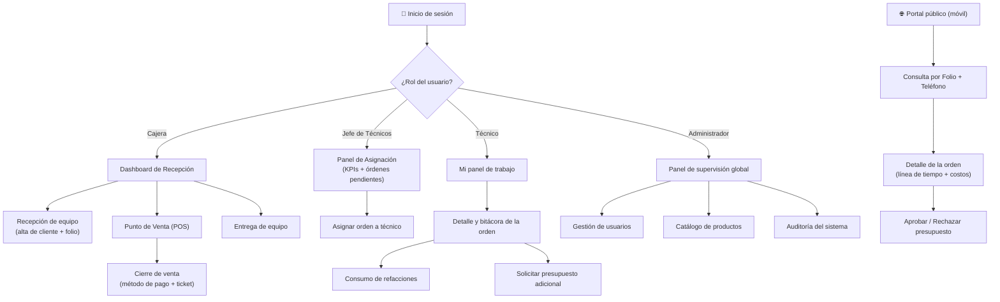
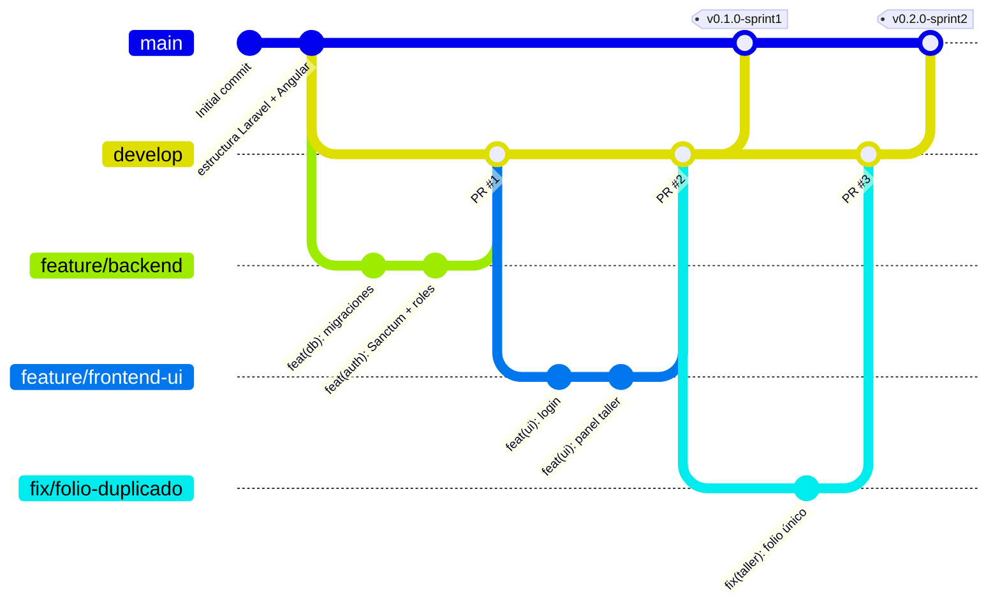
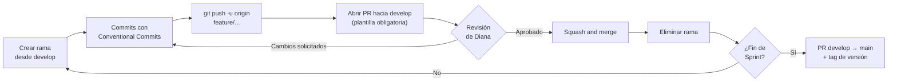
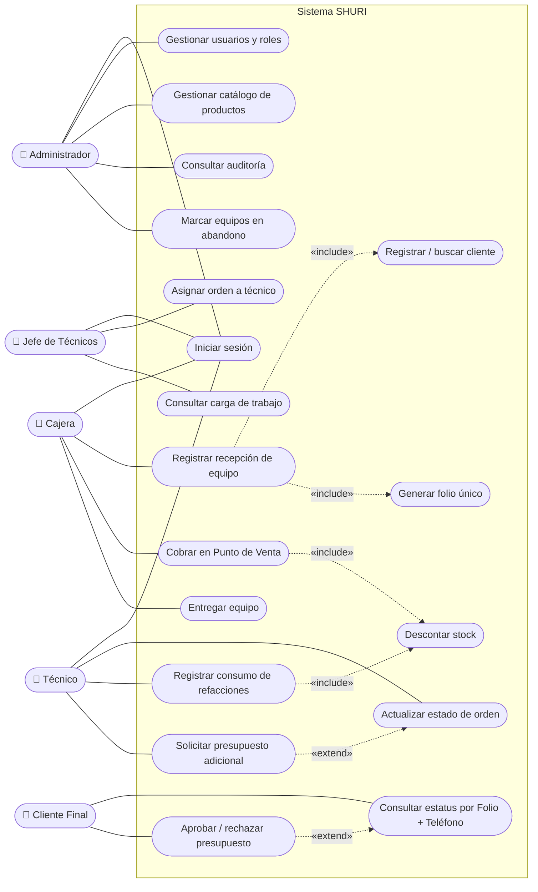
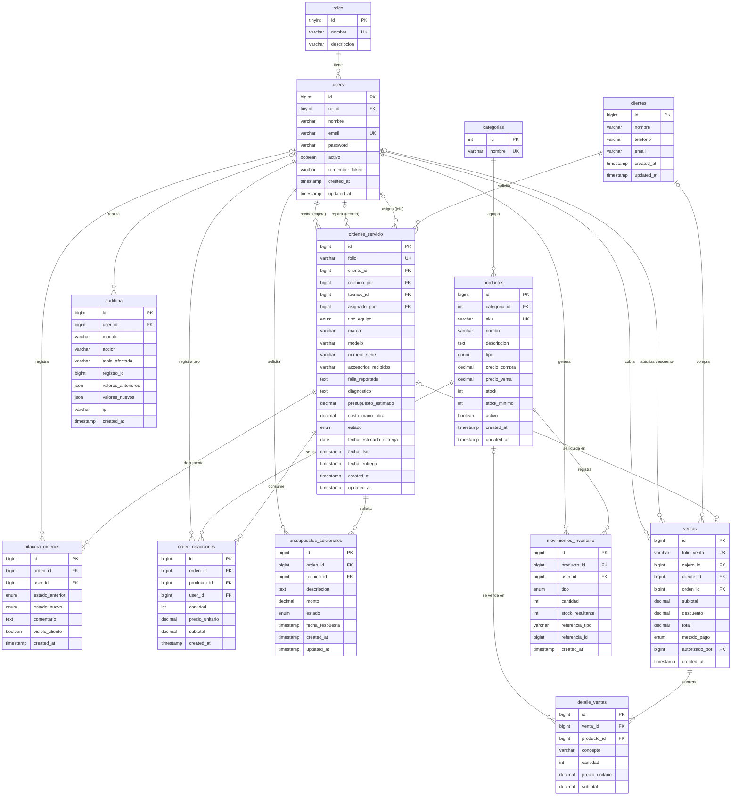
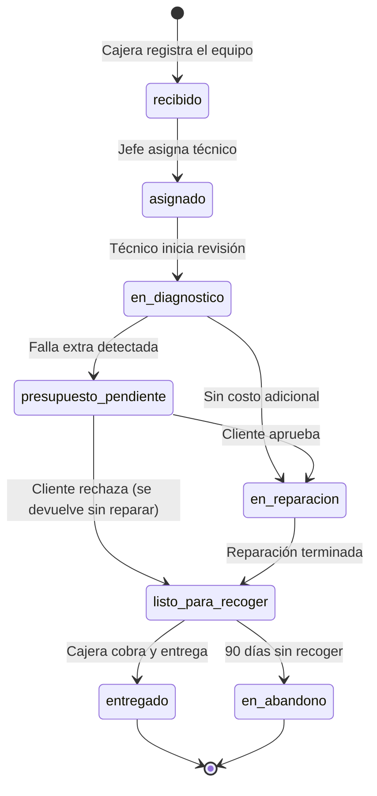

<div align="center">

# 🛠️ SHURI — Sistema Integral de Reparaciones y Ventas

**Plataforma web unificada para taller de reparación de electrónicos, inventario y punto de venta**


| | |
|---|---|
| **Universidad** | Universidad Tecnológica de Torreón |
| **Programa educativo** | Ingeniería en Desarrollo y Gestión de Software |
| **Asignatura** | Desarrollo Web Integral — 9° "A" |
| **Profesor** | Jesús Del Toro Robledo |
| **Prototipo (Figma)** | [Ver diseño en Figma](https://www.figma.com/design/wUFXid6RcC3a6H9iEdokWi/Untitled?node-id=62-22047&t=5qUdxVh60Zgiw0Ah-0) |

</div>

---

## 📑 Índice

**Unidad 1 — Análisis y planeación**
1. [Equipo de desarrollo](#-1-equipo-de-desarrollo)
2. [Planteamiento del problema](#-2-planteamiento-del-problema)
3. [Justificación](#-3-justificación)
4. [Objetivos](#-4-objetivos)
5. [Alcances, limitaciones y MVP](#-5-alcances-limitaciones-y-mvp)
6. [Requisitos funcionales y no funcionales](#-6-requisitos-funcionales-y-no-funcionales)
7. [Metodología, roles y plan de trabajo](#-7-metodología-roles-y-plan-de-trabajo)
8. [Arquitectura, stack tecnológico y patrones de diseño](#-8-arquitectura-stack-tecnológico-y-patrones-de-diseño)
9. [Prototipado y wireframes](#-9-prototipado-y-wireframes)
10. [Contenido y tono de comunicación](#-10-contenido-y-tono-de-comunicación)

**Unidad 2 — Control de versiones, diagramas y diccionario de datos**

11. [Justificación de la herramienta y plataforma de versionamiento](#-11-justificación-de-la-herramienta-y-plataforma-de-versionamiento)
12. [Flujo de trabajo (Workflow)](#-12-flujo-de-trabajo-workflow)
13. [Configuración del entorno de versiones](#-13-configuración-del-entorno-de-versiones)
14. [Diagramas del sistema](#-14-diagramas-del-sistema)
15. [Diccionario de datos](#-15-diccionario-de-datos)
16. [Instalación y ejecución local](#-16-instalación-y-ejecución-local)
17. [Estructura del repositorio](#-17-estructura-del-repositorio)

---

# 📘 UNIDAD 1 — Análisis y Planeación

## 👥 1. Equipo de desarrollo

| Integrante | Rol | Responsabilidades principales |
|---|---|---|
| **Diana Paola Ochoa Altamirano** | Líder de Proyecto · Scrum Master · Arquitecta Fullstack · QA | Coordinación del equipo, diseño de la arquitectura, revisión y aprobación de Pull Requests, integración Frontend/Backend, seguridad (RBAC) y pruebas. |
| **Brisa Daniela Luna Castañeda** | Desarrolladora Backend & DBA | Modelo entidad-relación, migraciones MySQL, API RESTful en Laravel, transacciones de inventario y autenticación con Sanctum. |
| **Félix Gael Martínez Saldívar** | Desarrollador Frontend & UX/UI | Prototipo en Figma, maquetación adaptativa en Angular, vistas de Taller, Punto de Venta y Portal del Cliente. |

---

## 📌 2. Planteamiento del problema

En la actualidad, los negocios dedicados a la reparación de equipos electrónicos (computadoras, dispositivos móviles y electrónica general) y a la venta física de refacciones y accesorios (audífonos, cables, mouses, entre otros) operan frecuentemente con sistemas fragmentados, hojas de cálculo aisladas o registros manuales en papel. Esta desconexión operativa genera tres problemas críticos en la sucursal:

- **Incertidumbre y saturación en la atención al cliente:** existe una carencia total de trazabilidad en los procesos de servicio técnico. El usuario final desconoce el estado actual de su equipo, qué refacciones adicionales se requieren o la fecha estimada de entrega, lo que satura el mostrador y los canales telefónicos con consultas repetitivas de seguimiento.
- **Caos operativo y descontrol en el taller de reparación:** los técnicos carecen de un sistema centralizado para registrar diagnósticos, solicitar autorizaciones de presupuesto ante fallas secundarias detectadas o gestionar el resguardo de equipos abandonados por periodos prolongados. Estos equipos ocupan espacio físico valioso y representan un pasivo legal y operativo para el negocio.
- **Descontrol de inventario físico y fugas en el punto de venta:** las existencias de refacciones para taller y los accesorios para venta al público no están sincronizadas en tiempo real. Esta falta de integración dificulta el cobro preciso en mostrador, favorece la discrepancia entre el inventario teórico y el real (merma o "inventario fantasma") y complica el cobro unificado de servicios de reparación junto con la venta de productos físicos.

---

## 💡 3. Justificación

El desarrollo de este sistema unificado es fundamental para modernizar, estructurar y optimizar tanto el flujo operativo del taller como la gestión comercial en el mostrador de la sucursal.

- **Justificación práctica:** centralizar la administración de inventarios, las ventas físicas y el flujo de reparaciones en una sola plataforma web elimina la redundancia de datos y agiliza los tiempos de respuesta. Permite controlar el ciclo de vida completo de un equipo y, mediante un módulo de auditoría global, brinda visibilidad total sobre las acciones de cada empleado, mitigando el error humano y previniendo fugas financieras.
- **Justificación teórica:** el proyecto se fundamenta en los principios de los sistemas de planificación de recursos (ERP) y de gestión de relaciones con clientes (CRM) adaptados a la escala de una PyME. Se aplica la teoría de la trazabilidad de la información: al poner los datos al alcance del cliente mediante un portal web se reduce la fricción comunicativa, se eleva su confianza y se agiliza la autorización de presupuestos.
- **Justificación metodológica:** se aplica un enfoque iterativo y ágil basado en Sprints, que permite priorizar la entrega de módulos críticos (Punto de Venta e inventario base) en fases tempranas, asegurando que la sucursal perciba valor operativo antes de la implementación total de las herramientas de comunicación técnico-cliente.

---

## 🎯 4. Objetivos

### 4.1 Objetivo general

**Desarrollar** un sistema web unificado de gestión interna para la sucursal que conecte de forma directa el área de taller, el control de inventario y el punto de venta (POS), permitiendo la comercialización de refacciones y accesorios, la recepción y cobro de servicios técnicos en mostrador, y ofreciendo al cliente un portal web de seguimiento transparente para monitorear el estado de su reparación, cuya recepción y entrega se realizará estrictamente en la sucursal física.

### 4.2 Objetivos específicos funcionales

1. **Desarrollar** un Módulo de Inventario Dinámico Unificado que controle en tiempo real las existencias de refacciones y accesorios, descontando automáticamente el stock por ventas en caja o por asignación de piezas a órdenes de servicio.
2. **Crear** el Punto de Venta y Gestión de Recepción/Entrega (Módulo Cajera) para cobrar productos, aplicar ajustes mediante clave de autorización, registrar nuevas órdenes de ingreso a taller y procesar la entrega de reparaciones concluidas.
3. **Programar** el Sistema de Asignación y Control de Taller (Módulo Jefe de Técnicos) para recibir órdenes de servicio, evaluar cargas de trabajo y asignar reparaciones a técnicos específicos.
4. **Construir** el Entorno Operativo y Bitácora de Comunicación (Módulo Técnico) para actualizar el estado del dispositivo, descontar refacciones del inventario y solicitar autorizaciones de presupuesto al cliente ante fallas extras.
5. **Configurar** el Panel de Supervisión, Auditoría y Seguridad (Módulo Administrador) con gestión de usuarios, catálogo maestro de productos y un registro de auditoría inmutable.
6. **Implementar** el Portal Público de Consulta de Estatus (Vista Cliente Final), accesible únicamente mediante número de teléfono y folio, para monitorear avances y responder a solicitudes de autorización.

---

## 📏 5. Alcances, limitaciones y MVP

### 5.1 Alcance

- **Funciones principales:** inventario centralizado (venta y taller), Punto de Venta en mostrador, panel de asignación de reparaciones, bitácora de servicio técnico, auditoría global de acciones y portal público de seguimiento.
- **Usuarios contemplados:** 5 perfiles con distintos niveles de acceso: **Administrador, Jefe de Técnicos, Técnico, Cajera y Cliente Final**.
- **Plazo de ejecución:** 8 semanas organizadas en 4 Sprints de 2 semanas (28 de septiembre – 22 de noviembre de 2026).

### 5.2 Limitaciones

| Limitación | Descripción |
|---|---|
| Venta exclusivamente en sucursal | No se incluye e-commerce, carrito web ni pasarelas de pago digitales. Todo cobro es presencial. |
| Logística exclusiva en sucursal | Sin integración con paqueterías ni gestión de rutas. Recepción y entrega físicas en el local. |
| Diagnóstico manual | El software documenta estados; no realiza diagnósticos de hardware automatizados. |
| Consulta voluntaria | No se envían SMS ni notificaciones por WhatsApp; el cliente consulta en el portal. |

### 5.3 Producto Mínimo Viable (MVP)

El MVP resuelve la operatividad crítica del mostrador y el flujo básico del taller, y se entrega al cierre del **Sprint 2 (semana 4)**:

1. **Prioridad 1 (Core):** recepción de equipo con generación de folio único y alta de clientes.
2. **Prioridad 2 (Operación):** asignación a técnico, actualización de estatus y registro manual de diagnóstico.
3. **Prioridad 3 (Comercio):** cobro de reparaciones y accesorios en el Punto de Venta y entrega final.
4. **Prioridad 4 (Transparencia):** consulta pública de estatus (solo lectura) con Folio y Teléfono.

---

## 📋 6. Requisitos funcionales y no funcionales

### 6.1 Requisitos funcionales (historias de usuario)

| ID | Prioridad (MoSCoW) | Historia de usuario | Criterios de aceptación verificables |
|---|---|---|---|
| RF-01 | Must have | Como **Administrador**, quiero crear, editar y desactivar usuarios asignando roles (Admin, Jefe, Técnico, Cajera) para controlar la seguridad. | Un usuario "Técnico" no puede acceder al Punto de Venta. Se guardan logs de los cambios. |
| RF-02 | Must have | Como **Sistema**, quiero actualizar el inventario en tiempo real tras ventas en caja o uso en taller para mantener la centralización. | El stock disminuye al instante. Se bloquea la transacción si la cantidad es 0. |
| RF-03 | Must have | Como **Cajera**, quiero registrar la entrada de equipos a taller asociando datos del cliente para llevar el control. | Se genera un folio alfanumérico único, imprimible y consultable. |
| RF-04 | Must have | Como **Jefe de Técnicos**, quiero un panel para asignar solicitudes de reparación a mi personal para equilibrar cargas. | La orden cambia a "Asignado" y aparece solo en la lista del técnico correspondiente. |
| RF-05 | Must have | Como **Técnico**, quiero actualizar el estado del servicio y descontar refacciones utilizadas para mantener la bitácora al día. | Las refacciones se descuentan del stock y se vinculan al costo final de la orden. |
| RF-06 | Must have | Como **Cliente Final**, quiero ingresar mi Folio y Teléfono en un portal público para ver el avance de mi equipo. | Si el Folio o el Teléfono no coinciden exactamente, el sistema deniega el acceso. |
| RF-07 | Should have | Como **Cliente Final**, quiero aceptar o rechazar un presupuesto extra desde la web para agilizar la reparación. | La decisión actualiza inmediatamente la bitácora del técnico en el panel interno. |
| RF-08 | Must have | Como **Cajera**, quiero usar el POS para cobrar accesorios y liquidar órdenes de taller terminadas. | Se genera un ticket y la orden cambia a "Entregado y Pagado". |
| RF-09 | Could have | Como **Administrador**, quiero clasificar equipos con más de 90 días sin recoger como "En Abandono" para liberar espacio. | El estado cambia, bloquea acciones técnicas y libera la responsabilidad según las políticas de la empresa. |

### 6.2 Requisitos no funcionales

| ID | Categoría | Descripción | Criterios de aceptación verificables |
|---|---|---|---|
| RNF-01 | Seguridad | Contraseñas cifradas con hash seguro (Bcrypt) y autenticación por tokens (Laravel Sanctum). | Comprobación en BD de que no existen contraseñas en texto plano. |
| RNF-02 | Rendimiento | Las actualizaciones de inventario y la consulta de folios deben ser ágiles. | Tiempo de respuesta < 2 s con 50 peticiones concurrentes. |
| RNF-03 | Usabilidad | Interfaz adaptativa (Responsive Web Design) para mostrador y celulares de clientes. | Ajuste visual correcto de 360 px (móvil) a 1920 px (escritorio). |
| RNF-04 | Integridad | Transacciones de base de datos (ACID) para evitar inconsistencias financieras. | Si falla un cobro, el descuento de stock se revierte automáticamente (rollback). |

---

## 🗓️ 7. Metodología, roles y plan de trabajo

### 7.1 Metodología

Se adopta **Scrum** con **4 Sprints de 2 semanas**. Cada Sprint termina con una entrega incremental integrada en la rama `main` y una revisión del equipo.

### 7.2 Plan de contingencia

1. **Ausencia de un integrante:** redistribución temporal de tareas mediante *Pair Programming*, coordinada por Diana Ochoa.
2. **Retraso en un módulo crítico:** se suspenden tareas secundarias (como el pulido visual) para reasignar esfuerzo a las funciones del MVP.

### 7.3 Definition of Done

Una tarea se considera terminada cuando:

1. Su código fue integrado a `develop` mediante un **Pull Request aprobado por Diana** (ver [sección 12](#-12-flujo-de-trabajo-workflow)).
2. Pasa las pruebas funcionales sin errores críticos.
3. La interfaz es adaptativa y funciona correctamente en móvil y escritorio.

### 7.4 Desglose de tareas

| ID | Tarea | Dependencia | Estimación | Asignado |
|---|---|---|---|---|
| T-01 | Modelado e implementación del esquema de base de datos en MySQL (migraciones y seeders). | — | 8 h | Brisa |
| T-02 | Autenticación con Sanctum y roles de usuario (RBAC). | T-01 | 8 h | Brisa / Diana |
| T-03 | API REST de inventario y refacciones. | T-01 | 1 día | Brisa |
| T-04 | Maquetación y flujo del módulo de Taller (Recepción y Asignación). | T-02 | 2 días | Félix |
| T-05 | Bitácora técnica de reparación y consumo de piezas. | T-04 | 8 h | Diana |
| T-06 | Módulo de Punto de Venta (POS) para Cajera. | T-03 | 1 día | Félix / Brisa |
| T-07 | Portal web de consulta de estatus del cliente (Folio + Teléfono). | T-04 | 2 días | Félix |
| T-08 | Aprobación de presupuestos en el Portal del Cliente. | T-07 | 1 día | Félix / Brisa |
| T-09 | Pruebas de integración, validación de seguridad y corrección de errores. | Todas | 1 día | Diana |

### 7.5 Cronograma de Sprints e hitos

| Sprint | Fechas | Hitos y entregables verificables | Responsables |
|---|---|---|---|
| **Sprint 1** | 28 sep – 11 oct | Estructura del repositorio, base de datos MySQL funcional, autenticación y permisos por rol (RBAC). | Brisa, Diana |
| **Sprint 2** | 12 oct – 25 oct | Inventario centralizado, panel de Recepción/Asignación de Taller y Bitácora del Técnico (**MVP operativo**). | Diana, Félix, Brisa |
| **Sprint 3** | 26 oct – 08 nov | Punto de Venta con liquidación de servicios y descuento automático de existencias. | Félix, Brisa |
| **Sprint 4** | 09 nov – 22 nov | Portal público del cliente con aprobación de presupuestos, pruebas de integración y cierre. | Félix, Diana |

---

## 🏛️ 8. Arquitectura, stack tecnológico y patrones de diseño

### 8.1 Estructura web

Se implementa una **arquitectura monolítica modular basada en API REST**, con frontend y backend desacoplados:

- **Capa de presentación (Frontend):** SPA en Angular que consume la API sin recargar la página.
- **Capa de aplicación y negocio (Backend):** controladores y servicios en Laravel que aplican las reglas de negocio (descuento atómico de existencias, cálculo de importes, cambios de estado).
- **Capa de datos:** MySQL con motor InnoDB y transacciones ACID.

El diagrama de arquitectura está en la [sección 14.1](#141-diagrama-de-arquitectura).

### 8.2 Stack tecnológico justificado

| Tecnología | Rol | Justificación técnica |
|---|---|---|
| **Angular 17** | Frontend (SPA) | Arquitectura modular y tipado fuerte con TypeScript; guardias de navegación (`CanActivate`) para restringir rutas por rol; servicios inyectables y RxJS para el estado del POS y la comunicación con la API. |
| **Laravel 10** | Backend (API REST) | Controladores de recursos y *API Resources* para respuestas JSON; **Laravel Sanctum** para tokens seguros en SPA; Eloquent ORM con transacciones y bloqueos para concurrencia. |
| **MySQL 8** | Base de datos | InnoDB transaccional (ACID) para que una venta o descuento de refacción sea atómica; integridad referencial entre folios, clientes, usuarios e inventario; *pessimistic locking* cuando técnico y cajera usan el mismo insumo a la vez. |
| **Tailwind CSS / Angular Material** | Estilos y componentes | Diseño *mobile-first* adaptable a monitores de mostrador y celulares de técnicos y clientes. |

### 8.3 Patrones de diseño

Además del patrón arquitectónico **MVC**, se aplican tres patrones de diseño:

| Patrón | Tipo | Dónde se aplica | Beneficio |
|---|---|---|---|
| **Repository** | Estructural | `InventoryRepository`, `OrderRepository` | Separa los controladores de las consultas Eloquent; facilita cambios en la BD y pruebas unitarias con *mocks*. |
| **Observer** | Comportamiento | `RepairOrderObserver`, `StockObserver` | Al cambiar el estado de una orden o el stock, registra automáticamente la bitácora, la auditoría y las alertas de stock mínimo sin cargar el controlador. |
| **Singleton** | Creacional | Administrador de conexiones de Laravel (`DatabaseManager`, registrado como *singleton* en el contenedor) | Una sola conexión a MySQL por petición HTTP; menor consumo de memoria y CPU. |

---

## 🎨 9. Prototipado y wireframes

El prototipo de alta fidelidad fue diseñado en **Figma** con principios de diseño centrado en el usuario, arquitectura de información clara y navegación intuitiva. Diferencia los entornos de escritorio con mucha información (personal de sucursal) de la experiencia móvil simplificada (cliente final).

🔗 **Prototipo completo:** [Abrir en Figma](https://www.figma.com/design/wUFXid6RcC3a6H9iEdokWi/Untitled?node-id=62-22047&t=5qUdxVh60Zgiw0Ah-0)

### 9.1 Mapa de navegación por rol



### 9.2 Pantallas del prototipo

| Entorno | Pantallas |
|---|---|
| **Acceso** | Inicio de sesión único con validación de credenciales. |
| **Mostrador (Cajera)** | Dashboard de recepción (ingresos del día, estatus global, órdenes recientes) · Recepción de equipo (cliente, dispositivo, falla, presupuesto estimado) · Punto de Venta (catálogo, carrito, totales) · Cierre de venta (efectivo, tarjeta o transferencia; ticket). |
| **Jefe de Técnicos** | Panel de asignación con KPIs, órdenes pendientes y asignación directa a técnicos. |
| **Técnico** | Mi panel de trabajo (tarjetas con equipos asignados y prioridad) · Detalle de orden (datos del cliente, checklist físico, refacciones, cambio de estatus y bitácora cronológica). |
| **Administrador** | Supervisión global (reportes financieros, ingresos semanales, rendimiento por técnico) · Gestión de usuarios · Auditoría con filtros y registro inmutable. |
| **Portal público (móvil)** | Consulta por Folio y Teléfono · Mis reparaciones · Detalle de la orden con línea de tiempo y desglose de costos · Aprobación de presupuesto adicional. |

### 9.3 Capturas del prototipo

| Inicio de sesión | Dashboard de Recepción | Punto de Venta |
|---|---|---|
|  |  |  |

| Panel de Asignación | Bitácora del Técnico | Portal del Cliente |
|---|---|---|
|  |  |  |

---

## 💬 10. Contenido y tono de comunicación

### 10.1 Tono

- **Interfaz interna (personal):** lenguaje técnico, conciso y funcional. Identificadores visuales, códigos de color por estatus y tablas optimizadas.
- **Portal externo (cliente):** lenguaje claro, transparente y empático, sin tecnicismos. Su objetivo es transmitir tranquilidad e informar con exactitud el estado del equipo.

### 10.2 Mensajes de estado para el cliente

| Estado | Mensaje en el portal | Color |
|---|---|---|
| Recibido en sucursal | "Tu equipo ha sido ingresado correctamente en nuestras instalaciones y está en cola para evaluación." | 🔵 Azul |
| En diagnóstico | "Nuestros técnicos especializados están revisando tu dispositivo para determinar la causa de la falla y los repuestos requeridos." | 🟡 Amarillo |
| Presupuesto pendiente | "Hemos determinado el diagnóstico de tu equipo. Por favor, revisa el desglose del costo y presiona 'Aprobar' para iniciar la reparación." | 🟠 Naranja |
| En reparación | "Presupuesto autorizado. Nuestro equipo técnico se encuentra trabajando en la reparación de tu dispositivo." | 🟡 Amarillo |
| Listo para recoger | "¡Tu equipo está listo! Puedes acudir a nuestra sucursal dentro del horario de atención para realizar tu pago y recolección." | 🟢 Verde |
| Entregado | "El servicio ha sido completado y el equipo ha sido entregado al cliente." | 🟢 Verde |
| Rechazado / En abandono | — (uso interno) | 🔴 Rojo / ⚪ Gris |

**Tipografía:** fuentes sans-serif modernas (Inter / Roboto) para lectura óptima en paneles densos y pantallas móviles.

---

# 📗 UNIDAD 2 — Control de Versiones, Diagramas y Diccionario de Datos

## 🧰 11. Justificación de la herramienta y plataforma de versionamiento

### 11.1 Sistema de control de versiones: Git

| Necesidad del proyecto | Cómo la resuelve Git |
|---|---|
| Tres integrantes trabajan al mismo tiempo en backend, frontend y documentación. | Es **distribuido**: cada integrante tiene una copia completa del repositorio y trabaja sin depender de un servidor central. |
| Los módulos (Inventario, Taller, POS, Portal) se desarrollan en paralelo. | Las **ramas** son ligeras y baratas; cada funcionalidad se aísla en su propia rama sin afectar el código estable. |
| Debemos poder volver a una versión funcional si algo se rompe antes de una entrega. | Cada *commit* es un punto de restauración; `git revert` y las etiquetas (`tags`) permiten regresar a versiones de Sprint. |
| Laravel, Angular y Composer/npm ya están integrados con Git. | Es el estándar de la industria; los *frameworks* incluyen sus propios `.gitignore` y las herramientas de CI lo soportan de forma nativa. |

### 11.2 Plataforma remota: GitHub

| Criterio | GitHub | GitLab | Bitbucket |
|---|---|---|---|
| Pull Requests con revisión obligatoria | ✅ | ✅ | ✅ |
| Protección de ramas en repos gratuitos públicos | ✅ | ✅ | ⚠️ Limitada |
| Renderizado de diagramas **Mermaid** en Markdown | ✅ | ✅ | ❌ |
| GitHub Projects (tablero Kanban para Sprints) | ✅ integrado | ✅ | ⚠️ Requiere Jira |
| Integración con VS Code y GitHub Desktop | ✅ nativa | Parcial | Parcial |
| Experiencia previa del equipo | ✅ | ❌ | ❌ |

**Decisión:** usamos **GitHub** porque permite revisar el código con Pull Requests obligatorios (requisito de nuestra *Definition of Done*), proteger la rama `main`, documentar todo el proyecto en este README con diagramas Mermaid que se muestran directamente, y llevar el tablero de Sprints en GitHub Projects sin herramientas externas. Además, el equipo ya lo conoce, lo que reduce la curva de aprendizaje en un proyecto de 8 semanas.

🔗 **Repositorio:** https://github.com/dianaaochoa/SHURI-Sistema-Gestion

---

## 🔀 12. Flujo de trabajo (Workflow)

### 12.1 Modelo elegido: Git Flow simplificado

Adoptamos **Git Flow simplificado** porque se ajusta a nuestra metodología Scrum: `develop` acumula el trabajo del Sprint y `main` solo recibe versiones estables al cierre de cada Sprint. Descartamos *GitHub Flow* puro porque integrar directamente en `main` no nos deja un punto de integración donde probar backend y frontend juntos antes de entregar.



### 12.2 Ramas y nomenclatura

| Rama | Propósito | Se crea desde | Se integra en | Vida |
|---|---|---|---|---|
| `main` | Código estable, entregado al final de cada Sprint. **Protegida.** | — | — | Permanente |
| `develop` | Integración del Sprint en curso. **Protegida.** | `main` | `main` | Permanente |
| `feature/<modulo>-<descripcion>` | Nueva funcionalidad. | `develop` | `develop` | Temporal |
| `fix/<modulo>-<descripcion>` | Corrección de un error detectado en `develop`. | `develop` | `develop` | Temporal |
| `hotfix/<descripcion>` | Corrección urgente sobre una versión entregada. | `main` | `main` **y** `develop` | Temporal |
| `docs/<descripcion>` | Cambios solo de documentación. | `develop` | `develop` | Temporal |

**Reglas de nombre:** minúsculas, palabras separadas por guiones, sin acentos ni espacios.

| ✅ Correcto | ❌ Incorrecto |
|---|---|
| `feature/inventario-api` | `Feature/Inventario API` |
| `feature/pos-carrito` | `rama-felix` |
| `fix/taller-folio-duplicado` | `arreglo` |

**Ramas actuales del Sprint 1–2** (creadas al inicializar el proyecto):

| Rama | Responsable | Contenido |
|---|---|---|
| `feature/backend` | Brisa | Migraciones, modelos, autenticación y API REST. |
| `feature/frontend-ui` | Félix | Maquetación de vistas en Angular a partir del prototipo. |
| `feature/docs-architecture` | Diana | Documentación, diagramas y diccionario de datos. |

A partir del Sprint 3 cada funcionalidad tendrá su propia rama corta (por ejemplo `feature/pos-carrito`, `feature/portal-consulta-folio`).

### 12.3 Convención de commits

Usamos **Conventional Commits** en español:

```
<tipo>(<módulo>): <descripción corta en imperativo>
```

| Tipo | Uso | Ejemplo |
|---|---|---|
| `feat` | Nueva funcionalidad | `feat(inventario): agregar endpoint de descuento de stock` |
| `fix` | Corrección de error | `fix(pos): corregir cálculo de total con descuento` |
| `docs` | Documentación | `docs(readme): agregar diccionario de datos` |
| `style` | Formato, sin cambiar lógica | `style(taller): aplicar formato a componente de asignación` |
| `refactor` | Reestructurar código sin cambiar comportamiento | `refactor(ordenes): mover consultas a OrderRepository` |
| `test` | Pruebas | `test(auth): probar acceso denegado de técnico al POS` |
| `chore` | Configuración y dependencias | `chore: actualizar .gitignore` |

**Módulos válidos:** `auth`, `usuarios`, `inventario`, `taller`, `bitacora`, `pos`, `portal`, `auditoria`, `db`, `ui`, `readme`.

### 12.4 Políticas de combinación (merge)

1. **Nadie hace `push` directo a `main` ni a `develop`.** Todo cambio entra por Pull Request.
2. Antes de abrir un PR, la rama se actualiza con lo último de `develop`:
   ```bash
   git switch develop && git pull
   git switch feature/mi-rama && git merge develop
   ```
3. Un PR solo se combina si:
   - Tiene **al menos 1 aprobación** (Diana revisa todo; los PR de Diana los revisa Brisa o Félix).
   - No tiene conflictos.
   - El proyecto compila (`ng build` y `php artisan test` sin errores).
4. **`feature/*` → `develop`:** *Squash and merge* (un commit limpio por funcionalidad).
5. **`develop` → `main`:** *Create a merge commit* al cierre de cada Sprint, seguido de una etiqueta de versión (`v0.1.0-sprint1`, `v0.2.0-sprint2`, …).
6. Las ramas temporales se eliminan después de combinarse.

### 12.5 Gestión de Pull Requests



- **Título:** igual que un commit convencional, por ejemplo `feat(pos): carrito de compras`.
- **Descripción:** se llena la [plantilla de PR](.github/pull_request_template.md) (qué cambia, cómo probarlo, requisito relacionado y checklist).
- **Revisor:** asignado automáticamente por [CODEOWNERS](.github/CODEOWNERS).
- **Relación con tareas:** cada PR menciona su tarea (`T-03`) o historia de usuario (`RF-02`).

---

## ⚙️ 13. Configuración del entorno de versiones

### 13.1 Configuración inicial de cada integrante

```bash
# Identidad (una sola vez por computadora)
git config --global user.name  "Nombre Apellido"
git config --global user.email "correo-de-github@ejemplo.com"

# Rama por defecto y saltos de línea (equipo en Windows)
git config --global init.defaultBranch main
git config --global core.autocrlf true

# Clonar el repositorio y traer todas las ramas
git clone https://github.com/dianaaochoa/SHURI-Sistema-Gestion.git
cd SHURI-Sistema-Gestion
git fetch origin
git switch develop
```

### 13.2 Control de accesos

| Integrante | Permiso en GitHub | Puede |
|---|---|---|
| Diana Ochoa | **Admin** (propietaria) | Configurar el repositorio, proteger ramas, aprobar y combinar PRs, crear *releases*. |
| Brisa Luna | **Write** (colaboradora) | Crear ramas, hacer *push* a sus ramas, abrir y revisar PRs. |
| Félix Martínez | **Write** (colaborador) | Crear ramas, hacer *push* a sus ramas, abrir y revisar PRs. |
| Profesor | **Read** | Consultar código, historial y PRs. |

**Reglas de protección** (*Settings → Branches → Branch protection rules*) aplicadas a `main` y `develop`:

- ✅ *Require a pull request before merging*
- ✅ *Require approvals* (1)
- ✅ *Require review from Code Owners*
- ✅ *Dismiss stale pull request approvals when new commits are pushed*
- ✅ *Require conversation resolution before merging*
- ✅ *Do not allow bypassing the above settings*
- ❌ *Allow force pushes* / *Allow deletions*

### 13.3 Archivos de exclusión (`.gitignore`)

El repositorio tiene un [`.gitignore`](.gitignore) en la raíz, además de los propios de [`backend/.gitignore`](backend/.gitignore) y [`frontend/.gitignore`](frontend/.gitignore):

| Se excluye | Motivo |
|---|---|
| `.env`, `.env.backup`, `.env.production`, `auth.json` | Contienen credenciales (BD, `APP_KEY`, tokens). **Nunca se suben.** |
| `backend/vendor/`, `node_modules/` | Dependencias que se reinstalan con `composer install` / `npm install`. |
| `frontend/dist/`, `frontend/.angular/`, `public/build`, `public/hot` | Archivos generados por la compilación. |
| `storage/*.key`, `bootstrap/cache/*` | Llaves y caché generadas por Laravel. |
| `.phpunit.result.cache` | Caché de pruebas. |
| `.vscode/`, `.idea/`, `.DS_Store`, `Thumbs.db` | Archivos del editor y del sistema operativo. |

El archivo [`backend/.env.example`](backend/.env.example) **sí** se versiona: es la plantilla sin contraseñas que cada integrante copia como `.env`.

### 13.4 Llaves y credenciales de seguridad

| Credencial | Manejo |
|---|---|
| **Acceso a GitHub** | HTTPS con *Git Credential Manager* (incluido en Git para Windows), que guarda el token de forma cifrada. Alternativa: llave **SSH ed25519** (`ssh-keygen -t ed25519 -C "correo"`) registrada en *GitHub → Settings → SSH keys*. Nunca se comparten contraseñas. |
| **`APP_KEY` de Laravel** | Cada integrante la genera localmente con `php artisan key:generate`; vive solo en su `.env`. |
| **Credenciales de MySQL** | Locales a cada computadora, dentro de `.env`. |
| **Tokens de API** | Emitidos por **Laravel Sanctum** al iniciar sesión, guardados con hash en `personal_access_tokens`. |
| **Contraseñas de usuarios** | Cifradas con **Bcrypt** (`Hash::make`), cumpliendo RNF-01. |

Si una credencial se sube por error, se **cambia de inmediato** (borrarla en un nuevo commit no basta, porque sigue en el historial).

---

## 📐 14. Diagramas del sistema

### 14.1 Diagrama de arquitectura

```mermaid
flowchart LR
    subgraph Clientes["👥 Clientes"]
        direction TB
        PC["🖥️ Navegador de escritorio<br/>(Admin, Jefe, Técnico, Cajera)"]
        Movil["📱 Navegador móvil<br/>(Cliente final)"]
    end

    subgraph Front["Capa de presentación — Angular 17 (SPA)"]
        direction TB
        Guards["Guards por rol<br/>(CanActivate)"]
        Modulos["Módulos: Admin · Taller · Técnico<br/>POS · Portal público"]
        Servicios["Servicios HTTP + Interceptor<br/>(token Bearer)"]
        Guards --> Modulos --> Servicios
    end

    subgraph Back["Capa de negocio — Laravel 10 (API REST)"]
        direction TB
        Rutas["routes/api.php"]
        MW["Middleware<br/>auth:sanctum + rol"]
        Ctrl["Controllers + Form Requests"]
        Svc["Services<br/>(reglas de negocio, DB::transaction)"]
        Repo["Repositories<br/>(InventoryRepository, OrderRepository)"]
        Obs["Observers<br/>(RepairOrderObserver, StockObserver)"]
        Rutas --> MW --> Ctrl --> Svc --> Repo
        Repo -. eventos .-> Obs
    end

    subgraph Datos["Capa de datos"]
        DB[("MySQL 8<br/>InnoDB · ACID")]
    end

    PC --> Front
    Movil --> Front
    Servicios -- "HTTPS · JSON" --> Rutas
    Repo -- "Eloquent ORM" --> DB
    Obs -- "bitácora · auditoría" --> DB
```



### 14.2 Diagrama de casos de uso (UML)



**Descripción de actores**

| Actor | Descripción | Casos de uso |
|---|---|---|
| Administrador | Supervisa la operación y la seguridad. | Usuarios y roles, catálogo, auditoría, equipos en abandono. |
| Cajera | Atiende el mostrador. | Recepción de equipos, cobro en POS, entrega. |
| Jefe de Técnicos | Distribuye el trabajo del taller. | Asignación de órdenes, carga de trabajo. |
| Técnico | Repara los equipos. | Estado de la orden, consumo de refacciones, presupuesto adicional. |
| Cliente Final | Dueño del equipo; sin cuenta en el sistema. | Consulta de estatus, aprobación de presupuesto. |

### 14.3 Diagrama Entidad-Relación (DER)



### 14.4 Diagrama de estados de una orden de servicio



---

## 🗄️ 15. Diccionario de datos

**Motor:** MySQL 8.0 · **Engine:** InnoDB · **Charset:** `utf8mb4` · **Collation:** `utf8mb4_unicode_ci`

> Además de estas tablas, Laravel usa sus tablas internas `password_reset_tokens`, `failed_jobs` y `personal_access_tokens` (tokens de Sanctum).

### 15.1 `roles`
Catálogo de perfiles de acceso del sistema (RBAC).

| Campo | Tipo | Nulo | Llave | Default | Descripción |
|---|---|---|---|---|---|
| `id` | TINYINT UNSIGNED | No | PK | AUTO_INCREMENT | Identificador del rol. |
| `nombre` | VARCHAR(30) | No | UK | — | `administrador`, `jefe_tecnicos`, `tecnico`, `cajera`. |
| `descripcion` | VARCHAR(150) | Sí | — | NULL | Descripción de los permisos del rol. |

### 15.2 `users`
Personal interno con acceso al sistema.

| Campo | Tipo | Nulo | Llave | Default | Descripción |
|---|---|---|---|---|---|
| `id` | BIGINT UNSIGNED | No | PK | AUTO_INCREMENT | Identificador del usuario. |
| `rol_id` | TINYINT UNSIGNED | No | FK → `roles.id` | — | Rol asignado. |
| `nombre` | VARCHAR(100) | No | — | — | Nombre completo. |
| `email` | VARCHAR(150) | No | UK | — | Correo de inicio de sesión. |
| `password` | VARCHAR(255) | No | — | — | Hash Bcrypt de la contraseña (RNF-01). |
| `activo` | BOOLEAN | No | — | TRUE | `FALSE` = cuenta desactivada (baja lógica, RF-01). |
| `remember_token` | VARCHAR(100) | Sí | — | NULL | Token de sesión persistente de Laravel. |
| `created_at` / `updated_at` | TIMESTAMP | Sí | — | NULL | Fechas de creación y modificación. |

### 15.3 `clientes`
Clientes que dejan equipos o compran en mostrador. No tienen cuenta en el sistema.

| Campo | Tipo | Nulo | Llave | Default | Descripción |
|---|---|---|---|---|---|
| `id` | BIGINT UNSIGNED | No | PK | AUTO_INCREMENT | Identificador del cliente. |
| `nombre` | VARCHAR(100) | No | — | — | Nombre completo. |
| `telefono` | VARCHAR(15) | No | INDEX | — | Teléfono a 10 dígitos; junto con el folio da acceso al portal (RF-06). |
| `email` | VARCHAR(150) | Sí | — | NULL | Correo opcional. |
| `created_at` / `updated_at` | TIMESTAMP | Sí | — | NULL | Fechas de creación y modificación. |

### 15.4 `categorias`
Agrupación de productos (Pantallas, Baterías, Cables, Audífonos, etc.).

| Campo | Tipo | Nulo | Llave | Default | Descripción |
|---|---|---|---|---|---|
| `id` | INT UNSIGNED | No | PK | AUTO_INCREMENT | Identificador de la categoría. |
| `nombre` | VARCHAR(60) | No | UK | — | Nombre de la categoría. |

### 15.5 `productos`
Inventario unificado de refacciones de taller y accesorios de venta (RF-02).

| Campo | Tipo | Nulo | Llave | Default | Descripción |
|---|---|---|---|---|---|
| `id` | BIGINT UNSIGNED | No | PK | AUTO_INCREMENT | Identificador del producto. |
| `categoria_id` | INT UNSIGNED | No | FK → `categorias.id` | — | Categoría del producto. |
| `sku` | VARCHAR(30) | No | UK | — | Código interno o de barras. |
| `nombre` | VARCHAR(120) | No | — | — | Nombre comercial. |
| `descripcion` | TEXT | Sí | — | NULL | Detalle o compatibilidad (modelos de equipo). |
| `tipo` | ENUM('refaccion','accesorio') | No | — | — | `refaccion` = uso en taller; `accesorio` = venta al público. |
| `precio_compra` | DECIMAL(10,2) | No | — | 0.00 | Costo de adquisición. |
| `precio_venta` | DECIMAL(10,2) | No | — | — | Precio al público. |
| `stock` | INT UNSIGNED | No | — | 0 | Existencias actuales. No puede ser negativo. |
| `stock_minimo` | INT UNSIGNED | No | — | 1 | Umbral para la alerta de stock bajo (`StockObserver`). |
| `activo` | BOOLEAN | No | — | TRUE | `FALSE` = descontinuado. |
| `created_at` / `updated_at` | TIMESTAMP | Sí | — | NULL | Fechas de creación y modificación. |

### 15.6 `ordenes_servicio`
Equipo recibido en sucursal y su ciclo de reparación (RF-03, RF-04, RF-05, RF-09).

| Campo | Tipo | Nulo | Llave | Default | Descripción |
|---|---|---|---|---|---|
| `id` | BIGINT UNSIGNED | No | PK | AUTO_INCREMENT | Identificador interno. |
| `folio` | VARCHAR(12) | No | UK | — | Folio alfanumérico único, p. ej. `SHU-2610-0001`. |
| `cliente_id` | BIGINT UNSIGNED | No | FK → `clientes.id` | — | Dueño del equipo. |
| `recibido_por` | BIGINT UNSIGNED | No | FK → `users.id` | — | Cajera que registró la recepción. |
| `tecnico_id` | BIGINT UNSIGNED | Sí | FK → `users.id` | NULL | Técnico asignado; NULL hasta la asignación. |
| `asignado_por` | BIGINT UNSIGNED | Sí | FK → `users.id` | NULL | Jefe de Técnicos que asignó la orden. |
| `tipo_equipo` | ENUM('celular','laptop','computadora','monitor','tablet','otro') | No | — | — | Tipo de dispositivo. |
| `marca` | VARCHAR(50) | No | — | — | Marca del equipo. |
| `modelo` | VARCHAR(80) | Sí | — | NULL | Modelo del equipo. |
| `numero_serie` | VARCHAR(80) | Sí | — | NULL | Número de serie o IMEI. |
| `accesorios_recibidos` | VARCHAR(255) | Sí | — | NULL | Cargador, funda, etc., entregados con el equipo. |
| `falla_reportada` | TEXT | No | — | — | Falla descrita por el cliente. |
| `diagnostico` | TEXT | Sí | — | NULL | Diagnóstico registrado por el técnico. |
| `presupuesto_estimado` | DECIMAL(10,2) | Sí | — | NULL | Costo estimado dado en mostrador. |
| `costo_mano_obra` | DECIMAL(10,2) | No | — | 0.00 | Mano de obra final. El total suma esto + `orden_refacciones` + presupuestos aprobados. |
| `estado` | ENUM('recibido','asignado','en_diagnostico','presupuesto_pendiente','en_reparacion','listo_para_recoger','entregado','en_abandono') | No | INDEX | 'recibido' | Estado actual (ver [14.4](#144-diagrama-de-estados-de-una-orden-de-servicio)). |
| `fecha_estimada_entrega` | DATE | Sí | — | NULL | Fecha prometida al cliente. |
| `fecha_listo` | TIMESTAMP | Sí | — | NULL | Cuándo pasó a `listo_para_recoger`; inicia el conteo de 90 días (RF-09). |
| `fecha_entrega` | TIMESTAMP | Sí | — | NULL | Fecha real de entrega. |
| `created_at` / `updated_at` | TIMESTAMP | Sí | — | NULL | `created_at` = fecha de ingreso. |

### 15.7 `bitacora_ordenes`
Historial cronológico de cada orden (RF-05, RF-07). Solo inserción.

| Campo | Tipo | Nulo | Llave | Default | Descripción |
|---|---|---|---|---|---|
| `id` | BIGINT UNSIGNED | No | PK | AUTO_INCREMENT | Identificador del registro. |
| `orden_id` | BIGINT UNSIGNED | No | FK → `ordenes_servicio.id` | — | Orden documentada. |
| `user_id` | BIGINT UNSIGNED | Sí | FK → `users.id` | NULL | Quién hizo el cambio; NULL si fue el cliente desde el portal. |
| `estado_anterior` | ENUM(*estados de la orden*) | Sí | — | NULL | Estado previo. |
| `estado_nuevo` | ENUM(*estados de la orden*) | No | — | — | Estado resultante. |
| `comentario` | TEXT | Sí | — | NULL | Nota del técnico o descripción del evento. |
| `visible_cliente` | BOOLEAN | No | — | FALSE | Si se muestra en el portal público. |
| `created_at` | TIMESTAMP | No | — | CURRENT_TIMESTAMP | Fecha del evento. |

### 15.8 `orden_refacciones`
Refacciones consumidas en una orden (RF-05). Cada inserción descuenta stock.

| Campo | Tipo | Nulo | Llave | Default | Descripción |
|---|---|---|---|---|---|
| `id` | BIGINT UNSIGNED | No | PK | AUTO_INCREMENT | Identificador. |
| `orden_id` | BIGINT UNSIGNED | No | FK → `ordenes_servicio.id` | — | Orden donde se usó. |
| `producto_id` | BIGINT UNSIGNED | No | FK → `productos.id` | — | Refacción utilizada. |
| `user_id` | BIGINT UNSIGNED | No | FK → `users.id` | — | Técnico que la registró. |
| `cantidad` | INT UNSIGNED | No | — | 1 | Piezas utilizadas. |
| `precio_unitario` | DECIMAL(10,2) | No | — | — | Precio al momento del uso (histórico). |
| `subtotal` | DECIMAL(10,2) | No | — | — | `cantidad × precio_unitario`. |
| `created_at` | TIMESTAMP | No | — | CURRENT_TIMESTAMP | Fecha de registro. |

### 15.9 `presupuestos_adicionales`
Costos extra solicitados al cliente ante fallas secundarias (RF-07).

| Campo | Tipo | Nulo | Llave | Default | Descripción |
|---|---|---|---|---|---|
| `id` | BIGINT UNSIGNED | No | PK | AUTO_INCREMENT | Identificador. |
| `orden_id` | BIGINT UNSIGNED | No | FK → `ordenes_servicio.id` | — | Orden relacionada. |
| `tecnico_id` | BIGINT UNSIGNED | No | FK → `users.id` | — | Técnico que lo solicita. |
| `descripcion` | TEXT | No | — | — | Falla detectada y trabajo propuesto. |
| `monto` | DECIMAL(10,2) | No | — | — | Costo adicional. |
| `estado` | ENUM('pendiente','aprobado','rechazado') | No | — | 'pendiente' | Respuesta del cliente. |
| `fecha_respuesta` | TIMESTAMP | Sí | — | NULL | Cuándo respondió el cliente. |
| `created_at` / `updated_at` | TIMESTAMP | Sí | — | NULL | Fechas de creación y modificación. |

### 15.10 `ventas`
Encabezado de cada cobro en el Punto de Venta (RF-08).

| Campo | Tipo | Nulo | Llave | Default | Descripción |
|---|---|---|---|---|---|
| `id` | BIGINT UNSIGNED | No | PK | AUTO_INCREMENT | Identificador. |
| `folio_venta` | VARCHAR(15) | No | UK | — | Número de ticket, p. ej. `V-2610-00001`. |
| `cajero_id` | BIGINT UNSIGNED | No | FK → `users.id` | — | Cajera que cobró. |
| `cliente_id` | BIGINT UNSIGNED | Sí | FK → `clientes.id` | NULL | Cliente; NULL en ventas de mostrador anónimas. |
| `orden_id` | BIGINT UNSIGNED | Sí | FK → `ordenes_servicio.id`, UK | NULL | Orden liquidada en esta venta, si aplica. |
| `subtotal` | DECIMAL(10,2) | No | — | — | Suma de `detalle_ventas`. |
| `descuento` | DECIMAL(10,2) | No | — | 0.00 | Descuento aplicado. |
| `total` | DECIMAL(10,2) | No | — | — | `subtotal − descuento`. |
| `metodo_pago` | ENUM('efectivo','tarjeta','transferencia') | No | — | — | Forma de pago presencial. |
| `autorizado_por` | BIGINT UNSIGNED | Sí | FK → `users.id` | NULL | Usuario que autorizó un descuento o ajuste con su clave. |
| `created_at` | TIMESTAMP | No | — | CURRENT_TIMESTAMP | Fecha y hora del cobro. |

### 15.11 `detalle_ventas`
Renglones de cada venta.

| Campo | Tipo | Nulo | Llave | Default | Descripción |
|---|---|---|---|---|---|
| `id` | BIGINT UNSIGNED | No | PK | AUTO_INCREMENT | Identificador. |
| `venta_id` | BIGINT UNSIGNED | No | FK → `ventas.id` (ON DELETE CASCADE) | — | Venta a la que pertenece. |
| `producto_id` | BIGINT UNSIGNED | Sí | FK → `productos.id` | NULL | Producto vendido; NULL si el renglón es un servicio de reparación. |
| `concepto` | VARCHAR(150) | No | — | — | Descripción impresa en el ticket. |
| `cantidad` | INT UNSIGNED | No | — | 1 | Unidades. |
| `precio_unitario` | DECIMAL(10,2) | No | — | — | Precio al momento de la venta. |
| `subtotal` | DECIMAL(10,2) | No | — | — | `cantidad × precio_unitario`. |

### 15.12 `movimientos_inventario`
Kárdex de cada entrada y salida de stock, para detectar "inventario fantasma".

| Campo | Tipo | Nulo | Llave | Default | Descripción |
|---|---|---|---|---|---|
| `id` | BIGINT UNSIGNED | No | PK | AUTO_INCREMENT | Identificador. |
| `producto_id` | BIGINT UNSIGNED | No | FK → `productos.id` | — | Producto afectado. |
| `user_id` | BIGINT UNSIGNED | No | FK → `users.id` | — | Quién generó el movimiento. |
| `tipo` | ENUM('entrada','venta','uso_taller','ajuste') | No | — | — | Origen del movimiento. |
| `cantidad` | INT | No | — | — | Positivo = entrada; negativo = salida. |
| `stock_resultante` | INT UNSIGNED | No | — | — | Existencias después del movimiento. |
| `referencia_tipo` | VARCHAR(50) | Sí | — | NULL | Tabla de origen (`ventas`, `orden_refacciones`). |
| `referencia_id` | BIGINT UNSIGNED | Sí | — | NULL | ID del registro de origen. |
| `created_at` | TIMESTAMP | No | — | CURRENT_TIMESTAMP | Fecha del movimiento. |

### 15.13 `auditoria`
Registro inmutable de acciones en la plataforma (Módulo Administrador). Solo inserción; ningún rol puede editar ni borrar.

| Campo | Tipo | Nulo | Llave | Default | Descripción |
|---|---|---|---|---|---|
| `id` | BIGINT UNSIGNED | No | PK | AUTO_INCREMENT | Identificador. |
| `user_id` | BIGINT UNSIGNED | Sí | FK → `users.id` | NULL | Usuario que actuó; NULL para acciones del portal público. |
| `modulo` | VARCHAR(30) | No | INDEX | — | `usuarios`, `inventario`, `taller`, `pos`, `portal`. |
| `accion` | VARCHAR(30) | No | — | — | `crear`, `actualizar`, `desactivar`, `cobrar`, `login`, etc. |
| `tabla_afectada` | VARCHAR(50) | Sí | — | NULL | Tabla modificada. |
| `registro_id` | BIGINT UNSIGNED | Sí | — | NULL | ID del registro modificado. |
| `valores_anteriores` | JSON | Sí | — | NULL | Estado previo del registro. |
| `valores_nuevos` | JSON | Sí | — | NULL | Estado posterior del registro. |
| `ip` | VARCHAR(45) | Sí | — | NULL | IP de origen (IPv4/IPv6). |
| `created_at` | TIMESTAMP | No | INDEX | CURRENT_TIMESTAMP | Fecha y hora de la acción. |

### 15.14 Reglas de integridad

| Regla | Implementación |
|---|---|
| El stock nunca es negativo (RF-02). | `stock` UNSIGNED + validación en el servicio + `lockForUpdate()` antes de descontar. |
| Cobro y descuento de stock son atómicos (RNF-04). | `DB::transaction()` en `ventas`, `detalle_ventas`, `productos` y `movimientos_inventario`; si algo falla se hace *rollback*. |
| No se borran registros con historial. | FKs con `ON DELETE RESTRICT`; usuarios y productos se desactivan (`activo = FALSE`). |
| Una orden se liquida una sola vez. | `ventas.orden_id` es UNIQUE. |
| Acceso al portal solo con folio y teléfono correctos (RF-06). | Consulta con `folio` (UK) unido a `clientes.telefono`; si no coinciden ambos se responde 404. |

---

## 🚀 16. Instalación y ejecución local

**Requisitos:** PHP 8.1+, Composer 2, Node.js 18+, Angular CLI 17, MySQL 8.

```bash
# 1. Clonar
git clone https://github.com/dianaaochoa/SHURI-Sistema-Gestion.git
cd SHURI-Sistema-Gestion
```

**Backend (Laravel)**

```bash
cd backend
composer install
cp .env.example .env          # en PowerShell: copy .env.example .env
php artisan key:generate
# Editar .env: DB_DATABASE=shuri, DB_USERNAME, DB_PASSWORD
php artisan migrate --seed
php artisan serve             # http://localhost:8000
```

**Frontend (Angular)**

```bash
cd frontend
npm install
ng serve                      # http://localhost:4200
```

---

## 📂 17. Estructura del repositorio

```
SHURI-Sistema-Gestion/
├── .github/
│   ├── CODEOWNERS                   # Revisor obligatorio de los PR
│   └── pull_request_template.md     # Plantilla de Pull Request
├── backend/                         # API REST — Laravel 10
│   ├── app/
│   │   ├── Http/Controllers/
│   │   ├── Models/
│   │   ├── Observers/               # RepairOrderObserver, StockObserver
│   │   ├── Repositories/            # InventoryRepository, OrderRepository
│   │   └── Services/
│   ├── database/migrations/
│   ├── routes/api.php
│   └── .env.example
├── frontend/                        # SPA — Angular 17
│   └── src/app/
│       ├── core/                    # guards, interceptors, servicios
│       ├── modules/                 # admin, taller, tecnico, pos, portal
│       └── shared/                  # componentes reutilizables
├── docs/
│   └── images/                      # logo y capturas del prototipo
├── .gitignore
└── README.md
```

---

<div align="center">

**SHURI — Reparaciones y Ventas** · Universidad Tecnológica de Torreón · 2026

</div>
