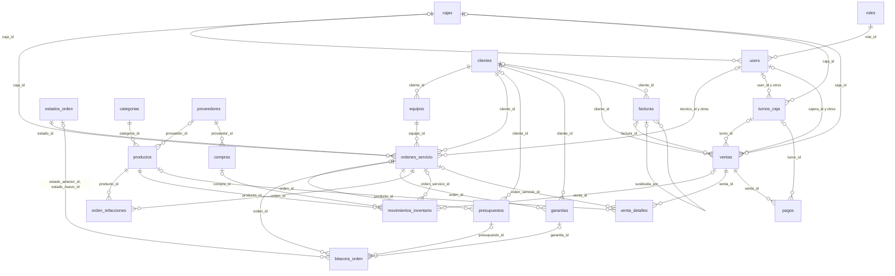
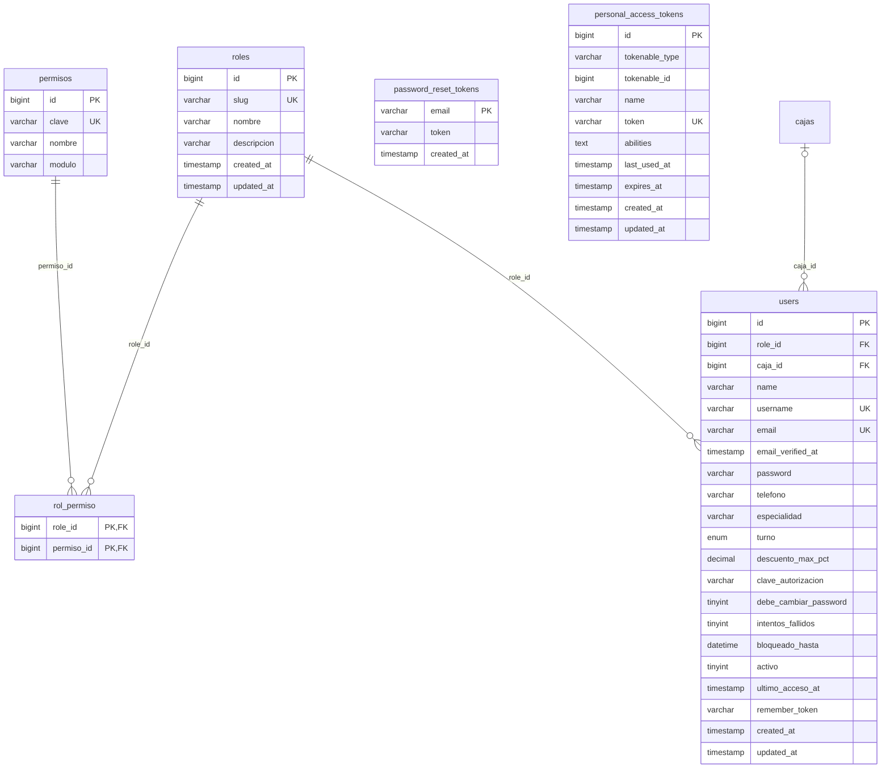
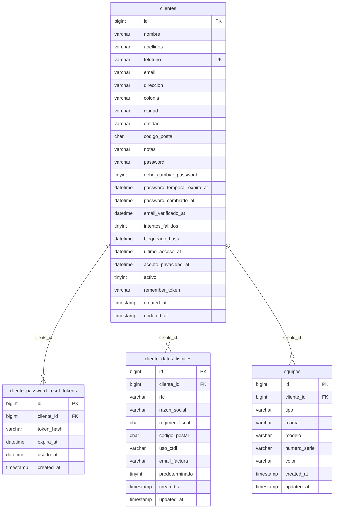
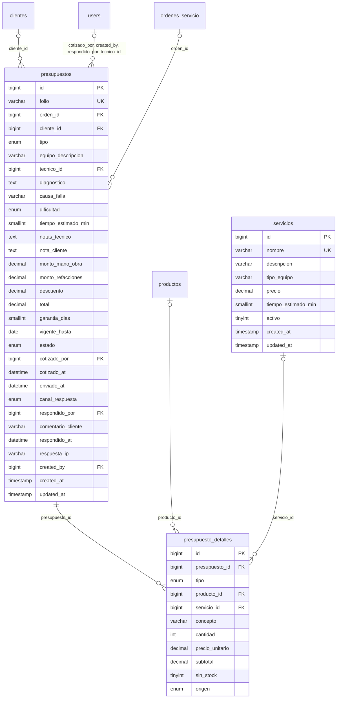
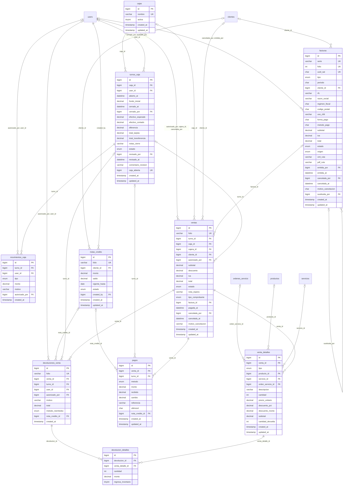
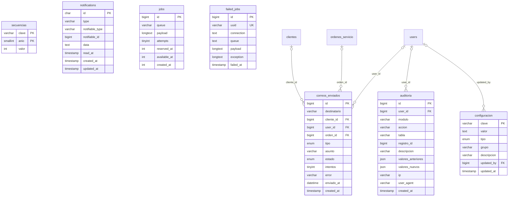

# SHURI-Sistema-Gestion
Plataforma web unificada de gestión técnica, inventario y POS para taller de reparaciones.

**Stack:** Laravel 10 (API REST) · Angular 17 (SPA) · MySQL 8.0

## 🗄️ Base de datos

Motor: **MySQL 8.0** (InnoDB, `utf8mb4`). Base de datos: `shuri_db`. **49 tablas** organizadas en 7 módulos.

### Índice

- [Diagrama entidad-relación](#diagrama-entidad-relación)
  - [Mapa general](#mapa-general)
  - [Diagrama: Seguridad y personal](#diagrama-seguridad-y-personal)
  - [Diagrama: Clientes y portal](#diagrama-clientes-y-portal)
  - [Diagrama: Taller (órdenes de servicio)](#diagrama-taller-órdenes-de-servicio)
  - [Diagrama: Cotización y presupuestos](#diagrama-cotización-y-presupuestos)
  - [Diagrama: Inventario, refacciones y compras](#diagrama-inventario-refacciones-y-compras)
  - [Diagrama: Caja y punto de venta](#diagrama-caja-y-punto-de-venta)
  - [Diagrama: Sistema, notificaciones y auditoría](#diagrama-sistema-notificaciones-y-auditoría)
- [Diccionario de datos](#diccionario-de-datos)
  - [Seguridad y personal](#seguridad-y-personal)
  - [Clientes y portal](#clientes-y-portal)
  - [Taller (órdenes de servicio)](#taller-órdenes-de-servicio)
  - [Cotización y presupuestos](#cotización-y-presupuestos)
  - [Inventario, refacciones y compras](#inventario-refacciones-y-compras)
  - [Caja y punto de venta](#caja-y-punto-de-venta)
  - [Sistema, notificaciones y auditoría](#sistema-notificaciones-y-auditoría)

---

### Diagrama entidad-relación

**Cómo leer las líneas:**

| Símbolo | Significado |
|---|---|
| `\|\|--o{` | Uno a muchos **obligatorio**: el registro hijo siempre pertenece a uno del padre (ej. todo equipo tiene un cliente dueño). |
| `\|o--o{` | Uno a muchos **opcional**: el hijo puede o no estar ligado al padre (ej. una venta puede no tener cliente). |

El texto sobre cada línea es la columna (llave foránea) que hace la conexión. **PK** = llave primaria, **FK** = llave foránea, **UK** = valor único.

#### Mapa general

Vista simplificada con las tablas principales y cómo se conectan.

#### Diagrama: Seguridad y personal

Usuarios internos (Administrador, Jefe de Técnicos, Técnico, Cajera), sus roles y permisos.

#### Diagrama: Clientes y portal

Clientes finales, su acceso al portal (teléfono + contraseña enviada por correo), sus equipos y datos fiscales.

#### Diagrama: Taller (órdenes de servicio)

Ciclo de vida de una reparación: recepción, asignación, diagnóstico, resguardo, entrega, abandono y garantía.

```mermaid
erDiagram
    estados_orden {
        bigint id PK
        varchar clave UK
        varchar nombre
        varchar mensaje_cliente
        char color_hex
        tinyint orden
        tinyint paso_portal
        tinyint es_final
        tinyint permite_trabajo
        tinyint espera_recoleccion
    }
    ordenes_servicio {
        bigint id PK
        varchar folio UK
        bigint cliente_id FK
        bigint equipo_id FK
        bigint estado_id FK
        enum prioridad
        bigint caja_id FK
        text falla_reportada
        varchar accesorios_recibidos
        json checklist_recepcion
        varchar condicion_fisica
        varchar pin_equipo
        text diagnostico
        varchar causa_falla
        enum dificultad
        smallint tiempo_estimado_min
        tinyint en_pausa
        varchar motivo_pausa
        varchar motivo_sin_reparacion
        decimal presupuesto_estimado
        decimal anticipo
        decimal costo_mano_obra
        decimal costo_refacciones
        decimal total
        tinyint pagado
        bigint recibido_por FK
        bigint asignado_por FK
        bigint tecnico_id FK
        bigint actualizado_por FK
        enum ubicacion
        datetime enviado_bodega_at
        tinyint almacenaje_condonado
        bigint condonado_por FK
        varchar motivo_condonacion
        decimal cargo_almacenaje
        smallint garantia_dias
        date garantia_hasta
        bigint entregado_por FK
        varchar recibio_nombre
        varchar recibio_identificacion
        varchar recibio_parentesco
        tinyint calificacion
        varchar comentario_calificacion
        datetime calificado_at
        date fecha_promesa
        datetime fecha_asignacion
        datetime fecha_cotizacion
        datetime fecha_aprobacion
        datetime fecha_listo
        datetime fecha_entrega
        datetime fecha_abandono
        datetime fecha_desecho
        bigint desechado_por FK
        timestamp created_at
        timestamp updated_at
    }
    orden_tiempos {
        bigint id PK
        bigint orden_id FK
        bigint tecnico_id FK
        enum tipo
        datetime inicio
        datetime fin
        varchar motivo_pausa
        int minutos
        bigint tecnico_en_curso UK
    }
    orden_archivos {
        bigint id PK
        bigint orden_id FK
        bigint presupuesto_id FK
        bigint garantia_id FK
        bigint user_id FK
        enum tipo
        varchar ruta
        varchar nombre_original
        varchar mime
        int tamano_bytes
        tinyint visible_cliente
        timestamp created_at
    }
    bitacora_orden {
        bigint id PK
        bigint orden_id FK
        bigint user_id FK
        enum tipo
        bigint estado_anterior_id FK
        bigint estado_nuevo_id FK
        bigint presupuesto_id FK
        bigint garantia_id FK
        text descripcion
        tinyint visible_cliente
        timestamp created_at
    }
    garantias {
        bigint id PK
        varchar folio UK
        bigint orden_id FK
        bigint cliente_id FK
        enum canal_solicitud
        text motivo_cliente
        enum estado
        bigint recibida_por FK
        datetime recibida_at
        bigint tecnico_id FK
        text revision_tecnico
        enum dictamen
        bigint dictaminada_por FK
        datetime dictaminada_at
        varchar motivo_dictamen
        decimal costo_extra
        tinyint costo_aceptado
        datetime respondido_at
        datetime terminada_at
        bigint entregada_por FK
        datetime entregada_at
        timestamp created_at
        timestamp updated_at
    }
    users |o--o{ ordenes_servicio : "actualizado_por, asignado_por, condonado_por, desechado_por, entregado_por, recibido_por, tecnico_id"
    cajas |o--o{ ordenes_servicio : "caja_id"
    clientes ||--o{ ordenes_servicio : "cliente_id"
    equipos ||--o{ ordenes_servicio : "equipo_id"
    estados_orden ||--o{ ordenes_servicio : "estado_id"
    ordenes_servicio ||--o{ orden_tiempos : "orden_id"
    users ||--o{ orden_tiempos : "tecnico_id"
    garantias |o--o{ orden_archivos : "garantia_id"
    ordenes_servicio ||--o{ orden_archivos : "orden_id"
    presupuestos |o--o{ orden_archivos : "presupuesto_id"
    users |o--o{ orden_archivos : "user_id"
    estados_orden |o--o{ bitacora_orden : "estado_anterior_id, estado_nuevo_id"
    garantias |o--o{ bitacora_orden : "garantia_id"
    ordenes_servicio ||--o{ bitacora_orden : "orden_id"
    presupuestos |o--o{ bitacora_orden : "presupuesto_id"
    users |o--o{ bitacora_orden : "user_id"
    clientes ||--o{ garantias : "cliente_id"
    users |o--o{ garantias : "dictaminada_por, entregada_por, recibida_por, tecnico_id"
    ordenes_servicio ||--o{ garantias : "orden_id"
```

#### Diagrama: Cotización y presupuestos

El técnico propone, el Jefe de Técnicos cotiza y el cliente aprueba o rechaza.

#### Diagrama: Inventario, refacciones y compras

Catálogo de productos, existencias, movimientos de stock, refacciones usadas en taller y compras a proveedores.

#### Diagrama: Caja y punto de venta

Turnos de caja, ventas de mostrador, cobro de reparaciones, pagos, devoluciones y facturas.

#### Diagrama: Sistema, notificaciones y auditoría

Configuración, folios, correos enviados, notificaciones internas, colas de Laravel y registro de auditoría.

---

### Diccionario de datos

Explicación columna por columna. **Obligatorio** indica si el dato siempre debe capturarse; *Automático* = lo llena la base de datos. Convenciones: los importes son **dinero en pesos con 2 decimales**; los precios al público **incluyen IVA**; las contraseñas se guardan **cifradas con bcrypt**, nunca en texto plano.

#### Seguridad y personal

Usuarios internos (Administrador, Jefe de Técnicos, Técnico, Cajera), sus roles y permisos.

##### `roles`

Catálogo de los 4 roles internos del sistema.

| Columna | Tipo (MySQL) | Qué guarda | Obligatorio | Por defecto | Llave | Descripción |
|---|---|---|---|---|---|---|
| `id` | `bigint unsigned` | Número entero (se genera solo) | Automático |  | PK | Identificador único del registro. |
| `slug` | `varchar(30)` | Texto (letras y números), hasta 30 caracteres | Sí |  | Único | Clave interna del rol (admin, jefe_tecnicos, tecnico, cajera). |
| `nombre` | `varchar(50)` | Texto (letras y números), hasta 50 caracteres | Sí |  |  | Nombre visible del rol. |
| `descripcion` | `varchar(255)` | Texto (letras y números), hasta 255 caracteres | No |  |  | Explicación breve de lo que hace el rol. |
| `created_at` | `timestamp` | Fecha y hora | No |  |  | Fecha y hora en que se creó el registro. |
| `updated_at` | `timestamp` | Fecha y hora | No |  |  | Fecha y hora de la última modificación. |

##### `permisos`

Acciones que se pueden permitir o negar (ej. "Aplicar descuentos").

| Columna | Tipo (MySQL) | Qué guarda | Obligatorio | Por defecto | Llave | Descripción |
|---|---|---|---|---|---|---|
| `id` | `bigint unsigned` | Número entero (se genera solo) | Automático |  | PK | Identificador único del registro. |
| `clave` | `varchar(60)` | Texto (letras y números), hasta 60 caracteres | Sí |  | Único | Clave interna del permiso (ej. pos.descuento). |
| `nombre` | `varchar(120)` | Texto (letras y números), hasta 120 caracteres | Sí |  |  | Nombre visible del permiso. |
| `modulo` | `varchar(40)` | Texto (letras y números), hasta 40 caracteres | Sí |  |  | Módulo al que pertenece (caja, taller, inventario…). |

##### `rol_permiso`

Qué permisos tiene cada rol (relación muchos a muchos).

| Columna | Tipo (MySQL) | Qué guarda | Obligatorio | Por defecto | Llave | Descripción |
|---|---|---|---|---|---|---|
| `role_id` | `bigint unsigned` | Número entero (id de `roles`) | Sí |  | PK, FK → `roles` | Rol que recibe el permiso. |
| `permiso_id` | `bigint unsigned` | Número entero (id de `permisos`) | Sí |  | PK, FK → `permisos` | Permiso otorgado. |

##### `users`

Personal interno que inicia sesión en el sistema.

| Columna | Tipo (MySQL) | Qué guarda | Obligatorio | Por defecto | Llave | Descripción |
|---|---|---|---|---|---|---|
| `id` | `bigint unsigned` | Número entero (se genera solo) | Automático |  | PK | Identificador único del registro. |
| `role_id` | `bigint unsigned` | Número entero (id de `roles`) | Sí |  | FK → `roles` | Rol del usuario (Administrador, Jefe, Técnico o Cajera). |
| `caja_id` | `bigint unsigned` | Número entero (id de `cajas`) | No |  | FK → `cajas` | Caja asignada (solo cajeras). |
| `name` | `varchar(150)` | Texto (letras y números), hasta 150 caracteres | Sí |  |  | Nombre completo del empleado. |
| `username` | `varchar(40)` | Texto (letras y números), hasta 40 caracteres | Sí |  | Único | Nombre de usuario para iniciar sesión. No se repite. |
| `email` | `varchar(150)` | Texto con formato de correo, hasta 150 caracteres | Sí |  | Único | Correo del empleado. No se repite. |
| `email_verified_at` | `timestamp` | Fecha y hora | No |  |  | Fecha en que verificó su correo. |
| `password` | `varchar(255)` | Texto cifrado (no se puede leer a simple vista) | Sí |  |  | Contraseña cifrada con bcrypt (nunca en texto plano). |
| `telefono` | `varchar(10)` | Texto de 10 dígitos numéricos | No |  |  | Teléfono del empleado, 10 dígitos. |
| `especialidad` | `varchar(100)` | Texto (letras y números), hasta 100 caracteres | No |  |  | Especialidad del técnico (ej. "iPhone y microsoldadura"). |
| `turno` | `enum('matutino','vespertino','completo')` | Lista de opciones: matutino, vespertino, completo | No |  |  | Turno de trabajo. |
| `descuento_max_pct` | `decimal(5,2)` | Porcentaje con 2 decimales | Sí | `0.00` |  | Porcentaje máximo de descuento que puede aplicar (0 a 100). |
| `clave_autorizacion` | `varchar(255)` | Texto cifrado (no se puede leer a simple vista) | No |  |  | Clave cifrada para autorizar descuentos o cancelaciones. |
| `debe_cambiar_password` | `tinyint(1)` | Sí / No (1 = sí, 0 = no) | Sí | Sí (1) |  | Sí = tiene contraseña temporal y debe cambiarla al entrar. |
| `intentos_fallidos` | `tinyint unsigned` | Número entero pequeño (0 a 255) | Sí | `0` |  | Intentos de inicio de sesión fallidos seguidos. |
| `bloqueado_hasta` | `datetime` | Fecha y hora | No |  |  | Hasta cuándo está bloqueado por intentos fallidos. |
| `activo` | `tinyint(1)` | Sí / No (1 = sí, 0 = no) | Sí | Sí (1) |  | Sí = puede entrar; No = dado de baja (no se borra). |
| `ultimo_acceso_at` | `timestamp` | Fecha y hora | No |  |  | Última vez que inició sesión. |
| `remember_token` | `varchar(100)` | Texto cifrado (no se puede leer a simple vista) | No |  |  | Token de Laravel para "recordarme". |
| `created_at` | `timestamp` | Fecha y hora | No |  |  | Fecha y hora en que se creó el registro. |
| `updated_at` | `timestamp` | Fecha y hora | No |  |  | Fecha y hora de la última modificación. |

##### `password_reset_tokens`

Tokens de Laravel para que el personal restablezca su contraseña.

| Columna | Tipo (MySQL) | Qué guarda | Obligatorio | Por defecto | Llave | Descripción |
|---|---|---|---|---|---|---|
| `email` | `varchar(150)` | Texto con formato de correo, hasta 150 caracteres | Sí |  | PK | Correo del empleado que pidió restablecer contraseña. |
| `token` | `varchar(255)` | Texto cifrado (no se puede leer a simple vista) | Sí |  |  | Token cifrado de restablecimiento. |
| `created_at` | `timestamp` | Fecha y hora | No |  |  | Fecha y hora en que se creó el registro. |

##### `personal_access_tokens`

Tokens de sesión de Laravel Sanctum (personal y clientes).

| Columna | Tipo (MySQL) | Qué guarda | Obligatorio | Por defecto | Llave | Descripción |
|---|---|---|---|---|---|---|
| `id` | `bigint unsigned` | Número entero (se genera solo) | Automático |  | PK | Identificador único del registro. |
| `tokenable_type` | `varchar(255)` | Texto cifrado (no se puede leer a simple vista) | Sí |  |  | Tipo de dueño del token (User o Cliente). |
| `tokenable_id` | `bigint unsigned` | Número entero | Sí |  |  | Id del usuario o cliente dueño del token. |
| `name` | `varchar(255)` | Texto (letras y números), hasta 255 caracteres | Sí |  |  | Nombre del token (ej. "portal", "spa"). |
| `token` | `varchar(64)` | Texto cifrado (no se puede leer a simple vista) | Sí |  | Único | Token cifrado (hash SHA-256). |
| `abilities` | `text` | Texto largo | No |  |  | Permisos del token. |
| `last_used_at` | `timestamp` | Fecha y hora | No |  |  | Última vez que se usó. |
| `expires_at` | `timestamp` | Fecha y hora | No |  |  | Fecha de expiración. |
| `created_at` | `timestamp` | Fecha y hora | No |  |  | Fecha y hora en que se creó el registro. |
| `updated_at` | `timestamp` | Fecha y hora | No |  |  | Fecha y hora de la última modificación. |

#### Clientes y portal

Clientes finales, su acceso al portal (teléfono + contraseña enviada por correo), sus equipos y datos fiscales.

##### `clientes`

Clientes finales. El teléfono es su usuario del portal.

| Columna | Tipo (MySQL) | Qué guarda | Obligatorio | Por defecto | Llave | Descripción |
|---|---|---|---|---|---|---|
| `id` | `bigint unsigned` | Número entero (se genera solo) | Automático |  | PK | Identificador único del registro. |
| `nombre` | `varchar(100)` | Texto (letras y números), hasta 100 caracteres | Sí |  |  | Nombre(s) del cliente. |
| `apellidos` | `varchar(100)` | Texto (letras y números), hasta 100 caracteres | No |  |  | Apellidos del cliente. |
| `telefono` | `varchar(10)` | Texto de 10 dígitos numéricos | Sí |  | Único | Teléfono del cliente, exactamente 10 dígitos. Es su USUARIO del portal y no se repite. |
| `email` | `varchar(150)` | Texto con formato de correo, hasta 150 caracteres | Sí |  |  | Correo del cliente (obligatorio). Ahí se le envía la contraseña temporal. |
| `direccion` | `varchar(200)` | Texto (letras y números), hasta 200 caracteres | No |  |  | Calle y número. |
| `colonia` | `varchar(100)` | Texto (letras y números), hasta 100 caracteres | No |  |  | Colonia. |
| `ciudad` | `varchar(100)` | Texto (letras y números), hasta 100 caracteres | No |  |  | Ciudad o municipio. |
| `entidad` | `varchar(60)` | Texto (letras y números), hasta 60 caracteres | No |  |  | Estado de la república. |
| `codigo_postal` | `char(5)` | Texto de 5 dígitos numéricos | No |  |  | Código postal de 5 dígitos. |
| `notas` | `varchar(255)` | Texto (letras y números), hasta 255 caracteres | No |  |  | Observaciones internas sobre el cliente. |
| `password` | `varchar(255)` | Texto cifrado (no se puede leer a simple vista) | No |  |  | Contraseña del portal cifrada con bcrypt. Vacío = aún sin acceso. |
| `debe_cambiar_password` | `tinyint(1)` | Sí / No (1 = sí, 0 = no) | Sí | Sí (1) |  | Sí = usa la contraseña temporal del correo y debe cambiarla al entrar. |
| `password_temporal_expira_at` | `datetime` | Fecha y hora | No |  |  | Hasta cuándo sirve la contraseña temporal. |
| `password_cambiado_at` | `datetime` | Fecha y hora | No |  |  | Cuándo puso su propia contraseña. |
| `email_verificado_at` | `datetime` | Fecha y hora | No |  |  | Cuándo se confirmó su correo (primer acceso correcto). |
| `intentos_fallidos` | `tinyint unsigned` | Número entero pequeño (0 a 255) | Sí | `0` |  | Intentos de acceso al portal fallidos seguidos. |
| `bloqueado_hasta` | `datetime` | Fecha y hora | No |  |  | Hasta cuándo está bloqueado el acceso al portal. |
| `ultimo_acceso_at` | `datetime` | Fecha y hora | No |  |  | Última vez que entró al portal. |
| `acepto_privacidad_at` | `datetime` | Fecha y hora | No |  |  | Cuándo aceptó el aviso de privacidad. |
| `activo` | `tinyint(1)` | Sí / No (1 = sí, 0 = no) | Sí | Sí (1) |  | Sí = cliente activo. |
| `remember_token` | `varchar(100)` | Texto cifrado (no se puede leer a simple vista) | No |  |  | Token de Laravel para "recordarme". |
| `created_at` | `timestamp` | Fecha y hora | No |  |  | Fecha y hora en que se creó el registro. |
| `updated_at` | `timestamp` | Fecha y hora | No |  |  | Fecha y hora de la última modificación. |

##### `cliente_password_reset_tokens`

Solicitudes de "Recuperar contraseña" del portal del cliente.

| Columna | Tipo (MySQL) | Qué guarda | Obligatorio | Por defecto | Llave | Descripción |
|---|---|---|---|---|---|---|
| `id` | `bigint unsigned` | Número entero (se genera solo) | Automático |  | PK | Identificador único del registro. |
| `cliente_id` | `bigint unsigned` | Número entero (id de `clientes`) | Sí |  | FK → `clientes` | Cliente que pidió recuperar su contraseña. |
| `token_hash` | `varchar(255)` | Texto cifrado (no se puede leer a simple vista) | Sí |  |  | Token cifrado enviado por correo. |
| `expira_at` | `datetime` | Fecha y hora | Sí |  |  | Hasta cuándo es válido el token. |
| `usado_at` | `datetime` | Fecha y hora | No |  |  | Cuándo se usó (vacío = no usado). |
| `created_at` | `timestamp` | Fecha y hora · se calcula automáticamente | Automático | Fecha actual |  | Fecha y hora en que se creó el registro. |

##### `cliente_datos_fiscales`

Datos para facturar a un cliente (RFC, razón social, etc.).

| Columna | Tipo (MySQL) | Qué guarda | Obligatorio | Por defecto | Llave | Descripción |
|---|---|---|---|---|---|---|
| `id` | `bigint unsigned` | Número entero (se genera solo) | Automático |  | PK | Identificador único del registro. |
| `cliente_id` | `bigint unsigned` | Número entero (id de `clientes`) | Sí |  | FK → `clientes` | Cliente dueño de los datos fiscales. |
| `rfc` | `varchar(13)` | Texto (letras y números), hasta 13 caracteres | Sí |  |  | RFC (12 o 13 caracteres). |
| `razon_social` | `varchar(200)` | Texto (letras y números), hasta 200 caracteres | Sí |  |  | Nombre o razón social para la factura. |
| `regimen_fiscal` | `char(3)` | Texto de exactamente 3 caracteres | Sí |  |  | Clave del régimen fiscal del SAT (3 dígitos). |
| `codigo_postal` | `char(5)` | Texto de 5 dígitos numéricos | Sí |  |  | Código postal fiscal (5 dígitos). |
| `uso_cfdi` | `varchar(4)` | Texto (letras y números), hasta 4 caracteres | Sí | `G03` |  | Clave de uso de CFDI del SAT (ej. G03). |
| `email_factura` | `varchar(150)` | Texto con formato de correo, hasta 150 caracteres | No |  |  | Correo al que se envía la factura. |
| `predeterminado` | `tinyint(1)` | Sí / No (1 = sí, 0 = no) | Sí | Sí (1) |  | Sí = son los datos que se usan por defecto. |
| `created_at` | `timestamp` | Fecha y hora | No |  |  | Fecha y hora en que se creó el registro. |
| `updated_at` | `timestamp` | Fecha y hora | No |  |  | Fecha y hora de la última modificación. |

##### `equipos`

Dispositivos de los clientes (celulares, laptops, etc.).

| Columna | Tipo (MySQL) | Qué guarda | Obligatorio | Por defecto | Llave | Descripción |
|---|---|---|---|---|---|---|
| `id` | `bigint unsigned` | Número entero (se genera solo) | Automático |  | PK | Identificador único del registro. |
| `cliente_id` | `bigint unsigned` | Número entero (id de `clientes`) | Sí |  | FK → `clientes` | Cliente dueño del equipo. |
| `tipo` | `varchar(40)` | Texto (letras y números), hasta 40 caracteres | Sí |  |  | Tipo de equipo (Teléfono celular, Laptop, Tablet…). |
| `marca` | `varchar(60)` | Texto (letras y números), hasta 60 caracteres | Sí |  |  | Marca (Apple, Samsung, HP…). |
| `modelo` | `varchar(80)` | Texto (letras y números), hasta 80 caracteres | No |  |  | Modelo (iPhone 11, Galaxy A54…). |
| `numero_serie` | `varchar(80)` | Texto (letras y números), hasta 80 caracteres | No |  |  | IMEI o número de serie. |
| `color` | `varchar(40)` | Texto (letras y números), hasta 40 caracteres | No |  |  | Color del equipo. |
| `created_at` | `timestamp` | Fecha y hora | No |  |  | Fecha y hora en que se creó el registro. |
| `updated_at` | `timestamp` | Fecha y hora | No |  |  | Fecha y hora de la última modificación. |

#### Taller (órdenes de servicio)

Ciclo de vida de una reparación: recepción, asignación, diagnóstico, resguardo, entrega, abandono y garantía.

##### `estados_orden`

Catálogo de estados por los que pasa una orden de servicio.

| Columna | Tipo (MySQL) | Qué guarda | Obligatorio | Por defecto | Llave | Descripción |
|---|---|---|---|---|---|---|
| `id` | `bigint unsigned` | Número entero | Sí |  | PK | Identificador del estado (fijo, no autoincrementable). |
| `clave` | `varchar(40)` | Texto (letras y números), hasta 40 caracteres | Sí |  | Único | Clave interna (recibido, en_cotizacion, en_abandono…). |
| `nombre` | `varchar(60)` | Texto (letras y números), hasta 60 caracteres | Sí |  |  | Nombre visible del estado. |
| `mensaje_cliente` | `varchar(255)` | Texto (letras y números), hasta 255 caracteres | Sí |  |  | Mensaje que ve el cliente en el portal. |
| `color_hex` | `char(7)` | Texto de 7 caracteres (#RRGGBB) | Sí |  |  | Color del estado en formato #RRGGBB. |
| `orden` | `tinyint unsigned` | Número entero pequeño (0 a 255) | Sí |  |  | Posición del estado en el flujo. |
| `paso_portal` | `tinyint unsigned` | Número entero pequeño (0 a 255) | Sí | `0` |  | Paso del 1 al 6 en la barra de avance del portal (0 = no aplica). |
| `es_final` | `tinyint(1)` | Sí / No (1 = sí, 0 = no) | Sí | No (0) |  | Sí = la orden ya no puede cambiar de estado. |
| `permite_trabajo` | `tinyint(1)` | Sí / No (1 = sí, 0 = no) | Sí | Sí (1) |  | Sí = el técnico puede trabajar la orden en este estado. |
| `espera_recoleccion` | `tinyint(1)` | Sí / No (1 = sí, 0 = no) | Sí | No (0) |  | Sí = corre el tiempo de resguardo (7 días de gracia, 90 para abandono). |

##### `ordenes_servicio`

Cada equipo recibido para reparación (orden con folio único).

| Columna | Tipo (MySQL) | Qué guarda | Obligatorio | Por defecto | Llave | Descripción |
|---|---|---|---|---|---|---|
| `id` | `bigint unsigned` | Número entero (se genera solo) | Automático |  | PK | Identificador único del registro. |
| `folio` | `varchar(20)` | Texto (letras y números), hasta 20 caracteres | Sí |  | Único | Folio único de la orden (letras y números, ej. SH26-00001). Se imprime y sirve para consultar. |
| `cliente_id` | `bigint unsigned` | Número entero (id de `clientes`) | Sí |  | FK → `clientes` | Cliente que dejó el equipo. |
| `equipo_id` | `bigint unsigned` | Número entero (id de `equipos`) | Sí |  | FK → `equipos` | Equipo que se va a reparar. |
| `estado_id` | `bigint unsigned` | Número entero (id de `estados_orden`) | Sí | `1` | FK → `estados_orden` | Estado actual de la orden. |
| `prioridad` | `enum('baja','normal','alta','urgente')` | Lista de opciones: baja, normal, alta, urgente | Sí | `normal` |  | Prioridad de la reparación. |
| `caja_id` | `bigint unsigned` | Número entero (id de `cajas`) | No |  | FK → `cajas` | Caja donde se recibió el equipo. |
| `falla_reportada` | `text` | Texto largo | Sí |  |  | Falla que describe el cliente. |
| `accesorios_recibidos` | `varchar(255)` | Texto (letras y números), hasta 255 caracteres | No |  |  | Accesorios que dejó el cliente (funda, cargador…). |
| `checklist_recepcion` | `json` | Datos estructurados (JSON) | No |  |  | Revisión física al recibir (enciende, pantalla, cámara…). |
| `condicion_fisica` | `varchar(255)` | Texto (letras y números), hasta 255 caracteres | No |  |  | Descripción del estado físico al recibir (golpes, rayones). |
| `pin_equipo` | `varchar(512)` | Texto cifrado (no se puede leer a simple vista) | No |  |  | PIN o patrón de desbloqueo, CIFRADO. No se imprime. |
| `diagnostico` | `text` | Texto largo | No |  |  | Diagnóstico del técnico. |
| `causa_falla` | `varchar(120)` | Texto (letras y números), hasta 120 caracteres | No |  |  | Causa de la falla (golpe, humedad, desgaste…). |
| `dificultad` | `enum('baja','media','alta')` | Lista de opciones: baja, media, alta | No |  |  | Dificultad estimada de la reparación. |
| `tiempo_estimado_min` | `smallint unsigned` | Número entero | No |  |  | Tiempo estimado de reparación en minutos. |
| `en_pausa` | `tinyint(1)` | Sí / No (1 = sí, 0 = no) | Sí | No (0) |  | Sí = el técnico pausó la orden. |
| `motivo_pausa` | `varchar(255)` | Texto (letras y números), hasta 255 caracteres | No |  |  | Por qué se pausó. |
| `motivo_sin_reparacion` | `varchar(255)` | Texto (letras y números), hasta 255 caracteres | No |  |  | Por qué el equipo no tiene reparación. |
| `presupuesto_estimado` | `decimal(10,2)` | Dinero (pesos con 2 decimales) | Sí | `0.00` |  | Costo aproximado que se le dijo al cliente al recibir (dinero). |
| `anticipo` | `decimal(10,2)` | Dinero (pesos con 2 decimales) | Sí | `0.00` |  | Dinero que dejó el cliente al recibir. Se cobra como venta. |
| `costo_mano_obra` | `decimal(10,2)` | Dinero (pesos con 2 decimales) | Sí | `0.00` |  | Costo final de mano de obra (dinero). |
| `costo_refacciones` | `decimal(10,2)` | Dinero (pesos con 2 decimales) | Sí | `0.00` |  | Costo final de refacciones (dinero). |
| `total` | `decimal(10,2)` | Dinero (pesos con 2 decimales) · se calcula automáticamente | Automático |  |  | Mano de obra + refacciones. Se calcula solo. |
| `pagado` | `tinyint(1)` | Sí / No (1 = sí, 0 = no) | Sí | No (0) |  | Sí = la orden ya se liquidó. |
| `recibido_por` | `bigint unsigned` | Número entero (id de `users`) | Sí |  | FK → `users` | Cajera que recibió el equipo. |
| `asignado_por` | `bigint unsigned` | Número entero (id de `users`) | No |  | FK → `users` | Jefe de Técnicos que asignó la orden. |
| `tecnico_id` | `bigint unsigned` | Número entero (id de `users`) | No |  | FK → `users` | Técnico responsable de la reparación. |
| `actualizado_por` | `bigint unsigned` | Número entero (id de `users`) | No |  | FK → `users` | Último usuario que modificó la orden. |
| `ubicacion` | `enum('taller','mostrador','bodega')` | Lista de opciones: taller, mostrador, bodega | Sí | `taller` |  | Dónde está físicamente el equipo. |
| `enviado_bodega_at` | `datetime` | Fecha y hora | No |  |  | Cuándo se envió a bodega. |
| `almacenaje_condonado` | `tinyint(1)` | Sí / No (1 = sí, 0 = no) | Sí | No (0) |  | Sí = se perdonó el cobro de almacenaje. |
| `condonado_por` | `bigint unsigned` | Número entero (id de `users`) | No |  | FK → `users` | Quién perdonó el almacenaje. |
| `motivo_condonacion` | `varchar(255)` | Texto (letras y números), hasta 255 caracteres | No |  |  | Por qué se perdonó el almacenaje. |
| `cargo_almacenaje` | `decimal(10,2)` | Dinero (pesos con 2 decimales) | Sí | `0.00` |  | Almacenaje cobrado al entregar (dinero). $10 por día después de 7 días de gracia (configurable). |
| `garantia_dias` | `smallint unsigned` | Número entero | Sí | `30` |  | Días de garantía de la reparación. |
| `garantia_hasta` | `date` | Fecha (AAAA-MM-DD) | No |  |  | Fecha en que termina la garantía (se calcula al entregar). |
| `entregado_por` | `bigint unsigned` | Número entero (id de `users`) | No |  | FK → `users` | Cajera que entregó el equipo. |
| `recibio_nombre` | `varchar(150)` | Texto (letras y números), hasta 150 caracteres | No |  |  | Nombre de quien recogió el equipo (si no fue el cliente). |
| `recibio_identificacion` | `varchar(60)` | Texto (letras y números), hasta 60 caracteres | No |  |  | Identificación de quien recogió. |
| `recibio_parentesco` | `varchar(40)` | Texto (letras y números), hasta 40 caracteres | No |  |  | Parentesco con el cliente de quien recogió. |
| `calificacion` | `tinyint unsigned` | Número entero pequeño (0 a 255) | No |  |  | Calificación del servicio, de 1 a 5 estrellas. |
| `comentario_calificacion` | `varchar(500)` | Texto (letras y números), hasta 500 caracteres | No |  |  | Comentario del cliente al calificar. |
| `calificado_at` | `datetime` | Fecha y hora | No |  |  | Cuándo calificó. |
| `fecha_promesa` | `date` | Fecha (AAAA-MM-DD) | No |  |  | Fecha prometida de entrega. |
| `fecha_asignacion` | `datetime` | Fecha y hora | No |  |  | Cuándo se asignó a un técnico. |
| `fecha_cotizacion` | `datetime` | Fecha y hora | No |  |  | Cuándo entró a "En Cotización". |
| `fecha_aprobacion` | `datetime` | Fecha y hora | No |  |  | Cuándo el cliente aprobó el presupuesto. |
| `fecha_listo` | `datetime` | Fecha y hora | No |  |  | Cuándo quedó lista para recoger. Desde aquí corre el resguardo. |
| `fecha_entrega` | `datetime` | Fecha y hora | No |  |  | Cuándo se entregó al cliente. |
| `fecha_abandono` | `datetime` | Fecha y hora | No |  |  | Cuándo pasó a "En Abandono" (90 días sin recoger). |
| `fecha_desecho` | `datetime` | Fecha y hora | No |  |  | Cuándo salió físicamente a desecho electrónico. |
| `desechado_por` | `bigint unsigned` | Número entero (id de `users`) | No |  | FK → `users` | Quién registró el desecho. |
| `created_at` | `timestamp` | Fecha y hora | No |  |  | Fecha y hora en que se creó el registro. |
| `updated_at` | `timestamp` | Fecha y hora | No |  |  | Fecha y hora de la última modificación. |

##### `orden_tiempos`

Cronómetro de trabajo del técnico por orden, incluidas las pausas.

| Columna | Tipo (MySQL) | Qué guarda | Obligatorio | Por defecto | Llave | Descripción |
|---|---|---|---|---|---|---|
| `id` | `bigint unsigned` | Número entero (se genera solo) | Automático |  | PK | Identificador único del registro. |
| `orden_id` | `bigint unsigned` | Número entero (id de `ordenes_servicio`) | Sí |  | FK → `ordenes_servicio` | Orden que se está trabajando. |
| `tecnico_id` | `bigint unsigned` | Número entero (id de `users`) | Sí |  | FK → `users` | Técnico que trabaja. |
| `tipo` | `enum('diagnostico','reparacion','garantia')` | Lista de opciones: diagnostico, reparacion, garantia | Sí | `reparacion` |  | Tipo de trabajo. |
| `inicio` | `datetime` | Fecha y hora | Sí |  |  | Cuándo empezó a trabajar. |
| `fin` | `datetime` | Fecha y hora | No |  |  | Cuándo terminó o pausó (vacío = en curso). |
| `motivo_pausa` | `varchar(255)` | Texto (letras y números), hasta 255 caracteres | No |  |  | Por qué pausó. |
| `minutos` | `int` | Número entero · se calcula automáticamente | Automático |  |  | Minutos trabajados. Se calcula solo. |
| `tecnico_en_curso` | `bigint unsigned` | Número entero · se calcula automáticamente | Automático |  | Único | Columna técnica que impide que un técnico tenga dos órdenes en curso. Se calcula sola. |

##### `orden_archivos`

Fotos y archivos de una orden (recepción, evidencia, entrega, garantía).

| Columna | Tipo (MySQL) | Qué guarda | Obligatorio | Por defecto | Llave | Descripción |
|---|---|---|---|---|---|---|
| `id` | `bigint unsigned` | Número entero (se genera solo) | Automático |  | PK | Identificador único del registro. |
| `orden_id` | `bigint unsigned` | Número entero (id de `ordenes_servicio`) | Sí |  | FK → `ordenes_servicio` | Orden a la que pertenece el archivo. |
| `presupuesto_id` | `bigint unsigned` | Número entero (id de `presupuestos`) | No |  | FK → `presupuestos` | Presupuesto relacionado (opcional). |
| `garantia_id` | `bigint unsigned` | Número entero (id de `garantias`) | No |  | FK → `garantias` | Garantía relacionada (opcional). |
| `user_id` | `bigint unsigned` | Número entero (id de `users`) | No |  | FK → `users` | Quién subió el archivo. |
| `tipo` | `enum('recepcion','diagnostico','evidencia','presupuesto','entrega','garantia')` | Lista de opciones: recepcion, diagnostico, evidencia, presupuesto, entrega, garantia | Sí |  |  | Momento en que se tomó la foto. |
| `ruta` | `varchar(255)` | Texto (letras y números), hasta 255 caracteres | Sí |  |  | Ruta del archivo en el servidor. |
| `nombre_original` | `varchar(150)` | Texto (letras y números), hasta 150 caracteres | No |  |  | Nombre original del archivo. |
| `mime` | `varchar(80)` | Texto (letras y números), hasta 80 caracteres | No |  |  | Tipo de archivo (image/jpeg, application/pdf…). |
| `tamano_bytes` | `int unsigned` | Número entero | No |  |  | Tamaño del archivo en bytes. |
| `visible_cliente` | `tinyint(1)` | Sí / No (1 = sí, 0 = no) | Sí | No (0) |  | Sí = el cliente lo ve en el portal. |
| `created_at` | `timestamp` | Fecha y hora · se calcula automáticamente | Automático | Fecha actual |  | Fecha y hora en que se creó el registro. |

##### `bitacora_orden`

Historial inmutable de todo lo que pasa en una orden. Alimenta la línea de tiempo del portal.

| Columna | Tipo (MySQL) | Qué guarda | Obligatorio | Por defecto | Llave | Descripción |
|---|---|---|---|---|---|---|
| `id` | `bigint unsigned` | Número entero (se genera solo) | Automático |  | PK | Identificador único del registro. |
| `orden_id` | `bigint unsigned` | Número entero (id de `ordenes_servicio`) | Sí |  | FK → `ordenes_servicio` | Orden a la que pertenece el evento. |
| `user_id` | `bigint unsigned` | Número entero (id de `users`) | No |  | FK → `users` | Quién hizo la acción (vacío = cliente o sistema). |
| `tipo` | `enum('ingreso','cambio_estado','asignacion','diagnostico','cotizacion','nota','refaccion','presupuesto','respuesta_cliente','solicitud_info','pausa','reanudacion','garantia','resguardo','abandono','desecho','entrega','calificacion','correo')` | Lista de opciones: ingreso, cambio_estado, asignacion, diagnostico, cotizacion, nota, refaccion, presupuesto, respuesta_cliente, solicitud_info, pausa, reanudacion, garantia, resguardo, abandono, desecho, entrega, calificacion, correo | Sí |  |  | Tipo de evento. |
| `estado_anterior_id` | `bigint unsigned` | Número entero (id de `estados_orden`) | No |  | FK → `estados_orden` | Estado antes del cambio. |
| `estado_nuevo_id` | `bigint unsigned` | Número entero (id de `estados_orden`) | No |  | FK → `estados_orden` | Estado después del cambio. |
| `presupuesto_id` | `bigint unsigned` | Número entero (id de `presupuestos`) | No |  | FK → `presupuestos` | Presupuesto relacionado (opcional). |
| `garantia_id` | `bigint unsigned` | Número entero (id de `garantias`) | No |  | FK → `garantias` | Garantía relacionada (opcional). |
| `descripcion` | `text` | Texto largo | Sí |  |  | Descripción del evento. |
| `visible_cliente` | `tinyint(1)` | Sí / No (1 = sí, 0 = no) | Sí | No (0) |  | Sí = aparece en la línea de tiempo del portal. |
| `created_at` | `timestamp` | Fecha y hora · se calcula automáticamente | Automático | Fecha actual |  | Fecha y hora en que se creó el registro. |

##### `garantias`

Solicitudes de garantía sobre una reparación ya entregada.

| Columna | Tipo (MySQL) | Qué guarda | Obligatorio | Por defecto | Llave | Descripción |
|---|---|---|---|---|---|---|
| `id` | `bigint unsigned` | Número entero (se genera solo) | Automático |  | PK | Identificador único del registro. |
| `folio` | `varchar(20)` | Texto (letras y números), hasta 20 caracteres | Sí |  | Único | Folio único de la garantía (letras y números). |
| `orden_id` | `bigint unsigned` | Número entero (id de `ordenes_servicio`) | Sí |  | FK → `ordenes_servicio` | Orden original que se reclama. |
| `cliente_id` | `bigint unsigned` | Número entero (id de `clientes`) | Sí |  | FK → `clientes` | Cliente que reclama. |
| `canal_solicitud` | `enum('portal','mostrador')` | Lista de opciones: portal, mostrador | Sí |  |  | Por dónde se solicitó. |
| `motivo_cliente` | `text` | Texto largo | Sí |  |  | Qué falla reporta el cliente. |
| `estado` | `enum('solicitada','recibida','en_revision','por_dictaminar','aprobada','rechazada','en_reparacion','terminada','entregada','cancelada')` | Lista de opciones: solicitada, recibida, en_revision, por_dictaminar, aprobada, rechazada, en_reparacion, terminada, entregada, cancelada | Sí | `solicitada` |  | Estado de la garantía. |
| `recibida_por` | `bigint unsigned` | Número entero (id de `users`) | No |  | FK → `users` | Cajera que recibió el equipo en garantía. |
| `recibida_at` | `datetime` | Fecha y hora | No |  |  | Cuándo se recibió. |
| `tecnico_id` | `bigint unsigned` | Número entero (id de `users`) | No |  | FK → `users` | Técnico que revisa. |
| `revision_tecnico` | `text` | Texto largo | No |  |  | Resultado de la revisión del técnico. |
| `dictamen` | `enum('procede','no_procede','procede_con_costo')` | Lista de opciones: procede, no_procede, procede_con_costo | No |  |  | Decisión del Jefe de Técnicos. |
| `dictaminada_por` | `bigint unsigned` | Número entero (id de `users`) | No |  | FK → `users` | Jefe que dictaminó. |
| `dictaminada_at` | `datetime` | Fecha y hora | No |  |  | Cuándo se dictaminó. |
| `motivo_dictamen` | `varchar(255)` | Texto (letras y números), hasta 255 caracteres | No |  |  | Explicación del dictamen. |
| `costo_extra` | `decimal(10,2)` | Dinero (pesos con 2 decimales) | Sí | `0.00` |  | Costo adicional si la garantía no cubre todo (dinero). |
| `costo_aceptado` | `tinyint(1)` | Sí / No (1 = sí, 0 = no) | No |  |  | Sí/No aceptó el costo extra (vacío = sin respuesta). |
| `respondido_at` | `datetime` | Fecha y hora | No |  |  | Cuándo respondió el cliente. |
| `terminada_at` | `datetime` | Fecha y hora | No |  |  | Cuándo se terminó la reparación en garantía. |
| `entregada_por` | `bigint unsigned` | Número entero (id de `users`) | No |  | FK → `users` | Quién entregó el equipo. |
| `entregada_at` | `datetime` | Fecha y hora | No |  |  | Cuándo se entregó. |
| `created_at` | `timestamp` | Fecha y hora | No |  |  | Fecha y hora en que se creó el registro. |
| `updated_at` | `timestamp` | Fecha y hora | No |  |  | Fecha y hora de la última modificación. |

#### Cotización y presupuestos

El técnico propone, el Jefe de Técnicos cotiza y el cliente aprueba o rechaza.

##### `presupuestos`

Cotizaciones: las que propone el técnico, las que cotiza el jefe y las de mostrador.

| Columna | Tipo (MySQL) | Qué guarda | Obligatorio | Por defecto | Llave | Descripción |
|---|---|---|---|---|---|---|
| `id` | `bigint unsigned` | Número entero (se genera solo) | Automático |  | PK | Identificador único del registro. |
| `folio` | `varchar(20)` | Texto (letras y números), hasta 20 caracteres | Sí |  | Único | Folio único del presupuesto (letras y números, ej. P26-00001). |
| `orden_id` | `bigint unsigned` | Número entero (id de `ordenes_servicio`) | No |  | FK → `ordenes_servicio` | Orden cotizada (vacío = presupuesto de mostrador). |
| `cliente_id` | `bigint unsigned` | Número entero (id de `clientes`) | No |  | FK → `clientes` | Cliente al que se le cotiza. |
| `tipo` | `enum('inicial','adicional','mostrador')` | Lista de opciones: inicial, adicional, mostrador | Sí | `inicial` |  | inicial = primera cotización; adicional = daño nuevo encontrado; mostrador = sin orden. |
| `equipo_descripcion` | `varchar(150)` | Texto (letras y números), hasta 150 caracteres | No |  |  | Equipo cotizado (solo presupuestos de mostrador). |
| `tecnico_id` | `bigint unsigned` | Número entero (id de `users`) | No |  | FK → `users` | Técnico que propuso la reparación. |
| `diagnostico` | `text` | Texto largo | No |  |  | Diagnóstico que justifica el presupuesto. |
| `causa_falla` | `varchar(120)` | Texto (letras y números), hasta 120 caracteres | No |  |  | Causa de la falla. |
| `dificultad` | `enum('baja','media','alta')` | Lista de opciones: baja, media, alta | No |  |  | Dificultad de la reparación. |
| `tiempo_estimado_min` | `smallint unsigned` | Número entero | No |  |  | Tiempo estimado en minutos. |
| `notas_tecnico` | `text` | Texto largo | No |  |  | Nota interna del técnico para el jefe. |
| `nota_cliente` | `text` | Texto largo | No |  |  | Explicación que ve el cliente al aprobar. |
| `monto_mano_obra` | `decimal(10,2)` | Dinero (pesos con 2 decimales) | Sí | `0.00` |  | Total de mano de obra (dinero). |
| `monto_refacciones` | `decimal(10,2)` | Dinero (pesos con 2 decimales) | Sí | `0.00` |  | Total de refacciones (dinero). |
| `descuento` | `decimal(10,2)` | Dinero (pesos con 2 decimales) | Sí | `0.00` |  | Descuento aplicado (dinero). |
| `total` | `decimal(10,2)` | Dinero (pesos con 2 decimales) · se calcula automáticamente | Automático |  |  | Mano de obra + refacciones − descuento. Se calcula solo. |
| `garantia_dias` | `smallint unsigned` | Número entero | Sí | `30` |  | Días de garantía ofrecidos. |
| `vigente_hasta` | `date` | Fecha (AAAA-MM-DD) | No |  |  | Fecha hasta la que es válido el precio. |
| `estado` | `enum('por_cotizar','pendiente','aprobado','rechazado','vencido','cancelado')` | Lista de opciones: por_cotizar, pendiente, aprobado, rechazado, vencido, cancelado | Sí | `por_cotizar` |  | por_cotizar = espera al jefe; pendiente = espera al cliente; aprobado / rechazado / vencido / cancelado. |
| `cotizado_por` | `bigint unsigned` | Número entero (id de `users`) | No |  | FK → `users` | Jefe de Técnicos que puso los precios. |
| `cotizado_at` | `datetime` | Fecha y hora | No |  |  | Cuándo se cotizó. |
| `enviado_at` | `datetime` | Fecha y hora | No |  |  | Cuándo se envió al cliente. |
| `canal_respuesta` | `enum('portal','mostrador','telefono')` | Lista de opciones: portal, mostrador, telefono | No |  |  | Por dónde respondió el cliente. |
| `respondido_por` | `bigint unsigned` | Número entero (id de `users`) | No |  | FK → `users` | Cajera que registró la respuesta (si fue en mostrador o por teléfono). |
| `comentario_cliente` | `varchar(255)` | Texto (letras y números), hasta 255 caracteres | No |  |  | Comentario del cliente al responder. |
| `respondido_at` | `datetime` | Fecha y hora | No |  |  | Cuándo respondió. |
| `respuesta_ip` | `varchar(45)` | Texto (letras y números), hasta 45 caracteres | No |  |  | Dirección IP desde la que respondió en el portal. |
| `created_by` | `bigint unsigned` | Número entero (id de `users`) | No |  | FK → `users` | Usuario que creó el presupuesto. |
| `created_at` | `timestamp` | Fecha y hora | No |  |  | Fecha y hora en que se creó el registro. |
| `updated_at` | `timestamp` | Fecha y hora | No |  |  | Fecha y hora de la última modificación. |

##### `presupuesto_detalles`

Renglones de un presupuesto (refacciones y mano de obra).

| Columna | Tipo (MySQL) | Qué guarda | Obligatorio | Por defecto | Llave | Descripción |
|---|---|---|---|---|---|---|
| `id` | `bigint unsigned` | Número entero (se genera solo) | Automático |  | PK | Identificador único del registro. |
| `presupuesto_id` | `bigint unsigned` | Número entero (id de `presupuestos`) | Sí |  | FK → `presupuestos` | Presupuesto al que pertenece el renglón. |
| `tipo` | `enum('refaccion','mano_obra','servicio','otro')` | Lista de opciones: refaccion, mano_obra, servicio, otro | Sí | `refaccion` |  | Tipo de concepto. |
| `producto_id` | `bigint unsigned` | Número entero (id de `productos`) | No |  | FK → `productos` | Refacción del catálogo (si aplica). |
| `servicio_id` | `bigint unsigned` | Número entero (id de `servicios`) | No |  | FK → `servicios` | Servicio del tabulador (si aplica). |
| `concepto` | `varchar(150)` | Texto (letras y números), hasta 150 caracteres | Sí |  |  | Descripción del concepto. |
| `cantidad` | `int` | Número entero | Sí | `1` |  | Cantidad (mayor a 0). |
| `precio_unitario` | `decimal(10,2)` | Dinero (pesos con 2 decimales) | Sí | `0.00` |  | Precio por unidad (dinero). |
| `subtotal` | `decimal(10,2)` | Dinero (pesos con 2 decimales) · se calcula automáticamente | Automático |  |  | Cantidad × precio. Se calcula solo. |
| `sin_stock` | `tinyint(1)` | Sí / No (1 = sí, 0 = no) | Sí | No (0) |  | Sí = no hay existencia y hay que pedirla. |
| `origen` | `enum('tecnico','jefe')` | Lista de opciones: tecnico, jefe | Sí | `tecnico` |  | Quién agregó el renglón (técnico o jefe). |

##### `servicios`

Tabulador de mano de obra y servicios con su precio.

| Columna | Tipo (MySQL) | Qué guarda | Obligatorio | Por defecto | Llave | Descripción |
|---|---|---|---|---|---|---|
| `id` | `bigint unsigned` | Número entero (se genera solo) | Automático |  | PK | Identificador único del registro. |
| `nombre` | `varchar(120)` | Texto (letras y números), hasta 120 caracteres | Sí |  | Único | Nombre del servicio (no se repite). |
| `descripcion` | `varchar(255)` | Texto (letras y números), hasta 255 caracteres | No |  |  | Descripción del servicio. |
| `tipo_equipo` | `varchar(40)` | Texto (letras y números), hasta 40 caracteres | No |  |  | Tipo de equipo al que aplica. |
| `precio` | `decimal(10,2)` | Dinero (pesos con 2 decimales) | Sí | `0.00` |  | Precio del servicio (dinero). |
| `tiempo_estimado_min` | `smallint unsigned` | Número entero | No |  |  | Duración estimada en minutos. |
| `activo` | `tinyint(1)` | Sí / No (1 = sí, 0 = no) | Sí | Sí (1) |  | Sí = se puede usar. |
| `created_at` | `timestamp` | Fecha y hora | No |  |  | Fecha y hora en que se creó el registro. |
| `updated_at` | `timestamp` | Fecha y hora | No |  |  | Fecha y hora de la última modificación. |

#### Inventario, refacciones y compras

Catálogo de productos, existencias, movimientos de stock, refacciones usadas en taller y compras a proveedores.

##### `categorias`

Agrupación de productos (Pantallas, Baterías, Audífonos…).

| Columna | Tipo (MySQL) | Qué guarda | Obligatorio | Por defecto | Llave | Descripción |
|---|---|---|---|---|---|---|
| `id` | `bigint unsigned` | Número entero (se genera solo) | Automático |  | PK | Identificador único del registro. |
| `nombre` | `varchar(80)` | Texto (letras y números), hasta 80 caracteres | Sí |  | Único | Nombre de la categoría (no se repite). |
| `tipo` | `enum('refaccion','accesorio','consumible')` | Lista de opciones: refaccion, accesorio, consumible | Sí |  |  | Tipo de producto de la categoría. |
| `created_at` | `timestamp` | Fecha y hora | No |  |  | Fecha y hora en que se creó el registro. |
| `updated_at` | `timestamp` | Fecha y hora | No |  |  | Fecha y hora de la última modificación. |

##### `productos`

Catálogo maestro de refacciones, accesorios y consumibles con su existencia.

| Columna | Tipo (MySQL) | Qué guarda | Obligatorio | Por defecto | Llave | Descripción |
|---|---|---|---|---|---|---|
| `id` | `bigint unsigned` | Número entero (se genera solo) | Automático |  | PK | Identificador único del registro. |
| `categoria_id` | `bigint unsigned` | Número entero (id de `categorias`) | Sí |  | FK → `categorias` | Categoría del producto. |
| `proveedor_id` | `bigint unsigned` | Número entero (id de `proveedores`) | No |  | FK → `proveedores` | Proveedor habitual. |
| `sku` | `varchar(40)` | Texto (letras y números), hasta 40 caracteres | Sí |  | Único | Código interno del producto, letras y números (no se repite). |
| `codigo_barras` | `varchar(50)` | Texto (letras y números), hasta 50 caracteres | No |  | Único | Código de barras para escanear en el POS (no se repite). |
| `nombre` | `varchar(150)` | Texto (letras y números), hasta 150 caracteres | Sí |  |  | Nombre del producto. |
| `marca` | `varchar(60)` | Texto (letras y números), hasta 60 caracteres | No |  |  | Marca del producto. |
| `compatible_con` | `varchar(150)` | Texto (letras y números), hasta 150 caracteres | No |  |  | Modelos compatibles. |
| `descripcion` | `varchar(255)` | Texto (letras y números), hasta 255 caracteres | No |  |  | Descripción del producto. |
| `tipo` | `enum('refaccion','accesorio','consumible')` | Lista de opciones: refaccion, accesorio, consumible | Sí |  |  | refaccion = para taller; accesorio = venta; consumible = insumos. |
| `vendible_mostrador` | `tinyint(1)` | Sí / No (1 = sí, 0 = no) | Sí | Sí (1) |  | Sí = aparece en el punto de venta. |
| `usable_taller` | `tinyint(1)` | Sí / No (1 = sí, 0 = no) | Sí | Sí (1) |  | Sí = el técnico lo puede usar en reparaciones. |
| `precio_compra` | `decimal(10,2)` | Dinero (pesos con 2 decimales) | Sí | `0.00` |  | Costo de compra sin IVA (dinero). |
| `precio_venta` | `decimal(10,2)` | Dinero (pesos con 2 decimales) | Sí | `0.00` |  | Precio al público con IVA (dinero). |
| `stock` | `int` | Número entero | Sí | `0` |  | Existencia actual. Nunca puede ser negativa. |
| `stock_minimo` | `int` | Número entero | Sí | `0` |  | Existencia mínima; por debajo aparece alerta de stock bajo. |
| `ubicacion` | `varchar(40)` | Texto (letras y números), hasta 40 caracteres | No |  |  | Dónde está guardado (anaquel, cajón). |
| `imagen` | `varchar(255)` | Texto (letras y números), hasta 255 caracteres | No |  |  | Ruta de la imagen del producto. |
| `activo` | `tinyint(1)` | Sí / No (1 = sí, 0 = no) | Sí | Sí (1) |  | Sí = producto vigente. |
| `created_at` | `timestamp` | Fecha y hora | No |  |  | Fecha y hora en que se creó el registro. |
| `updated_at` | `timestamp` | Fecha y hora | No |  |  | Fecha y hora de la última modificación. |

##### `historial_precios`

Registro de cada cambio de costo o precio de un producto.

| Columna | Tipo (MySQL) | Qué guarda | Obligatorio | Por defecto | Llave | Descripción |
|---|---|---|---|---|---|---|
| `id` | `bigint unsigned` | Número entero (se genera solo) | Automático |  | PK | Identificador único del registro. |
| `producto_id` | `bigint unsigned` | Número entero (id de `productos`) | Sí |  | FK → `productos` | Producto que cambió de precio. |
| `user_id` | `bigint unsigned` | Número entero (id de `users`) | Sí |  | FK → `users` | Quién hizo el cambio. |
| `precio_compra_antes` | `decimal(10,2)` | Dinero (pesos con 2 decimales) | Sí |  |  | Costo anterior (dinero). |
| `precio_compra_nuevo` | `decimal(10,2)` | Dinero (pesos con 2 decimales) | Sí |  |  | Costo nuevo (dinero). |
| `precio_venta_antes` | `decimal(10,2)` | Dinero (pesos con 2 decimales) | Sí |  |  | Precio de venta anterior (dinero). |
| `precio_venta_nuevo` | `decimal(10,2)` | Dinero (pesos con 2 decimales) | Sí |  |  | Precio de venta nuevo (dinero). |
| `motivo` | `varchar(255)` | Texto (letras y números), hasta 255 caracteres | No |  |  | Motivo del cambio. |
| `lote` | `char(36)` | Texto de exactamente 36 caracteres | No |  |  | Identificador común cuando se ajustan varios precios a la vez. |
| `created_at` | `timestamp` | Fecha y hora · se calcula automáticamente | Automático | Fecha actual |  | Fecha y hora en que se creó el registro. |

##### `movimientos_inventario`

Kardex: cada entrada o salida de stock con existencia antes y después.

| Columna | Tipo (MySQL) | Qué guarda | Obligatorio | Por defecto | Llave | Descripción |
|---|---|---|---|---|---|---|
| `id` | `bigint unsigned` | Número entero (se genera solo) | Automático |  | PK | Identificador único del registro. |
| `producto_id` | `bigint unsigned` | Número entero (id de `productos`) | Sí |  | FK → `productos` | Producto que se movió. |
| `user_id` | `bigint unsigned` | Número entero (id de `users`) | No |  | FK → `users` | Quién hizo el movimiento. |
| `autorizado_por` | `bigint unsigned` | Número entero (id de `users`) | No |  | FK → `users` | Quién autorizó (en ajustes). |
| `tipo` | `enum('entrada','ajuste','venta','consumo_taller','devolucion_venta','devolucion_taller','devolucion_proveedor','merma')` | Lista de opciones: entrada, ajuste, venta, consumo_taller, devolucion_venta, devolucion_taller, devolucion_proveedor, merma | Sí |  |  | Motivo del movimiento. |
| `cantidad` | `int` | Número entero | Sí |  |  | Unidades: positivo = entra, negativo = sale. |
| `stock_anterior` | `int` | Número entero | Sí |  |  | Existencia antes del movimiento. |
| `stock_nuevo` | `int` | Número entero | Sí |  |  | Existencia después del movimiento (anterior + cantidad). |
| `venta_id` | `bigint unsigned` | Número entero (id de `ventas`) | No |  | FK → `ventas` | Venta que lo originó (si aplica). |
| `orden_servicio_id` | `bigint unsigned` | Número entero (id de `ordenes_servicio`) | No |  | FK → `ordenes_servicio` | Orden de taller que lo originó (si aplica). |
| `compra_id` | `bigint unsigned` | Número entero (id de `compras`) | No |  | FK → `compras` | Compra que lo originó (si aplica). |
| `devolucion_venta_id` | `bigint unsigned` | Número entero (id de `devoluciones_venta`) | No |  | FK → `devoluciones_venta` | Devolución que lo originó (si aplica). |
| `referencia_id` | `bigint unsigned` | Número entero | No |  |  | Id del renglón que lo originó. |
| `motivo` | `varchar(255)` | Texto (letras y números), hasta 255 caracteres | No |  |  | Explicación del movimiento. |
| `created_at` | `timestamp` | Fecha y hora · se calcula automáticamente | Automático | Fecha actual |  | Fecha y hora en que se creó el registro. |

##### `orden_refacciones`

Refacciones usadas en una orden de servicio (descuentan stock).

| Columna | Tipo (MySQL) | Qué guarda | Obligatorio | Por defecto | Llave | Descripción |
|---|---|---|---|---|---|---|
| `id` | `bigint unsigned` | Número entero (se genera solo) | Automático |  | PK | Identificador único del registro. |
| `orden_id` | `bigint unsigned` | Número entero (id de `ordenes_servicio`) | Sí |  | FK → `ordenes_servicio` | Orden donde se usó la pieza. |
| `producto_id` | `bigint unsigned` | Número entero (id de `productos`) | Sí |  | FK → `productos` | Pieza usada. |
| `tecnico_id` | `bigint unsigned` | Número entero (id de `users`) | Sí |  | FK → `users` | Técnico que la usó. |
| `solicitud_id` | `bigint unsigned` | Número entero (id de `solicitudes_refaccion`) | No |  | FK → `solicitudes_refaccion` | Solicitud de refacción relacionada (opcional). |
| `cantidad` | `int` | Número entero | Sí | `1` |  | Unidades usadas (mayor a 0). |
| `cantidad_devuelta` | `int` | Número entero | Sí | `0` |  | Unidades regresadas al almacén. |
| `precio_unitario` | `decimal(10,2)` | Dinero (pesos con 2 decimales) | No |  |  | Precio cobrado por unidad (dinero). |
| `subtotal` | `decimal(10,2)` | Dinero (pesos con 2 decimales) | Sí | `0.00` |  | Cantidad × precio (dinero). |
| `created_at` | `timestamp` | Fecha y hora | No |  |  | Fecha y hora en que se creó el registro. |
| `updated_at` | `timestamp` | Fecha y hora | No |  |  | Fecha y hora de la última modificación. |

##### `solicitudes_refaccion`

Piezas que el técnico le pide al Jefe de Técnicos.

| Columna | Tipo (MySQL) | Qué guarda | Obligatorio | Por defecto | Llave | Descripción |
|---|---|---|---|---|---|---|
| `id` | `bigint unsigned` | Número entero (se genera solo) | Automático |  | PK | Identificador único del registro. |
| `folio` | `varchar(20)` | Texto (letras y números), hasta 20 caracteres | Sí |  | Único | Folio único de la solicitud (letras y números). |
| `orden_id` | `bigint unsigned` | Número entero (id de `ordenes_servicio`) | No |  | FK → `ordenes_servicio` | Orden para la que se pide la pieza. |
| `tecnico_id` | `bigint unsigned` | Número entero (id de `users`) | Sí |  | FK → `users` | Técnico que la pide. |
| `producto_id` | `bigint unsigned` | Número entero (id de `productos`) | No |  | FK → `productos` | Producto del catálogo (vacío si no existe aún). |
| `descripcion` | `varchar(200)` | Texto (letras y números), hasta 200 caracteres | Sí |  |  | Descripción de la pieza pedida. |
| `cantidad` | `int` | Número entero | Sí | `1` |  | Unidades pedidas. |
| `urgencia` | `enum('normal','urgente')` | Lista de opciones: normal, urgente | Sí | `normal` |  | Urgencia de la solicitud. |
| `estado` | `enum('pendiente','aprobada','entregada','en_pedido','rechazada','cancelada')` | Lista de opciones: pendiente, aprobada, entregada, en_pedido, rechazada, cancelada | Sí | `pendiente` |  | Estado de la solicitud. |
| `atendida_por` | `bigint unsigned` | Número entero (id de `users`) | No |  | FK → `users` | Jefe que la atendió. |
| `atendida_at` | `datetime` | Fecha y hora | No |  |  | Cuándo se atendió. |
| `pedido_id` | `bigint unsigned` | Número entero (id de `pedidos_proveedor`) | No |  | FK → `pedidos_proveedor` | Pedido a proveedor generado (si aplica). |
| `motivo_rechazo` | `varchar(255)` | Texto (letras y números), hasta 255 caracteres | No |  |  | Por qué se rechazó. |
| `notas` | `varchar(255)` | Texto (letras y números), hasta 255 caracteres | No |  |  | Notas adicionales. |
| `created_at` | `timestamp` | Fecha y hora | No |  |  | Fecha y hora en que se creó el registro. |
| `updated_at` | `timestamp` | Fecha y hora | No |  |  | Fecha y hora de la última modificación. |

##### `devoluciones_refaccion`

Piezas que el técnico regresa al almacén.

| Columna | Tipo (MySQL) | Qué guarda | Obligatorio | Por defecto | Llave | Descripción |
|---|---|---|---|---|---|---|
| `id` | `bigint unsigned` | Número entero (se genera solo) | Automático |  | PK | Identificador único del registro. |
| `orden_refaccion_id` | `bigint unsigned` | Número entero (id de `orden_refacciones`) | Sí |  | FK → `orden_refacciones` | Pieza usada que se devuelve. |
| `tecnico_id` | `bigint unsigned` | Número entero (id de `users`) | Sí |  | FK → `users` | Técnico que la devuelve. |
| `cantidad` | `int` | Número entero | Sí | `1` |  | Unidades devueltas. |
| `motivo` | `varchar(255)` | Texto (letras y números), hasta 255 caracteres | Sí |  |  | Motivo de la devolución. |
| `estado` | `enum('pendiente','recibida','rechazada')` | Lista de opciones: pendiente, recibida, rechazada | Sí | `pendiente` |  | Estado de la devolución. |
| `regresa_a_stock` | `tinyint(1)` | Sí / No (1 = sí, 0 = no) | Sí | Sí (1) |  | Sí = vuelve al inventario; No = pieza dañada (merma). |
| `recibida_por` | `bigint unsigned` | Número entero (id de `users`) | No |  | FK → `users` | Quién recibió la pieza. |
| `recibida_at` | `datetime` | Fecha y hora | No |  |  | Cuándo se recibió. |
| `created_at` | `timestamp` | Fecha y hora | No |  |  | Fecha y hora en que se creó el registro. |
| `updated_at` | `timestamp` | Fecha y hora | No |  |  | Fecha y hora de la última modificación. |

##### `proveedores`

Empresas a las que se les compra mercancía.

| Columna | Tipo (MySQL) | Qué guarda | Obligatorio | Por defecto | Llave | Descripción |
|---|---|---|---|---|---|---|
| `id` | `bigint unsigned` | Número entero (se genera solo) | Automático |  | PK | Identificador único del registro. |
| `nombre` | `varchar(150)` | Texto (letras y números), hasta 150 caracteres | Sí |  | Único | Nombre del proveedor (no se repite). |
| `contacto` | `varchar(120)` | Texto (letras y números), hasta 120 caracteres | No |  |  | Persona de contacto. |
| `telefono` | `varchar(15)` | Texto (letras y números), hasta 15 caracteres | No |  |  | Teléfono del proveedor. |
| `email` | `varchar(150)` | Texto con formato de correo, hasta 150 caracteres | No |  |  | Correo del proveedor. |
| `rfc` | `varchar(13)` | Texto (letras y números), hasta 13 caracteres | No |  |  | RFC del proveedor. |
| `dias_credito` | `smallint unsigned` | Número entero | Sí | `0` |  | Días de crédito que da el proveedor. |
| `notas` | `varchar(255)` | Texto (letras y números), hasta 255 caracteres | No |  |  | Notas. |
| `activo` | `tinyint(1)` | Sí / No (1 = sí, 0 = no) | Sí | Sí (1) |  | Sí = proveedor vigente. |
| `created_at` | `timestamp` | Fecha y hora | No |  |  | Fecha y hora en que se creó el registro. |
| `updated_at` | `timestamp` | Fecha y hora | No |  |  | Fecha y hora de la última modificación. |

##### `pedidos_proveedor`

Pedidos de mercancía hechos a un proveedor.

| Columna | Tipo (MySQL) | Qué guarda | Obligatorio | Por defecto | Llave | Descripción |
|---|---|---|---|---|---|---|
| `id` | `bigint unsigned` | Número entero (se genera solo) | Automático |  | PK | Identificador único del registro. |
| `folio` | `varchar(20)` | Texto (letras y números), hasta 20 caracteres | Sí |  | Único | Folio único del pedido (letras y números). |
| `proveedor_id` | `bigint unsigned` | Número entero (id de `proveedores`) | Sí |  | FK → `proveedores` | Proveedor al que se pide. |
| `solicitado_por` | `bigint unsigned` | Número entero (id de `users`) | Sí |  | FK → `users` | Jefe que hizo el pedido. |
| `estado` | `enum('borrador','enviado','recibido_parcial','recibido','cancelado')` | Lista de opciones: borrador, enviado, recibido_parcial, recibido, cancelado | Sí | `borrador` |  | Estado del pedido. |
| `fecha_estimada` | `date` | Fecha (AAAA-MM-DD) | No |  |  | Fecha estimada de llegada. |
| `total_estimado` | `decimal(10,2)` | Dinero (pesos con 2 decimales) | Sí | `0.00` |  | Total estimado del pedido (dinero). |
| `notas` | `varchar(255)` | Texto (letras y números), hasta 255 caracteres | No |  |  | Notas. |
| `created_at` | `timestamp` | Fecha y hora | No |  |  | Fecha y hora en que se creó el registro. |
| `updated_at` | `timestamp` | Fecha y hora | No |  |  | Fecha y hora de la última modificación. |

##### `pedido_detalles`

Renglones de un pedido a proveedor.

| Columna | Tipo (MySQL) | Qué guarda | Obligatorio | Por defecto | Llave | Descripción |
|---|---|---|---|---|---|---|
| `id` | `bigint unsigned` | Número entero (se genera solo) | Automático |  | PK | Identificador único del registro. |
| `pedido_id` | `bigint unsigned` | Número entero (id de `pedidos_proveedor`) | Sí |  | FK → `pedidos_proveedor` | Pedido al que pertenece. |
| `producto_id` | `bigint unsigned` | Número entero (id de `productos`) | No |  | FK → `productos` | Producto pedido (si existe en catálogo). |
| `descripcion` | `varchar(200)` | Texto (letras y números), hasta 200 caracteres | Sí |  |  | Descripción del producto pedido. |
| `cantidad` | `int` | Número entero | Sí |  |  | Unidades pedidas. |
| `cantidad_recibida` | `int` | Número entero | Sí | `0` |  | Unidades que ya llegaron. |
| `costo_unitario` | `decimal(10,2)` | Dinero (pesos con 2 decimales) | Sí | `0.00` |  | Costo por unidad (dinero). |
| `subtotal` | `decimal(10,2)` | Dinero (pesos con 2 decimales) · se calcula automáticamente | Automático |  |  | Cantidad × costo. Se calcula solo. |

##### `compras`

Entradas de mercancía con factura del proveedor (cuentas por pagar).

| Columna | Tipo (MySQL) | Qué guarda | Obligatorio | Por defecto | Llave | Descripción |
|---|---|---|---|---|---|---|
| `id` | `bigint unsigned` | Número entero (se genera solo) | Automático |  | PK | Identificador único del registro. |
| `folio` | `varchar(20)` | Texto (letras y números), hasta 20 caracteres | Sí |  | Único | Folio único de la compra (letras y números). |
| `proveedor_id` | `bigint unsigned` | Número entero (id de `proveedores`) | Sí |  | FK → `proveedores` | Proveedor que vendió. |
| `pedido_id` | `bigint unsigned` | Número entero (id de `pedidos_proveedor`) | No |  | FK → `pedidos_proveedor` | Pedido que se está recibiendo (si aplica). |
| `user_id` | `bigint unsigned` | Número entero (id de `users`) | Sí |  | FK → `users` | Quién registró la entrada. |
| `factura_proveedor` | `varchar(40)` | Texto (letras y números), hasta 40 caracteres | No |  |  | Número de factura del proveedor. |
| `fecha` | `date` | Fecha (AAAA-MM-DD) | Sí |  |  | Fecha de la compra. |
| `subtotal` | `decimal(10,2)` | Dinero (pesos con 2 decimales) | Sí | `0.00` |  | Subtotal sin IVA (dinero). |
| `iva` | `decimal(10,2)` | Dinero (pesos con 2 decimales) | Sí | `0.00` |  | IVA de la compra (dinero). |
| `total` | `decimal(10,2)` | Dinero (pesos con 2 decimales) · se calcula automáticamente | Automático |  |  | Subtotal + IVA. Se calcula solo. |
| `pagado` | `decimal(10,2)` | Dinero (pesos con 2 decimales) | Sí | `0.00` |  | Cuánto se ha pagado (dinero). |
| `estado_pago` | `enum('pendiente','parcial','pagada')` | Lista de opciones: pendiente, parcial, pagada | Sí | `pendiente` |  | Situación del pago. |
| `fecha_vencimiento` | `date` | Fecha (AAAA-MM-DD) | No |  |  | Fecha límite de pago. |
| `notas` | `varchar(255)` | Texto (letras y números), hasta 255 caracteres | No |  |  | Notas. |
| `created_at` | `timestamp` | Fecha y hora | No |  |  | Fecha y hora en que se creó el registro. |
| `updated_at` | `timestamp` | Fecha y hora | No |  |  | Fecha y hora de la última modificación. |

##### `compra_detalles`

Productos y cantidades de cada compra.

| Columna | Tipo (MySQL) | Qué guarda | Obligatorio | Por defecto | Llave | Descripción |
|---|---|---|---|---|---|---|
| `id` | `bigint unsigned` | Número entero (se genera solo) | Automático |  | PK | Identificador único del registro. |
| `compra_id` | `bigint unsigned` | Número entero (id de `compras`) | Sí |  | FK → `compras` | Compra a la que pertenece. |
| `producto_id` | `bigint unsigned` | Número entero (id de `productos`) | Sí |  | FK → `productos` | Producto comprado. |
| `cantidad` | `int` | Número entero | Sí |  |  | Unidades compradas. |
| `costo_unitario` | `decimal(10,2)` | Dinero (pesos con 2 decimales) | Sí |  |  | Costo por unidad (dinero). |
| `subtotal` | `decimal(10,2)` | Dinero (pesos con 2 decimales) · se calcula automáticamente | Automático |  |  | Cantidad × costo. Se calcula solo. |

##### `pagos_proveedor`

Pagos realizados a proveedores por una compra.

| Columna | Tipo (MySQL) | Qué guarda | Obligatorio | Por defecto | Llave | Descripción |
|---|---|---|---|---|---|---|
| `id` | `bigint unsigned` | Número entero (se genera solo) | Automático |  | PK | Identificador único del registro. |
| `compra_id` | `bigint unsigned` | Número entero (id de `compras`) | Sí |  | FK → `compras` | Compra que se paga. |
| `user_id` | `bigint unsigned` | Número entero (id de `users`) | Sí |  | FK → `users` | Quién registró el pago. |
| `turno_id` | `bigint unsigned` | Número entero (id de `turnos_caja`) | No |  | FK → `turnos_caja` | Turno de caja, si se pagó con efectivo de la caja. |
| `metodo` | `enum('efectivo','tarjeta','transferencia')` | Lista de opciones: efectivo, tarjeta, transferencia | Sí |  |  | Forma de pago. |
| `monto` | `decimal(10,2)` | Dinero (pesos con 2 decimales) | Sí |  |  | Monto pagado (dinero). |
| `referencia` | `varchar(80)` | Texto (letras y números), hasta 80 caracteres | No |  |  | Referencia de la transferencia o comprobante. |
| `created_at` | `timestamp` | Fecha y hora · se calcula automáticamente | Automático | Fecha actual |  | Fecha y hora en que se creó el registro. |

#### Caja y punto de venta

Turnos de caja, ventas de mostrador, cobro de reparaciones, pagos, devoluciones y facturas.

##### `cajas`

Cajas registradoras físicas de la sucursal.

| Columna | Tipo (MySQL) | Qué guarda | Obligatorio | Por defecto | Llave | Descripción |
|---|---|---|---|---|---|---|
| `id` | `bigint unsigned` | Número entero (se genera solo) | Automático |  | PK | Identificador único del registro. |
| `nombre` | `varchar(40)` | Texto (letras y números), hasta 40 caracteres | Sí |  | Único | Nombre de la caja (Caja 01…). |
| `activa` | `tinyint(1)` | Sí / No (1 = sí, 0 = no) | Sí | Sí (1) |  | Sí = caja en uso. |
| `created_at` | `timestamp` | Fecha y hora | No |  |  | Fecha y hora en que se creó el registro. |
| `updated_at` | `timestamp` | Fecha y hora | No |  |  | Fecha y hora de la última modificación. |

##### `turnos_caja`

Apertura y corte de cada turno de caja.

| Columna | Tipo (MySQL) | Qué guarda | Obligatorio | Por defecto | Llave | Descripción |
|---|---|---|---|---|---|---|
| `id` | `bigint unsigned` | Número entero (se genera solo) | Automático |  | PK | Identificador único del registro. |
| `caja_id` | `bigint unsigned` | Número entero (id de `cajas`) | Sí |  | FK → `cajas` | Caja del turno. |
| `user_id` | `bigint unsigned` | Número entero (id de `users`) | Sí |  | FK → `users` | Cajera que abrió el turno. |
| `abierto_at` | `datetime` | Fecha y hora | Sí |  |  | Cuándo se abrió. |
| `fondo_inicial` | `decimal(10,2)` | Dinero (pesos con 2 decimales) | Sí | `0.00` |  | Efectivo con el que inicia la caja (dinero). |
| `cerrado_at` | `datetime` | Fecha y hora | No |  |  | Cuándo se cerró. |
| `cerrado_por` | `bigint unsigned` | Número entero (id de `users`) | No |  | FK → `users` | Quién cerró. |
| `efectivo_esperado` | `decimal(10,2)` | Dinero (pesos con 2 decimales) | No |  |  | Efectivo que debería haber según el sistema (dinero). |
| `efectivo_contado` | `decimal(10,2)` | Dinero (pesos con 2 decimales) | No |  |  | Efectivo contado físicamente al cerrar (dinero). |
| `diferencia` | `decimal(10,2)` | Dinero (pesos con 2 decimales) · se calcula automáticamente | Automático |  |  | Contado − esperado. Se calcula solo. |
| `total_tarjeta` | `decimal(10,2)` | Dinero (pesos con 2 decimales) | No |  |  | Total cobrado con tarjeta (dinero). |
| `total_transferencia` | `decimal(10,2)` | Dinero (pesos con 2 decimales) | No |  |  | Total cobrado por transferencia (dinero). |
| `notas_cierre` | `varchar(255)` | Texto (letras y números), hasta 255 caracteres | No |  |  | Notas del cierre. |
| `estado` | `enum('abierto','cerrado','revisado')` | Lista de opciones: abierto, cerrado, revisado | Sí | `abierto` |  | Estado del turno. |
| `revisado_por` | `bigint unsigned` | Número entero (id de `users`) | No |  | FK → `users` | Administrador que revisó el corte. |
| `revisado_at` | `datetime` | Fecha y hora | No |  |  | Cuándo se revisó. |
| `comentario_revision` | `varchar(255)` | Texto (letras y números), hasta 255 caracteres | No |  |  | Comentario de la revisión. |
| `caja_abierta` | `bigint unsigned` | Número entero · se calcula automáticamente | Automático |  | Único | Columna técnica que impide abrir dos turnos en la misma caja. Se calcula sola. |
| `created_at` | `timestamp` | Fecha y hora | No |  |  | Fecha y hora en que se creó el registro. |
| `updated_at` | `timestamp` | Fecha y hora | No |  |  | Fecha y hora de la última modificación. |

##### `movimientos_caja`

Retiros o ingresos de efectivo durante un turno.

| Columna | Tipo (MySQL) | Qué guarda | Obligatorio | Por defecto | Llave | Descripción |
|---|---|---|---|---|---|---|
| `id` | `bigint unsigned` | Número entero (se genera solo) | Automático |  | PK | Identificador único del registro. |
| `turno_id` | `bigint unsigned` | Número entero (id de `turnos_caja`) | Sí |  | FK → `turnos_caja` | Turno en el que ocurrió. |
| `user_id` | `bigint unsigned` | Número entero (id de `users`) | Sí |  | FK → `users` | Quién hizo el movimiento. |
| `tipo` | `enum('retiro','ingreso')` | Lista de opciones: retiro, ingreso | Sí |  |  | Retiro o ingreso de efectivo. |
| `monto` | `decimal(10,2)` | Dinero (pesos con 2 decimales) | Sí |  |  | Monto (dinero, mayor a 0). |
| `motivo` | `varchar(255)` | Texto (letras y números), hasta 255 caracteres | Sí |  |  | Motivo del movimiento. |
| `autorizado_por` | `bigint unsigned` | Número entero (id de `users`) | No |  | FK → `users` | Quién autorizó. |
| `created_at` | `timestamp` | Fecha y hora · se calcula automáticamente | Automático | Fecha actual |  | Fecha y hora en que se creó el registro. |

##### `ventas`

Cada cobro en mostrador (ticket): productos, reparaciones, anticipos, almacenaje.

| Columna | Tipo (MySQL) | Qué guarda | Obligatorio | Por defecto | Llave | Descripción |
|---|---|---|---|---|---|---|
| `id` | `bigint unsigned` | Número entero (se genera solo) | Automático |  | PK | Identificador único del registro. |
| `folio` | `varchar(20)` | Texto (letras y números), hasta 20 caracteres | Sí |  | Único | Folio único del ticket (letras y números, ej. V26-000001). |
| `turno_id` | `bigint unsigned` | Número entero (id de `turnos_caja`) | No |  | FK → `turnos_caja` | Turno de caja en el que se cobró. |
| `caja_id` | `bigint unsigned` | Número entero (id de `cajas`) | No |  | FK → `cajas` | Caja en la que se cobró. |
| `cajera_id` | `bigint unsigned` | Número entero (id de `users`) | Sí |  | FK → `users` | Cajera que cobró. |
| `cliente_id` | `bigint unsigned` | Número entero (id de `clientes`) | No |  | FK → `clientes` | Cliente (opcional, vacío = público general). |
| `autorizado_por` | `bigint unsigned` | Número entero (id de `users`) | No |  | FK → `users` | Quién autorizó el descuento con su clave. |
| `subtotal` | `decimal(10,2)` | Dinero (pesos con 2 decimales) | Sí | `0.00` |  | Importe sin IVA (dinero). |
| `descuento` | `decimal(10,2)` | Dinero (pesos con 2 decimales) | Sí | `0.00` |  | Descuento sin IVA (dinero). |
| `iva` | `decimal(10,2)` | Dinero (pesos con 2 decimales) | Sí | `0.00` |  | IVA (dinero). |
| `total` | `decimal(10,2)` | Dinero (pesos con 2 decimales) · se calcula automáticamente | Automático |  |  | Subtotal − descuento + IVA. Se calcula solo. |
| `estado` | `enum('abierta','en_espera','pagada','cancelada','devuelta','devuelta_parcial')` | Lista de opciones: abierta, en_espera, pagada, cancelada, devuelta, devuelta_parcial | Sí | `abierta` |  | Estado de la venta. |
| `nota_espera` | `varchar(120)` | Texto (letras y números), hasta 120 caracteres | No |  |  | Nota al pausar una venta. |
| `tipo_comprobante` | `enum('ticket','factura')` | Lista de opciones: ticket, factura | Sí | `ticket` |  | Ticket o factura. |
| `factura_id` | `bigint unsigned` | Número entero (id de `facturas`) | No |  | FK → `facturas` | Factura emitida para esta venta (si aplica). |
| `pagada_at` | `datetime` | Fecha y hora | No |  |  | Cuándo se pagó. |
| `cancelada_por` | `bigint unsigned` | Número entero (id de `users`) | No |  | FK → `users` | Quién canceló. |
| `cancelada_at` | `datetime` | Fecha y hora | No |  |  | Cuándo se canceló. |
| `motivo_cancelacion` | `varchar(255)` | Texto (letras y números), hasta 255 caracteres | No |  |  | Motivo de la cancelación. |
| `created_at` | `timestamp` | Fecha y hora | No |  |  | Fecha y hora en que se creó el registro. |
| `updated_at` | `timestamp` | Fecha y hora | No |  |  | Fecha y hora de la última modificación. |

##### `venta_detalles`

Renglones de una venta.

| Columna | Tipo (MySQL) | Qué guarda | Obligatorio | Por defecto | Llave | Descripción |
|---|---|---|---|---|---|---|
| `id` | `bigint unsigned` | Número entero (se genera solo) | Automático |  | PK | Identificador único del registro. |
| `venta_id` | `bigint unsigned` | Número entero (id de `ventas`) | Sí |  | FK → `ventas` | Venta a la que pertenece el renglón. |
| `tipo` | `enum('producto','servicio','orden','anticipo','cargo_adicional','almacenaje','temporal')` | Lista de opciones: producto, servicio, orden, anticipo, cargo_adicional, almacenaje, temporal | Sí |  |  | Qué se cobra: producto, servicio, liquidación de orden, anticipo, cargo adicional, almacenaje o producto temporal. |
| `producto_id` | `bigint unsigned` | Número entero (id de `productos`) | No |  | FK → `productos` | Producto vendido (si aplica). |
| `servicio_id` | `bigint unsigned` | Número entero (id de `servicios`) | No |  | FK → `servicios` | Servicio cobrado (si aplica). |
| `orden_servicio_id` | `bigint unsigned` | Número entero (id de `ordenes_servicio`) | No |  | FK → `ordenes_servicio` | Orden de taller que se cobra (si aplica). |
| `descripcion` | `varchar(200)` | Texto (letras y números), hasta 200 caracteres | Sí |  |  | Descripción que sale en el ticket. |
| `cantidad` | `int` | Número entero | Sí | `1` |  | Unidades (mayor a 0). |
| `precio_unitario` | `decimal(10,2)` | Dinero (pesos con 2 decimales) | Sí | `0.00` |  | Precio por unidad con IVA (dinero). |
| `descuento_pct` | `decimal(5,2)` | Porcentaje con 2 decimales | Sí | `0.00` |  | Porcentaje de descuento del renglón (0 a 100). |
| `descuento_monto` | `decimal(10,2)` | Dinero (pesos con 2 decimales) | Sí | `0.00` |  | Descuento del renglón (dinero). |
| `subtotal` | `decimal(10,2)` | Dinero (pesos con 2 decimales) | Sí | `0.00` |  | Cantidad × precio − descuento (dinero). |
| `cantidad_devuelta` | `int` | Número entero | Sí | `0` |  | Unidades devueltas de este renglón. |
| `created_at` | `timestamp` | Fecha y hora | No |  |  | Fecha y hora en que se creó el registro. |
| `updated_at` | `timestamp` | Fecha y hora | No |  |  | Fecha y hora de la última modificación. |

##### `pagos`

Formas de pago de una venta (puede haber varias = pago mixto).

| Columna | Tipo (MySQL) | Qué guarda | Obligatorio | Por defecto | Llave | Descripción |
|---|---|---|---|---|---|---|
| `id` | `bigint unsigned` | Número entero (se genera solo) | Automático |  | PK | Identificador único del registro. |
| `venta_id` | `bigint unsigned` | Número entero (id de `ventas`) | Sí |  | FK → `ventas` | Venta que se paga. |
| `turno_id` | `bigint unsigned` | Número entero (id de `turnos_caja`) | No |  | FK → `turnos_caja` | Turno de caja. |
| `metodo` | `enum('efectivo','tarjeta','transferencia','nota_credito')` | Lista de opciones: efectivo, tarjeta, transferencia, nota_credito | Sí |  |  | Forma de pago. |
| `monto` | `decimal(10,2)` | Dinero (pesos con 2 decimales) | Sí |  |  | Monto pagado con esta forma (dinero, mayor a 0). |
| `recibido` | `decimal(10,2)` | Dinero (pesos con 2 decimales) | No |  |  | Efectivo que entregó el cliente (dinero). |
| `cambio` | `decimal(10,2)` | Dinero (pesos con 2 decimales) | No |  |  | Cambio entregado (dinero). |
| `referencia` | `varchar(80)` | Texto (letras y números), hasta 80 caracteres | No |  |  | Número de autorización o referencia. |
| `ultimos4` | `char(4)` | Texto de exactamente 4 caracteres | No |  |  | Últimos 4 dígitos de la tarjeta. |
| `nota_credito_id` | `bigint unsigned` | Número entero (id de `notas_credito`) | No |  | FK → `notas_credito` | Nota de crédito usada como pago (si aplica). |
| `created_at` | `timestamp` | Fecha y hora | No |  |  | Fecha y hora en que se creó el registro. |
| `updated_at` | `timestamp` | Fecha y hora | No |  |  | Fecha y hora de la última modificación. |

##### `devoluciones_venta`

Devoluciones de mercancía vendida.

| Columna | Tipo (MySQL) | Qué guarda | Obligatorio | Por defecto | Llave | Descripción |
|---|---|---|---|---|---|---|
| `id` | `bigint unsigned` | Número entero (se genera solo) | Automático |  | PK | Identificador único del registro. |
| `folio` | `varchar(20)` | Texto (letras y números), hasta 20 caracteres | Sí |  | Único | Folio único de la devolución (letras y números). |
| `venta_id` | `bigint unsigned` | Número entero (id de `ventas`) | Sí |  | FK → `ventas` | Venta que se devuelve. |
| `turno_id` | `bigint unsigned` | Número entero (id de `turnos_caja`) | No |  | FK → `turnos_caja` | Turno en el que se devolvió. |
| `user_id` | `bigint unsigned` | Número entero (id de `users`) | Sí |  | FK → `users` | Quién registró la devolución. |
| `autorizado_por` | `bigint unsigned` | Número entero (id de `users`) | No |  | FK → `users` | Quién autorizó. |
| `motivo` | `varchar(255)` | Texto (letras y números), hasta 255 caracteres | Sí |  |  | Motivo de la devolución. |
| `total` | `decimal(10,2)` | Dinero (pesos con 2 decimales) | Sí |  |  | Importe devuelto (dinero). |
| `metodo_reembolso` | `enum('efectivo','tarjeta','transferencia','nota_credito')` | Lista de opciones: efectivo, tarjeta, transferencia, nota_credito | Sí |  |  | Cómo se reembolsó. |
| `nota_credito_id` | `bigint unsigned` | Número entero (id de `notas_credito`) | No |  | FK → `notas_credito` | Nota de crédito generada (si aplica). |
| `created_at` | `timestamp` | Fecha y hora · se calcula automáticamente | Automático | Fecha actual |  | Fecha y hora en que se creó el registro. |

##### `devolucion_detalles`

Qué renglones y cantidades se devolvieron.

| Columna | Tipo (MySQL) | Qué guarda | Obligatorio | Por defecto | Llave | Descripción |
|---|---|---|---|---|---|---|
| `id` | `bigint unsigned` | Número entero (se genera solo) | Automático |  | PK | Identificador único del registro. |
| `devolucion_id` | `bigint unsigned` | Número entero (id de `devoluciones_venta`) | Sí |  | FK → `devoluciones_venta` | Devolución a la que pertenece. |
| `venta_detalle_id` | `bigint unsigned` | Número entero (id de `venta_detalles`) | Sí |  | FK → `venta_detalles` | Renglón de la venta que se devuelve. |
| `cantidad` | `int` | Número entero | Sí |  |  | Unidades devueltas. |
| `monto` | `decimal(10,2)` | Dinero (pesos con 2 decimales) | Sí |  |  | Importe devuelto del renglón (dinero). |
| `regresa_inventario` | `tinyint(1)` | Sí / No (1 = sí, 0 = no) | Sí | Sí (1) |  | Sí = el producto vuelve al stock. |

##### `notas_credito`

Saldo a favor del cliente generado por una devolución.

| Columna | Tipo (MySQL) | Qué guarda | Obligatorio | Por defecto | Llave | Descripción |
|---|---|---|---|---|---|---|
| `id` | `bigint unsigned` | Número entero (se genera solo) | Automático |  | PK | Identificador único del registro. |
| `folio` | `varchar(20)` | Texto (letras y números), hasta 20 caracteres | Sí |  | Único | Folio único de la nota de crédito (letras y números). |
| `cliente_id` | `bigint unsigned` | Número entero (id de `clientes`) | No |  | FK → `clientes` | Cliente beneficiado. |
| `monto` | `decimal(10,2)` | Dinero (pesos con 2 decimales) | Sí |  |  | Monto original (dinero). |
| `saldo` | `decimal(10,2)` | Dinero (pesos con 2 decimales) | Sí |  |  | Saldo disponible (dinero). |
| `vigente_hasta` | `date` | Fecha (AAAA-MM-DD) | No |  |  | Fecha de vencimiento. |
| `estado` | `enum('vigente','aplicada','vencida','cancelada')` | Lista de opciones: vigente, aplicada, vencida, cancelada | Sí | `vigente` |  | Estado de la nota. |
| `created_by` | `bigint unsigned` | Número entero (id de `users`) | Sí |  | FK → `users` | Quién la generó. |
| `created_at` | `timestamp` | Fecha y hora | No |  |  | Fecha y hora en que se creó el registro. |
| `updated_at` | `timestamp` | Fecha y hora | No |  |  | Fecha y hora de la última modificación. |

##### `facturas`

Facturas electrónicas (CFDI) individuales o globales.

| Columna | Tipo (MySQL) | Qué guarda | Obligatorio | Por defecto | Llave | Descripción |
|---|---|---|---|---|---|---|
| `id` | `bigint unsigned` | Número entero (se genera solo) | Automático |  | PK | Identificador único del registro. |
| `serie` | `varchar(10)` | Texto (letras y números), hasta 10 caracteres | Sí | `A` | Único | Serie de la factura (ej. A). |
| `folio` | `int unsigned` | Número entero | Sí |  | Único | Número consecutivo dentro de la serie. |
| `uuid_sat` | `char(36)` | Texto de exactamente 36 caracteres | No |  | Único | Folio fiscal (UUID) que asigna el SAT. |
| `tipo` | `enum('individual','global')` | Lista de opciones: individual, global | Sí | `individual` |  | individual = una venta; global = ventas del mes al público general. |
| `periodo` | `char(7)` | Texto de exactamente 7 caracteres | No |  |  | Mes de la factura global (AAAA-MM). |
| `cliente_id` | `bigint unsigned` | Número entero (id de `clientes`) | No |  | FK → `clientes` | Cliente facturado (si aplica). |
| `rfc` | `varchar(13)` | Texto (letras y números), hasta 13 caracteres | Sí |  |  | RFC del receptor. |
| `razon_social` | `varchar(200)` | Texto (letras y números), hasta 200 caracteres | Sí |  |  | Razón social del receptor. |
| `regimen_fiscal` | `char(3)` | Texto de exactamente 3 caracteres | Sí |  |  | Régimen fiscal del receptor (clave SAT). |
| `codigo_postal` | `char(5)` | Texto de 5 dígitos numéricos | Sí |  |  | Código postal fiscal del receptor. |
| `uso_cfdi` | `varchar(4)` | Texto (letras y números), hasta 4 caracteres | Sí |  |  | Uso de CFDI (clave SAT). |
| `forma_pago` | `char(2)` | Texto de exactamente 2 caracteres | Sí |  |  | Forma de pago (clave SAT: 01 efectivo, 03 transferencia, 04 tarjeta). |
| `metodo_pago` | `char(3)` | Texto de exactamente 3 caracteres | Sí | `PUE` |  | Método de pago (PUE / PPD). |
| `subtotal` | `decimal(10,2)` | Dinero (pesos con 2 decimales) | Sí |  |  | Subtotal (dinero). |
| `iva` | `decimal(10,2)` | Dinero (pesos con 2 decimales) | Sí |  |  | IVA (dinero). |
| `total` | `decimal(10,2)` | Dinero (pesos con 2 decimales) | Sí |  |  | Total facturado (dinero). |
| `estado` | `enum('pendiente','emitida','cancelada','error')` | Lista de opciones: pendiente, emitida, cancelada, error | Sí | `pendiente` |  | Estado de la factura. |
| `origen` | `enum('mostrador','portal','admin')` | Lista de opciones: mostrador, portal, admin | Sí | `mostrador` |  | Desde dónde se solicitó. |
| `xml_ruta` | `varchar(255)` | Texto (letras y números), hasta 255 caracteres | No |  |  | Ruta del XML timbrado. |
| `pdf_ruta` | `varchar(255)` | Texto (letras y números), hasta 255 caracteres | No |  |  | Ruta del PDF. |
| `emitida_por` | `bigint unsigned` | Número entero (id de `users`) | No |  | FK → `users` | Quién la emitió. |
| `emitida_at` | `datetime` | Fecha y hora | No |  |  | Cuándo se emitió. |
| `cancelada_por` | `bigint unsigned` | Número entero (id de `users`) | No |  | FK → `users` | Quién la canceló. |
| `cancelada_at` | `datetime` | Fecha y hora | No |  |  | Cuándo se canceló. |
| `motivo_cancelacion` | `char(2)` | Texto de exactamente 2 caracteres | No |  |  | Motivo de cancelación (clave SAT 01 a 04). |
| `sustituida_por` | `bigint unsigned` | Número entero (id de `facturas`) | No |  | FK → `facturas` | Factura que la sustituye (si aplica). |
| `created_at` | `timestamp` | Fecha y hora | No |  |  | Fecha y hora en que se creó el registro. |
| `updated_at` | `timestamp` | Fecha y hora | No |  |  | Fecha y hora de la última modificación. |

#### Sistema, notificaciones y auditoría

Configuración, folios, correos enviados, notificaciones internas, colas de Laravel y registro de auditoría.

##### `configuracion`

Parámetros del sistema editables por el administrador (clave = valor).

| Columna | Tipo (MySQL) | Qué guarda | Obligatorio | Por defecto | Llave | Descripción |
|---|---|---|---|---|---|---|
| `clave` | `varchar(60)` | Texto (letras y números), hasta 60 caracteres | Sí |  | PK | Nombre del parámetro (ej. dias_abandono). |
| `valor` | `text` | Texto largo | Sí |  |  | Valor del parámetro. |
| `tipo` | `enum('texto','entero','decimal','booleano','json')` | Lista de opciones: texto, entero, decimal, booleano, json | Sí | `texto` |  | Tipo de valor. |
| `grupo` | `varchar(30)` | Texto (letras y números), hasta 30 caracteres | Sí | `negocio` |  | Pantalla de configuración donde aparece. |
| `descripcion` | `varchar(255)` | Texto (letras y números), hasta 255 caracteres | No |  |  | Para qué sirve el parámetro. |
| `updated_by` | `bigint unsigned` | Número entero (id de `users`) | No |  | FK → `users` | Quién lo modificó por última vez. |
| `updated_at` | `timestamp` | Fecha y hora | No |  |  | Fecha y hora de la última modificación. |

##### `secuencias`

Contadores para generar folios consecutivos por año.

| Columna | Tipo (MySQL) | Qué guarda | Obligatorio | Por defecto | Llave | Descripción |
|---|---|---|---|---|---|---|
| `clave` | `varchar(20)` | Texto (letras y números), hasta 20 caracteres | Sí |  | PK | Tipo de folio (orden, venta, presupuesto…). |
| `anio` | `smallint unsigned` | Número entero | Sí |  | PK | Año del consecutivo. |
| `valor` | `int unsigned` | Número entero | Sí | `0` |  | Último número usado. |

##### `correos_enviados`

Registro de cada correo enviado a clientes o personal. Nunca guarda contraseñas.

| Columna | Tipo (MySQL) | Qué guarda | Obligatorio | Por defecto | Llave | Descripción |
|---|---|---|---|---|---|---|
| `id` | `bigint unsigned` | Número entero (se genera solo) | Automático |  | PK | Identificador único del registro. |
| `destinatario` | `varchar(150)` | Texto con formato de correo, hasta 150 caracteres | Sí |  |  | Correo al que se envió. |
| `cliente_id` | `bigint unsigned` | Número entero (id de `clientes`) | No |  | FK → `clientes` | Cliente destinatario (si aplica). |
| `user_id` | `bigint unsigned` | Número entero (id de `users`) | No |  | FK → `users` | Empleado relacionado (si aplica). |
| `orden_id` | `bigint unsigned` | Número entero (id de `ordenes_servicio`) | No |  | FK → `ordenes_servicio` | Orden relacionada (si aplica). |
| `tipo` | `enum('password_temporal','recuperar_password','password_cambiado','orden_registrada','presupuesto_por_aprobar','solicitud_informacion','listo_para_recoger','recordatorio_resguardo','aviso_cargo_almacenaje','aviso_abandono','garantia','factura')` | Lista de opciones: password_temporal, recuperar_password, password_cambiado, orden_registrada, presupuesto_por_aprobar, solicitud_informacion, listo_para_recoger, recordatorio_resguardo, aviso_cargo_almacenaje, aviso_abandono, garantia, factura | Sí |  |  | Motivo del correo (contraseña temporal, listo para recoger, aviso de abandono…). |
| `asunto` | `varchar(200)` | Texto (letras y números), hasta 200 caracteres | Sí |  |  | Asunto del correo. |
| `estado` | `enum('pendiente','enviado','fallido')` | Lista de opciones: pendiente, enviado, fallido | Sí | `pendiente` |  | Estado del envío. |
| `intentos` | `tinyint unsigned` | Número entero pequeño (0 a 255) | Sí | `0` |  | Intentos de envío. |
| `error` | `varchar(500)` | Texto (letras y números), hasta 500 caracteres | No |  |  | Mensaje de error si falló. |
| `enviado_at` | `datetime` | Fecha y hora | No |  |  | Cuándo se envió. |
| `created_at` | `timestamp` | Fecha y hora · se calcula automáticamente | Automático | Fecha actual |  | Fecha y hora en que se creó el registro. |

##### `notifications`

Notificaciones internas (campanita) de Laravel.

| Columna | Tipo (MySQL) | Qué guarda | Obligatorio | Por defecto | Llave | Descripción |
|---|---|---|---|---|---|---|
| `id` | `char(36)` | Texto de exactamente 36 caracteres | Sí |  | PK | Identificador único (UUID). |
| `type` | `varchar(255)` | Texto (letras y números), hasta 255 caracteres | Sí |  |  | Clase de la notificación en Laravel. |
| `notifiable_type` | `varchar(255)` | Texto (letras y números), hasta 255 caracteres | Sí |  |  | Tipo de destinatario (User). |
| `notifiable_id` | `bigint unsigned` | Número entero | Sí |  |  | Id del destinatario. |
| `data` | `text` | Texto largo | Sí |  |  | Contenido de la notificación. |
| `read_at` | `timestamp` | Fecha y hora | No |  |  | Cuándo se leyó (vacío = no leída). |
| `created_at` | `timestamp` | Fecha y hora | No |  |  | Fecha y hora en que se creó el registro. |
| `updated_at` | `timestamp` | Fecha y hora | No |  |  | Fecha y hora de la última modificación. |

##### `jobs`

Cola de trabajos de Laravel (envío de correos en segundo plano).

| Columna | Tipo (MySQL) | Qué guarda | Obligatorio | Por defecto | Llave | Descripción |
|---|---|---|---|---|---|---|
| `id` | `bigint unsigned` | Número entero (se genera solo) | Automático |  | PK | Identificador único del registro. |
| `queue` | `varchar(255)` | Texto (letras y números), hasta 255 caracteres | Sí |  |  | Nombre de la cola. |
| `payload` | `longtext` | Texto largo | Sí |  |  | Datos del trabajo. |
| `attempts` | `tinyint unsigned` | Número entero pequeño (0 a 255) | Sí |  |  | Intentos realizados. |
| `reserved_at` | `int unsigned` | Número entero | No |  |  | Momento en que un proceso lo tomó. |
| `available_at` | `int unsigned` | Número entero | Sí |  |  | Momento desde el que se puede ejecutar. |
| `created_at` | `int unsigned` | Número entero | Sí |  |  | Momento en que se creó. |

##### `failed_jobs`

Trabajos de la cola que fallaron.

| Columna | Tipo (MySQL) | Qué guarda | Obligatorio | Por defecto | Llave | Descripción |
|---|---|---|---|---|---|---|
| `id` | `bigint unsigned` | Número entero (se genera solo) | Automático |  | PK | Identificador único del registro. |
| `uuid` | `varchar(255)` | Texto (letras y números), hasta 255 caracteres | Sí |  | Único | Identificador único del trabajo fallido. |
| `connection` | `text` | Texto largo | Sí |  |  | Conexión de cola. |
| `queue` | `text` | Texto largo | Sí |  |  | Nombre de la cola. |
| `payload` | `longtext` | Texto largo | Sí |  |  | Datos del trabajo. |
| `exception` | `longtext` | Texto largo | Sí |  |  | Error que provocó la falla. |
| `failed_at` | `timestamp` | Fecha y hora · se calcula automáticamente | Automático | Fecha actual |  | Cuándo falló. |

##### `auditoria`

Registro inmutable de las acciones del personal (no se puede editar ni borrar).

| Columna | Tipo (MySQL) | Qué guarda | Obligatorio | Por defecto | Llave | Descripción |
|---|---|---|---|---|---|---|
| `id` | `bigint unsigned` | Número entero (se genera solo) | Automático |  | PK | Identificador único del registro. |
| `user_id` | `bigint unsigned` | Número entero (id de `users`) | No |  | FK → `users` | Empleado que hizo la acción. |
| `modulo` | `varchar(50)` | Texto (letras y números), hasta 50 caracteres | Sí |  |  | Módulo donde ocurrió (caja, taller, usuarios…). |
| `accion` | `varchar(50)` | Texto (letras y números), hasta 50 caracteres | Sí |  |  | Acción realizada (crear, editar, autorizar_descuento…). |
| `tabla` | `varchar(64)` | Texto (letras y números), hasta 64 caracteres | No |  |  | Tabla afectada. |
| `registro_id` | `bigint unsigned` | Número entero | No |  |  | Id del registro afectado. |
| `descripcion` | `varchar(255)` | Texto (letras y números), hasta 255 caracteres | No |  |  | Detalle legible de la acción. |
| `valores_anteriores` | `json` | Datos estructurados (JSON) | No |  |  | Valores antes del cambio. |
| `valores_nuevos` | `json` | Datos estructurados (JSON) | No |  |  | Valores después del cambio. |
| `ip` | `varchar(45)` | Texto (letras y números), hasta 45 caracteres | No |  |  | Dirección IP del equipo. |
| `user_agent` | `varchar(255)` | Texto (letras y números), hasta 255 caracteres | No |  |  | Navegador o dispositivo usado. |
| `created_at` | `timestamp` | Fecha y hora · se calcula automáticamente | Automático | Fecha actual |  | Fecha y hora en que se creó el registro. |

