<div align="center">

# 🛠️ SHURI — Sistema Integral de Reparaciones y Ventas

**Plataforma web unificada para taller de reparación de electrónicos, inventario y punto de venta**


| | |
|---|---|
| **Universidad** | Universidad Tecnológica de Torreón |
| **Programa educativo** | Ingeniería en Desarrollo y Gestión de Software |
| **Asignatura** | Desarrollo Web Integral — 9° "A" |
| **Profesor** | Jesús Del Toro Robledo |
| **Prototipo (Figma)** | [Ver diseño en Figma](https://www.figma.com/design/wUFXid6RcC3a6H9iEdokWi/Untitled?node-id=62-22047&t=5qUdxVh60Zgiw0Ah-0) |

</div>

---

## 📑 Índice

**Unidad 1 — Análisis y planeación**
1. [Equipo de desarrollo](#-1-equipo-de-desarrollo)
2. [Planteamiento del problema](#-2-planteamiento-del-problema)
3. [Justificación](#-3-justificación)
4. [Objetivos](#-4-objetivos)
5. [Alcances, limitaciones y MVP](#-5-alcances-limitaciones-y-mvp)
6. [Requisitos funcionales y no funcionales](#-6-requisitos-funcionales-y-no-funcionales)
7. [Metodología, roles y plan de trabajo](#-7-metodología-roles-y-plan-de-trabajo)
8. [Arquitectura, stack tecnológico y patrones de diseño](#-8-arquitectura-stack-tecnológico-y-patrones-de-diseño)
9. [Prototipado y wireframes](#-9-prototipado-y-wireframes)
10. [Contenido y tono de comunicación](#-10-contenido-y-tono-de-comunicación)

**Unidad 2 — Control de versiones, diagramas y diccionario de datos**

11. [Justificación de la herramienta y plataforma de versionamiento](#-11-justificación-de-la-herramienta-y-plataforma-de-versionamiento)
12. [Flujo de trabajo (Workflow)](#-12-flujo-de-trabajo-workflow)
13. [Configuración del entorno de versiones](#-13-configuración-del-entorno-de-versiones)
14. [Diagramas del sistema](#-14-diagramas-del-sistema)
15. [Diccionario de datos](#-15-diccionario-de-datos)
16. [Instalación y ejecución local](#-16-instalación-y-ejecución-local)
17. [Estructura del repositorio](#-17-estructura-del-repositorio)

---

# 📘 UNIDAD 1 — Análisis y Planeación

## 👥 1. Equipo de desarrollo

| Integrante | Rol | Responsabilidades principales |
|---|---|---|
| **Diana Paola Ochoa Altamirano** | Líder de Proyecto · Scrum Master · Arquitecta Fullstack · QA | Coordinación del equipo, diseño de la arquitectura, revisión y aprobación de Pull Requests, integración Frontend/Backend, seguridad (RBAC) y pruebas. |
| **Brisa Daniela Luna Castañeda** | Desarrolladora Backend & DBA | Modelo entidad-relación, migraciones MySQL, API RESTful en Laravel, transacciones de inventario y autenticación con Sanctum. |
| **Félix Gael Martínez Saldívar** | Desarrollador Frontend & UX/UI | Prototipo en Figma, maquetación adaptativa en Angular, vistas de Taller, Punto de Venta y Portal del Cliente. |

---

## 📌 2. Planteamiento del problema

En la actualidad, los negocios dedicados a la reparación de equipos electrónicos (computadoras, dispositivos móviles y electrónica general) y a la venta física de refacciones y accesorios (audífonos, cables, mouses, entre otros) operan frecuentemente con sistemas fragmentados, hojas de cálculo aisladas o registros manuales en papel. Esta desconexión operativa genera tres problemas críticos en la sucursal:

- **Incertidumbre y saturación en la atención al cliente:** existe una carencia total de trazabilidad en los procesos de servicio técnico. El usuario final desconoce el estado actual de su equipo, qué refacciones adicionales se requieren o la fecha estimada de entrega, lo que satura el mostrador y los canales telefónicos con consultas repetitivas de seguimiento.
- **Caos operativo y descontrol en el taller de reparación:** los técnicos carecen de un sistema centralizado para registrar diagnósticos, solicitar autorizaciones de presupuesto ante fallas secundarias detectadas o gestionar el resguardo de equipos abandonados por periodos prolongados. Estos equipos ocupan espacio físico valioso y representan un pasivo legal y operativo para el negocio.
- **Descontrol de inventario físico y fugas en el punto de venta:** las existencias de refacciones para taller y los accesorios para venta al público no están sincronizadas en tiempo real. Esta falta de integración dificulta el cobro preciso en mostrador, favorece la discrepancia entre el inventario teórico y el real (merma o "inventario fantasma") y complica el cobro unificado de servicios de reparación junto con la venta de productos físicos.

---

## 💡 3. Justificación

El desarrollo de este sistema unificado es fundamental para modernizar, estructurar y optimizar tanto el flujo operativo del taller como la gestión comercial en el mostrador de la sucursal.

- **Justificación práctica:** centralizar la administración de inventarios, las ventas físicas y el flujo de reparaciones en una sola plataforma web elimina la redundancia de datos y agiliza los tiempos de respuesta. Permite controlar el ciclo de vida completo de un equipo y, mediante un módulo de auditoría global, brinda visibilidad total sobre las acciones de cada empleado, mitigando el error humano y previniendo fugas financieras.
- **Justificación teórica:** el proyecto se fundamenta en los principios de los sistemas de planificación de recursos (ERP) y de gestión de relaciones con clientes (CRM) adaptados a la escala de una PyME. Se aplica la teoría de la trazabilidad de la información: al poner los datos al alcance del cliente mediante un portal web se reduce la fricción comunicativa, se eleva su confianza y se agiliza la autorización de presupuestos.
- **Justificación metodológica:** se aplica un enfoque iterativo y ágil basado en Sprints, que permite priorizar la entrega de módulos críticos (Punto de Venta e inventario base) en fases tempranas, asegurando que la sucursal perciba valor operativo antes de la implementación total de las herramientas de comunicación técnico-cliente.

---

## 🎯 4. Objetivos

### 4.1 Objetivo general

**Desarrollar** un sistema web unificado de gestión interna para la sucursal que conecte de forma directa el área de taller, el control de inventario y el punto de venta (POS), permitiendo la comercialización de refacciones y accesorios, la recepción y cobro de servicios técnicos en mostrador, y ofreciendo al cliente un portal web de seguimiento transparente para monitorear el estado de su reparación, cuya recepción y entrega se realizará estrictamente en la sucursal física.

### 4.2 Objetivos específicos funcionales

1. **Desarrollar** un Módulo de Inventario Dinámico Unificado que controle en tiempo real las existencias de refacciones y accesorios, descontando automáticamente el stock por ventas en caja o por asignación de piezas a órdenes de servicio.
2. **Crear** el Punto de Venta y Gestión de Recepción/Entrega (Módulo Cajera) para cobrar productos, aplicar ajustes mediante clave de autorización, registrar nuevas órdenes de ingreso a taller y procesar la entrega de reparaciones concluidas.
3. **Programar** el Sistema de Asignación y Control de Taller (Módulo Jefe de Técnicos) para recibir órdenes de servicio, evaluar cargas de trabajo y asignar reparaciones a técnicos específicos.
4. **Construir** el Entorno Operativo y Bitácora de Comunicación (Módulo Técnico) para actualizar el estado del dispositivo, descontar refacciones del inventario y solicitar autorizaciones de presupuesto al cliente ante fallas extras.
5. **Configurar** el Panel de Supervisión, Auditoría y Seguridad (Módulo Administrador) con gestión de usuarios, catálogo maestro de productos y un registro de auditoría inmutable.
6. **Implementar** el Portal del Cliente, al que se entra con **correo y contraseña** (temporal en el primer acceso), para monitorear el avance de sus equipos, aprobar o rechazar presupuestos, solicitar garantías y comunicarse con el Jefe de Técnicos por chat.
7. **Integrar** la gestión de caja y compras: apertura y corte de caja por turno, pedidos y compras a proveedores, facturación electrónica (CFDI) y avisos automáticos al cliente por correo.

---

## 📏 5. Alcances, limitaciones y MVP

### 5.1 Alcance

- **Funciones principales:**
  - **Mostrador:** Punto de Venta, apertura y corte de caja, recepción y entrega de equipos, devoluciones, notas de crédito y facturación (CFDI).
  - **Taller:** asignación de órdenes, banco de trabajo del técnico con cronómetro, bitácora, cotizaciones, solicitudes de refacciones y garantías.
  - **Inventario y compras:** catálogo unificado (refacciones y accesorios), movimientos de stock, proveedores, pedidos y compras.
  - **Administración:** usuarios y permisos, reportes, cortes de caja, configuración del negocio y auditoría global.
  - **Portal del cliente:** seguimiento de reparaciones, aprobación de presupuestos, solicitud de garantía, chat con el Jefe de Técnicos y avisos por correo.
- **Usuarios contemplados:** 5 perfiles con distintos niveles de acceso: **Administrador, Jefe de Técnicos, Técnico, Cajera y Cliente Final**.
- **Plazo de ejecución:** 8 semanas organizadas en 4 Sprints de 2 semanas (28 de septiembre – 22 de noviembre de 2026).

### 5.2 Limitaciones

| Limitación | Descripción |
|---|---|
| Venta exclusivamente en sucursal | No se incluye e-commerce, carrito web ni pasarelas de pago digitales. Todo cobro es presencial. |
| Logística exclusiva en sucursal | Sin integración con paqueterías ni gestión de rutas. Recepción y entrega físicas en el local. |
| Diagnóstico manual | El software documenta estados; no realiza diagnósticos de hardware automatizados. |
| Comunicación solo por portal y correo | No se envían SMS ni mensajes de WhatsApp ni se hacen llamadas. Los avisos al cliente llegan al portal y a su correo, y sus dudas se atienden por el chat del portal. |
| Una sola sucursal | El sistema administra un único negocio con una sucursal (puede tener varias cajas). |

### 5.3 Producto Mínimo Viable (MVP)

El MVP resuelve la operatividad crítica del mostrador y el flujo básico del taller, y se entrega al cierre del **Sprint 2 (semana 4)**:

1. **Prioridad 1 (Core):** recepción de equipo con generación de folio único y alta de clientes.
2. **Prioridad 2 (Operación):** asignación a técnico, actualización de estatus y registro manual de diagnóstico.
3. **Prioridad 3 (Comercio):** cobro de reparaciones y accesorios en el Punto de Venta y entrega final.
4. **Prioridad 4 (Transparencia):** portal del cliente con acceso por correo y contraseña temporal, y consulta del estatus de sus equipos.

Garantías, chat, compras a proveedores y facturación se entregan en los Sprints 3 y 4.

---

## 📋 6. Requisitos funcionales y no funcionales

### 6.1 Requisitos funcionales (historias de usuario)

| ID | Prioridad (MoSCoW) | Historia de usuario | Criterios de aceptación verificables |
|---|---|---|---|
| RF-01 | Must have | Como **Administrador**, quiero crear, editar y desactivar usuarios asignando roles (Admin, Jefe, Técnico, Cajera) para controlar la seguridad. | Un usuario "Técnico" no puede acceder al Punto de Venta. Se guardan logs de los cambios. |
| RF-02 | Must have | Como **Sistema**, quiero actualizar el inventario en tiempo real tras ventas en caja o uso en taller para mantener la centralización. | El stock disminuye al instante. Se bloquea la transacción si la cantidad es 0. |
| RF-03 | Must have | Como **Cajera**, quiero registrar la entrada de equipos a taller asociando datos del cliente para llevar el control. | Se genera un folio alfanumérico único, imprimible y consultable. |
| RF-04 | Must have | Como **Jefe de Técnicos**, quiero un panel para asignar solicitudes de reparación a mi personal para equilibrar cargas. | La orden cambia a "Asignado" y aparece solo en la lista del técnico correspondiente. |
| RF-05 | Must have | Como **Técnico**, quiero actualizar el estado del servicio y descontar refacciones utilizadas para mantener la bitácora al día. | Las refacciones se descuentan del stock y se vinculan al costo final de la orden. |
| RF-06 | Must have | Como **Cliente Final**, quiero entrar al portal con mi correo y contraseña para ver el avance de mis equipos. | Al registrar la orden se envía una contraseña temporal al correo (y se imprime en la hoja de recepción). En el primer acceso el sistema obliga a crear una contraseña propia. Tras varios intentos fallidos, la cuenta se bloquea temporalmente. |
| RF-07 | Should have | Como **Cliente Final**, quiero aceptar o rechazar un presupuesto desde el portal para agilizar la reparación. | La decisión queda en la bitácora de la orden y el técnico la ve de inmediato en su panel. |
| RF-08 | Must have | Como **Cajera**, quiero usar el POS para cobrar accesorios y liquidar órdenes de taller terminadas. | Se genera un ticket, la orden queda pagada y cambia a "Entregado". |
| RF-09 | Could have | Como **Administrador**, quiero que los equipos con más de 90 días sin recoger pasen a "En Abandono" para liberar espacio. | Tras 7 días de gracia se cobra almacenaje diario (configurable). A los 90 días el estado cambia a "En Abandono" y se bloquean acciones técnicas. |
| RF-10 | Must have | Como **Jefe de Técnicos**, quiero cotizar el diagnóstico que propone el técnico para enviar el presupuesto al cliente. | El presupuesto pasa de "por cotizar" a "pendiente" y el cliente recibe un aviso en el portal y por correo. |
| RF-11 | Should have | Como **Cliente Final**, quiero solicitar una garantía desde el portal para que revisen mi equipo reparado. | Solo se permite mientras la garantía de la orden siga vigente. El técnico revisa el equipo y el Jefe de Técnicos dictamina si procede, si no procede o si procede con costo. |
| RF-12 | Should have | Como **Cliente Final**, quiero chatear con el Jefe de Técnicos desde el portal para resolver dudas sin ir a la sucursal. | Los mensajes aparecen en la bandeja del jefe (J11). Si el jefe se marcó "no disponible hoy", el portal se lo indica al cliente. |
| RF-13 | Must have | Como **Cajera**, quiero abrir y cerrar mi turno de caja para cuadrar el efectivo. | Solo puede haber un turno abierto por caja. Al cerrar se calcula la diferencia entre el efectivo esperado y el contado, y el administrador revisa el corte. |
| RF-14 | Must have | Como **Administrador**, quiero definir el descuento máximo de cada usuario para evitar fugas. | Un descuento mayor al permitido (tope de 20 %) requiere la clave de autorización de un superior y queda en la auditoría. |
| RF-15 | Should have | Como **Jefe de Técnicos**, quiero hacer pedidos de refacciones a proveedores cuando no hay stock. | Las solicitudes de refacción del técnico se agrupan en un pedido. Al recibir la mercancía, el stock aumenta. |
| RF-16 | Could have | Como **Administrador**, quiero emitir facturas electrónicas (CFDI) de las ventas. | La factura usa los datos fiscales del cliente y se puede cancelar o sustituir. |
| RF-17 | Must have | Como **Sistema**, quiero avisar al cliente por correo cuando cambie algo importante de su orden. | Se envían correos cuando la orden se registra, tiene presupuesto por aprobar o está lista para recoger, y antes del abandono. Cada envío queda registrado. |

### 6.2 Requisitos no funcionales

| ID | Categoría | Descripción | Criterios de aceptación verificables |
|---|---|---|---|
| RNF-01 | Seguridad | Contraseñas cifradas con hash seguro (Bcrypt) y autenticación por tokens (Laravel Sanctum). | Comprobación en BD de que no existen contraseñas en texto plano. |
| RNF-02 | Rendimiento | Las actualizaciones de inventario y la consulta de folios deben ser ágiles. | Tiempo de respuesta < 2 s con 50 peticiones concurrentes. |
| RNF-03 | Usabilidad | Interfaz adaptativa (Responsive Web Design) para mostrador y celulares de clientes. | Ajuste visual correcto de 360 px (móvil) a 1920 px (escritorio). |
| RNF-04 | Integridad | Transacciones de base de datos (ACID) para evitar inconsistencias financieras. | Si falla un cobro, el descuento de stock se revierte automáticamente (rollback). |

---

## 🗓️ 7. Metodología, roles y plan de trabajo

### 7.1 Metodología

Se adopta **Scrum** con **4 Sprints de 2 semanas**. Cada Sprint termina con una entrega incremental integrada en la rama `main` y una revisión del equipo.

### 7.2 Plan de contingencia

1. **Ausencia de un integrante:** redistribución temporal de tareas mediante *Pair Programming*, coordinada por Diana Ochoa.
2. **Retraso en un módulo crítico:** se suspenden tareas secundarias (como el pulido visual) para reasignar esfuerzo a las funciones del MVP.

### 7.3 Definition of Done

Una tarea se considera terminada cuando:

1. Su código fue integrado a `develop` mediante un **Pull Request aprobado por Diana** (ver [sección 12](#-12-flujo-de-trabajo-workflow)).
2. Pasa las pruebas funcionales sin errores críticos.
3. La interfaz es adaptativa y funciona correctamente en móvil y escritorio.

### 7.4 Desglose de tareas

| ID | Tarea | Dependencia | Estimación | Asignado |
|---|---|---|---|---|
| T-01 | Modelado e implementación del esquema de base de datos en MySQL (migraciones y seeders). | — | 8 h | Brisa |
| T-02 | Autenticación con Sanctum y roles de usuario (RBAC). | T-01 | 8 h | Brisa / Diana |
| T-03 | API REST de inventario y refacciones. | T-01 | 1 día | Brisa |
| T-04 | Maquetación y flujo del módulo de Taller (Recepción y Asignación). | T-02 | 2 días | Félix |
| T-05 | Bitácora técnica de reparación y consumo de piezas. | T-04 | 8 h | Diana |
| T-06 | Módulo de Punto de Venta (POS) para Cajera. | T-03 | 1 día | Félix / Brisa |
| T-07 | Portal del cliente: acceso con correo y contraseña temporal, y seguimiento de órdenes. | T-04 | 2 días | Félix |
| T-08 | Aprobación de presupuestos en el Portal del Cliente. | T-07 | 1 día | Félix / Brisa |
| T-09 | Caja: apertura, corte por turno, devoluciones y notas de crédito. | T-06 | 1 día | Félix / Brisa |
| T-10 | Garantías y solicitudes de refacción con pedidos y compras a proveedores. | T-05 | 2 días | Brisa / Diana |
| T-11 | Chat cliente ↔ Jefe de Técnicos y correos automáticos (cola de Laravel). | T-07 | 2 días | Diana / Félix |
| T-12 | Facturación electrónica (CFDI) y configuración del negocio. | T-09 | 1 día | Brisa |
| T-13 | Pruebas de integración, validación de seguridad y corrección de errores. | Todas | 1 día | Diana |

### 7.5 Cronograma de Sprints e hitos

| Sprint | Fechas | Hitos y entregables verificables | Responsables |
|---|---|---|---|
| **Sprint 1** | 28 sep – 11 oct | Estructura del repositorio, base de datos MySQL funcional, autenticación y permisos por rol (RBAC). | Brisa, Diana |
| **Sprint 2** | 12 oct – 25 oct | Inventario centralizado, panel de Recepción/Asignación de Taller y Bitácora del Técnico (**MVP operativo**). | Diana, Félix, Brisa |
| **Sprint 3** | 26 oct – 08 nov | Punto de Venta con liquidación de servicios, caja con cortes, cotizaciones, garantías y compras a proveedores. | Félix, Brisa |
| **Sprint 4** | 09 nov – 22 nov | Portal del cliente (aprobación de presupuestos, garantía, chat), correos automáticos, facturación, pruebas de integración y cierre. | Félix, Diana, Brisa |

### 7.6 Avance del proyecto (corte: 20 de octubre de 2026)

| Entregable | Estado | Evidencia | Responsable |
|---|---|---|---|
| Estructura del proyecto (Laravel 10 + Angular 17) | ✅ Terminado | [`backend/`](backend/), [`frontend/`](frontend/) | Diana |
| Repositorio, flujo de trabajo y plantillas de PR | ✅ Terminado | [Sección 12](#-12-flujo-de-trabajo-workflow), [`.github/`](.github/) | Diana |
| Prototipo de alta fidelidad (6 módulos + sistema de diseño) | ✅ Terminado | [Sección 9](#-9-prototipado-y-wireframes), [`docs/diseno/`](docs/diseno/) | Félix |
| Diagrama de casos de uso | ✅ Terminado | [Sección 14.2](#142-diagrama-de-casos-de-uso-uml) | Félix |
| Modelo de datos: DER y diccionario (51 tablas) | ✅ Terminado | [Sección 14.3](#143-diagrama-entidad-relación-der), [Sección 15](#-15-diccionario-de-datos) | Brisa |
| `.gitignore` y configuración de seguridad del repositorio | ✅ Terminado | [Sección 13](#-13-configuración-del-entorno-de-versiones) | Brisa, Diana |
| Migraciones y seeders en Laravel | 🔄 En curso | `backend/database/migrations/` | Brisa |
| Maquetación de vistas en Angular | 🔄 En curso | `frontend/src/app/` | Félix |
| API REST, autenticación y RBAC | ⏳ Pendiente (Sprint 2–3) | — | Brisa, Diana |

---

## 🏛️ 8. Arquitectura, stack tecnológico y patrones de diseño

### 8.1 Estructura web

Se implementa una **arquitectura monolítica modular basada en API REST**, con frontend y backend desacoplados:

- **Capa de presentación (Frontend):** SPA en Angular que consume la API sin recargar la página.
- **Capa de aplicación y negocio (Backend):** controladores y servicios en Laravel que aplican las reglas de negocio (descuento atómico de existencias, cálculo de importes, cambios de estado).
- **Capa de datos:** MySQL con motor InnoDB y transacciones ACID.

El diagrama de arquitectura está en la [sección 14.1](#141-diagrama-de-arquitectura).

### 8.2 Stack tecnológico justificado

| Tecnología | Rol | Justificación técnica |
|---|---|---|
| **Angular 17** | Frontend (SPA) | Arquitectura modular y tipado fuerte con TypeScript; guardias de navegación (`CanActivate`) para restringir rutas por rol; servicios inyectables y RxJS para el estado del POS y la comunicación con la API. |
| **Laravel 10** | Backend (API REST) | Controladores de recursos y *API Resources* para respuestas JSON; **Laravel Sanctum** para tokens seguros en SPA; Eloquent ORM con transacciones y bloqueos para concurrencia. |
| **MySQL 8** | Base de datos | InnoDB transaccional (ACID) para que una venta o descuento de refacción sea atómica; integridad referencial entre folios, clientes, usuarios e inventario; *pessimistic locking* cuando técnico y cajera usan el mismo insumo a la vez. |
| **Tailwind CSS / Angular Material** | Estilos y componentes | Diseño *mobile-first* adaptable a monitores de mostrador y celulares de técnicos y clientes. |

### 8.3 Patrones de diseño

Además del patrón arquitectónico **MVC**, se aplican tres patrones de diseño:

| Patrón | Tipo | Dónde se aplica | Beneficio |
|---|---|---|---|
| **Repository** | Estructural | `InventoryRepository`, `OrderRepository` | Separa los controladores de las consultas Eloquent; facilita cambios en la BD y pruebas unitarias con *mocks*. |
| **Observer** | Comportamiento | `RepairOrderObserver`, `StockObserver` | Al cambiar el estado de una orden o el stock, registra automáticamente la bitácora, la auditoría y las alertas de stock mínimo sin cargar el controlador. |
| **Singleton** | Creacional | Administrador de conexiones de Laravel (`DatabaseManager`, registrado como *singleton* en el contenedor) | Una sola conexión a MySQL por petición HTTP; menor consumo de memoria y CPU. |

---

## 🎨 9. Prototipado y wireframes

El prototipo de alta fidelidad fue diseñado en **Figma** por **Félix Martínez** (Frontend & UX/UI), con principios de diseño centrado en el usuario, arquitectura de información clara y navegación intuitiva. Distingue los entornos de escritorio con mucha información (personal de sucursal) de la experiencia móvil simplificada (cliente final).

🔗 **Prototipo completo:** [Abrir en Figma](https://www.figma.com/design/wUFXid6RcC3a6H9iEdokWi/Untitled?node-id=62-22047&t=5qUdxVh60Zgiw0Ah-0) · 📁 **Exportación del diseño:** [`docs/diseno/`](docs/diseno/)

**Tamaños base:** escritorio 1440×900 (menú lateral de 184 px) · compacto 1366×768 (riel de 72 px) · tablet 1180×820 · celular 390×844.

### 9.1 Mapa de navegación por rol

```mermaid
flowchart TD
    Login["🔐 Acceso del personal<br/>(usuario + contraseña;<br/>temporal la primera vez)"] --> RBAC{"¿Rol?"}

    RBAC -->|Administrador| AD1["AD1 Inicio"]
    AD1 --> AD2["AD2 Reportes"] & AD3["AD3 Cortes de caja"] & AD4["AD4 Catálogo y precios"]
    AD1 --> AD5["AD5 Proveedores"] & AD6["AD6 Facturación"] & AD7["AD7 Usuarios y permisos"]
    AD1 --> AD8["AD8 Bitácora"] & AD9["AD9 Configuración"]

    RBAC -->|Cajera| C1["01 Inicio y apertura de caja"]
    C1 --> C2["02 Punto de venta"] & C3["03 Ventas"] & C4["04 Órdenes de servicio"]
    C4 --> C5["05 Nueva orden"] & C6["06 Entrega de equipo"]
    C1 --> C7["07 Inventario"] & C8["08 Clientes"] & C9["09 Estadísticas"]
    C1 --> C10["10 Corte de caja"] --> C11["11 Documentos impresos"]

    RBAC -->|Jefe de Técnicos| J1["J1 Inicio"]
    J1 --> J2["J2 Tablero de órdenes"] --> J3["J3 Cotizar"]
    J1 --> J4["J4 Garantías"] & J5["J5 Refacciones"] & J6["J6 Inventario"]
    J1 --> J7["J7 Técnicos"] & J8["J8 Equipos terminados"] & J11["J11 Mensajes de clientes"]

    RBAC -->|Técnico| T1["T1 Inicio"]
    T1 --> T2["T2 Equipos asignados"] --> T3["T3 Banco de trabajo"]
    T1 --> T4["T4 Garantías"] & T5["T5 Refacciones"] & T6["T6 Mi historial"]

    Portal["🌐 Portal del cliente<br/>(correo + contraseña)"] --> P1["P1 Acceso y mis equipos"]
    P1 --> P2["P2 Seguimiento de la reparación"]
    P1 --> P3["P3 Garantía"] & P4["P4 Información"] & P5["P5 Chat con el jefe"]
    J11 -. chat .- P5
```

### 9.2 Pantallas del prototipo

| Entorno | Pantallas | Versiones |
|---|---|---|
| **Acceso** | A.1–A.6: inicio de sesión, datos incorrectos, olvidé mi contraseña, crear y cambiar contraseña. | Escritorio |
| **Administrador** | AD1 Inicio · AD2 Reportes · AD3 Cortes de caja · AD4 Catálogo y precios · AD5 Proveedores · AD6 Facturación · AD7 Usuarios y permisos (asignar contraseña temporal) · AD8 Bitácora · AD9 Configuración (negocio, marca y correo). | Escritorio |
| **Cajera** | 01 Inicio y apertura de caja · 02 Punto de venta · 03 Ventas · 04 Órdenes de servicio · 05 Nueva orden · 06 Entrega de equipo · 07 Inventario · 08 Clientes · 09 Estadísticas · 10 Corte de caja · 11 Documentos impresos. | Escritorio |
| **Jefe de Técnicos** | J1 Inicio · J2 Tablero de órdenes · J3 Cotizar · J4 Garantías · J5 Refacciones · J6 Inventario · J7 Técnicos · J8 Equipos terminados · J9 Configuración · J11 Mensajes de clientes. | Escritorio + J10 celular |
| **Técnico** | T1 Inicio · T2 Equipos asignados · T3 Banco de trabajo · T4 Garantías · T5 Refacciones · T6 Mi historial. | Escritorio + T7 tablet |
| **Portal del cliente** | P1 Acceso y mis equipos · P2 Seguimiento de la reparación · P3 Garantía (solo si se solicita) · P4 Información · P5 Chat con el Jefe de Técnicos · P6 Correos que recibe el cliente. | Celular |
| **Sistema de diseño** | Componentes, tokens (color, espaciado, radios, sombras), iconos, reglas de comportamiento y versión a 1366 px. | — |

### 9.3 Capturas del prototipo

Cada imagen es una sección completa de Figma con todas sus pantallas en orden.

| Acceso del personal | Punto de venta (Cajera) |
|---|---|
| 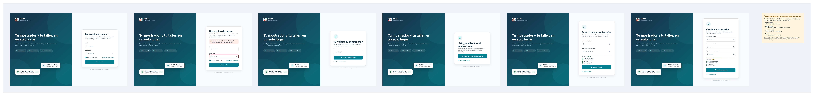 |  |

| Tablero de órdenes (Jefe) | Banco de trabajo (Técnico) |
|---|---|
| 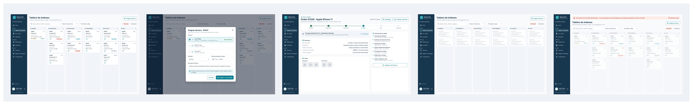 |  |

| Seguimiento (Portal) | Usuarios y permisos (Admin) |
|---|---|
| 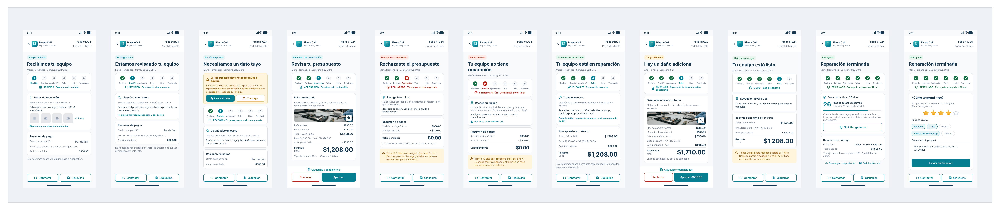 | 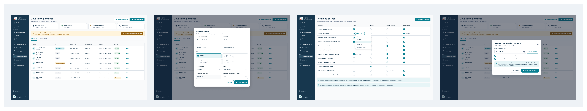 |

<details>
<summary><b>Ver todas las pantallas</b></summary>

| Módulo | Archivos |
|---|---|
| Acceso | [00 Acceso del personal](docs/diseno/01-acceso/00-acceso-del-personal.png) |
| Administrador | [AD1](docs/diseno/02-administrador/ad1-inicio.png) · [AD2](docs/diseno/02-administrador/ad2-reportes.png) · [AD3](docs/diseno/02-administrador/ad3-cortes-de-caja.png) · [AD4](docs/diseno/02-administrador/ad4-catalogo-y-precios.png) · [AD5](docs/diseno/02-administrador/ad5-proveedores.png) · [AD6](docs/diseno/02-administrador/ad6-facturacion.png) · [AD7](docs/diseno/02-administrador/ad7-usuarios-y-permisos.png) · [AD8](docs/diseno/02-administrador/ad8-bitacora.png) · [AD9](docs/diseno/02-administrador/ad9-configuracion.png) |
| Cajera | [01](docs/diseno/03-cajera/01-inicio-y-apertura-de-caja.png) · [02](docs/diseno/03-cajera/02-punto-de-venta.png) · [03](docs/diseno/03-cajera/03-ventas.png) · [04](docs/diseno/03-cajera/04-ordenes-de-servicio.png) · [05](docs/diseno/03-cajera/05-nueva-orden-de-servicio.png) · [06](docs/diseno/03-cajera/06-entrega-de-equipo.png) · [07](docs/diseno/03-cajera/07-inventario.png) · [08](docs/diseno/03-cajera/08-clientes.png) · [09](docs/diseno/03-cajera/09-estadisticas.png) · [10](docs/diseno/03-cajera/10-corte-de-caja.png) · [11](docs/diseno/03-cajera/11-documentos-impresos.png) |
| Jefe de Técnicos | [J1](docs/diseno/04-jefe-de-tecnicos/j1-inicio.png) · [J2](docs/diseno/04-jefe-de-tecnicos/j2-tablero-de-ordenes.png) · [J3](docs/diseno/04-jefe-de-tecnicos/j3-cotizar.png) · [J4](docs/diseno/04-jefe-de-tecnicos/j4-garantias.png) · [J5](docs/diseno/04-jefe-de-tecnicos/j5-refacciones.png) · [J6](docs/diseno/04-jefe-de-tecnicos/j6-inventario.png) · [J7](docs/diseno/04-jefe-de-tecnicos/j7-tecnicos.png) · [J8](docs/diseno/04-jefe-de-tecnicos/j8-equipos-terminados.png) · [J9](docs/diseno/04-jefe-de-tecnicos/j9-configuracion.png) · [J10](docs/diseno/04-jefe-de-tecnicos/j10-version-celular.png) · [J11](docs/diseno/04-jefe-de-tecnicos/j11-mensajes-de-clientes.png) |
| Técnico | [T1](docs/diseno/05-tecnico/t1-inicio.png) · [T2](docs/diseno/05-tecnico/t2-equipos-asignados.png) · [T3](docs/diseno/05-tecnico/t3-banco-de-trabajo.png) · [T4](docs/diseno/05-tecnico/t4-garantias.png) · [T5](docs/diseno/05-tecnico/t5-refacciones.png) · [T6](docs/diseno/05-tecnico/t6-mi-historial.png) · [T7](docs/diseno/05-tecnico/t7-version-tablet.png) |
| Portal del cliente | [P1](docs/diseno/06-portal-cliente/p1-acceso-y-mis-equipos.png) · [P2](docs/diseno/06-portal-cliente/p2-seguimiento-de-la-reparacion.png) · [P3](docs/diseno/06-portal-cliente/p3-garantia-solo-si-se-solicita.png) · [P4](docs/diseno/06-portal-cliente/p4-informacion.png) · [P5](docs/diseno/06-portal-cliente/p5-chat-con-el-jefe-de-tecnicos.png) · [P6](docs/diseno/06-portal-cliente/p6-correos-que-recibe-el-cliente.png) |
| Componentes | [Componentes y tokens](docs/diseno/07-componentes/componentes-y-tokens.png) · [Iconos y navegación](docs/diseno/07-componentes/componentes-parte-2-iconos-navegacion-portal.png) · [Chat, marca y celular](docs/diseno/07-componentes/componentes-parte-3-chat-marca-y-celular.png) · [Reglas de comportamiento](docs/diseno/07-componentes/reglas-de-comportamiento-para-desarrollo.png) · [Versión 1366 px](docs/diseno/07-componentes/comportamiento-a-1366-px-menu-compacto.png) |

</details>

---

## 💬 10. Contenido y tono de comunicación

### 10.1 Tono

- **Interfaz interna (personal):** lenguaje técnico, conciso y funcional. Identificadores visuales, códigos de color por estatus y tablas optimizadas.
- **Portal externo (cliente):** lenguaje claro, transparente y empático, sin tecnicismos. Su objetivo es transmitir tranquilidad e informar con exactitud el estado del equipo.

### 10.2 Mensajes de estado para el cliente

| Estado | Mensaje en el portal | Color |
|---|---|---|
| Recibido en sucursal | "Tu equipo ha sido ingresado correctamente en nuestras instalaciones y está en cola para evaluación." | 🔵 Azul |
| En diagnóstico | "Nuestros técnicos especializados están revisando tu dispositivo para determinar la causa de la falla y los repuestos requeridos." | 🟡 Amarillo |
| Presupuesto pendiente | "Hemos determinado el diagnóstico de tu equipo. Por favor, revisa el desglose del costo y presiona 'Aprobar' para iniciar la reparación." | 🟠 Naranja |
| En reparación | "Presupuesto autorizado. Nuestro equipo técnico se encuentra trabajando en la reparación de tu dispositivo." | 🟡 Amarillo |
| Listo para recoger | "¡Tu equipo está listo! Puedes acudir a nuestra sucursal dentro del horario de atención para realizar tu pago y recolección." | 🟢 Verde |
| Entregado | "El servicio ha sido completado y el equipo ha sido entregado al cliente." | 🟢 Verde |
| Rechazado / En abandono | — (uso interno) | 🔴 Rojo / ⚪ Gris |

Cada mensaje se guarda en `estados_orden.mensaje_cliente`, y su color en `estados_orden.color_hex`. El campo `paso_portal` (1 a 6) indica qué paso se ilumina en la barra de avance de la pantalla P2.

**Tipografía:** fuentes sans-serif modernas (Inter / Roboto) para lectura óptima en paneles densos y pantallas móviles.

---

# 📗 UNIDAD 2 — Control de Versiones, Diagramas y Diccionario de Datos

## 🧰 11. Justificación de la herramienta y plataforma de versionamiento

### 11.1 Sistema de control de versiones: Git

| Necesidad del proyecto | Cómo la resuelve Git |
|---|---|
| Tres integrantes trabajan al mismo tiempo en backend, frontend y documentación. | Es **distribuido**: cada integrante tiene una copia completa del repositorio y trabaja sin depender de un servidor central. |
| Los módulos (Inventario, Taller, POS, Portal) se desarrollan en paralelo. | Las **ramas** son ligeras y baratas; cada funcionalidad se aísla en su propia rama sin afectar el código estable. |
| Debemos poder volver a una versión funcional si algo se rompe antes de una entrega. | Cada *commit* es un punto de restauración; `git revert` y las etiquetas (`tags`) permiten regresar a versiones de Sprint. |
| Laravel, Angular y Composer/npm ya están integrados con Git. | Es el estándar de la industria; los *frameworks* incluyen sus propios `.gitignore` y las herramientas de CI lo soportan de forma nativa. |

### 11.2 Plataforma remota: GitHub

| Criterio | GitHub | GitLab | Bitbucket |
|---|---|---|---|
| Pull Requests con revisión obligatoria | ✅ | ✅ | ✅ |
| Protección de ramas en repos gratuitos públicos | ✅ | ✅ | ⚠️ Limitada |
| Renderizado de diagramas **Mermaid** en Markdown | ✅ | ✅ | ❌ |
| GitHub Projects (tablero Kanban para Sprints) | ✅ integrado | ✅ | ⚠️ Requiere Jira |
| Integración con VS Code y GitHub Desktop | ✅ nativa | Parcial | Parcial |
| Experiencia previa del equipo | ✅ | ❌ | ❌ |

**Decisión:** usamos **GitHub** porque permite revisar el código con Pull Requests obligatorios (requisito de nuestra *Definition of Done*), proteger la rama `main`, documentar todo el proyecto en este README con diagramas Mermaid que se muestran directamente, y llevar el tablero de Sprints en GitHub Projects sin herramientas externas. Además, el equipo ya lo conoce, lo que reduce la curva de aprendizaje en un proyecto de 8 semanas.

🔗 **Repositorio:** https://github.com/dianaaochoa/SHURI-Sistema-Gestion

---

## 🔀 12. Flujo de trabajo (Workflow)

### 12.1 Modelo elegido: Git Flow simplificado

Adoptamos **Git Flow simplificado** porque se ajusta a nuestra metodología Scrum: `develop` acumula el trabajo del Sprint y `main` solo recibe versiones estables al cierre de cada Sprint. Descartamos *GitHub Flow* puro porque integrar directamente en `main` no nos deja un punto de integración donde probar backend y frontend juntos antes de entregar.

**Flujo aplicado en los Sprints 1–2** (cada rama entra a `develop` por Pull Request; `develop` pasa a `main` al cierre del Sprint):

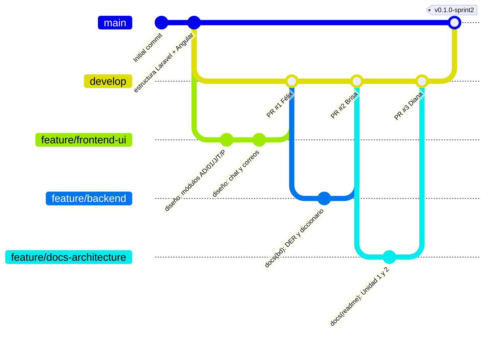

### 12.2 Ramas y nomenclatura

| Rama | Propósito | Se crea desde | Se integra en | Vida |
|---|---|---|---|---|
| `main` | Código estable, entregado al final de cada Sprint. **Protegida.** | — | — | Permanente |
| `develop` | Integración del Sprint en curso. **Protegida.** | `main` | `main` | Permanente |
| `feature/<modulo>-<descripcion>` | Nueva funcionalidad. | `develop` | `develop` | Temporal |
| `fix/<modulo>-<descripcion>` | Corrección de un error detectado en `develop`. | `develop` | `develop` | Temporal |
| `hotfix/<descripcion>` | Corrección urgente sobre una versión entregada. | `main` | `main` **y** `develop` | Temporal |
| `docs/<descripcion>` | Cambios solo de documentación. | `develop` | `develop` | Temporal |

**Reglas de nombre:** minúsculas, palabras separadas por guiones, sin acentos ni espacios.

| ✅ Correcto | ❌ Incorrecto |
|---|---|
| `feature/inventario-api` | `Feature/Inventario API` |
| `feature/pos-carrito` | `rama-felix` |
| `fix/taller-folio-duplicado` | `arreglo` |

**Ramas actuales del Sprint 1–2** (creadas al inicializar el proyecto):

| Rama | Responsable | Contenido |
|---|---|---|
| `feature/backend` | Brisa | Modelo de datos (DER, diccionario) y `.gitignore`; después, migraciones, modelos, autenticación y API REST. |
| `feature/frontend-ui` | Félix | Prototipo exportado de Figma y casos de uso; después, maquetación de vistas en Angular. |
| `feature/docs-architecture` | Diana | Documentación, diagramas y diccionario de datos. |

A partir del Sprint 3 cada funcionalidad tendrá su propia rama corta (por ejemplo `feature/pos-carrito`, `feature/portal-consulta-folio`).

### 12.3 Convención de commits

Usamos **Conventional Commits** en español:

```
<tipo>(<módulo>): <descripción corta en imperativo>
```

| Tipo | Uso | Ejemplo |
|---|---|---|
| `feat` | Nueva funcionalidad | `feat(inventario): agregar endpoint de descuento de stock` |
| `fix` | Corrección de error | `fix(pos): corregir cálculo de total con descuento` |
| `docs` | Documentación | `docs(readme): agregar diccionario de datos` |
| `style` | Formato, sin cambiar lógica | `style(taller): aplicar formato a componente de asignación` |
| `refactor` | Reestructurar código sin cambiar comportamiento | `refactor(ordenes): mover consultas a OrderRepository` |
| `test` | Pruebas | `test(auth): probar acceso denegado de técnico al POS` |
| `chore` | Configuración y dependencias | `chore: actualizar .gitignore` |

**Módulos válidos:** `auth`, `usuarios`, `inventario`, `taller`, `bitacora`, `pos`, `caja`, `garantias`, `compras`, `chat`, `portal`, `auditoria`, `bd`, `ui`, `diseno`, `readme`.

Los cambios de diseño se registran como `docs(diseno): ...` (por ejemplo, `docs(diseno): agregar pantallas del portal`).

### 12.4 Políticas de combinación (merge)

1. **Nadie hace `push` directo a `main` ni a `develop`.** Todo cambio entra por Pull Request.
2. Antes de abrir un PR, la rama se actualiza con lo último de `develop`:
   ```bash
   git switch develop && git pull
   git switch feature/mi-rama && git merge develop
   ```
3. Un PR solo se combina si:
   - Tiene **al menos 1 aprobación** (Diana revisa todo; los PR de Diana los revisa Brisa o Félix).
   - No tiene conflictos.
   - El proyecto compila (`ng build` y `php artisan test` sin errores).
4. **`feature/*` → `develop`:** *Squash and merge* (un commit limpio por funcionalidad).
5. **`develop` → `main`:** *Create a merge commit* al cierre de cada Sprint, seguido de una etiqueta de versión (`v0.1.0-sprint1`, `v0.2.0-sprint2`, …).
6. Las ramas temporales se eliminan después de combinarse.

### 12.5 Gestión de Pull Requests

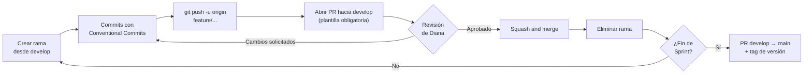

- **Título:** igual que un commit convencional, por ejemplo `feat(pos): carrito de compras`.
- **Descripción:** se llena la [plantilla de PR](.github/pull_request_template.md) (qué cambia, cómo probarlo, requisito relacionado y checklist).
- **Revisor:** asignado automáticamente por [CODEOWNERS](.github/CODEOWNERS).
- **Relación con tareas:** cada PR menciona su tarea (`T-03`) o historia de usuario (`RF-02`).

---

## ⚙️ 13. Configuración del entorno de versiones

### 13.1 Configuración inicial de cada integrante

```bash
# Identidad (una sola vez por computadora)
git config --global user.name  "Nombre Apellido"
git config --global user.email "correo-de-github@ejemplo.com"

# Rama por defecto y saltos de línea (equipo en Windows)
git config --global init.defaultBranch main
git config --global core.autocrlf true

# Clonar el repositorio y traer todas las ramas
git clone https://github.com/dianaaochoa/SHURI-Sistema-Gestion.git
cd SHURI-Sistema-Gestion
git fetch origin
git switch develop
```

### 13.2 Control de accesos

| Integrante | Usuario de GitHub | Permiso | Puede |
|---|---|---|---|
| Diana Ochoa | `@dianaaochoa` | **Admin** (propietaria) | Configurar el repositorio, proteger ramas, aprobar y combinar PRs, crear *releases*. |
| Brisa Luna | `@LunaBrisa` | **Write** (colaboradora) | Crear ramas, hacer *push* a sus ramas, abrir y revisar PRs. |
| Félix Martínez | `@GaelSaldivar` | **Write** (colaborador) | Crear ramas, hacer *push* a sus ramas, abrir y revisar PRs. |
| Profesor | — | **Lectura** (repositorio público) | Consultar código, historial y PRs. |

**Reglas de protección** (*Settings → Branches → Branch protection rules*) aplicadas a `main` y `develop`:

- ✅ *Require a pull request before merging*
- ✅ *Require approvals* (1): Diana aprueba los PR de Brisa y Félix; Brisa o Félix aprueban los de Diana.
- ✅ *Dismiss stale pull request approvals when new commits are pushed*
- ✅ *Require conversation resolution before merging*
- ✅ *Do not allow bypassing the above settings*
- ❌ *Allow force pushes* / *Allow deletions*

### 13.3 Archivos de exclusión (`.gitignore`)

El [`.gitignore`](.gitignore) de la raíz, mantenido por Brisa, está organizado en 7 bloques. Se complementa con los propios de [`backend/.gitignore`](backend/.gitignore) y [`frontend/.gitignore`](frontend/.gitignore):

| Bloque | Se excluye | Motivo |
|---|---|---|
| 1. Contraseñas y llaves | `.env`, `.env.*` (excepto `.env.example`), `*.key`, `*.pem`, `*.p12`, `*.pfx`, `*.cer`, `auth.json`, `credentials.json`, `secrets.json` | Credenciales de BD, `APP_KEY`, tokens y certificados de facturación (CSD). **Nunca se suben.** |
| 2. Base de datos | `*.sql`, `*.dump`, `*.sqlite`, `*.db`, `dumps/` | Los respaldos pueden contener datos personales de clientes. La estructura se versiona con **migraciones**, no con respaldos. |
| 3. Dependencias | `vendor/`, `node_modules/` | Se reinstalan con `composer install` / `npm install`. |
| 4. Backend | `bootstrap/cache/*`, `storage/*.key`, `public/storage`, `public/build`, `.phpunit.result.cache` | Caché, llaves y archivos que genera Laravel. |
| 5. Frontend | `dist/`, `.angular/`, `coverage/`, `out-tsc/` | Archivos generados por la compilación y las pruebas de Angular. |
| 6. Logs y temporales | `*.log`, `*.tmp`, `*.cache` | Se generan al ejecutar el proyecto. |
| 7. Sistema y editores | `.DS_Store`, `Thumbs.db`, `desktop.ini`, `.vscode/`, `.idea/`, `*.swp` | Archivos personales del sistema operativo y del editor. |

El archivo [`backend/.env.example`](backend/.env.example) **sí** se versiona: es la plantilla sin contraseñas que cada integrante copia como `.env`.

### 13.4 Llaves y credenciales de seguridad

| Credencial | Manejo |
|---|---|
| **Acceso a GitHub** | HTTPS con *Git Credential Manager* (incluido en Git para Windows), que guarda el token de forma cifrada. Alternativa: llave **SSH ed25519** (`ssh-keygen -t ed25519 -C "correo"`) registrada en *GitHub → Settings → SSH keys*. Nunca se comparten contraseñas. |
| **`APP_KEY` de Laravel** | Cada integrante la genera localmente con `php artisan key:generate`; vive solo en su `.env`. |
| **Credenciales de MySQL** | Locales a cada computadora, dentro de `.env`. |
| **Tokens de API** | Emitidos por **Laravel Sanctum** al iniciar sesión, guardados con hash en `personal_access_tokens`. |
| **Contraseñas de usuarios** | Cifradas con **Bcrypt** (`Hash::make`), cumpliendo RNF-01. |

Si una credencial se sube por error, se **cambia de inmediato** (borrarla en un nuevo commit no basta, porque sigue en el historial).

---

## 📐 14. Diagramas del sistema

### 14.1 Diagrama de arquitectura

```mermaid
flowchart LR
    subgraph Clientes["👥 Clientes"]
        direction TB
        PC["🖥️ Navegador de escritorio<br/>(Admin, Jefe, Técnico, Cajera)"]
        Movil["📱 Navegador móvil<br/>(Cliente final)"]
    end

    subgraph Front["Capa de presentación — Angular 17 (SPA)"]
        direction TB
        Guards["Guards por rol<br/>(CanActivate)"]
        Modulos["Módulos: Admin · Taller · Técnico<br/>POS · Portal público"]
        Servicios["Servicios HTTP + Interceptor<br/>(token Bearer)"]
        Guards --> Modulos --> Servicios
    end

    subgraph Back["Capa de negocio — Laravel 10 (API REST)"]
        direction TB
        Rutas["routes/api.php"]
        MW["Middleware<br/>auth:sanctum + rol"]
        Ctrl["Controllers + Form Requests"]
        Svc["Services<br/>(reglas de negocio, DB::transaction)"]
        Repo["Repositories<br/>(InventoryRepository, OrderRepository)"]
        Obs["Observers<br/>(RepairOrderObserver, StockObserver)"]
        Rutas --> MW --> Ctrl --> Svc --> Repo
        Repo -. eventos .-> Obs
    end

    subgraph Datos["Capa de datos"]
        DB[("MySQL 8<br/>InnoDB · ACID")]
    end

    PC --> Front
    Movil --> Front
    Servicios -- "HTTPS · JSON" --> Rutas
    Repo -- "Eloquent ORM" --> DB
    Obs -- "bitácora · auditoría" --> DB
    Obs -- "avisos" --> Cola["Cola de trabajos<br/>(jobs)"]
    Cola -- "SMTP" --> Correo["📧 Correo del cliente"]
```

### 14.2 Diagrama de casos de uso (UML)

Diagrama elaborado por **Félix Martínez** a partir del prototipo ([SVG](docs/diseno/08-casos-de-uso/casos-de-uso.svg) · [PNG](docs/diseno/08-casos-de-uso/casos-de-uso.png)).

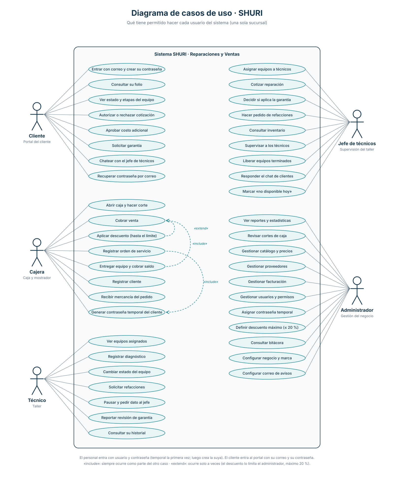

**Actores y casos de uso**

| Actor | Casos de uso | Requisitos |
|---|---|---|
| **Cliente** (portal) | Entrar con correo y crear su contraseña · Recuperar contraseña por correo · Consultar su folio · Ver estado y etapas del equipo · Autorizar o rechazar cotización · Aprobar costo adicional · Solicitar garantía · Chatear con el Jefe de Técnicos | RF-06, RF-07, RF-11, RF-12 |
| **Cajera** | Abrir caja y hacer corte · Cobrar venta · Aplicar descuento (hasta el límite) · Registrar orden de servicio · Entregar equipo y cobrar saldo · Registrar cliente · Generar contraseña temporal del cliente · Recibir mercancía del pedido | RF-03, RF-08, RF-13, RF-14 |
| **Técnico** | Ver equipos asignados · Registrar diagnóstico · Cambiar estado del equipo · Solicitar refacciones · Pausar y pedir dato al jefe · Reportar revisión de garantía · Consultar su historial | RF-05, RF-11 |
| **Jefe de Técnicos** | Asignar equipos a técnicos · Cotizar reparación · Decidir si aplica la garantía · Hacer pedido de refacciones · Consultar inventario · Supervisar a los técnicos · Liberar equipos terminados · Responder el chat de clientes · Marcar «no disponible hoy» | RF-04, RF-10, RF-11, RF-12, RF-15 |
| **Administrador** | Ver reportes y estadísticas · Revisar cortes de caja · Gestionar catálogo y precios · Gestionar proveedores · Gestionar facturación · Gestionar usuarios y permisos · Asignar contraseña temporal · Definir descuento máximo (≤ 20 %) · Consultar bitácora · Configurar negocio y marca · Configurar correo de avisos | RF-01, RF-09, RF-14, RF-16, RF-17 |

**Relaciones:** «include»: *Entregar equipo y cobrar saldo* siempre incluye *Cobrar venta*. «extend»: *Aplicar descuento* extiende a *Cobrar venta* solo cuando hay descuento, limitado por el administrador.
### 14.3 Diagrama Entidad-Relación (DER)

Modelo de datos diseñado por **Brisa Luna** (Backend & DBA): **51 tablas** en 7 módulos. Para que sea legible, primero se muestra un mapa general con las tablas principales y después un diagrama por módulo con todas sus columnas. Cada tabla está descrita columna por columna en el [diccionario de datos](#-15-diccionario-de-datos).

**Cómo leer las líneas:**

| Símbolo | Significado |
|---|---|
| `\|\|--o{` | Uno a muchos **obligatorio**: el registro hijo siempre pertenece a uno del padre (ej. todo equipo tiene un cliente dueño). |
| `\|o--o{` | Uno a muchos **opcional**: el hijo puede o no estar ligado al padre (ej. una venta puede no tener cliente). |

El texto sobre cada línea es la columna (llave foránea) que hace la conexión. **PK** = llave primaria, **FK** = llave foránea, **UK** = valor único.

#### Mapa general

Vista simplificada con las tablas principales y cómo se conectan.

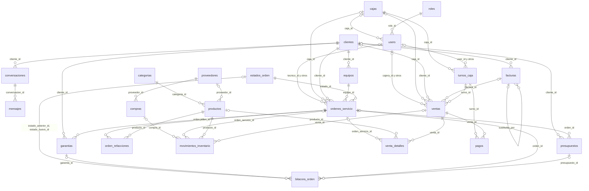

#### Diagrama: Seguridad y personal

Usuarios internos (Administrador, Jefe de Técnicos, Técnico, Cajera), sus roles y permisos.

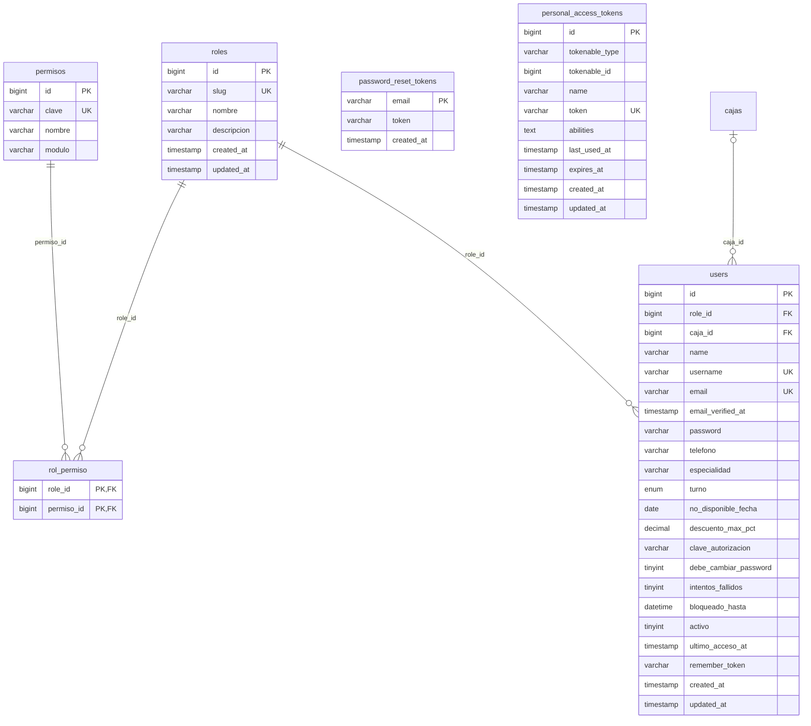

#### Diagrama: Clientes y portal

Clientes finales, su acceso al portal (correo + contraseña temporal enviada por correo), sus conversaciones del chat, sus equipos y datos fiscales.

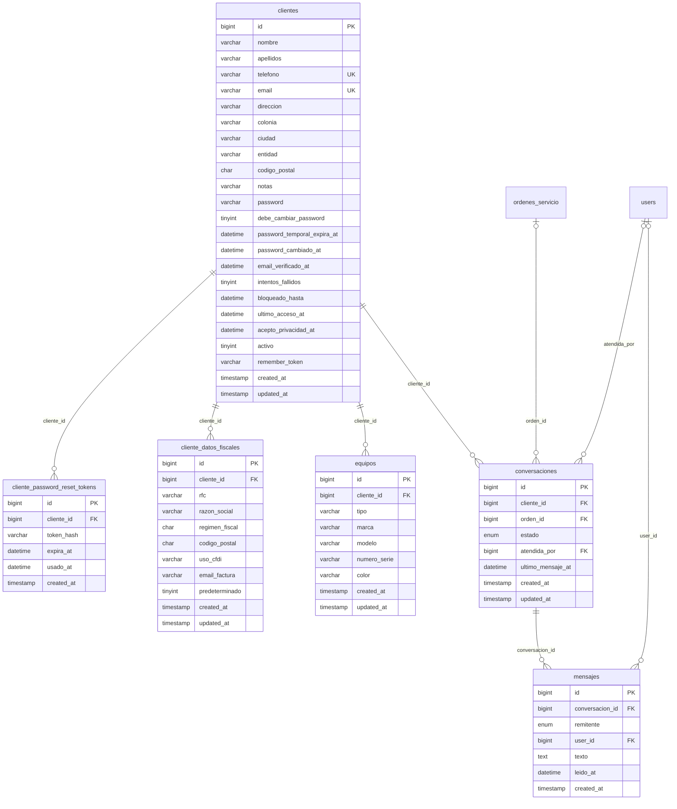

#### Diagrama: Taller (órdenes de servicio)

Ciclo de vida de una reparación: recepción, asignación, diagnóstico, resguardo, entrega, abandono y garantía.

```mermaid
erDiagram
    estados_orden {
        bigint id PK
        varchar clave UK
        varchar nombre
        varchar mensaje_cliente
        char color_hex
        tinyint orden
        tinyint paso_portal
        tinyint es_final
        tinyint permite_trabajo
        tinyint espera_recoleccion
    }
    ordenes_servicio {
        bigint id PK
        varchar folio UK
        bigint cliente_id FK
        bigint equipo_id FK
        bigint estado_id FK
        enum prioridad
        bigint caja_id FK
        text falla_reportada
        varchar accesorios_recibidos
        json checklist_recepcion
        varchar condicion_fisica
        varchar pin_equipo
        text diagnostico
        varchar causa_falla
        enum dificultad
        smallint tiempo_estimado_min
        tinyint en_pausa
        varchar motivo_pausa
        varchar motivo_sin_reparacion
        decimal presupuesto_estimado
        decimal anticipo
        decimal costo_mano_obra
        decimal costo_refacciones
        decimal total
        tinyint pagado
        bigint recibido_por FK
        bigint asignado_por FK
        bigint tecnico_id FK
        bigint actualizado_por FK
        enum ubicacion
        datetime enviado_bodega_at
        tinyint almacenaje_condonado
        bigint condonado_por FK
        varchar motivo_condonacion
        decimal cargo_almacenaje
        smallint garantia_dias
        date garantia_hasta
        bigint entregado_por FK
        varchar recibio_nombre
        varchar recibio_identificacion
        varchar recibio_parentesco
        tinyint calificacion
        varchar comentario_calificacion
        datetime calificado_at
        date fecha_promesa
        datetime fecha_asignacion
        datetime fecha_cotizacion
        datetime fecha_aprobacion
        datetime fecha_listo
        datetime fecha_entrega
        datetime fecha_abandono
        datetime fecha_desecho
        bigint desechado_por FK
        timestamp created_at
        timestamp updated_at
    }
    orden_tiempos {
        bigint id PK
        bigint orden_id FK
        bigint tecnico_id FK
        enum tipo
        datetime inicio
        datetime fin
        varchar motivo_pausa
        int minutos
        bigint tecnico_en_curso UK
    }
    orden_archivos {
        bigint id PK
        bigint orden_id FK
        bigint presupuesto_id FK
        bigint garantia_id FK
        bigint user_id FK
        enum tipo
        varchar ruta
        varchar nombre_original
        varchar mime
        int tamano_bytes
        tinyint visible_cliente
        timestamp created_at
    }
    bitacora_orden {
        bigint id PK
        bigint orden_id FK
        bigint user_id FK
        enum tipo
        bigint estado_anterior_id FK
        bigint estado_nuevo_id FK
        bigint presupuesto_id FK
        bigint garantia_id FK
        text descripcion
        tinyint visible_cliente
        timestamp created_at
    }
    garantias {
        bigint id PK
        varchar folio UK
        bigint orden_id FK
        bigint cliente_id FK
        enum canal_solicitud
        text motivo_cliente
        enum estado
        bigint recibida_por FK
        datetime recibida_at
        bigint tecnico_id FK
        text revision_tecnico
        enum dictamen
        bigint dictaminada_por FK
        datetime dictaminada_at
        varchar motivo_dictamen
        decimal costo_extra
        tinyint costo_aceptado
        datetime respondido_at
        datetime terminada_at
        bigint entregada_por FK
        datetime entregada_at
        timestamp created_at
        timestamp updated_at
    }
    users |o--o{ ordenes_servicio : "actualizado_por, asignado_por, condonado_por, desechado_por, entregado_por, recibido_por, tecnico_id"
    cajas |o--o{ ordenes_servicio : "caja_id"
    clientes ||--o{ ordenes_servicio : "cliente_id"
    equipos ||--o{ ordenes_servicio : "equipo_id"
    estados_orden ||--o{ ordenes_servicio : "estado_id"
    ordenes_servicio ||--o{ orden_tiempos : "orden_id"
    users ||--o{ orden_tiempos : "tecnico_id"
    garantias |o--o{ orden_archivos : "garantia_id"
    ordenes_servicio ||--o{ orden_archivos : "orden_id"
    presupuestos |o--o{ orden_archivos : "presupuesto_id"
    users |o--o{ orden_archivos : "user_id"
    estados_orden |o--o{ bitacora_orden : "estado_anterior_id, estado_nuevo_id"
    garantias |o--o{ bitacora_orden : "garantia_id"
    ordenes_servicio ||--o{ bitacora_orden : "orden_id"
    presupuestos |o--o{ bitacora_orden : "presupuesto_id"
    users |o--o{ bitacora_orden : "user_id"
    clientes ||--o{ garantias : "cliente_id"
    users |o--o{ garantias : "dictaminada_por, entregada_por, recibida_por, tecnico_id"
    ordenes_servicio ||--o{ garantias : "orden_id"
```

#### Diagrama: Cotización y presupuestos

El técnico propone, el Jefe de Técnicos cotiza y el cliente aprueba o rechaza.

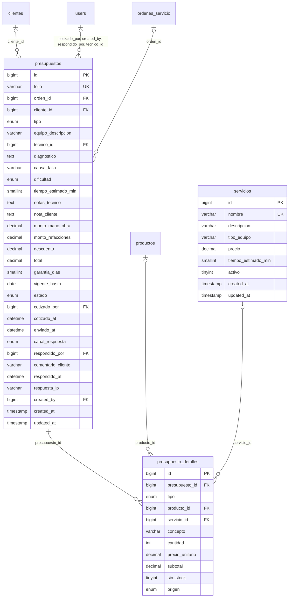

#### Diagrama: Inventario, refacciones y compras

Catálogo de productos, existencias, movimientos de stock, refacciones usadas en taller y compras a proveedores.

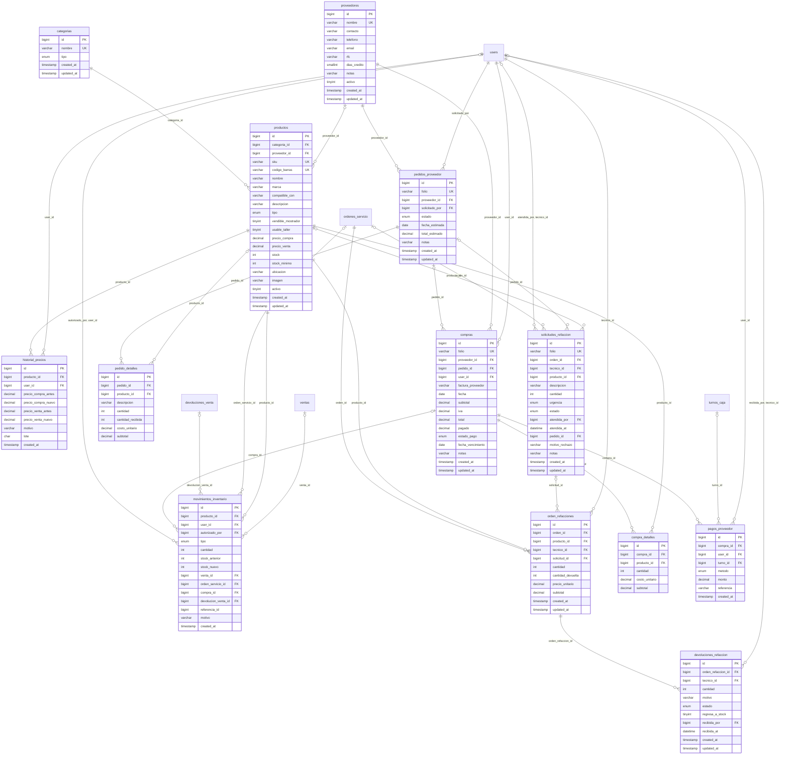

#### Diagrama: Caja y punto de venta

Turnos de caja, ventas de mostrador, cobro de reparaciones, pagos, devoluciones y facturas.

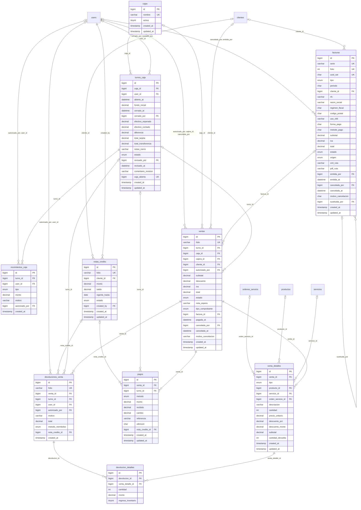

#### Diagrama: Sistema, notificaciones y auditoría

Configuración, folios, correos enviados, notificaciones internas, colas de Laravel y registro de auditoría.


### 14.4 Diagrama de estados de una orden de servicio

Los estados viven en la tabla catálogo `estados_orden`. Cada cambio queda en `bitacora_orden` y actualiza su fecha en `ordenes_servicio` (`fecha_asignacion`, `fecha_cotizacion`, `fecha_aprobacion`, `fecha_listo`, `fecha_entrega`, `fecha_abandono`, `fecha_desecho`). La **pausa** no es un estado: el técnico la marca con `en_pausa` sin perder el estado actual.

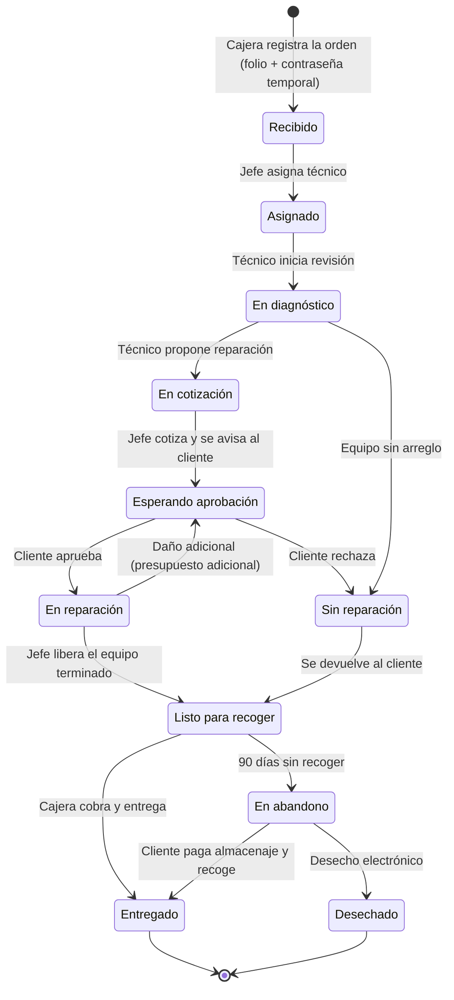

Una orden **entregada** puede abrir una **garantía** (tabla `garantias`), que sigue su propio flujo: solicitada → recibida → en revisión → por dictaminar → aprobada / rechazada → en reparación → terminada → entregada.

---

## 🗄️ 15. Diccionario de datos

**Motor:** MySQL 8.0 · **Engine:** InnoDB · **Charset:** `utf8mb4` · **Base de datos:** `shuri_db` · **51 tablas**

| Módulo | Tablas |
|---|---|
| [15.1 Seguridad y personal](#151-seguridad-y-personal) | `roles`, `permisos`, `rol_permiso`, `users`, `password_reset_tokens`, `personal_access_tokens` |
| [15.2 Clientes y portal](#152-clientes-y-portal) | `clientes`, `cliente_password_reset_tokens`, `cliente_datos_fiscales`, `equipos`, `conversaciones`, `mensajes` |
| [15.3 Taller](#153-taller-órdenes-de-servicio) | `estados_orden`, `ordenes_servicio`, `orden_tiempos`, `orden_archivos`, `bitacora_orden`, `garantias` |
| [15.4 Cotización y presupuestos](#154-cotización-y-presupuestos) | `presupuestos`, `presupuesto_detalles`, `servicios` |
| [15.5 Inventario, refacciones y compras](#155-inventario-refacciones-y-compras) | `categorias`, `productos`, `historial_precios`, `movimientos_inventario`, `orden_refacciones`, `solicitudes_refaccion`, `devoluciones_refaccion`, `proveedores`, `pedidos_proveedor`, `pedido_detalles`, `compras`, `compra_detalles`, `pagos_proveedor` |
| [15.6 Caja y punto de venta](#156-caja-y-punto-de-venta) | `cajas`, `turnos_caja`, `movimientos_caja`, `ventas`, `venta_detalles`, `pagos`, `devoluciones_venta`, `devolucion_detalles`, `notas_credito`, `facturas` |
| [15.7 Sistema, notificaciones y auditoría](#157-sistema-notificaciones-y-auditoría) | `configuracion`, `secuencias`, `correos_enviados`, `notifications`, `jobs`, `failed_jobs`, `auditoria` |

Explicación columna por columna. **Obligatorio** indica si el dato siempre debe capturarse; *Automático* = lo llena la base de datos. Convenciones: los importes son **dinero en pesos con 2 decimales**; los precios al público **incluyen IVA**; las contraseñas se guardan **cifradas con bcrypt**, nunca en texto plano.

### 15.1 Seguridad y personal

Usuarios internos (Administrador, Jefe de Técnicos, Técnico, Cajera), sus roles y permisos.

#### `roles`

Catálogo de los 4 roles internos del sistema.

| Columna | Tipo (MySQL) | Qué guarda | Obligatorio | Por defecto | Llave | Descripción |
|---|---|---|---|---|---|---|
| `id` | `bigint unsigned` | Número entero (se genera solo) | Automático |  | PK | Identificador único del registro. |
| `slug` | `varchar(30)` | Texto (letras y números), hasta 30 caracteres | Sí |  | Único | Clave interna del rol (admin, jefe_tecnicos, tecnico, cajera). |
| `nombre` | `varchar(50)` | Texto (letras y números), hasta 50 caracteres | Sí |  |  | Nombre visible del rol. |
| `descripcion` | `varchar(255)` | Texto (letras y números), hasta 255 caracteres | No |  |  | Explicación breve de lo que hace el rol. |
| `created_at` | `timestamp` | Fecha y hora | No |  |  | Fecha y hora en que se creó el registro. |
| `updated_at` | `timestamp` | Fecha y hora | No |  |  | Fecha y hora de la última modificación. |

#### `permisos`

Acciones que se pueden permitir o negar (ej. "Aplicar descuentos").

| Columna | Tipo (MySQL) | Qué guarda | Obligatorio | Por defecto | Llave | Descripción |
|---|---|---|---|---|---|---|
| `id` | `bigint unsigned` | Número entero (se genera solo) | Automático |  | PK | Identificador único del registro. |
| `clave` | `varchar(60)` | Texto (letras y números), hasta 60 caracteres | Sí |  | Único | Clave interna del permiso (ej. pos.descuento). |
| `nombre` | `varchar(120)` | Texto (letras y números), hasta 120 caracteres | Sí |  |  | Nombre visible del permiso. |
| `modulo` | `varchar(40)` | Texto (letras y números), hasta 40 caracteres | Sí |  |  | Módulo al que pertenece (caja, taller, inventario…). |

#### `rol_permiso`

Qué permisos tiene cada rol (relación muchos a muchos).

| Columna | Tipo (MySQL) | Qué guarda | Obligatorio | Por defecto | Llave | Descripción |
|---|---|---|---|---|---|---|
| `role_id` | `bigint unsigned` | Número entero (id de `roles`) | Sí |  | PK, FK → `roles` | Rol que recibe el permiso. |
| `permiso_id` | `bigint unsigned` | Número entero (id de `permisos`) | Sí |  | PK, FK → `permisos` | Permiso otorgado. |

#### `users`

Personal interno que inicia sesión en el sistema.

| Columna | Tipo (MySQL) | Qué guarda | Obligatorio | Por defecto | Llave | Descripción |
|---|---|---|---|---|---|---|
| `id` | `bigint unsigned` | Número entero (se genera solo) | Automático |  | PK | Identificador único del registro. |
| `role_id` | `bigint unsigned` | Número entero (id de `roles`) | Sí |  | FK → `roles` | Rol del usuario (Administrador, Jefe, Técnico o Cajera). |
| `caja_id` | `bigint unsigned` | Número entero (id de `cajas`) | No |  | FK → `cajas` | Caja asignada (solo cajeras). |
| `name` | `varchar(150)` | Texto (letras y números), hasta 150 caracteres | Sí |  |  | Nombre completo del empleado. |
| `username` | `varchar(40)` | Texto (letras y números), hasta 40 caracteres | Sí |  | Único | Nombre de usuario para iniciar sesión. No se repite. |
| `email` | `varchar(150)` | Texto con formato de correo, hasta 150 caracteres | Sí |  | Único | Correo del empleado. No se repite. |
| `email_verified_at` | `timestamp` | Fecha y hora | No |  |  | Fecha en que verificó su correo. |
| `password` | `varchar(255)` | Texto cifrado (no se puede leer a simple vista) | Sí |  |  | Contraseña cifrada con bcrypt (nunca en texto plano). |
| `telefono` | `varchar(10)` | Texto de 10 dígitos numéricos | No |  |  | Teléfono del empleado, 10 dígitos. |
| `especialidad` | `varchar(100)` | Texto (letras y números), hasta 100 caracteres | No |  |  | Especialidad del técnico (ej. "iPhone y microsoldadura"). |
| `turno` | `enum('matutino','vespertino','completo')` | Lista de opciones: matutino, vespertino, completo | No |  |  | Turno de trabajo. |
| `no_disponible_fecha` | `date` | Fecha (AAAA-MM-DD) | No |  |  | Día en que el empleado se marcó «no disponible hoy». Si es la fecha actual, no recibe asignaciones y el chat avisa al cliente que el jefe no está disponible. |
| `descuento_max_pct` | `decimal(5,2)` | Porcentaje con 2 decimales | Sí | `0.00` |  | Porcentaje máximo de descuento que puede aplicar sin autorización (0 a 20; el administrador no puede asignar más del 20 %). |
| `clave_autorizacion` | `varchar(255)` | Texto cifrado (no se puede leer a simple vista) | No |  |  | Clave cifrada para autorizar descuentos o cancelaciones. |
| `debe_cambiar_password` | `tinyint(1)` | Sí / No (1 = sí, 0 = no) | Sí | Sí (1) |  | Sí = tiene contraseña temporal y debe cambiarla al entrar. |
| `intentos_fallidos` | `tinyint unsigned` | Número entero pequeño (0 a 255) | Sí | `0` |  | Intentos de inicio de sesión fallidos seguidos. |
| `bloqueado_hasta` | `datetime` | Fecha y hora | No |  |  | Hasta cuándo está bloqueado por intentos fallidos. |
| `activo` | `tinyint(1)` | Sí / No (1 = sí, 0 = no) | Sí | Sí (1) |  | Sí = puede entrar; No = dado de baja (no se borra). |
| `ultimo_acceso_at` | `timestamp` | Fecha y hora | No |  |  | Última vez que inició sesión. |
| `remember_token` | `varchar(100)` | Texto cifrado (no se puede leer a simple vista) | No |  |  | Token de Laravel para "recordarme". |
| `created_at` | `timestamp` | Fecha y hora | No |  |  | Fecha y hora en que se creó el registro. |
| `updated_at` | `timestamp` | Fecha y hora | No |  |  | Fecha y hora de la última modificación. |

#### `password_reset_tokens`

Tokens de Laravel para que el personal restablezca su contraseña.

| Columna | Tipo (MySQL) | Qué guarda | Obligatorio | Por defecto | Llave | Descripción |
|---|---|---|---|---|---|---|
| `email` | `varchar(150)` | Texto con formato de correo, hasta 150 caracteres | Sí |  | PK | Correo del empleado que pidió restablecer contraseña. |
| `token` | `varchar(255)` | Texto cifrado (no se puede leer a simple vista) | Sí |  |  | Token cifrado de restablecimiento. |
| `created_at` | `timestamp` | Fecha y hora | No |  |  | Fecha y hora en que se creó el registro. |

#### `personal_access_tokens`

Tokens de sesión de Laravel Sanctum (personal y clientes).

| Columna | Tipo (MySQL) | Qué guarda | Obligatorio | Por defecto | Llave | Descripción |
|---|---|---|---|---|---|---|
| `id` | `bigint unsigned` | Número entero (se genera solo) | Automático |  | PK | Identificador único del registro. |
| `tokenable_type` | `varchar(255)` | Texto cifrado (no se puede leer a simple vista) | Sí |  |  | Tipo de dueño del token (User o Cliente). |
| `tokenable_id` | `bigint unsigned` | Número entero | Sí |  |  | Id del usuario o cliente dueño del token. |
| `name` | `varchar(255)` | Texto (letras y números), hasta 255 caracteres | Sí |  |  | Nombre del token (ej. "portal", "spa"). |
| `token` | `varchar(64)` | Texto cifrado (no se puede leer a simple vista) | Sí |  | Único | Token cifrado (hash SHA-256). |
| `abilities` | `text` | Texto largo | No |  |  | Permisos del token. |
| `last_used_at` | `timestamp` | Fecha y hora | No |  |  | Última vez que se usó. |
| `expires_at` | `timestamp` | Fecha y hora | No |  |  | Fecha de expiración. |
| `created_at` | `timestamp` | Fecha y hora | No |  |  | Fecha y hora en que se creó el registro. |
| `updated_at` | `timestamp` | Fecha y hora | No |  |  | Fecha y hora de la última modificación. |

### 15.2 Clientes y portal

Clientes finales, su acceso al portal (correo + contraseña temporal enviada por correo), sus conversaciones del chat, sus equipos y datos fiscales.

#### `clientes`

Clientes finales. El **correo** es su usuario del portal.

| Columna | Tipo (MySQL) | Qué guarda | Obligatorio | Por defecto | Llave | Descripción |
|---|---|---|---|---|---|---|
| `id` | `bigint unsigned` | Número entero (se genera solo) | Automático |  | PK | Identificador único del registro. |
| `nombre` | `varchar(100)` | Texto (letras y números), hasta 100 caracteres | Sí |  |  | Nombre(s) del cliente. |
| `apellidos` | `varchar(100)` | Texto (letras y números), hasta 100 caracteres | No |  |  | Apellidos del cliente. |
| `telefono` | `varchar(10)` | Texto de 10 dígitos numéricos | Sí |  | Único | Teléfono del cliente, exactamente 10 dígitos. No se repite. |
| `email` | `varchar(150)` | Texto con formato de correo, hasta 150 caracteres | Sí |  | Único | Correo del cliente (obligatorio, no se repite). Es su USUARIO del portal y ahí se le envía la contraseña temporal. |
| `direccion` | `varchar(200)` | Texto (letras y números), hasta 200 caracteres | No |  |  | Calle y número. |
| `colonia` | `varchar(100)` | Texto (letras y números), hasta 100 caracteres | No |  |  | Colonia. |
| `ciudad` | `varchar(100)` | Texto (letras y números), hasta 100 caracteres | No |  |  | Ciudad o municipio. |
| `entidad` | `varchar(60)` | Texto (letras y números), hasta 60 caracteres | No |  |  | Estado de la república. |
| `codigo_postal` | `char(5)` | Texto de 5 dígitos numéricos | No |  |  | Código postal de 5 dígitos. |
| `notas` | `varchar(255)` | Texto (letras y números), hasta 255 caracteres | No |  |  | Observaciones internas sobre el cliente. |
| `password` | `varchar(255)` | Texto cifrado (no se puede leer a simple vista) | No |  |  | Contraseña del portal cifrada con bcrypt. Vacío = aún sin acceso. |
| `debe_cambiar_password` | `tinyint(1)` | Sí / No (1 = sí, 0 = no) | Sí | Sí (1) |  | Sí = usa la contraseña temporal del correo y debe cambiarla al entrar. |
| `password_temporal_expira_at` | `datetime` | Fecha y hora | No |  |  | Hasta cuándo sirve la contraseña temporal. |
| `password_cambiado_at` | `datetime` | Fecha y hora | No |  |  | Cuándo puso su propia contraseña. |
| `email_verificado_at` | `datetime` | Fecha y hora | No |  |  | Cuándo se confirmó su correo (primer acceso correcto). |
| `intentos_fallidos` | `tinyint unsigned` | Número entero pequeño (0 a 255) | Sí | `0` |  | Intentos de acceso al portal fallidos seguidos. |
| `bloqueado_hasta` | `datetime` | Fecha y hora | No |  |  | Hasta cuándo está bloqueado el acceso al portal. |
| `ultimo_acceso_at` | `datetime` | Fecha y hora | No |  |  | Última vez que entró al portal. |
| `acepto_privacidad_at` | `datetime` | Fecha y hora | No |  |  | Cuándo aceptó el aviso de privacidad. |
| `activo` | `tinyint(1)` | Sí / No (1 = sí, 0 = no) | Sí | Sí (1) |  | Sí = cliente activo. |
| `remember_token` | `varchar(100)` | Texto cifrado (no se puede leer a simple vista) | No |  |  | Token de Laravel para "recordarme". |
| `created_at` | `timestamp` | Fecha y hora | No |  |  | Fecha y hora en que se creó el registro. |
| `updated_at` | `timestamp` | Fecha y hora | No |  |  | Fecha y hora de la última modificación. |

#### `cliente_password_reset_tokens`

Solicitudes de "Recuperar contraseña" del portal del cliente.

| Columna | Tipo (MySQL) | Qué guarda | Obligatorio | Por defecto | Llave | Descripción |
|---|---|---|---|---|---|---|
| `id` | `bigint unsigned` | Número entero (se genera solo) | Automático |  | PK | Identificador único del registro. |
| `cliente_id` | `bigint unsigned` | Número entero (id de `clientes`) | Sí |  | FK → `clientes` | Cliente que pidió recuperar su contraseña. |
| `token_hash` | `varchar(255)` | Texto cifrado (no se puede leer a simple vista) | Sí |  |  | Token cifrado enviado por correo. |
| `expira_at` | `datetime` | Fecha y hora | Sí |  |  | Hasta cuándo es válido el token. |
| `usado_at` | `datetime` | Fecha y hora | No |  |  | Cuándo se usó (vacío = no usado). |
| `created_at` | `timestamp` | Fecha y hora · se calcula automáticamente | Automático | Fecha actual |  | Fecha y hora en que se creó el registro. |

#### `cliente_datos_fiscales`

Datos para facturar a un cliente (RFC, razón social, etc.).

| Columna | Tipo (MySQL) | Qué guarda | Obligatorio | Por defecto | Llave | Descripción |
|---|---|---|---|---|---|---|
| `id` | `bigint unsigned` | Número entero (se genera solo) | Automático |  | PK | Identificador único del registro. |
| `cliente_id` | `bigint unsigned` | Número entero (id de `clientes`) | Sí |  | FK → `clientes` | Cliente dueño de los datos fiscales. |
| `rfc` | `varchar(13)` | Texto (letras y números), hasta 13 caracteres | Sí |  |  | RFC (12 o 13 caracteres). |
| `razon_social` | `varchar(200)` | Texto (letras y números), hasta 200 caracteres | Sí |  |  | Nombre o razón social para la factura. |
| `regimen_fiscal` | `char(3)` | Texto de exactamente 3 caracteres | Sí |  |  | Clave del régimen fiscal del SAT (3 dígitos). |
| `codigo_postal` | `char(5)` | Texto de 5 dígitos numéricos | Sí |  |  | Código postal fiscal (5 dígitos). |
| `uso_cfdi` | `varchar(4)` | Texto (letras y números), hasta 4 caracteres | Sí | `G03` |  | Clave de uso de CFDI del SAT (ej. G03). |
| `email_factura` | `varchar(150)` | Texto con formato de correo, hasta 150 caracteres | No |  |  | Correo al que se envía la factura. |
| `predeterminado` | `tinyint(1)` | Sí / No (1 = sí, 0 = no) | Sí | Sí (1) |  | Sí = son los datos que se usan por defecto. |
| `created_at` | `timestamp` | Fecha y hora | No |  |  | Fecha y hora en que se creó el registro. |
| `updated_at` | `timestamp` | Fecha y hora | No |  |  | Fecha y hora de la última modificación. |

#### `equipos`

Dispositivos de los clientes (celulares, laptops, etc.).

| Columna | Tipo (MySQL) | Qué guarda | Obligatorio | Por defecto | Llave | Descripción |
|---|---|---|---|---|---|---|
| `id` | `bigint unsigned` | Número entero (se genera solo) | Automático |  | PK | Identificador único del registro. |
| `cliente_id` | `bigint unsigned` | Número entero (id de `clientes`) | Sí |  | FK → `clientes` | Cliente dueño del equipo. |
| `tipo` | `varchar(40)` | Texto (letras y números), hasta 40 caracteres | Sí |  |  | Tipo de equipo (Teléfono celular, Laptop, Tablet…). |
| `marca` | `varchar(60)` | Texto (letras y números), hasta 60 caracteres | Sí |  |  | Marca (Apple, Samsung, HP…). |
| `modelo` | `varchar(80)` | Texto (letras y números), hasta 80 caracteres | No |  |  | Modelo (iPhone 11, Galaxy A54…). |
| `numero_serie` | `varchar(80)` | Texto (letras y números), hasta 80 caracteres | No |  |  | IMEI o número de serie. |
| `color` | `varchar(40)` | Texto (letras y números), hasta 40 caracteres | No |  |  | Color del equipo. |
| `created_at` | `timestamp` | Fecha y hora | No |  |  | Fecha y hora en que se creó el registro. |
| `updated_at` | `timestamp` | Fecha y hora | No |  |  | Fecha y hora de la última modificación. |

#### `conversaciones`

Chat del portal entre el cliente y el Jefe de Técnicos (pantallas P5 y J11).

| Columna | Tipo (MySQL) | Qué guarda | Obligatorio | Por defecto | Llave | Descripción |
|---|---|---|---|---|---|---|
| `id` | `bigint unsigned` | Número entero (se genera solo) | Automático |  | PK | Identificador único del registro. |
| `cliente_id` | `bigint unsigned` | Número entero (id de `clientes`) | Sí |  | FK → `clientes` | Cliente que inició la conversación. |
| `orden_id` | `bigint unsigned` | Número entero (id de `ordenes_servicio`) | No |  | FK → `ordenes_servicio` | Orden sobre la que pregunta (vacío = consulta general). |
| `estado` | `enum('abierta','cerrada')` | Lista de opciones: abierta, cerrada | Sí | `abierta` |  | Estado de la conversación. |
| `atendida_por` | `bigint unsigned` | Número entero (id de `users`) | No |  | FK → `users` | Jefe de Técnicos que atiende la conversación. |
| `ultimo_mensaje_at` | `datetime` | Fecha y hora | No |  |  | Fecha del último mensaje; ordena la bandeja del jefe. |
| `created_at` | `timestamp` | Fecha y hora | No |  |  | Fecha y hora en que se creó el registro. |
| `updated_at` | `timestamp` | Fecha y hora | No |  |  | Fecha y hora de la última modificación. |

#### `mensajes`

Cada mensaje escrito en una conversación. Solo inserción: los mensajes no se editan ni se borran.

| Columna | Tipo (MySQL) | Qué guarda | Obligatorio | Por defecto | Llave | Descripción |
|---|---|---|---|---|---|---|
| `id` | `bigint unsigned` | Número entero (se genera solo) | Automático |  | PK | Identificador único del registro. |
| `conversacion_id` | `bigint unsigned` | Número entero (id de `conversaciones`) | Sí |  | FK → `conversaciones` | Conversación a la que pertenece. |
| `remitente` | `enum('cliente','personal')` | Lista de opciones: cliente, personal | Sí |  |  | Quién escribió el mensaje. |
| `user_id` | `bigint unsigned` | Número entero (id de `users`) | No |  | FK → `users` | Empleado que respondió (vacío = lo escribió el cliente). |
| `texto` | `text` | Texto largo | Sí |  |  | Contenido del mensaje. |
| `leido_at` | `datetime` | Fecha y hora | No |  |  | Cuándo lo leyó el destinatario (vacío = no leído). |
| `created_at` | `timestamp` | Fecha y hora · se calcula automáticamente | Automático | Fecha actual |  | Fecha y hora en que se envió. |

### 15.3 Taller (órdenes de servicio)

Ciclo de vida de una reparación: recepción, asignación, diagnóstico, resguardo, entrega, abandono y garantía.

#### `estados_orden`

Catálogo de estados por los que pasa una orden de servicio.

| Columna | Tipo (MySQL) | Qué guarda | Obligatorio | Por defecto | Llave | Descripción |
|---|---|---|---|---|---|---|
| `id` | `bigint unsigned` | Número entero | Sí |  | PK | Identificador del estado (fijo, no autoincrementable). |
| `clave` | `varchar(40)` | Texto (letras y números), hasta 40 caracteres | Sí |  | Único | Clave interna (recibido, en_cotizacion, en_abandono…). |
| `nombre` | `varchar(60)` | Texto (letras y números), hasta 60 caracteres | Sí |  |  | Nombre visible del estado. |
| `mensaje_cliente` | `varchar(255)` | Texto (letras y números), hasta 255 caracteres | Sí |  |  | Mensaje que ve el cliente en el portal. |
| `color_hex` | `char(7)` | Texto de 7 caracteres (#RRGGBB) | Sí |  |  | Color del estado en formato #RRGGBB. |
| `orden` | `tinyint unsigned` | Número entero pequeño (0 a 255) | Sí |  |  | Posición del estado en el flujo. |
| `paso_portal` | `tinyint unsigned` | Número entero pequeño (0 a 255) | Sí | `0` |  | Paso del 1 al 6 en la barra de avance del portal (0 = no aplica). |
| `es_final` | `tinyint(1)` | Sí / No (1 = sí, 0 = no) | Sí | No (0) |  | Sí = la orden ya no puede cambiar de estado. |
| `permite_trabajo` | `tinyint(1)` | Sí / No (1 = sí, 0 = no) | Sí | Sí (1) |  | Sí = el técnico puede trabajar la orden en este estado. |
| `espera_recoleccion` | `tinyint(1)` | Sí / No (1 = sí, 0 = no) | Sí | No (0) |  | Sí = corre el tiempo de resguardo (7 días de gracia, 90 para abandono). |

#### `ordenes_servicio`

Cada equipo recibido para reparación (orden con folio único).

| Columna | Tipo (MySQL) | Qué guarda | Obligatorio | Por defecto | Llave | Descripción |
|---|---|---|---|---|---|---|
| `id` | `bigint unsigned` | Número entero (se genera solo) | Automático |  | PK | Identificador único del registro. |
| `folio` | `varchar(20)` | Texto (letras y números), hasta 20 caracteres | Sí |  | Único | Folio único de la orden (letras y números, ej. SH26-00001). Se imprime y sirve para consultar. |
| `cliente_id` | `bigint unsigned` | Número entero (id de `clientes`) | Sí |  | FK → `clientes` | Cliente que dejó el equipo. |
| `equipo_id` | `bigint unsigned` | Número entero (id de `equipos`) | Sí |  | FK → `equipos` | Equipo que se va a reparar. |
| `estado_id` | `bigint unsigned` | Número entero (id de `estados_orden`) | Sí | `1` | FK → `estados_orden` | Estado actual de la orden. |
| `prioridad` | `enum('baja','normal','alta','urgente')` | Lista de opciones: baja, normal, alta, urgente | Sí | `normal` |  | Prioridad de la reparación. |
| `caja_id` | `bigint unsigned` | Número entero (id de `cajas`) | No |  | FK → `cajas` | Caja donde se recibió el equipo. |
| `falla_reportada` | `text` | Texto largo | Sí |  |  | Falla que describe el cliente. |
| `accesorios_recibidos` | `varchar(255)` | Texto (letras y números), hasta 255 caracteres | No |  |  | Accesorios que dejó el cliente (funda, cargador…). |
| `checklist_recepcion` | `json` | Datos estructurados (JSON) | No |  |  | Revisión física al recibir (enciende, pantalla, cámara…). |
| `condicion_fisica` | `varchar(255)` | Texto (letras y números), hasta 255 caracteres | No |  |  | Descripción del estado físico al recibir (golpes, rayones). |
| `pin_equipo` | `varchar(512)` | Texto cifrado (no se puede leer a simple vista) | No |  |  | PIN o patrón de desbloqueo, CIFRADO. No se imprime. |
| `diagnostico` | `text` | Texto largo | No |  |  | Diagnóstico del técnico. |
| `causa_falla` | `varchar(120)` | Texto (letras y números), hasta 120 caracteres | No |  |  | Causa de la falla (golpe, humedad, desgaste…). |
| `dificultad` | `enum('baja','media','alta')` | Lista de opciones: baja, media, alta | No |  |  | Dificultad estimada de la reparación. |
| `tiempo_estimado_min` | `smallint unsigned` | Número entero | No |  |  | Tiempo estimado de reparación en minutos. |
| `en_pausa` | `tinyint(1)` | Sí / No (1 = sí, 0 = no) | Sí | No (0) |  | Sí = el técnico pausó la orden. |
| `motivo_pausa` | `varchar(255)` | Texto (letras y números), hasta 255 caracteres | No |  |  | Por qué se pausó. |
| `motivo_sin_reparacion` | `varchar(255)` | Texto (letras y números), hasta 255 caracteres | No |  |  | Por qué el equipo no tiene reparación. |
| `presupuesto_estimado` | `decimal(10,2)` | Dinero (pesos con 2 decimales) | Sí | `0.00` |  | Costo aproximado que se le dijo al cliente al recibir (dinero). |
| `anticipo` | `decimal(10,2)` | Dinero (pesos con 2 decimales) | Sí | `0.00` |  | Dinero que dejó el cliente al recibir. Se cobra como venta. |
| `costo_mano_obra` | `decimal(10,2)` | Dinero (pesos con 2 decimales) | Sí | `0.00` |  | Costo final de mano de obra (dinero). |
| `costo_refacciones` | `decimal(10,2)` | Dinero (pesos con 2 decimales) | Sí | `0.00` |  | Costo final de refacciones (dinero). |
| `total` | `decimal(10,2)` | Dinero (pesos con 2 decimales) · se calcula automáticamente | Automático |  |  | Mano de obra + refacciones. Se calcula solo. |
| `pagado` | `tinyint(1)` | Sí / No (1 = sí, 0 = no) | Sí | No (0) |  | Sí = la orden ya se liquidó. |
| `recibido_por` | `bigint unsigned` | Número entero (id de `users`) | Sí |  | FK → `users` | Cajera que recibió el equipo. |
| `asignado_por` | `bigint unsigned` | Número entero (id de `users`) | No |  | FK → `users` | Jefe de Técnicos que asignó la orden. |
| `tecnico_id` | `bigint unsigned` | Número entero (id de `users`) | No |  | FK → `users` | Técnico responsable de la reparación. |
| `actualizado_por` | `bigint unsigned` | Número entero (id de `users`) | No |  | FK → `users` | Último usuario que modificó la orden. |
| `ubicacion` | `enum('taller','mostrador','bodega')` | Lista de opciones: taller, mostrador, bodega | Sí | `taller` |  | Dónde está físicamente el equipo. |
| `enviado_bodega_at` | `datetime` | Fecha y hora | No |  |  | Cuándo se envió a bodega. |
| `almacenaje_condonado` | `tinyint(1)` | Sí / No (1 = sí, 0 = no) | Sí | No (0) |  | Sí = se perdonó el cobro de almacenaje. |
| `condonado_por` | `bigint unsigned` | Número entero (id de `users`) | No |  | FK → `users` | Quién perdonó el almacenaje. |
| `motivo_condonacion` | `varchar(255)` | Texto (letras y números), hasta 255 caracteres | No |  |  | Por qué se perdonó el almacenaje. |
| `cargo_almacenaje` | `decimal(10,2)` | Dinero (pesos con 2 decimales) | Sí | `0.00` |  | Almacenaje cobrado al entregar (dinero). $10 por día después de 7 días de gracia (configurable). |
| `garantia_dias` | `smallint unsigned` | Número entero | Sí | `30` |  | Días de garantía de la reparación. |
| `garantia_hasta` | `date` | Fecha (AAAA-MM-DD) | No |  |  | Fecha en que termina la garantía (se calcula al entregar). |
| `entregado_por` | `bigint unsigned` | Número entero (id de `users`) | No |  | FK → `users` | Cajera que entregó el equipo. |
| `recibio_nombre` | `varchar(150)` | Texto (letras y números), hasta 150 caracteres | No |  |  | Nombre de quien recogió el equipo (si no fue el cliente). |
| `recibio_identificacion` | `varchar(60)` | Texto (letras y números), hasta 60 caracteres | No |  |  | Identificación de quien recogió. |
| `recibio_parentesco` | `varchar(40)` | Texto (letras y números), hasta 40 caracteres | No |  |  | Parentesco con el cliente de quien recogió. |
| `calificacion` | `tinyint unsigned` | Número entero pequeño (0 a 255) | No |  |  | Calificación del servicio, de 1 a 5 estrellas. |
| `comentario_calificacion` | `varchar(500)` | Texto (letras y números), hasta 500 caracteres | No |  |  | Comentario del cliente al calificar. |
| `calificado_at` | `datetime` | Fecha y hora | No |  |  | Cuándo calificó. |
| `fecha_promesa` | `date` | Fecha (AAAA-MM-DD) | No |  |  | Fecha prometida de entrega. |
| `fecha_asignacion` | `datetime` | Fecha y hora | No |  |  | Cuándo se asignó a un técnico. |
| `fecha_cotizacion` | `datetime` | Fecha y hora | No |  |  | Cuándo entró a "En Cotización". |
| `fecha_aprobacion` | `datetime` | Fecha y hora | No |  |  | Cuándo el cliente aprobó el presupuesto. |
| `fecha_listo` | `datetime` | Fecha y hora | No |  |  | Cuándo quedó lista para recoger. Desde aquí corre el resguardo. |
| `fecha_entrega` | `datetime` | Fecha y hora | No |  |  | Cuándo se entregó al cliente. |
| `fecha_abandono` | `datetime` | Fecha y hora | No |  |  | Cuándo pasó a "En Abandono" (90 días sin recoger). |
| `fecha_desecho` | `datetime` | Fecha y hora | No |  |  | Cuándo salió físicamente a desecho electrónico. |
| `desechado_por` | `bigint unsigned` | Número entero (id de `users`) | No |  | FK → `users` | Quién registró el desecho. |
| `created_at` | `timestamp` | Fecha y hora | No |  |  | Fecha y hora en que se creó el registro. |
| `updated_at` | `timestamp` | Fecha y hora | No |  |  | Fecha y hora de la última modificación. |

#### `orden_tiempos`

Cronómetro de trabajo del técnico por orden, incluidas las pausas.

| Columna | Tipo (MySQL) | Qué guarda | Obligatorio | Por defecto | Llave | Descripción |
|---|---|---|---|---|---|---|
| `id` | `bigint unsigned` | Número entero (se genera solo) | Automático |  | PK | Identificador único del registro. |
| `orden_id` | `bigint unsigned` | Número entero (id de `ordenes_servicio`) | Sí |  | FK → `ordenes_servicio` | Orden que se está trabajando. |
| `tecnico_id` | `bigint unsigned` | Número entero (id de `users`) | Sí |  | FK → `users` | Técnico que trabaja. |
| `tipo` | `enum('diagnostico','reparacion','garantia')` | Lista de opciones: diagnostico, reparacion, garantia | Sí | `reparacion` |  | Tipo de trabajo. |
| `inicio` | `datetime` | Fecha y hora | Sí |  |  | Cuándo empezó a trabajar. |
| `fin` | `datetime` | Fecha y hora | No |  |  | Cuándo terminó o pausó (vacío = en curso). |
| `motivo_pausa` | `varchar(255)` | Texto (letras y números), hasta 255 caracteres | No |  |  | Por qué pausó. |
| `minutos` | `int` | Número entero · se calcula automáticamente | Automático |  |  | Minutos trabajados. Se calcula solo. |
| `tecnico_en_curso` | `bigint unsigned` | Número entero · se calcula automáticamente | Automático |  | Único | Columna técnica que impide que un técnico tenga dos órdenes en curso. Se calcula sola. |

#### `orden_archivos`

Fotos y archivos de una orden (recepción, evidencia, entrega, garantía).

| Columna | Tipo (MySQL) | Qué guarda | Obligatorio | Por defecto | Llave | Descripción |
|---|---|---|---|---|---|---|
| `id` | `bigint unsigned` | Número entero (se genera solo) | Automático |  | PK | Identificador único del registro. |
| `orden_id` | `bigint unsigned` | Número entero (id de `ordenes_servicio`) | Sí |  | FK → `ordenes_servicio` | Orden a la que pertenece el archivo. |
| `presupuesto_id` | `bigint unsigned` | Número entero (id de `presupuestos`) | No |  | FK → `presupuestos` | Presupuesto relacionado (opcional). |
| `garantia_id` | `bigint unsigned` | Número entero (id de `garantias`) | No |  | FK → `garantias` | Garantía relacionada (opcional). |
| `user_id` | `bigint unsigned` | Número entero (id de `users`) | No |  | FK → `users` | Quién subió el archivo. |
| `tipo` | `enum('recepcion','diagnostico','evidencia','presupuesto','entrega','garantia')` | Lista de opciones: recepcion, diagnostico, evidencia, presupuesto, entrega, garantia | Sí |  |  | Momento en que se tomó la foto. |
| `ruta` | `varchar(255)` | Texto (letras y números), hasta 255 caracteres | Sí |  |  | Ruta del archivo en el servidor. |
| `nombre_original` | `varchar(150)` | Texto (letras y números), hasta 150 caracteres | No |  |  | Nombre original del archivo. |
| `mime` | `varchar(80)` | Texto (letras y números), hasta 80 caracteres | No |  |  | Tipo de archivo (image/jpeg, application/pdf…). |
| `tamano_bytes` | `int unsigned` | Número entero | No |  |  | Tamaño del archivo en bytes. |
| `visible_cliente` | `tinyint(1)` | Sí / No (1 = sí, 0 = no) | Sí | No (0) |  | Sí = el cliente lo ve en el portal. |
| `created_at` | `timestamp` | Fecha y hora · se calcula automáticamente | Automático | Fecha actual |  | Fecha y hora en que se creó el registro. |

#### `bitacora_orden`

Historial inmutable de todo lo que pasa en una orden. Alimenta la línea de tiempo del portal.

| Columna | Tipo (MySQL) | Qué guarda | Obligatorio | Por defecto | Llave | Descripción |
|---|---|---|---|---|---|---|
| `id` | `bigint unsigned` | Número entero (se genera solo) | Automático |  | PK | Identificador único del registro. |
| `orden_id` | `bigint unsigned` | Número entero (id de `ordenes_servicio`) | Sí |  | FK → `ordenes_servicio` | Orden a la que pertenece el evento. |
| `user_id` | `bigint unsigned` | Número entero (id de `users`) | No |  | FK → `users` | Quién hizo la acción (vacío = cliente o sistema). |
| `tipo` | `enum('ingreso','cambio_estado','asignacion','diagnostico','cotizacion','nota','refaccion','presupuesto','respuesta_cliente','solicitud_info','pausa','reanudacion','garantia','resguardo','abandono','desecho','entrega','calificacion','correo')` | Lista de opciones: ingreso, cambio_estado, asignacion, diagnostico, cotizacion, nota, refaccion, presupuesto, respuesta_cliente, solicitud_info, pausa, reanudacion, garantia, resguardo, abandono, desecho, entrega, calificacion, correo | Sí |  |  | Tipo de evento. |
| `estado_anterior_id` | `bigint unsigned` | Número entero (id de `estados_orden`) | No |  | FK → `estados_orden` | Estado antes del cambio. |
| `estado_nuevo_id` | `bigint unsigned` | Número entero (id de `estados_orden`) | No |  | FK → `estados_orden` | Estado después del cambio. |
| `presupuesto_id` | `bigint unsigned` | Número entero (id de `presupuestos`) | No |  | FK → `presupuestos` | Presupuesto relacionado (opcional). |
| `garantia_id` | `bigint unsigned` | Número entero (id de `garantias`) | No |  | FK → `garantias` | Garantía relacionada (opcional). |
| `descripcion` | `text` | Texto largo | Sí |  |  | Descripción del evento. |
| `visible_cliente` | `tinyint(1)` | Sí / No (1 = sí, 0 = no) | Sí | No (0) |  | Sí = aparece en la línea de tiempo del portal. |
| `created_at` | `timestamp` | Fecha y hora · se calcula automáticamente | Automático | Fecha actual |  | Fecha y hora en que se creó el registro. |

#### `garantias`

Solicitudes de garantía sobre una reparación ya entregada.

| Columna | Tipo (MySQL) | Qué guarda | Obligatorio | Por defecto | Llave | Descripción |
|---|---|---|---|---|---|---|
| `id` | `bigint unsigned` | Número entero (se genera solo) | Automático |  | PK | Identificador único del registro. |
| `folio` | `varchar(20)` | Texto (letras y números), hasta 20 caracteres | Sí |  | Único | Folio único de la garantía (letras y números). |
| `orden_id` | `bigint unsigned` | Número entero (id de `ordenes_servicio`) | Sí |  | FK → `ordenes_servicio` | Orden original que se reclama. |
| `cliente_id` | `bigint unsigned` | Número entero (id de `clientes`) | Sí |  | FK → `clientes` | Cliente que reclama. |
| `canal_solicitud` | `enum('portal','mostrador')` | Lista de opciones: portal, mostrador | Sí |  |  | Por dónde se solicitó. |
| `motivo_cliente` | `text` | Texto largo | Sí |  |  | Qué falla reporta el cliente. |
| `estado` | `enum('solicitada','recibida','en_revision','por_dictaminar','aprobada','rechazada','en_reparacion','terminada','entregada','cancelada')` | Lista de opciones: solicitada, recibida, en_revision, por_dictaminar, aprobada, rechazada, en_reparacion, terminada, entregada, cancelada | Sí | `solicitada` |  | Estado de la garantía. |
| `recibida_por` | `bigint unsigned` | Número entero (id de `users`) | No |  | FK → `users` | Cajera que recibió el equipo en garantía. |
| `recibida_at` | `datetime` | Fecha y hora | No |  |  | Cuándo se recibió. |
| `tecnico_id` | `bigint unsigned` | Número entero (id de `users`) | No |  | FK → `users` | Técnico que revisa. |
| `revision_tecnico` | `text` | Texto largo | No |  |  | Resultado de la revisión del técnico. |
| `dictamen` | `enum('procede','no_procede','procede_con_costo')` | Lista de opciones: procede, no_procede, procede_con_costo | No |  |  | Decisión del Jefe de Técnicos. |
| `dictaminada_por` | `bigint unsigned` | Número entero (id de `users`) | No |  | FK → `users` | Jefe que dictaminó. |
| `dictaminada_at` | `datetime` | Fecha y hora | No |  |  | Cuándo se dictaminó. |
| `motivo_dictamen` | `varchar(255)` | Texto (letras y números), hasta 255 caracteres | No |  |  | Explicación del dictamen. |
| `costo_extra` | `decimal(10,2)` | Dinero (pesos con 2 decimales) | Sí | `0.00` |  | Costo adicional si la garantía no cubre todo (dinero). |
| `costo_aceptado` | `tinyint(1)` | Sí / No (1 = sí, 0 = no) | No |  |  | Sí/No aceptó el costo extra (vacío = sin respuesta). |
| `respondido_at` | `datetime` | Fecha y hora | No |  |  | Cuándo respondió el cliente. |
| `terminada_at` | `datetime` | Fecha y hora | No |  |  | Cuándo se terminó la reparación en garantía. |
| `entregada_por` | `bigint unsigned` | Número entero (id de `users`) | No |  | FK → `users` | Quién entregó el equipo. |
| `entregada_at` | `datetime` | Fecha y hora | No |  |  | Cuándo se entregó. |
| `created_at` | `timestamp` | Fecha y hora | No |  |  | Fecha y hora en que se creó el registro. |
| `updated_at` | `timestamp` | Fecha y hora | No |  |  | Fecha y hora de la última modificación. |

### 15.4 Cotización y presupuestos

El técnico propone, el Jefe de Técnicos cotiza y el cliente aprueba o rechaza.

#### `presupuestos`

Cotizaciones: las que propone el técnico, las que cotiza el jefe y las de mostrador.

| Columna | Tipo (MySQL) | Qué guarda | Obligatorio | Por defecto | Llave | Descripción |
|---|---|---|---|---|---|---|
| `id` | `bigint unsigned` | Número entero (se genera solo) | Automático |  | PK | Identificador único del registro. |
| `folio` | `varchar(20)` | Texto (letras y números), hasta 20 caracteres | Sí |  | Único | Folio único del presupuesto (letras y números, ej. P26-00001). |
| `orden_id` | `bigint unsigned` | Número entero (id de `ordenes_servicio`) | No |  | FK → `ordenes_servicio` | Orden cotizada (vacío = presupuesto de mostrador). |
| `cliente_id` | `bigint unsigned` | Número entero (id de `clientes`) | No |  | FK → `clientes` | Cliente al que se le cotiza. |
| `tipo` | `enum('inicial','adicional','mostrador')` | Lista de opciones: inicial, adicional, mostrador | Sí | `inicial` |  | inicial = primera cotización; adicional = daño nuevo encontrado; mostrador = sin orden. |
| `equipo_descripcion` | `varchar(150)` | Texto (letras y números), hasta 150 caracteres | No |  |  | Equipo cotizado (solo presupuestos de mostrador). |
| `tecnico_id` | `bigint unsigned` | Número entero (id de `users`) | No |  | FK → `users` | Técnico que propuso la reparación. |
| `diagnostico` | `text` | Texto largo | No |  |  | Diagnóstico que justifica el presupuesto. |
| `causa_falla` | `varchar(120)` | Texto (letras y números), hasta 120 caracteres | No |  |  | Causa de la falla. |
| `dificultad` | `enum('baja','media','alta')` | Lista de opciones: baja, media, alta | No |  |  | Dificultad de la reparación. |
| `tiempo_estimado_min` | `smallint unsigned` | Número entero | No |  |  | Tiempo estimado en minutos. |
| `notas_tecnico` | `text` | Texto largo | No |  |  | Nota interna del técnico para el jefe. |
| `nota_cliente` | `text` | Texto largo | No |  |  | Explicación que ve el cliente al aprobar. |
| `monto_mano_obra` | `decimal(10,2)` | Dinero (pesos con 2 decimales) | Sí | `0.00` |  | Total de mano de obra (dinero). |
| `monto_refacciones` | `decimal(10,2)` | Dinero (pesos con 2 decimales) | Sí | `0.00` |  | Total de refacciones (dinero). |
| `descuento` | `decimal(10,2)` | Dinero (pesos con 2 decimales) | Sí | `0.00` |  | Descuento aplicado (dinero). |
| `total` | `decimal(10,2)` | Dinero (pesos con 2 decimales) · se calcula automáticamente | Automático |  |  | Mano de obra + refacciones − descuento. Se calcula solo. |
| `garantia_dias` | `smallint unsigned` | Número entero | Sí | `30` |  | Días de garantía ofrecidos. |
| `vigente_hasta` | `date` | Fecha (AAAA-MM-DD) | No |  |  | Fecha hasta la que es válido el precio. |
| `estado` | `enum('por_cotizar','pendiente','aprobado','rechazado','vencido','cancelado')` | Lista de opciones: por_cotizar, pendiente, aprobado, rechazado, vencido, cancelado | Sí | `por_cotizar` |  | por_cotizar = espera al jefe; pendiente = espera al cliente; aprobado / rechazado / vencido / cancelado. |
| `cotizado_por` | `bigint unsigned` | Número entero (id de `users`) | No |  | FK → `users` | Jefe de Técnicos que puso los precios. |
| `cotizado_at` | `datetime` | Fecha y hora | No |  |  | Cuándo se cotizó. |
| `enviado_at` | `datetime` | Fecha y hora | No |  |  | Cuándo se envió al cliente. |
| `canal_respuesta` | `enum('portal','mostrador','telefono')` | Lista de opciones: portal, mostrador, telefono | No |  |  | Por dónde respondió el cliente. |
| `respondido_por` | `bigint unsigned` | Número entero (id de `users`) | No |  | FK → `users` | Cajera que registró la respuesta (si fue en mostrador o por teléfono). |
| `comentario_cliente` | `varchar(255)` | Texto (letras y números), hasta 255 caracteres | No |  |  | Comentario del cliente al responder. |
| `respondido_at` | `datetime` | Fecha y hora | No |  |  | Cuándo respondió. |
| `respuesta_ip` | `varchar(45)` | Texto (letras y números), hasta 45 caracteres | No |  |  | Dirección IP desde la que respondió en el portal. |
| `created_by` | `bigint unsigned` | Número entero (id de `users`) | No |  | FK → `users` | Usuario que creó el presupuesto. |
| `created_at` | `timestamp` | Fecha y hora | No |  |  | Fecha y hora en que se creó el registro. |
| `updated_at` | `timestamp` | Fecha y hora | No |  |  | Fecha y hora de la última modificación. |

#### `presupuesto_detalles`

Renglones de un presupuesto (refacciones y mano de obra).

| Columna | Tipo (MySQL) | Qué guarda | Obligatorio | Por defecto | Llave | Descripción |
|---|---|---|---|---|---|---|
| `id` | `bigint unsigned` | Número entero (se genera solo) | Automático |  | PK | Identificador único del registro. |
| `presupuesto_id` | `bigint unsigned` | Número entero (id de `presupuestos`) | Sí |  | FK → `presupuestos` | Presupuesto al que pertenece el renglón. |
| `tipo` | `enum('refaccion','mano_obra','servicio','otro')` | Lista de opciones: refaccion, mano_obra, servicio, otro | Sí | `refaccion` |  | Tipo de concepto. |
| `producto_id` | `bigint unsigned` | Número entero (id de `productos`) | No |  | FK → `productos` | Refacción del catálogo (si aplica). |
| `servicio_id` | `bigint unsigned` | Número entero (id de `servicios`) | No |  | FK → `servicios` | Servicio del tabulador (si aplica). |
| `concepto` | `varchar(150)` | Texto (letras y números), hasta 150 caracteres | Sí |  |  | Descripción del concepto. |
| `cantidad` | `int` | Número entero | Sí | `1` |  | Cantidad (mayor a 0). |
| `precio_unitario` | `decimal(10,2)` | Dinero (pesos con 2 decimales) | Sí | `0.00` |  | Precio por unidad (dinero). |
| `subtotal` | `decimal(10,2)` | Dinero (pesos con 2 decimales) · se calcula automáticamente | Automático |  |  | Cantidad × precio. Se calcula solo. |
| `sin_stock` | `tinyint(1)` | Sí / No (1 = sí, 0 = no) | Sí | No (0) |  | Sí = no hay existencia y hay que pedirla. |
| `origen` | `enum('tecnico','jefe')` | Lista de opciones: tecnico, jefe | Sí | `tecnico` |  | Quién agregó el renglón (técnico o jefe). |

#### `servicios`

Tabulador de mano de obra y servicios con su precio.

| Columna | Tipo (MySQL) | Qué guarda | Obligatorio | Por defecto | Llave | Descripción |
|---|---|---|---|---|---|---|
| `id` | `bigint unsigned` | Número entero (se genera solo) | Automático |  | PK | Identificador único del registro. |
| `nombre` | `varchar(120)` | Texto (letras y números), hasta 120 caracteres | Sí |  | Único | Nombre del servicio (no se repite). |
| `descripcion` | `varchar(255)` | Texto (letras y números), hasta 255 caracteres | No |  |  | Descripción del servicio. |
| `tipo_equipo` | `varchar(40)` | Texto (letras y números), hasta 40 caracteres | No |  |  | Tipo de equipo al que aplica. |
| `precio` | `decimal(10,2)` | Dinero (pesos con 2 decimales) | Sí | `0.00` |  | Precio del servicio (dinero). |
| `tiempo_estimado_min` | `smallint unsigned` | Número entero | No |  |  | Duración estimada en minutos. |
| `activo` | `tinyint(1)` | Sí / No (1 = sí, 0 = no) | Sí | Sí (1) |  | Sí = se puede usar. |
| `created_at` | `timestamp` | Fecha y hora | No |  |  | Fecha y hora en que se creó el registro. |
| `updated_at` | `timestamp` | Fecha y hora | No |  |  | Fecha y hora de la última modificación. |

### 15.5 Inventario, refacciones y compras

Catálogo de productos, existencias, movimientos de stock, refacciones usadas en taller y compras a proveedores.

#### `categorias`

Agrupación de productos (Pantallas, Baterías, Audífonos…).

| Columna | Tipo (MySQL) | Qué guarda | Obligatorio | Por defecto | Llave | Descripción |
|---|---|---|---|---|---|---|
| `id` | `bigint unsigned` | Número entero (se genera solo) | Automático |  | PK | Identificador único del registro. |
| `nombre` | `varchar(80)` | Texto (letras y números), hasta 80 caracteres | Sí |  | Único | Nombre de la categoría (no se repite). |
| `tipo` | `enum('refaccion','accesorio','consumible')` | Lista de opciones: refaccion, accesorio, consumible | Sí |  |  | Tipo de producto de la categoría. |
| `created_at` | `timestamp` | Fecha y hora | No |  |  | Fecha y hora en que se creó el registro. |
| `updated_at` | `timestamp` | Fecha y hora | No |  |  | Fecha y hora de la última modificación. |

#### `productos`

Catálogo maestro de refacciones, accesorios y consumibles con su existencia.

| Columna | Tipo (MySQL) | Qué guarda | Obligatorio | Por defecto | Llave | Descripción |
|---|---|---|---|---|---|---|
| `id` | `bigint unsigned` | Número entero (se genera solo) | Automático |  | PK | Identificador único del registro. |
| `categoria_id` | `bigint unsigned` | Número entero (id de `categorias`) | Sí |  | FK → `categorias` | Categoría del producto. |
| `proveedor_id` | `bigint unsigned` | Número entero (id de `proveedores`) | No |  | FK → `proveedores` | Proveedor habitual. |
| `sku` | `varchar(40)` | Texto (letras y números), hasta 40 caracteres | Sí |  | Único | Código interno del producto, letras y números (no se repite). |
| `codigo_barras` | `varchar(50)` | Texto (letras y números), hasta 50 caracteres | No |  | Único | Código de barras para escanear en el POS (no se repite). |
| `nombre` | `varchar(150)` | Texto (letras y números), hasta 150 caracteres | Sí |  |  | Nombre del producto. |
| `marca` | `varchar(60)` | Texto (letras y números), hasta 60 caracteres | No |  |  | Marca del producto. |
| `compatible_con` | `varchar(150)` | Texto (letras y números), hasta 150 caracteres | No |  |  | Modelos compatibles. |
| `descripcion` | `varchar(255)` | Texto (letras y números), hasta 255 caracteres | No |  |  | Descripción del producto. |
| `tipo` | `enum('refaccion','accesorio','consumible')` | Lista de opciones: refaccion, accesorio, consumible | Sí |  |  | refaccion = para taller; accesorio = venta; consumible = insumos. |
| `vendible_mostrador` | `tinyint(1)` | Sí / No (1 = sí, 0 = no) | Sí | Sí (1) |  | Sí = aparece en el punto de venta. |
| `usable_taller` | `tinyint(1)` | Sí / No (1 = sí, 0 = no) | Sí | Sí (1) |  | Sí = el técnico lo puede usar en reparaciones. |
| `precio_compra` | `decimal(10,2)` | Dinero (pesos con 2 decimales) | Sí | `0.00` |  | Costo de compra sin IVA (dinero). |
| `precio_venta` | `decimal(10,2)` | Dinero (pesos con 2 decimales) | Sí | `0.00` |  | Precio al público con IVA (dinero). |
| `stock` | `int` | Número entero | Sí | `0` |  | Existencia actual. Nunca puede ser negativa. |
| `stock_minimo` | `int` | Número entero | Sí | `0` |  | Existencia mínima; por debajo aparece alerta de stock bajo. |
| `ubicacion` | `varchar(40)` | Texto (letras y números), hasta 40 caracteres | No |  |  | Dónde está guardado (anaquel, cajón). |
| `imagen` | `varchar(255)` | Texto (letras y números), hasta 255 caracteres | No |  |  | Ruta de la imagen del producto. |
| `activo` | `tinyint(1)` | Sí / No (1 = sí, 0 = no) | Sí | Sí (1) |  | Sí = producto vigente. |
| `created_at` | `timestamp` | Fecha y hora | No |  |  | Fecha y hora en que se creó el registro. |
| `updated_at` | `timestamp` | Fecha y hora | No |  |  | Fecha y hora de la última modificación. |

#### `historial_precios`

Registro de cada cambio de costo o precio de un producto.

| Columna | Tipo (MySQL) | Qué guarda | Obligatorio | Por defecto | Llave | Descripción |
|---|---|---|---|---|---|---|
| `id` | `bigint unsigned` | Número entero (se genera solo) | Automático |  | PK | Identificador único del registro. |
| `producto_id` | `bigint unsigned` | Número entero (id de `productos`) | Sí |  | FK → `productos` | Producto que cambió de precio. |
| `user_id` | `bigint unsigned` | Número entero (id de `users`) | Sí |  | FK → `users` | Quién hizo el cambio. |
| `precio_compra_antes` | `decimal(10,2)` | Dinero (pesos con 2 decimales) | Sí |  |  | Costo anterior (dinero). |
| `precio_compra_nuevo` | `decimal(10,2)` | Dinero (pesos con 2 decimales) | Sí |  |  | Costo nuevo (dinero). |
| `precio_venta_antes` | `decimal(10,2)` | Dinero (pesos con 2 decimales) | Sí |  |  | Precio de venta anterior (dinero). |
| `precio_venta_nuevo` | `decimal(10,2)` | Dinero (pesos con 2 decimales) | Sí |  |  | Precio de venta nuevo (dinero). |
| `motivo` | `varchar(255)` | Texto (letras y números), hasta 255 caracteres | No |  |  | Motivo del cambio. |
| `lote` | `char(36)` | Texto de exactamente 36 caracteres | No |  |  | Identificador común cuando se ajustan varios precios a la vez. |
| `created_at` | `timestamp` | Fecha y hora · se calcula automáticamente | Automático | Fecha actual |  | Fecha y hora en que se creó el registro. |

#### `movimientos_inventario`

Kardex: cada entrada o salida de stock con existencia antes y después.

| Columna | Tipo (MySQL) | Qué guarda | Obligatorio | Por defecto | Llave | Descripción |
|---|---|---|---|---|---|---|
| `id` | `bigint unsigned` | Número entero (se genera solo) | Automático |  | PK | Identificador único del registro. |
| `producto_id` | `bigint unsigned` | Número entero (id de `productos`) | Sí |  | FK → `productos` | Producto que se movió. |
| `user_id` | `bigint unsigned` | Número entero (id de `users`) | No |  | FK → `users` | Quién hizo el movimiento. |
| `autorizado_por` | `bigint unsigned` | Número entero (id de `users`) | No |  | FK → `users` | Quién autorizó (en ajustes). |
| `tipo` | `enum('entrada','ajuste','venta','consumo_taller','devolucion_venta','devolucion_taller','devolucion_proveedor','merma')` | Lista de opciones: entrada, ajuste, venta, consumo_taller, devolucion_venta, devolucion_taller, devolucion_proveedor, merma | Sí |  |  | Motivo del movimiento. |
| `cantidad` | `int` | Número entero | Sí |  |  | Unidades: positivo = entra, negativo = sale. |
| `stock_anterior` | `int` | Número entero | Sí |  |  | Existencia antes del movimiento. |
| `stock_nuevo` | `int` | Número entero | Sí |  |  | Existencia después del movimiento (anterior + cantidad). |
| `venta_id` | `bigint unsigned` | Número entero (id de `ventas`) | No |  | FK → `ventas` | Venta que lo originó (si aplica). |
| `orden_servicio_id` | `bigint unsigned` | Número entero (id de `ordenes_servicio`) | No |  | FK → `ordenes_servicio` | Orden de taller que lo originó (si aplica). |
| `compra_id` | `bigint unsigned` | Número entero (id de `compras`) | No |  | FK → `compras` | Compra que lo originó (si aplica). |
| `devolucion_venta_id` | `bigint unsigned` | Número entero (id de `devoluciones_venta`) | No |  | FK → `devoluciones_venta` | Devolución que lo originó (si aplica). |
| `referencia_id` | `bigint unsigned` | Número entero | No |  |  | Id del renglón que lo originó. |
| `motivo` | `varchar(255)` | Texto (letras y números), hasta 255 caracteres | No |  |  | Explicación del movimiento. |
| `created_at` | `timestamp` | Fecha y hora · se calcula automáticamente | Automático | Fecha actual |  | Fecha y hora en que se creó el registro. |

#### `orden_refacciones`

Refacciones usadas en una orden de servicio (descuentan stock).

| Columna | Tipo (MySQL) | Qué guarda | Obligatorio | Por defecto | Llave | Descripción |
|---|---|---|---|---|---|---|
| `id` | `bigint unsigned` | Número entero (se genera solo) | Automático |  | PK | Identificador único del registro. |
| `orden_id` | `bigint unsigned` | Número entero (id de `ordenes_servicio`) | Sí |  | FK → `ordenes_servicio` | Orden donde se usó la pieza. |
| `producto_id` | `bigint unsigned` | Número entero (id de `productos`) | Sí |  | FK → `productos` | Pieza usada. |
| `tecnico_id` | `bigint unsigned` | Número entero (id de `users`) | Sí |  | FK → `users` | Técnico que la usó. |
| `solicitud_id` | `bigint unsigned` | Número entero (id de `solicitudes_refaccion`) | No |  | FK → `solicitudes_refaccion` | Solicitud de refacción relacionada (opcional). |
| `cantidad` | `int` | Número entero | Sí | `1` |  | Unidades usadas (mayor a 0). |
| `cantidad_devuelta` | `int` | Número entero | Sí | `0` |  | Unidades regresadas al almacén. |
| `precio_unitario` | `decimal(10,2)` | Dinero (pesos con 2 decimales) | No |  |  | Precio cobrado por unidad (dinero). |
| `subtotal` | `decimal(10,2)` | Dinero (pesos con 2 decimales) | Sí | `0.00` |  | Cantidad × precio (dinero). |
| `created_at` | `timestamp` | Fecha y hora | No |  |  | Fecha y hora en que se creó el registro. |
| `updated_at` | `timestamp` | Fecha y hora | No |  |  | Fecha y hora de la última modificación. |

#### `solicitudes_refaccion`

Piezas que el técnico le pide al Jefe de Técnicos.

| Columna | Tipo (MySQL) | Qué guarda | Obligatorio | Por defecto | Llave | Descripción |
|---|---|---|---|---|---|---|
| `id` | `bigint unsigned` | Número entero (se genera solo) | Automático |  | PK | Identificador único del registro. |
| `folio` | `varchar(20)` | Texto (letras y números), hasta 20 caracteres | Sí |  | Único | Folio único de la solicitud (letras y números). |
| `orden_id` | `bigint unsigned` | Número entero (id de `ordenes_servicio`) | No |  | FK → `ordenes_servicio` | Orden para la que se pide la pieza. |
| `tecnico_id` | `bigint unsigned` | Número entero (id de `users`) | Sí |  | FK → `users` | Técnico que la pide. |
| `producto_id` | `bigint unsigned` | Número entero (id de `productos`) | No |  | FK → `productos` | Producto del catálogo (vacío si no existe aún). |
| `descripcion` | `varchar(200)` | Texto (letras y números), hasta 200 caracteres | Sí |  |  | Descripción de la pieza pedida. |
| `cantidad` | `int` | Número entero | Sí | `1` |  | Unidades pedidas. |
| `urgencia` | `enum('normal','urgente')` | Lista de opciones: normal, urgente | Sí | `normal` |  | Urgencia de la solicitud. |
| `estado` | `enum('pendiente','aprobada','entregada','en_pedido','rechazada','cancelada')` | Lista de opciones: pendiente, aprobada, entregada, en_pedido, rechazada, cancelada | Sí | `pendiente` |  | Estado de la solicitud. |
| `atendida_por` | `bigint unsigned` | Número entero (id de `users`) | No |  | FK → `users` | Jefe que la atendió. |
| `atendida_at` | `datetime` | Fecha y hora | No |  |  | Cuándo se atendió. |
| `pedido_id` | `bigint unsigned` | Número entero (id de `pedidos_proveedor`) | No |  | FK → `pedidos_proveedor` | Pedido a proveedor generado (si aplica). |
| `motivo_rechazo` | `varchar(255)` | Texto (letras y números), hasta 255 caracteres | No |  |  | Por qué se rechazó. |
| `notas` | `varchar(255)` | Texto (letras y números), hasta 255 caracteres | No |  |  | Notas adicionales. |
| `created_at` | `timestamp` | Fecha y hora | No |  |  | Fecha y hora en que se creó el registro. |
| `updated_at` | `timestamp` | Fecha y hora | No |  |  | Fecha y hora de la última modificación. |

#### `devoluciones_refaccion`

Piezas que el técnico regresa al almacén.

| Columna | Tipo (MySQL) | Qué guarda | Obligatorio | Por defecto | Llave | Descripción |
|---|---|---|---|---|---|---|
| `id` | `bigint unsigned` | Número entero (se genera solo) | Automático |  | PK | Identificador único del registro. |
| `orden_refaccion_id` | `bigint unsigned` | Número entero (id de `orden_refacciones`) | Sí |  | FK → `orden_refacciones` | Pieza usada que se devuelve. |
| `tecnico_id` | `bigint unsigned` | Número entero (id de `users`) | Sí |  | FK → `users` | Técnico que la devuelve. |
| `cantidad` | `int` | Número entero | Sí | `1` |  | Unidades devueltas. |
| `motivo` | `varchar(255)` | Texto (letras y números), hasta 255 caracteres | Sí |  |  | Motivo de la devolución. |
| `estado` | `enum('pendiente','recibida','rechazada')` | Lista de opciones: pendiente, recibida, rechazada | Sí | `pendiente` |  | Estado de la devolución. |
| `regresa_a_stock` | `tinyint(1)` | Sí / No (1 = sí, 0 = no) | Sí | Sí (1) |  | Sí = vuelve al inventario; No = pieza dañada (merma). |
| `recibida_por` | `bigint unsigned` | Número entero (id de `users`) | No |  | FK → `users` | Quién recibió la pieza. |
| `recibida_at` | `datetime` | Fecha y hora | No |  |  | Cuándo se recibió. |
| `created_at` | `timestamp` | Fecha y hora | No |  |  | Fecha y hora en que se creó el registro. |
| `updated_at` | `timestamp` | Fecha y hora | No |  |  | Fecha y hora de la última modificación. |

#### `proveedores`

Empresas a las que se les compra mercancía.

| Columna | Tipo (MySQL) | Qué guarda | Obligatorio | Por defecto | Llave | Descripción |
|---|---|---|---|---|---|---|
| `id` | `bigint unsigned` | Número entero (se genera solo) | Automático |  | PK | Identificador único del registro. |
| `nombre` | `varchar(150)` | Texto (letras y números), hasta 150 caracteres | Sí |  | Único | Nombre del proveedor (no se repite). |
| `contacto` | `varchar(120)` | Texto (letras y números), hasta 120 caracteres | No |  |  | Persona de contacto. |
| `telefono` | `varchar(15)` | Texto (letras y números), hasta 15 caracteres | No |  |  | Teléfono del proveedor. |
| `email` | `varchar(150)` | Texto con formato de correo, hasta 150 caracteres | No |  |  | Correo del proveedor. |
| `rfc` | `varchar(13)` | Texto (letras y números), hasta 13 caracteres | No |  |  | RFC del proveedor. |
| `dias_credito` | `smallint unsigned` | Número entero | Sí | `0` |  | Días de crédito que da el proveedor. |
| `notas` | `varchar(255)` | Texto (letras y números), hasta 255 caracteres | No |  |  | Notas. |
| `activo` | `tinyint(1)` | Sí / No (1 = sí, 0 = no) | Sí | Sí (1) |  | Sí = proveedor vigente. |
| `created_at` | `timestamp` | Fecha y hora | No |  |  | Fecha y hora en que se creó el registro. |
| `updated_at` | `timestamp` | Fecha y hora | No |  |  | Fecha y hora de la última modificación. |

#### `pedidos_proveedor`

Pedidos de mercancía hechos a un proveedor.

| Columna | Tipo (MySQL) | Qué guarda | Obligatorio | Por defecto | Llave | Descripción |
|---|---|---|---|---|---|---|
| `id` | `bigint unsigned` | Número entero (se genera solo) | Automático |  | PK | Identificador único del registro. |
| `folio` | `varchar(20)` | Texto (letras y números), hasta 20 caracteres | Sí |  | Único | Folio único del pedido (letras y números). |
| `proveedor_id` | `bigint unsigned` | Número entero (id de `proveedores`) | Sí |  | FK → `proveedores` | Proveedor al que se pide. |
| `solicitado_por` | `bigint unsigned` | Número entero (id de `users`) | Sí |  | FK → `users` | Jefe que hizo el pedido. |
| `estado` | `enum('borrador','enviado','recibido_parcial','recibido','cancelado')` | Lista de opciones: borrador, enviado, recibido_parcial, recibido, cancelado | Sí | `borrador` |  | Estado del pedido. |
| `fecha_estimada` | `date` | Fecha (AAAA-MM-DD) | No |  |  | Fecha estimada de llegada. |
| `total_estimado` | `decimal(10,2)` | Dinero (pesos con 2 decimales) | Sí | `0.00` |  | Total estimado del pedido (dinero). |
| `notas` | `varchar(255)` | Texto (letras y números), hasta 255 caracteres | No |  |  | Notas. |
| `created_at` | `timestamp` | Fecha y hora | No |  |  | Fecha y hora en que se creó el registro. |
| `updated_at` | `timestamp` | Fecha y hora | No |  |  | Fecha y hora de la última modificación. |

#### `pedido_detalles`

Renglones de un pedido a proveedor.

| Columna | Tipo (MySQL) | Qué guarda | Obligatorio | Por defecto | Llave | Descripción |
|---|---|---|---|---|---|---|
| `id` | `bigint unsigned` | Número entero (se genera solo) | Automático |  | PK | Identificador único del registro. |
| `pedido_id` | `bigint unsigned` | Número entero (id de `pedidos_proveedor`) | Sí |  | FK → `pedidos_proveedor` | Pedido al que pertenece. |
| `producto_id` | `bigint unsigned` | Número entero (id de `productos`) | No |  | FK → `productos` | Producto pedido (si existe en catálogo). |
| `descripcion` | `varchar(200)` | Texto (letras y números), hasta 200 caracteres | Sí |  |  | Descripción del producto pedido. |
| `cantidad` | `int` | Número entero | Sí |  |  | Unidades pedidas. |
| `cantidad_recibida` | `int` | Número entero | Sí | `0` |  | Unidades que ya llegaron. |
| `costo_unitario` | `decimal(10,2)` | Dinero (pesos con 2 decimales) | Sí | `0.00` |  | Costo por unidad (dinero). |
| `subtotal` | `decimal(10,2)` | Dinero (pesos con 2 decimales) · se calcula automáticamente | Automático |  |  | Cantidad × costo. Se calcula solo. |

#### `compras`

Entradas de mercancía con factura del proveedor (cuentas por pagar).

| Columna | Tipo (MySQL) | Qué guarda | Obligatorio | Por defecto | Llave | Descripción |
|---|---|---|---|---|---|---|
| `id` | `bigint unsigned` | Número entero (se genera solo) | Automático |  | PK | Identificador único del registro. |
| `folio` | `varchar(20)` | Texto (letras y números), hasta 20 caracteres | Sí |  | Único | Folio único de la compra (letras y números). |
| `proveedor_id` | `bigint unsigned` | Número entero (id de `proveedores`) | Sí |  | FK → `proveedores` | Proveedor que vendió. |
| `pedido_id` | `bigint unsigned` | Número entero (id de `pedidos_proveedor`) | No |  | FK → `pedidos_proveedor` | Pedido que se está recibiendo (si aplica). |
| `user_id` | `bigint unsigned` | Número entero (id de `users`) | Sí |  | FK → `users` | Quién registró la entrada. |
| `factura_proveedor` | `varchar(40)` | Texto (letras y números), hasta 40 caracteres | No |  |  | Número de factura del proveedor. |
| `fecha` | `date` | Fecha (AAAA-MM-DD) | Sí |  |  | Fecha de la compra. |
| `subtotal` | `decimal(10,2)` | Dinero (pesos con 2 decimales) | Sí | `0.00` |  | Subtotal sin IVA (dinero). |
| `iva` | `decimal(10,2)` | Dinero (pesos con 2 decimales) | Sí | `0.00` |  | IVA de la compra (dinero). |
| `total` | `decimal(10,2)` | Dinero (pesos con 2 decimales) · se calcula automáticamente | Automático |  |  | Subtotal + IVA. Se calcula solo. |
| `pagado` | `decimal(10,2)` | Dinero (pesos con 2 decimales) | Sí | `0.00` |  | Cuánto se ha pagado (dinero). |
| `estado_pago` | `enum('pendiente','parcial','pagada')` | Lista de opciones: pendiente, parcial, pagada | Sí | `pendiente` |  | Situación del pago. |
| `fecha_vencimiento` | `date` | Fecha (AAAA-MM-DD) | No |  |  | Fecha límite de pago. |
| `notas` | `varchar(255)` | Texto (letras y números), hasta 255 caracteres | No |  |  | Notas. |
| `created_at` | `timestamp` | Fecha y hora | No |  |  | Fecha y hora en que se creó el registro. |
| `updated_at` | `timestamp` | Fecha y hora | No |  |  | Fecha y hora de la última modificación. |

#### `compra_detalles`

Productos y cantidades de cada compra.

| Columna | Tipo (MySQL) | Qué guarda | Obligatorio | Por defecto | Llave | Descripción |
|---|---|---|---|---|---|---|
| `id` | `bigint unsigned` | Número entero (se genera solo) | Automático |  | PK | Identificador único del registro. |
| `compra_id` | `bigint unsigned` | Número entero (id de `compras`) | Sí |  | FK → `compras` | Compra a la que pertenece. |
| `producto_id` | `bigint unsigned` | Número entero (id de `productos`) | Sí |  | FK → `productos` | Producto comprado. |
| `cantidad` | `int` | Número entero | Sí |  |  | Unidades compradas. |
| `costo_unitario` | `decimal(10,2)` | Dinero (pesos con 2 decimales) | Sí |  |  | Costo por unidad (dinero). |
| `subtotal` | `decimal(10,2)` | Dinero (pesos con 2 decimales) · se calcula automáticamente | Automático |  |  | Cantidad × costo. Se calcula solo. |

#### `pagos_proveedor`

Pagos realizados a proveedores por una compra.

| Columna | Tipo (MySQL) | Qué guarda | Obligatorio | Por defecto | Llave | Descripción |
|---|---|---|---|---|---|---|
| `id` | `bigint unsigned` | Número entero (se genera solo) | Automático |  | PK | Identificador único del registro. |
| `compra_id` | `bigint unsigned` | Número entero (id de `compras`) | Sí |  | FK → `compras` | Compra que se paga. |
| `user_id` | `bigint unsigned` | Número entero (id de `users`) | Sí |  | FK → `users` | Quién registró el pago. |
| `turno_id` | `bigint unsigned` | Número entero (id de `turnos_caja`) | No |  | FK → `turnos_caja` | Turno de caja, si se pagó con efectivo de la caja. |
| `metodo` | `enum('efectivo','tarjeta','transferencia')` | Lista de opciones: efectivo, tarjeta, transferencia | Sí |  |  | Forma de pago. |
| `monto` | `decimal(10,2)` | Dinero (pesos con 2 decimales) | Sí |  |  | Monto pagado (dinero). |
| `referencia` | `varchar(80)` | Texto (letras y números), hasta 80 caracteres | No |  |  | Referencia de la transferencia o comprobante. |
| `created_at` | `timestamp` | Fecha y hora · se calcula automáticamente | Automático | Fecha actual |  | Fecha y hora en que se creó el registro. |

### 15.6 Caja y punto de venta

Turnos de caja, ventas de mostrador, cobro de reparaciones, pagos, devoluciones y facturas.

#### `cajas`

Cajas registradoras físicas de la sucursal.

| Columna | Tipo (MySQL) | Qué guarda | Obligatorio | Por defecto | Llave | Descripción |
|---|---|---|---|---|---|---|
| `id` | `bigint unsigned` | Número entero (se genera solo) | Automático |  | PK | Identificador único del registro. |
| `nombre` | `varchar(40)` | Texto (letras y números), hasta 40 caracteres | Sí |  | Único | Nombre de la caja (Caja 01…). |
| `activa` | `tinyint(1)` | Sí / No (1 = sí, 0 = no) | Sí | Sí (1) |  | Sí = caja en uso. |
| `created_at` | `timestamp` | Fecha y hora | No |  |  | Fecha y hora en que se creó el registro. |
| `updated_at` | `timestamp` | Fecha y hora | No |  |  | Fecha y hora de la última modificación. |

#### `turnos_caja`

Apertura y corte de cada turno de caja.

| Columna | Tipo (MySQL) | Qué guarda | Obligatorio | Por defecto | Llave | Descripción |
|---|---|---|---|---|---|---|
| `id` | `bigint unsigned` | Número entero (se genera solo) | Automático |  | PK | Identificador único del registro. |
| `caja_id` | `bigint unsigned` | Número entero (id de `cajas`) | Sí |  | FK → `cajas` | Caja del turno. |
| `user_id` | `bigint unsigned` | Número entero (id de `users`) | Sí |  | FK → `users` | Cajera que abrió el turno. |
| `abierto_at` | `datetime` | Fecha y hora | Sí |  |  | Cuándo se abrió. |
| `fondo_inicial` | `decimal(10,2)` | Dinero (pesos con 2 decimales) | Sí | `0.00` |  | Efectivo con el que inicia la caja (dinero). |
| `cerrado_at` | `datetime` | Fecha y hora | No |  |  | Cuándo se cerró. |
| `cerrado_por` | `bigint unsigned` | Número entero (id de `users`) | No |  | FK → `users` | Quién cerró. |
| `efectivo_esperado` | `decimal(10,2)` | Dinero (pesos con 2 decimales) | No |  |  | Efectivo que debería haber según el sistema (dinero). |
| `efectivo_contado` | `decimal(10,2)` | Dinero (pesos con 2 decimales) | No |  |  | Efectivo contado físicamente al cerrar (dinero). |
| `diferencia` | `decimal(10,2)` | Dinero (pesos con 2 decimales) · se calcula automáticamente | Automático |  |  | Contado − esperado. Se calcula solo. |
| `total_tarjeta` | `decimal(10,2)` | Dinero (pesos con 2 decimales) | No |  |  | Total cobrado con tarjeta (dinero). |
| `total_transferencia` | `decimal(10,2)` | Dinero (pesos con 2 decimales) | No |  |  | Total cobrado por transferencia (dinero). |
| `notas_cierre` | `varchar(255)` | Texto (letras y números), hasta 255 caracteres | No |  |  | Notas del cierre. |
| `estado` | `enum('abierto','cerrado','revisado')` | Lista de opciones: abierto, cerrado, revisado | Sí | `abierto` |  | Estado del turno. |
| `revisado_por` | `bigint unsigned` | Número entero (id de `users`) | No |  | FK → `users` | Administrador que revisó el corte. |
| `revisado_at` | `datetime` | Fecha y hora | No |  |  | Cuándo se revisó. |
| `comentario_revision` | `varchar(255)` | Texto (letras y números), hasta 255 caracteres | No |  |  | Comentario de la revisión. |
| `caja_abierta` | `bigint unsigned` | Número entero · se calcula automáticamente | Automático |  | Único | Columna técnica que impide abrir dos turnos en la misma caja. Se calcula sola. |
| `created_at` | `timestamp` | Fecha y hora | No |  |  | Fecha y hora en que se creó el registro. |
| `updated_at` | `timestamp` | Fecha y hora | No |  |  | Fecha y hora de la última modificación. |

#### `movimientos_caja`

Retiros o ingresos de efectivo durante un turno.

| Columna | Tipo (MySQL) | Qué guarda | Obligatorio | Por defecto | Llave | Descripción |
|---|---|---|---|---|---|---|
| `id` | `bigint unsigned` | Número entero (se genera solo) | Automático |  | PK | Identificador único del registro. |
| `turno_id` | `bigint unsigned` | Número entero (id de `turnos_caja`) | Sí |  | FK → `turnos_caja` | Turno en el que ocurrió. |
| `user_id` | `bigint unsigned` | Número entero (id de `users`) | Sí |  | FK → `users` | Quién hizo el movimiento. |
| `tipo` | `enum('retiro','ingreso')` | Lista de opciones: retiro, ingreso | Sí |  |  | Retiro o ingreso de efectivo. |
| `monto` | `decimal(10,2)` | Dinero (pesos con 2 decimales) | Sí |  |  | Monto (dinero, mayor a 0). |
| `motivo` | `varchar(255)` | Texto (letras y números), hasta 255 caracteres | Sí |  |  | Motivo del movimiento. |
| `autorizado_por` | `bigint unsigned` | Número entero (id de `users`) | No |  | FK → `users` | Quién autorizó. |
| `created_at` | `timestamp` | Fecha y hora · se calcula automáticamente | Automático | Fecha actual |  | Fecha y hora en que se creó el registro. |

#### `ventas`

Cada cobro en mostrador (ticket): productos, reparaciones, anticipos, almacenaje.

| Columna | Tipo (MySQL) | Qué guarda | Obligatorio | Por defecto | Llave | Descripción |
|---|---|---|---|---|---|---|
| `id` | `bigint unsigned` | Número entero (se genera solo) | Automático |  | PK | Identificador único del registro. |
| `folio` | `varchar(20)` | Texto (letras y números), hasta 20 caracteres | Sí |  | Único | Folio único del ticket (letras y números, ej. V26-000001). |
| `turno_id` | `bigint unsigned` | Número entero (id de `turnos_caja`) | No |  | FK → `turnos_caja` | Turno de caja en el que se cobró. |
| `caja_id` | `bigint unsigned` | Número entero (id de `cajas`) | No |  | FK → `cajas` | Caja en la que se cobró. |
| `cajera_id` | `bigint unsigned` | Número entero (id de `users`) | Sí |  | FK → `users` | Cajera que cobró. |
| `cliente_id` | `bigint unsigned` | Número entero (id de `clientes`) | No |  | FK → `clientes` | Cliente (opcional, vacío = público general). |
| `autorizado_por` | `bigint unsigned` | Número entero (id de `users`) | No |  | FK → `users` | Quién autorizó el descuento con su clave. |
| `subtotal` | `decimal(10,2)` | Dinero (pesos con 2 decimales) | Sí | `0.00` |  | Importe sin IVA (dinero). |
| `descuento` | `decimal(10,2)` | Dinero (pesos con 2 decimales) | Sí | `0.00` |  | Descuento sin IVA (dinero). |
| `iva` | `decimal(10,2)` | Dinero (pesos con 2 decimales) | Sí | `0.00` |  | IVA (dinero). |
| `total` | `decimal(10,2)` | Dinero (pesos con 2 decimales) · se calcula automáticamente | Automático |  |  | Subtotal − descuento + IVA. Se calcula solo. |
| `estado` | `enum('abierta','en_espera','pagada','cancelada','devuelta','devuelta_parcial')` | Lista de opciones: abierta, en_espera, pagada, cancelada, devuelta, devuelta_parcial | Sí | `abierta` |  | Estado de la venta. |
| `nota_espera` | `varchar(120)` | Texto (letras y números), hasta 120 caracteres | No |  |  | Nota al pausar una venta. |
| `tipo_comprobante` | `enum('ticket','factura')` | Lista de opciones: ticket, factura | Sí | `ticket` |  | Ticket o factura. |
| `factura_id` | `bigint unsigned` | Número entero (id de `facturas`) | No |  | FK → `facturas` | Factura emitida para esta venta (si aplica). |
| `pagada_at` | `datetime` | Fecha y hora | No |  |  | Cuándo se pagó. |
| `cancelada_por` | `bigint unsigned` | Número entero (id de `users`) | No |  | FK → `users` | Quién canceló. |
| `cancelada_at` | `datetime` | Fecha y hora | No |  |  | Cuándo se canceló. |
| `motivo_cancelacion` | `varchar(255)` | Texto (letras y números), hasta 255 caracteres | No |  |  | Motivo de la cancelación. |
| `created_at` | `timestamp` | Fecha y hora | No |  |  | Fecha y hora en que se creó el registro. |
| `updated_at` | `timestamp` | Fecha y hora | No |  |  | Fecha y hora de la última modificación. |

#### `venta_detalles`

Renglones de una venta.

| Columna | Tipo (MySQL) | Qué guarda | Obligatorio | Por defecto | Llave | Descripción |
|---|---|---|---|---|---|---|
| `id` | `bigint unsigned` | Número entero (se genera solo) | Automático |  | PK | Identificador único del registro. |
| `venta_id` | `bigint unsigned` | Número entero (id de `ventas`) | Sí |  | FK → `ventas` | Venta a la que pertenece el renglón. |
| `tipo` | `enum('producto','servicio','orden','anticipo','cargo_adicional','almacenaje','temporal')` | Lista de opciones: producto, servicio, orden, anticipo, cargo_adicional, almacenaje, temporal | Sí |  |  | Qué se cobra: producto, servicio, liquidación de orden, anticipo, cargo adicional, almacenaje o producto temporal. |
| `producto_id` | `bigint unsigned` | Número entero (id de `productos`) | No |  | FK → `productos` | Producto vendido (si aplica). |
| `servicio_id` | `bigint unsigned` | Número entero (id de `servicios`) | No |  | FK → `servicios` | Servicio cobrado (si aplica). |
| `orden_servicio_id` | `bigint unsigned` | Número entero (id de `ordenes_servicio`) | No |  | FK → `ordenes_servicio` | Orden de taller que se cobra (si aplica). |
| `descripcion` | `varchar(200)` | Texto (letras y números), hasta 200 caracteres | Sí |  |  | Descripción que sale en el ticket. |
| `cantidad` | `int` | Número entero | Sí | `1` |  | Unidades (mayor a 0). |
| `precio_unitario` | `decimal(10,2)` | Dinero (pesos con 2 decimales) | Sí | `0.00` |  | Precio por unidad con IVA (dinero). |
| `descuento_pct` | `decimal(5,2)` | Porcentaje con 2 decimales | Sí | `0.00` |  | Porcentaje de descuento del renglón (0 a 100). |
| `descuento_monto` | `decimal(10,2)` | Dinero (pesos con 2 decimales) | Sí | `0.00` |  | Descuento del renglón (dinero). |
| `subtotal` | `decimal(10,2)` | Dinero (pesos con 2 decimales) | Sí | `0.00` |  | Cantidad × precio − descuento (dinero). |
| `cantidad_devuelta` | `int` | Número entero | Sí | `0` |  | Unidades devueltas de este renglón. |
| `created_at` | `timestamp` | Fecha y hora | No |  |  | Fecha y hora en que se creó el registro. |
| `updated_at` | `timestamp` | Fecha y hora | No |  |  | Fecha y hora de la última modificación. |

#### `pagos`

Formas de pago de una venta (puede haber varias = pago mixto).

| Columna | Tipo (MySQL) | Qué guarda | Obligatorio | Por defecto | Llave | Descripción |
|---|---|---|---|---|---|---|
| `id` | `bigint unsigned` | Número entero (se genera solo) | Automático |  | PK | Identificador único del registro. |
| `venta_id` | `bigint unsigned` | Número entero (id de `ventas`) | Sí |  | FK → `ventas` | Venta que se paga. |
| `turno_id` | `bigint unsigned` | Número entero (id de `turnos_caja`) | No |  | FK → `turnos_caja` | Turno de caja. |
| `metodo` | `enum('efectivo','tarjeta','transferencia','nota_credito')` | Lista de opciones: efectivo, tarjeta, transferencia, nota_credito | Sí |  |  | Forma de pago. |
| `monto` | `decimal(10,2)` | Dinero (pesos con 2 decimales) | Sí |  |  | Monto pagado con esta forma (dinero, mayor a 0). |
| `recibido` | `decimal(10,2)` | Dinero (pesos con 2 decimales) | No |  |  | Efectivo que entregó el cliente (dinero). |
| `cambio` | `decimal(10,2)` | Dinero (pesos con 2 decimales) | No |  |  | Cambio entregado (dinero). |
| `referencia` | `varchar(80)` | Texto (letras y números), hasta 80 caracteres | No |  |  | Número de autorización o referencia. |
| `ultimos4` | `char(4)` | Texto de exactamente 4 caracteres | No |  |  | Últimos 4 dígitos de la tarjeta. |
| `nota_credito_id` | `bigint unsigned` | Número entero (id de `notas_credito`) | No |  | FK → `notas_credito` | Nota de crédito usada como pago (si aplica). |
| `created_at` | `timestamp` | Fecha y hora | No |  |  | Fecha y hora en que se creó el registro. |
| `updated_at` | `timestamp` | Fecha y hora | No |  |  | Fecha y hora de la última modificación. |

#### `devoluciones_venta`

Devoluciones de mercancía vendida.

| Columna | Tipo (MySQL) | Qué guarda | Obligatorio | Por defecto | Llave | Descripción |
|---|---|---|---|---|---|---|
| `id` | `bigint unsigned` | Número entero (se genera solo) | Automático |  | PK | Identificador único del registro. |
| `folio` | `varchar(20)` | Texto (letras y números), hasta 20 caracteres | Sí |  | Único | Folio único de la devolución (letras y números). |
| `venta_id` | `bigint unsigned` | Número entero (id de `ventas`) | Sí |  | FK → `ventas` | Venta que se devuelve. |
| `turno_id` | `bigint unsigned` | Número entero (id de `turnos_caja`) | No |  | FK → `turnos_caja` | Turno en el que se devolvió. |
| `user_id` | `bigint unsigned` | Número entero (id de `users`) | Sí |  | FK → `users` | Quién registró la devolución. |
| `autorizado_por` | `bigint unsigned` | Número entero (id de `users`) | No |  | FK → `users` | Quién autorizó. |
| `motivo` | `varchar(255)` | Texto (letras y números), hasta 255 caracteres | Sí |  |  | Motivo de la devolución. |
| `total` | `decimal(10,2)` | Dinero (pesos con 2 decimales) | Sí |  |  | Importe devuelto (dinero). |
| `metodo_reembolso` | `enum('efectivo','tarjeta','transferencia','nota_credito')` | Lista de opciones: efectivo, tarjeta, transferencia, nota_credito | Sí |  |  | Cómo se reembolsó. |
| `nota_credito_id` | `bigint unsigned` | Número entero (id de `notas_credito`) | No |  | FK → `notas_credito` | Nota de crédito generada (si aplica). |
| `created_at` | `timestamp` | Fecha y hora · se calcula automáticamente | Automático | Fecha actual |  | Fecha y hora en que se creó el registro. |

#### `devolucion_detalles`

Qué renglones y cantidades se devolvieron.

| Columna | Tipo (MySQL) | Qué guarda | Obligatorio | Por defecto | Llave | Descripción |
|---|---|---|---|---|---|---|
| `id` | `bigint unsigned` | Número entero (se genera solo) | Automático |  | PK | Identificador único del registro. |
| `devolucion_id` | `bigint unsigned` | Número entero (id de `devoluciones_venta`) | Sí |  | FK → `devoluciones_venta` | Devolución a la que pertenece. |
| `venta_detalle_id` | `bigint unsigned` | Número entero (id de `venta_detalles`) | Sí |  | FK → `venta_detalles` | Renglón de la venta que se devuelve. |
| `cantidad` | `int` | Número entero | Sí |  |  | Unidades devueltas. |
| `monto` | `decimal(10,2)` | Dinero (pesos con 2 decimales) | Sí |  |  | Importe devuelto del renglón (dinero). |
| `regresa_inventario` | `tinyint(1)` | Sí / No (1 = sí, 0 = no) | Sí | Sí (1) |  | Sí = el producto vuelve al stock. |

#### `notas_credito`

Saldo a favor del cliente generado por una devolución.

| Columna | Tipo (MySQL) | Qué guarda | Obligatorio | Por defecto | Llave | Descripción |
|---|---|---|---|---|---|---|
| `id` | `bigint unsigned` | Número entero (se genera solo) | Automático |  | PK | Identificador único del registro. |
| `folio` | `varchar(20)` | Texto (letras y números), hasta 20 caracteres | Sí |  | Único | Folio único de la nota de crédito (letras y números). |
| `cliente_id` | `bigint unsigned` | Número entero (id de `clientes`) | No |  | FK → `clientes` | Cliente beneficiado. |
| `monto` | `decimal(10,2)` | Dinero (pesos con 2 decimales) | Sí |  |  | Monto original (dinero). |
| `saldo` | `decimal(10,2)` | Dinero (pesos con 2 decimales) | Sí |  |  | Saldo disponible (dinero). |
| `vigente_hasta` | `date` | Fecha (AAAA-MM-DD) | No |  |  | Fecha de vencimiento. |
| `estado` | `enum('vigente','aplicada','vencida','cancelada')` | Lista de opciones: vigente, aplicada, vencida, cancelada | Sí | `vigente` |  | Estado de la nota. |
| `created_by` | `bigint unsigned` | Número entero (id de `users`) | Sí |  | FK → `users` | Quién la generó. |
| `created_at` | `timestamp` | Fecha y hora | No |  |  | Fecha y hora en que se creó el registro. |
| `updated_at` | `timestamp` | Fecha y hora | No |  |  | Fecha y hora de la última modificación. |

#### `facturas`

Facturas electrónicas (CFDI) individuales o globales.

| Columna | Tipo (MySQL) | Qué guarda | Obligatorio | Por defecto | Llave | Descripción |
|---|---|---|---|---|---|---|
| `id` | `bigint unsigned` | Número entero (se genera solo) | Automático |  | PK | Identificador único del registro. |
| `serie` | `varchar(10)` | Texto (letras y números), hasta 10 caracteres | Sí | `A` | Único | Serie de la factura (ej. A). |
| `folio` | `int unsigned` | Número entero | Sí |  | Único | Número consecutivo dentro de la serie. |
| `uuid_sat` | `char(36)` | Texto de exactamente 36 caracteres | No |  | Único | Folio fiscal (UUID) que asigna el SAT. |
| `tipo` | `enum('individual','global')` | Lista de opciones: individual, global | Sí | `individual` |  | individual = una venta; global = ventas del mes al público general. |
| `periodo` | `char(7)` | Texto de exactamente 7 caracteres | No |  |  | Mes de la factura global (AAAA-MM). |
| `cliente_id` | `bigint unsigned` | Número entero (id de `clientes`) | No |  | FK → `clientes` | Cliente facturado (si aplica). |
| `rfc` | `varchar(13)` | Texto (letras y números), hasta 13 caracteres | Sí |  |  | RFC del receptor. |
| `razon_social` | `varchar(200)` | Texto (letras y números), hasta 200 caracteres | Sí |  |  | Razón social del receptor. |
| `regimen_fiscal` | `char(3)` | Texto de exactamente 3 caracteres | Sí |  |  | Régimen fiscal del receptor (clave SAT). |
| `codigo_postal` | `char(5)` | Texto de 5 dígitos numéricos | Sí |  |  | Código postal fiscal del receptor. |
| `uso_cfdi` | `varchar(4)` | Texto (letras y números), hasta 4 caracteres | Sí |  |  | Uso de CFDI (clave SAT). |
| `forma_pago` | `char(2)` | Texto de exactamente 2 caracteres | Sí |  |  | Forma de pago (clave SAT: 01 efectivo, 03 transferencia, 04 tarjeta). |
| `metodo_pago` | `char(3)` | Texto de exactamente 3 caracteres | Sí | `PUE` |  | Método de pago (PUE / PPD). |
| `subtotal` | `decimal(10,2)` | Dinero (pesos con 2 decimales) | Sí |  |  | Subtotal (dinero). |
| `iva` | `decimal(10,2)` | Dinero (pesos con 2 decimales) | Sí |  |  | IVA (dinero). |
| `total` | `decimal(10,2)` | Dinero (pesos con 2 decimales) | Sí |  |  | Total facturado (dinero). |
| `estado` | `enum('pendiente','emitida','cancelada','error')` | Lista de opciones: pendiente, emitida, cancelada, error | Sí | `pendiente` |  | Estado de la factura. |
| `origen` | `enum('mostrador','portal','admin')` | Lista de opciones: mostrador, portal, admin | Sí | `mostrador` |  | Desde dónde se solicitó. |
| `xml_ruta` | `varchar(255)` | Texto (letras y números), hasta 255 caracteres | No |  |  | Ruta del XML timbrado. |
| `pdf_ruta` | `varchar(255)` | Texto (letras y números), hasta 255 caracteres | No |  |  | Ruta del PDF. |
| `emitida_por` | `bigint unsigned` | Número entero (id de `users`) | No |  | FK → `users` | Quién la emitió. |
| `emitida_at` | `datetime` | Fecha y hora | No |  |  | Cuándo se emitió. |
| `cancelada_por` | `bigint unsigned` | Número entero (id de `users`) | No |  | FK → `users` | Quién la canceló. |
| `cancelada_at` | `datetime` | Fecha y hora | No |  |  | Cuándo se canceló. |
| `motivo_cancelacion` | `char(2)` | Texto de exactamente 2 caracteres | No |  |  | Motivo de cancelación (clave SAT 01 a 04). |
| `sustituida_por` | `bigint unsigned` | Número entero (id de `facturas`) | No |  | FK → `facturas` | Factura que la sustituye (si aplica). |
| `created_at` | `timestamp` | Fecha y hora | No |  |  | Fecha y hora en que se creó el registro. |
| `updated_at` | `timestamp` | Fecha y hora | No |  |  | Fecha y hora de la última modificación. |

### 15.7 Sistema, notificaciones y auditoría

Configuración, folios, correos enviados, notificaciones internas, colas de Laravel y registro de auditoría.

#### `configuracion`

Parámetros del sistema editables por el administrador (clave = valor).

| Columna | Tipo (MySQL) | Qué guarda | Obligatorio | Por defecto | Llave | Descripción |
|---|---|---|---|---|---|---|
| `clave` | `varchar(60)` | Texto (letras y números), hasta 60 caracteres | Sí |  | PK | Nombre del parámetro (ej. dias_abandono). |
| `valor` | `text` | Texto largo | Sí |  |  | Valor del parámetro. |
| `tipo` | `enum('texto','entero','decimal','booleano','json')` | Lista de opciones: texto, entero, decimal, booleano, json | Sí | `texto` |  | Tipo de valor. |
| `grupo` | `varchar(30)` | Texto (letras y números), hasta 30 caracteres | Sí | `negocio` |  | Pantalla de configuración donde aparece. |
| `descripcion` | `varchar(255)` | Texto (letras y números), hasta 255 caracteres | No |  |  | Para qué sirve el parámetro. |
| `updated_by` | `bigint unsigned` | Número entero (id de `users`) | No |  | FK → `users` | Quién lo modificó por última vez. |
| `updated_at` | `timestamp` | Fecha y hora | No |  |  | Fecha y hora de la última modificación. |

#### `secuencias`

Contadores para generar folios consecutivos por año.

| Columna | Tipo (MySQL) | Qué guarda | Obligatorio | Por defecto | Llave | Descripción |
|---|---|---|---|---|---|---|
| `clave` | `varchar(20)` | Texto (letras y números), hasta 20 caracteres | Sí |  | PK | Tipo de folio (orden, venta, presupuesto…). |
| `anio` | `smallint unsigned` | Número entero | Sí |  | PK | Año del consecutivo. |
| `valor` | `int unsigned` | Número entero | Sí | `0` |  | Último número usado. |

#### `correos_enviados`

Registro de cada correo enviado a clientes o personal. Nunca guarda contraseñas.

| Columna | Tipo (MySQL) | Qué guarda | Obligatorio | Por defecto | Llave | Descripción |
|---|---|---|---|---|---|---|
| `id` | `bigint unsigned` | Número entero (se genera solo) | Automático |  | PK | Identificador único del registro. |
| `destinatario` | `varchar(150)` | Texto con formato de correo, hasta 150 caracteres | Sí |  |  | Correo al que se envió. |
| `cliente_id` | `bigint unsigned` | Número entero (id de `clientes`) | No |  | FK → `clientes` | Cliente destinatario (si aplica). |
| `user_id` | `bigint unsigned` | Número entero (id de `users`) | No |  | FK → `users` | Empleado relacionado (si aplica). |
| `orden_id` | `bigint unsigned` | Número entero (id de `ordenes_servicio`) | No |  | FK → `ordenes_servicio` | Orden relacionada (si aplica). |
| `tipo` | `enum('password_temporal','recuperar_password','password_cambiado','orden_registrada','presupuesto_por_aprobar','solicitud_informacion','listo_para_recoger','recordatorio_resguardo','aviso_cargo_almacenaje','aviso_abandono','garantia','factura')` | Lista de opciones: password_temporal, recuperar_password, password_cambiado, orden_registrada, presupuesto_por_aprobar, solicitud_informacion, listo_para_recoger, recordatorio_resguardo, aviso_cargo_almacenaje, aviso_abandono, garantia, factura | Sí |  |  | Motivo del correo (contraseña temporal, listo para recoger, aviso de abandono…). |
| `asunto` | `varchar(200)` | Texto (letras y números), hasta 200 caracteres | Sí |  |  | Asunto del correo. |
| `estado` | `enum('pendiente','enviado','fallido')` | Lista de opciones: pendiente, enviado, fallido | Sí | `pendiente` |  | Estado del envío. |
| `intentos` | `tinyint unsigned` | Número entero pequeño (0 a 255) | Sí | `0` |  | Intentos de envío. |
| `error` | `varchar(500)` | Texto (letras y números), hasta 500 caracteres | No |  |  | Mensaje de error si falló. |
| `enviado_at` | `datetime` | Fecha y hora | No |  |  | Cuándo se envió. |
| `created_at` | `timestamp` | Fecha y hora · se calcula automáticamente | Automático | Fecha actual |  | Fecha y hora en que se creó el registro. |

#### `notifications`

Notificaciones internas (campanita) de Laravel.

| Columna | Tipo (MySQL) | Qué guarda | Obligatorio | Por defecto | Llave | Descripción |
|---|---|---|---|---|---|---|
| `id` | `char(36)` | Texto de exactamente 36 caracteres | Sí |  | PK | Identificador único (UUID). |
| `type` | `varchar(255)` | Texto (letras y números), hasta 255 caracteres | Sí |  |  | Clase de la notificación en Laravel. |
| `notifiable_type` | `varchar(255)` | Texto (letras y números), hasta 255 caracteres | Sí |  |  | Tipo de destinatario (User). |
| `notifiable_id` | `bigint unsigned` | Número entero | Sí |  |  | Id del destinatario. |
| `data` | `text` | Texto largo | Sí |  |  | Contenido de la notificación. |
| `read_at` | `timestamp` | Fecha y hora | No |  |  | Cuándo se leyó (vacío = no leída). |
| `created_at` | `timestamp` | Fecha y hora | No |  |  | Fecha y hora en que se creó el registro. |
| `updated_at` | `timestamp` | Fecha y hora | No |  |  | Fecha y hora de la última modificación. |

#### `jobs`

Cola de trabajos de Laravel (envío de correos en segundo plano).

| Columna | Tipo (MySQL) | Qué guarda | Obligatorio | Por defecto | Llave | Descripción |
|---|---|---|---|---|---|---|
| `id` | `bigint unsigned` | Número entero (se genera solo) | Automático |  | PK | Identificador único del registro. |
| `queue` | `varchar(255)` | Texto (letras y números), hasta 255 caracteres | Sí |  |  | Nombre de la cola. |
| `payload` | `longtext` | Texto largo | Sí |  |  | Datos del trabajo. |
| `attempts` | `tinyint unsigned` | Número entero pequeño (0 a 255) | Sí |  |  | Intentos realizados. |
| `reserved_at` | `int unsigned` | Número entero | No |  |  | Momento en que un proceso lo tomó. |
| `available_at` | `int unsigned` | Número entero | Sí |  |  | Momento desde el que se puede ejecutar. |
| `created_at` | `int unsigned` | Número entero | Sí |  |  | Momento en que se creó. |

#### `failed_jobs`

Trabajos de la cola que fallaron.

| Columna | Tipo (MySQL) | Qué guarda | Obligatorio | Por defecto | Llave | Descripción |
|---|---|---|---|---|---|---|
| `id` | `bigint unsigned` | Número entero (se genera solo) | Automático |  | PK | Identificador único del registro. |
| `uuid` | `varchar(255)` | Texto (letras y números), hasta 255 caracteres | Sí |  | Único | Identificador único del trabajo fallido. |
| `connection` | `text` | Texto largo | Sí |  |  | Conexión de cola. |
| `queue` | `text` | Texto largo | Sí |  |  | Nombre de la cola. |
| `payload` | `longtext` | Texto largo | Sí |  |  | Datos del trabajo. |
| `exception` | `longtext` | Texto largo | Sí |  |  | Error que provocó la falla. |
| `failed_at` | `timestamp` | Fecha y hora · se calcula automáticamente | Automático | Fecha actual |  | Cuándo falló. |

#### `auditoria`

Registro inmutable de las acciones del personal (no se puede editar ni borrar).

| Columna | Tipo (MySQL) | Qué guarda | Obligatorio | Por defecto | Llave | Descripción |
|---|---|---|---|---|---|---|
| `id` | `bigint unsigned` | Número entero (se genera solo) | Automático |  | PK | Identificador único del registro. |
| `user_id` | `bigint unsigned` | Número entero (id de `users`) | No |  | FK → `users` | Empleado que hizo la acción. |
| `modulo` | `varchar(50)` | Texto (letras y números), hasta 50 caracteres | Sí |  |  | Módulo donde ocurrió (caja, taller, usuarios…). |
| `accion` | `varchar(50)` | Texto (letras y números), hasta 50 caracteres | Sí |  |  | Acción realizada (crear, editar, autorizar_descuento…). |
| `tabla` | `varchar(64)` | Texto (letras y números), hasta 64 caracteres | No |  |  | Tabla afectada. |
| `registro_id` | `bigint unsigned` | Número entero | No |  |  | Id del registro afectado. |
| `descripcion` | `varchar(255)` | Texto (letras y números), hasta 255 caracteres | No |  |  | Detalle legible de la acción. |
| `valores_anteriores` | `json` | Datos estructurados (JSON) | No |  |  | Valores antes del cambio. |
| `valores_nuevos` | `json` | Datos estructurados (JSON) | No |  |  | Valores después del cambio. |
| `ip` | `varchar(45)` | Texto (letras y números), hasta 45 caracteres | No |  |  | Dirección IP del equipo. |
| `user_agent` | `varchar(255)` | Texto (letras y números), hasta 255 caracteres | No |  |  | Navegador o dispositivo usado. |
| `created_at` | `timestamp` | Fecha y hora · se calcula automáticamente | Automático | Fecha actual |  | Fecha y hora en que se creó el registro. |

### 15.8 Reglas de integridad

| Regla | Implementación |
|---|---|
| El stock nunca queda negativo (RF-02). | Validación en el servicio + `lockForUpdate()` sobre `productos` antes de descontar. |
| Cobro y descuento de stock son atómicos (RNF-04). | `DB::transaction()` sobre `ventas`, `venta_detalles`, `pagos` y `movimientos_inventario`; si algo falla se hace *rollback*. |
| No se borran registros con historial. | Usuarios, clientes y productos se desactivan (`activo = 0`); las llaves foráneas usan `RESTRICT`. |
| Totales siempre correctos. | `ordenes_servicio.total`, `presupuestos.total` y `orden_tiempos.minutos` son columnas calculadas por MySQL. |
| Un técnico no trabaja dos órdenes a la vez. | `orden_tiempos.tecnico_en_curso` es UNIQUE. |
| Una caja solo tiene un turno abierto. | `turnos_caja.caja_abierta` es UNIQUE. |
| Folios consecutivos sin huecos. | Tabla `secuencias` (contador por tipo de folio y año). |
| Bitácora, mensajes y auditoría inmutables. | `bitacora_orden`, `mensajes` y `auditoria` son de solo inserción. |
| Acceso seguro al portal (RF-06, RNF-01). | `clientes.email` UNIQUE + contraseña Bcrypt + `intentos_fallidos` / `bloqueado_hasta`. |
| Datos sensibles protegidos. | `ordenes_servicio.pin_equipo` y `users.clave_autorizacion` se guardan cifrados. |

---

## 🚀 16. Instalación y ejecución local

**Requisitos:** PHP 8.1+, Composer 2, Node.js 18+, Angular CLI 17, MySQL 8.

```bash
# 1. Clonar
git clone https://github.com/dianaaochoa/SHURI-Sistema-Gestion.git
cd SHURI-Sistema-Gestion
```

**Backend (Laravel)**

```bash
cd backend
composer install
cp .env.example .env          # en PowerShell: copy .env.example .env
php artisan key:generate
# Editar .env: DB_DATABASE=shuri_db, DB_USERNAME, DB_PASSWORD
php artisan migrate --seed
php artisan serve             # http://localhost:8000
```

**Frontend (Angular)**

```bash
cd frontend
npm install
ng serve                      # http://localhost:4200
```

---

## 📂 17. Estructura del repositorio

```
SHURI-Sistema-Gestion/
├── .github/
│   ├── CODEOWNERS                   # Revisor obligatorio de los PR
│   └── pull_request_template.md     # Plantilla de Pull Request
├── backend/                         # API REST — Laravel 10
│   ├── app/
│   │   ├── Http/Controllers/
│   │   ├── Models/
│   │   ├── Observers/               # RepairOrderObserver, StockObserver   (Sprint 2–3)
│   │   ├── Repositories/            # InventoryRepository, OrderRepository (Sprint 2–3)
│   │   └── Services/                # Reglas de negocio                    (Sprint 2–3)
│   ├── database/migrations/
│   ├── routes/api.php
│   └── .env.example
├── frontend/                        # SPA — Angular 17
│   └── src/app/
│       ├── core/                    # guards, interceptors, servicios      (Sprint 2–3)
│       ├── modules/                 # admin, cajera, jefe, tecnico, portal (Sprint 2–4)
│       └── shared/                  # componentes reutilizables            (Sprint 2–3)
├── docs/
│   └── diseno/                      # Prototipo exportado de Figma
│       ├── 01-acceso/ … 06-portal-cliente/   # Pantallas por rol
│       ├── 07-componentes/          # Sistema de diseño
│       ├── 08-casos-de-uso/         # Diagrama de casos de uso
│       └── README.md                # Índice del diseño
├── .gitignore
└── README.md
```

---

<div align="center">

**SHURI — Reparaciones y Ventas** · Universidad Tecnológica de Torreón · 2026

</div>
