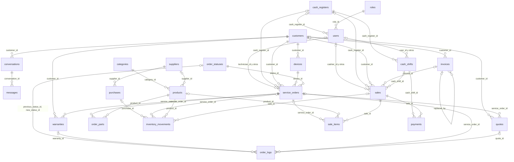
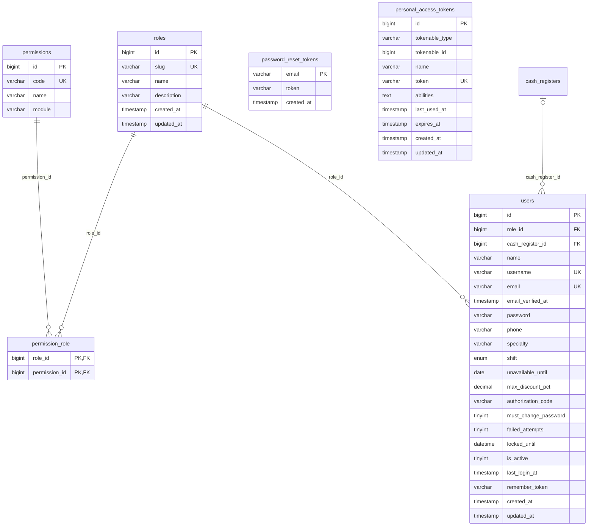
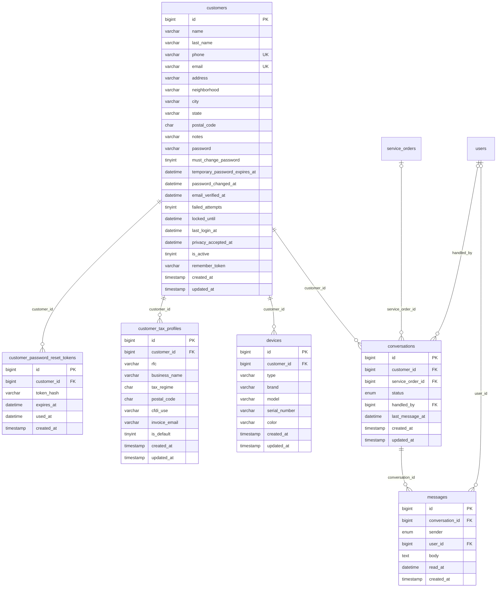
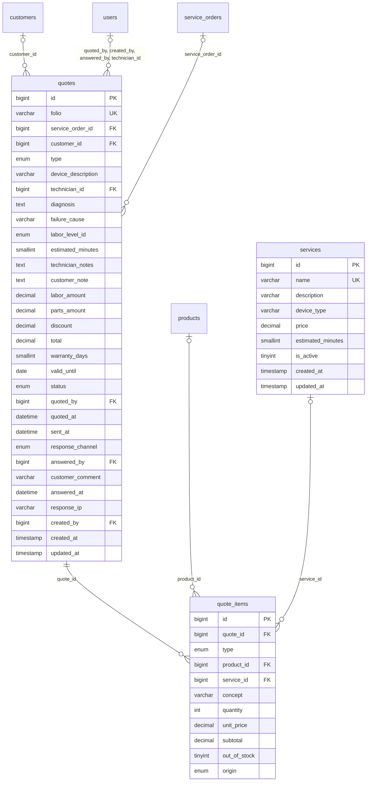
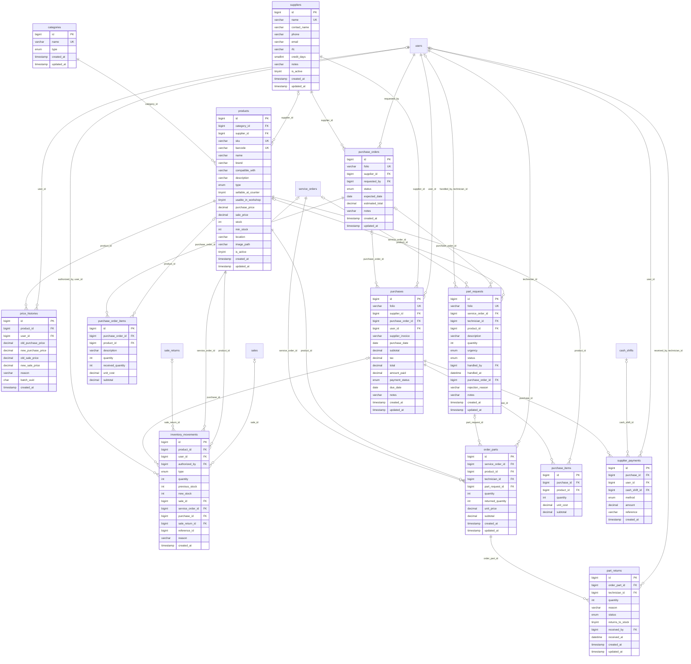
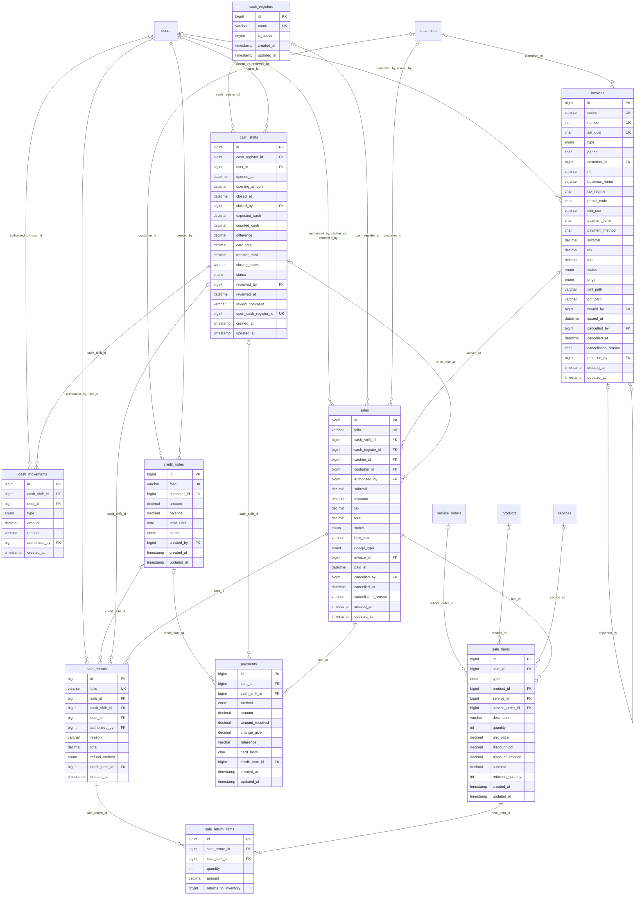
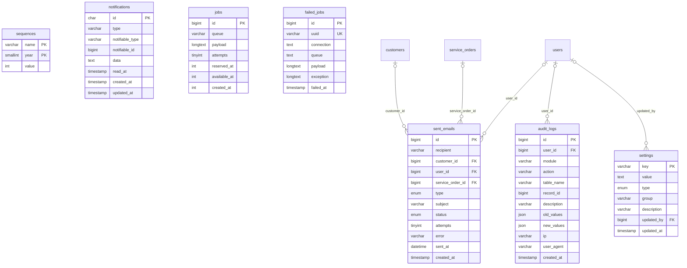

# ⚙️ SHURI · Backend (API REST)

**Laravel 10 · PHP 8.1+ · MySQL 8.0 · Laravel Sanctum**

Documentación técnica del backend: modelo de datos completo, diccionario de datos e instalación.
Responsable: **Brisa Luna** (Backend & DBA). ← [Volver al README principal](../README.md)

## Índice

1. [Diagrama entidad-relación](#1-diagrama-entidad-relación)
2. [Diccionario de datos](#2-diccionario-de-datos)
3. [Reglas de integridad](#3-reglas-de-integridad)
4. [Instalación](#4-instalación)

---

## 1. Diagrama entidad-relación

Base de datos `shuri_db`: **51 tablas** organizadas en 7 módulos. Primero, un mapa general; después, un diagrama por módulo con todas sus columnas.

**Cómo leer las líneas:**

| Símbolo | Significado |
|---|---|
| `\|\|--o{` | Uno a muchos **obligatorio**: el registro hijo siempre pertenece a uno del padre (ej. todo equipo tiene un cliente dueño). |
| `\|o--o{` | Uno a muchos **opcional**: el hijo puede o no estar ligado al padre (ej. una venta puede no tener cliente). |

El texto sobre cada línea es la columna (llave foránea) que hace la conexión. **PK** = llave primaria, **FK** = llave foránea, **UK** = valor único.

### Mapa general

Vista simplificada con las tablas principales y cómo se conectan.



### Diagrama: Seguridad y personal

Usuarios internos (Administrador, Jefe de Técnicos, Técnico, Cajera), sus roles y permisos.



### Diagrama: Clientes y portal

Clientes finales, su acceso al portal (correo + contraseña temporal enviada por correo), sus conversaciones del chat, sus equipos y datos fiscales.



### Diagrama: Taller (órdenes de servicio)

Ciclo de vida de una reparación: recepción, asignación, diagnóstico, resguardo, entrega, abandono y garantía.



```mermaid
erDiagram
    order_statuses {
        bigint id PK
        varchar code UK
        varchar name
        varchar customer_message
        char color_hex
        tinyint sort_order
        tinyint portal_step
        tinyint is_final
        tinyint allows_work
        tinyint awaiting_pickup
    }
    service_orders {
        bigint id PK
        varchar folio UK
        bigint customer_id FK
        bigint device_id FK
        bigint status_id FK
        enum priority
        bigint cash_register_id FK
        text reported_issue
        varchar received_accessories
        json intake_checklist
        varchar physical_condition
        varchar device_pin
        text diagnosis
        varchar failure_cause
        enum labor_level_id
        smallint estimated_minutes
        tinyint is_paused
        varchar pause_reason
        varchar no_repair_reason
        decimal estimated_cost
        decimal deposit
        decimal labor_cost
        decimal parts_cost
        decimal total
        tinyint is_paid
        bigint received_by FK
        bigint assigned_by FK
        bigint technician_id FK
        bigint updated_by FK
        enum location
        datetime sent_to_storage_at
        tinyint storage_fee_waived
        bigint waived_by FK
        varchar waiver_reason
        decimal storage_fee
        smallint warranty_days
        date warranty_until
        bigint delivered_by FK
        varchar picked_up_by_name
        varchar picked_up_id_number
        varchar picked_up_relationship
        tinyint rating
        varchar rating_comment
        datetime rated_at
        date promised_date
        datetime assigned_at
        datetime quoting_started_at
        datetime approved_at
        datetime ready_at
        datetime delivered_at
        datetime abandoned_at
        datetime disposed_at
        bigint disposed_by FK
        timestamp created_at
        timestamp updated_at
    }
    order_time_logs {
        bigint id PK
        bigint service_order_id FK
        bigint technician_id FK
        enum type
        datetime starts_at
        datetime ends_at
        varchar pause_reason
        int minutes
        bigint active_technician_id UK
    }
    order_files {
        bigint id PK
        bigint service_order_id FK
        bigint quote_id FK
        bigint warranty_id FK
        bigint user_id FK
        enum type
        varchar path
        varchar original_name
        varchar mime_type
        int size_bytes
        tinyint visible_to_customer
        timestamp created_at
    }
    order_logs {
        bigint id PK
        bigint service_order_id FK
        bigint user_id FK
        enum type
        bigint previous_status_id FK
        bigint new_status_id FK
        bigint quote_id FK
        bigint warranty_id FK
        text description
        tinyint visible_to_customer
        timestamp created_at
    }
    warranties {
        bigint id PK
        varchar folio UK
        bigint service_order_id FK
        bigint customer_id FK
        enum request_channel
        text customer_reason
        enum status
        bigint received_by FK
        datetime received_at
        bigint technician_id FK
        text technician_review
        enum ruling
        bigint ruled_by FK
        datetime ruled_at
        varchar ruling_reason
        decimal extra_cost
        tinyint extra_cost_accepted
        datetime answered_at
        datetime finished_at
        bigint delivered_by FK
        datetime delivered_at
        timestamp created_at
        timestamp updated_at
    }
    users |o--o{ service_orders : "updated_by, assigned_by, waived_by, disposed_by, delivered_by, received_by, technician_id"
    cash_registers |o--o{ service_orders : "cash_register_id"
    customers ||--o{ service_orders : "customer_id"
    devices ||--o{ service_orders : "device_id"
    order_statuses ||--o{ service_orders : "status_id"
    service_orders ||--o{ order_time_logs : "service_order_id"
    users ||--o{ order_time_logs : "technician_id"
    warranties |o--o{ order_files : "warranty_id"
    service_orders ||--o{ order_files : "service_order_id"
    quotes |o--o{ order_files : "quote_id"
    users |o--o{ order_files : "user_id"
    order_statuses |o--o{ order_logs : "previous_status_id, new_status_id"
    warranties |o--o{ order_logs : "warranty_id"
    service_orders ||--o{ order_logs : "service_order_id"
    quotes |o--o{ order_logs : "quote_id"
    users |o--o{ order_logs : "user_id"
    customers ||--o{ warranties : "customer_id"
    users |o--o{ warranties : "ruled_by, delivered_by, received_by, technician_id"
    service_orders ||--o{ warranties : "service_order_id"
```

### Diagrama: Cotización y presupuestos

El técnico propone, el Jefe de Técnicos cotiza y el cliente aprueba o rechaza.



### Diagrama: Inventario, refacciones y compras

Catálogo de productos, existencias, movimientos de stock, refacciones usadas en taller y compras a proveedores.



### Diagrama: Caja y punto de venta

Turnos de caja, ventas de mostrador, cobro de reparaciones, pagos, devoluciones y facturas.



### Diagrama: Sistema, notificaciones y auditoría

Configuración, folios, correos enviados, notificaciones internas, colas de Laravel y registro de auditoría.



---

## 2. Diccionario de datos

Explicación columna por columna. **Obligatorio** indica si el dato siempre debe capturarse; *Automático* = lo llena la base de datos. Convenciones: los importes son **dinero en pesos con 2 decimales**; los precios al público **incluyen IVA**; las contraseñas se guardan **cifradas con bcrypt**, nunca en texto plano.

| Módulo | Tablas |
|---|---|
| [2.1 Seguridad y personal](#21-seguridad-y-personal) | `roles`, `permissions`, `permission_role`, `users`, `password_reset_tokens`, `personal_access_tokens` |
| [2.2 Clientes y portal](#22-clientes-y-portal) | `customers`, `customer_password_reset_tokens`, `customer_tax_profiles`, `devices`, `conversations`, `messages` |
| [2.3 Taller](#23-taller-órdenes-de-servicio) | `order_statuses`, `service_orders`, `order_time_logs`, `order_files`, `order_logs`, `warranties` |
| [2.4 Cotización y presupuestos](#24-cotización-y-presupuestos) | `quotes`, `quote_items`, `services` |
| [2.5 Inventario, refacciones y compras](#25-inventario-refacciones-y-compras) | `categories`, `products`, `price_histories`, `inventory_movements`, `order_parts`, `part_requests`, `part_returns`, `suppliers`, `purchase_orders`, `purchase_order_items`, `purchases`, `purchase_items`, `supplier_payments` |
| [2.6 Caja y punto de venta](#26-caja-y-punto-de-venta) | `cash_registers`, `cash_shifts`, `cash_movements`, `sales`, `sale_items`, `payments`, `sale_returns`, `sale_return_items`, `credit_notes`, `invoices` |
| [2.7 Sistema, notificaciones y auditoría](#27-sistema-notificaciones-y-auditoría) | `settings`, `sequences`, `sent_emails`, `notifications`, `jobs`, `failed_jobs`, `audit_logs` |

### 2.1 Seguridad y personal

Usuarios internos (Administrador, Jefe de Técnicos, Técnico, Cajera), sus roles y permisos.

##### `roles`

Catálogo de los 4 roles internos del sistema.

| Columna | Tipo (MySQL) | Qué guarda | Obligatorio | Por defecto | Llave | Descripción |
|---|---|---|---|---|---|---|
| `id` | `bigint unsigned` | Número entero (se genera solo) | Automático |  | PK | Identificador único del registro. |
| `slug` | `varchar(30)` | Texto (letras y números), hasta 30 caracteres | Sí |  | Único | Clave interna del rol (admin, jefe_tecnicos, tecnico, cajera). |
| `name` | `varchar(50)` | Texto (letras y números), hasta 50 caracteres | Sí |  |  | Nombre visible del rol. |
| `description` | `varchar(255)` | Texto (letras y números), hasta 255 caracteres | No |  |  | Explicación breve de lo que hace el rol. |
| `created_at` | `timestamp` | Fecha y hora | No |  |  | Fecha y hora en que se creó el registro. |
| `updated_at` | `timestamp` | Fecha y hora | No |  |  | Fecha y hora de la última modificación. |

##### `permissions`

Acciones que se pueden permitir o negar (ej. "Aplicar descuentos").

| Columna | Tipo (MySQL) | Qué guarda | Obligatorio | Por defecto | Llave | Descripción |
|---|---|---|---|---|---|---|
| `id` | `bigint unsigned` | Número entero (se genera solo) | Automático |  | PK | Identificador único del registro. |
| `code` | `varchar(60)` | Texto (letras y números), hasta 60 caracteres | Sí |  | Único | Clave interna del permiso (ej. pos.descuento). |
| `name` | `varchar(120)` | Texto (letras y números), hasta 120 caracteres | Sí |  |  | Nombre visible del permiso. |
| `module` | `varchar(40)` | Texto (letras y números), hasta 40 caracteres | Sí |  |  | Módulo al que pertenece (caja, taller, inventario…). |

##### `permission_role`

Qué permisos tiene cada rol (relación muchos a muchos).

| Columna | Tipo (MySQL) | Qué guarda | Obligatorio | Por defecto | Llave | Descripción |
|---|---|---|---|---|---|---|
| `role_id` | `bigint unsigned` | Número entero (id de `roles`) | Sí |  | PK, FK → `roles` | Rol que recibe el permiso. |
| `permission_id` | `bigint unsigned` | Número entero (id de `permissions`) | Sí |  | PK, FK → `permissions` | Permiso otorgado. |

##### `users`

Personal interno que inicia sesión en el sistema.

| Columna | Tipo (MySQL) | Qué guarda | Obligatorio | Por defecto | Llave | Descripción |
|---|---|---|---|---|---|---|
| `id` | `bigint unsigned` | Número entero (se genera solo) | Automático |  | PK | Identificador único del registro. |
| `role_id` | `bigint unsigned` | Número entero (id de `roles`) | Sí |  | FK → `roles` | Rol del usuario (Administrador, Jefe, Técnico o Cajera). |
| `cash_register_id` | `bigint unsigned` | Número entero (id de `cash_registers`) | No |  | FK → `cash_registers` | Caja asignada (solo cajeras). |
| `name` | `varchar(150)` | Texto (letras y números), hasta 150 caracteres | Sí |  |  | Nombre completo del empleado. |
| `username` | `varchar(40)` | Texto (letras y números), hasta 40 caracteres | Sí |  | Único | Nombre de usuario para iniciar sesión. No se repite. |
| `email` | `varchar(150)` | Texto con formato de correo, hasta 150 caracteres | Sí |  | Único | Correo del empleado. No se repite. |
| `email_verified_at` | `timestamp` | Fecha y hora | No |  |  | Fecha en que verificó su correo. |
| `password` | `varchar(255)` | Texto cifrado (no se puede leer a simple vista) | Sí |  |  | Contraseña cifrada con bcrypt (nunca en texto plano). |
| `phone` | `varchar(10)` | Texto de 10 dígitos numéricos | No |  |  | Teléfono del empleado, 10 dígitos. |
| `specialty` | `varchar(100)` | Texto (letras y números), hasta 100 caracteres | No |  |  | Especialidad del técnico (ej. "iPhone y microsoldadura"). |
| `shift` | `enum('matutino','vespertino','completo')` | Lista de opciones: matutino, vespertino, completo | No |  |  | Turno de trabajo. |
| `unavailable_until` | `date` | Fecha (AAAA-MM-DD) | No |  |  | Día en que el empleado se marcó «no disponible hoy». Si es la fecha actual, no recibe asignaciones y el chat avisa al cliente que el jefe no está disponible. |
| `max_discount_pct` | `decimal(5,2)` | Porcentaje con 2 decimales | Sí | `0.00` |  | Porcentaje máximo de descuento que puede aplicar sin autorización (0 a 20; el administrador no puede asignar más del 20 %). |
| `authorization_code` | `varchar(255)` | Texto cifrado (no se puede leer a simple vista) | No |  |  | Clave cifrada para autorizar descuentos o cancelaciones. |
| `must_change_password` | `tinyint(1)` | Sí / No (1 = sí, 0 = no) | Sí | Sí (1) |  | Sí = tiene contraseña temporal y debe cambiarla al entrar. |
| `failed_attempts` | `tinyint unsigned` | Número entero pequeño (0 a 255) | Sí | `0` |  | Intentos de inicio de sesión fallidos seguidos. |
| `locked_until` | `datetime` | Fecha y hora | No |  |  | Hasta cuándo está bloqueado por intentos fallidos. |
| `is_active` | `tinyint(1)` | Sí / No (1 = sí, 0 = no) | Sí | Sí (1) |  | Sí = puede entrar; No = dado de baja (no se borra). |
| `last_login_at` | `timestamp` | Fecha y hora | No |  |  | Última vez que inició sesión. |
| `remember_token` | `varchar(100)` | Texto cifrado (no se puede leer a simple vista) | No |  |  | Token de Laravel para "recordarme". |
| `created_at` | `timestamp` | Fecha y hora | No |  |  | Fecha y hora en que se creó el registro. |
| `updated_at` | `timestamp` | Fecha y hora | No |  |  | Fecha y hora de la última modificación. |

##### `password_reset_tokens`

Tokens de Laravel para que el personal restablezca su contraseña.

| Columna | Tipo (MySQL) | Qué guarda | Obligatorio | Por defecto | Llave | Descripción |
|---|---|---|---|---|---|---|
| `email` | `varchar(150)` | Texto con formato de correo, hasta 150 caracteres | Sí |  | PK | Correo del empleado que pidió restablecer contraseña. |
| `token` | `varchar(255)` | Texto cifrado (no se puede leer a simple vista) | Sí |  |  | Token cifrado de restablecimiento. |
| `created_at` | `timestamp` | Fecha y hora | No |  |  | Fecha y hora en que se creó el registro. |

##### `personal_access_tokens`

Tokens de sesión de Laravel Sanctum (personal y clientes).

| Columna | Tipo (MySQL) | Qué guarda | Obligatorio | Por defecto | Llave | Descripción |
|---|---|---|---|---|---|---|
| `id` | `bigint unsigned` | Número entero (se genera solo) | Automático |  | PK | Identificador único del registro. |
| `tokenable_type` | `varchar(255)` | Texto cifrado (no se puede leer a simple vista) | Sí |  |  | Tipo de dueño del token (User o Cliente). |
| `tokenable_id` | `bigint unsigned` | Número entero | Sí |  |  | Id del usuario o cliente dueño del token. |
| `name` | `varchar(255)` | Texto (letras y números), hasta 255 caracteres | Sí |  |  | Nombre del token (ej. "portal", "spa"). |
| `token` | `varchar(64)` | Texto cifrado (no se puede leer a simple vista) | Sí |  | Único | Token cifrado (hash SHA-256). |
| `abilities` | `text` | Texto largo | No |  |  | Permisos del token. |
| `last_used_at` | `timestamp` | Fecha y hora | No |  |  | Última vez que se usó. |
| `expires_at` | `timestamp` | Fecha y hora | No |  |  | Fecha de expiración. |
| `created_at` | `timestamp` | Fecha y hora | No |  |  | Fecha y hora en que se creó el registro. |
| `updated_at` | `timestamp` | Fecha y hora | No |  |  | Fecha y hora de la última modificación. |

### 2.2 Clientes y portal

Clientes finales, su acceso al portal (correo + contraseña temporal enviada por correo), sus conversaciones del chat, sus equipos y datos fiscales.

##### `customers`

Clientes finales. El **correo** es su usuario del portal.

| Columna | Tipo (MySQL) | Qué guarda | Obligatorio | Por defecto | Llave | Descripción |
|---|---|---|---|---|---|---|
| `id` | `bigint unsigned` | Número entero (se genera solo) | Automático |  | PK | Identificador único del registro. |
| `name` | `varchar(100)` | Texto (letras y números), hasta 100 caracteres | Sí |  |  | Nombre(s) del cliente. |
| `last_name` | `varchar(100)` | Texto (letras y números), hasta 100 caracteres | No |  |  | Apellidos del cliente. |
| `phone` | `varchar(10)` | Texto de 10 dígitos numéricos | Sí |  | Único | Teléfono del cliente, exactamente 10 dígitos. No se repite. |
| `email` | `varchar(150)` | Texto con formato de correo, hasta 150 caracteres | Sí |  | Único | Correo del cliente (obligatorio, no se repite). Es su USUARIO del portal y ahí se le envía la contraseña temporal. |
| `address` | `varchar(200)` | Texto (letras y números), hasta 200 caracteres | No |  |  | Calle y número. |
| `neighborhood` | `varchar(100)` | Texto (letras y números), hasta 100 caracteres | No |  |  | Colonia. |
| `city` | `varchar(100)` | Texto (letras y números), hasta 100 caracteres | No |  |  | Ciudad o municipio. |
| `state` | `varchar(60)` | Texto (letras y números), hasta 60 caracteres | No |  |  | Estado de la república. |
| `postal_code` | `char(5)` | Texto de 5 dígitos numéricos | No |  |  | Código postal de 5 dígitos. |
| `notes` | `varchar(255)` | Texto (letras y números), hasta 255 caracteres | No |  |  | Observaciones internas sobre el cliente. |
| `password` | `varchar(255)` | Texto cifrado (no se puede leer a simple vista) | No |  |  | Contraseña del portal cifrada con bcrypt. Vacío = aún sin acceso. |
| `must_change_password` | `tinyint(1)` | Sí / No (1 = sí, 0 = no) | Sí | Sí (1) |  | Sí = usa la contraseña temporal del correo y debe cambiarla al entrar. |
| `temporary_password_expires_at` | `datetime` | Fecha y hora | No |  |  | Hasta cuándo sirve la contraseña temporal. |
| `password_changed_at` | `datetime` | Fecha y hora | No |  |  | Cuándo puso su propia contraseña. |
| `email_verified_at` | `datetime` | Fecha y hora | No |  |  | Cuándo se confirmó su correo (primer acceso correcto). |
| `failed_attempts` | `tinyint unsigned` | Número entero pequeño (0 a 255) | Sí | `0` |  | Intentos de acceso al portal fallidos seguidos. |
| `locked_until` | `datetime` | Fecha y hora | No |  |  | Hasta cuándo está bloqueado el acceso al portal. |
| `last_login_at` | `datetime` | Fecha y hora | No |  |  | Última vez que entró al portal. |
| `privacy_accepted_at` | `datetime` | Fecha y hora | No |  |  | Cuándo aceptó el aviso de privacidad. |
| `is_active` | `tinyint(1)` | Sí / No (1 = sí, 0 = no) | Sí | Sí (1) |  | Sí = cliente activo. |
| `remember_token` | `varchar(100)` | Texto cifrado (no se puede leer a simple vista) | No |  |  | Token de Laravel para "recordarme". |
| `created_at` | `timestamp` | Fecha y hora | No |  |  | Fecha y hora en que se creó el registro. |
| `updated_at` | `timestamp` | Fecha y hora | No |  |  | Fecha y hora de la última modificación. |

##### `customer_password_reset_tokens`

Solicitudes de "Recuperar contraseña" del portal del cliente.

| Columna | Tipo (MySQL) | Qué guarda | Obligatorio | Por defecto | Llave | Descripción |
|---|---|---|---|---|---|---|
| `id` | `bigint unsigned` | Número entero (se genera solo) | Automático |  | PK | Identificador único del registro. |
| `customer_id` | `bigint unsigned` | Número entero (id de `customers`) | Sí |  | FK → `customers` | Cliente que pidió recuperar su contraseña. |
| `token_hash` | `varchar(255)` | Texto cifrado (no se puede leer a simple vista) | Sí |  |  | Token cifrado enviado por correo. |
| `expires_at` | `datetime` | Fecha y hora | Sí |  |  | Hasta cuándo es válido el token. |
| `used_at` | `datetime` | Fecha y hora | No |  |  | Cuándo se usó (vacío = no usado). |
| `created_at` | `timestamp` | Fecha y hora · se calcula automáticamente | Automático | Fecha actual |  | Fecha y hora en que se creó el registro. |

##### `customer_tax_profiles`

Datos para facturar a un cliente (RFC, razón social, etc.).

| Columna | Tipo (MySQL) | Qué guarda | Obligatorio | Por defecto | Llave | Descripción |
|---|---|---|---|---|---|---|
| `id` | `bigint unsigned` | Número entero (se genera solo) | Automático |  | PK | Identificador único del registro. |
| `customer_id` | `bigint unsigned` | Número entero (id de `customers`) | Sí |  | FK → `customers` | Cliente dueño de los datos fiscales. |
| `rfc` | `varchar(13)` | Texto (letras y números), hasta 13 caracteres | Sí |  |  | RFC (12 o 13 caracteres). |
| `business_name` | `varchar(200)` | Texto (letras y números), hasta 200 caracteres | Sí |  |  | Nombre o razón social para la factura. |
| `tax_regime` | `char(3)` | Texto de exactamente 3 caracteres | Sí |  |  | Clave del régimen fiscal del SAT (3 dígitos). |
| `postal_code` | `char(5)` | Texto de 5 dígitos numéricos | Sí |  |  | Código postal fiscal (5 dígitos). |
| `cfdi_use` | `varchar(4)` | Texto (letras y números), hasta 4 caracteres | Sí | `G03` |  | Clave de uso de CFDI del SAT (ej. G03). |
| `invoice_email` | `varchar(150)` | Texto con formato de correo, hasta 150 caracteres | No |  |  | Correo al que se envía la factura. |
| `is_default` | `tinyint(1)` | Sí / No (1 = sí, 0 = no) | Sí | Sí (1) |  | Sí = son los datos que se usan por defecto. |
| `created_at` | `timestamp` | Fecha y hora | No |  |  | Fecha y hora en que se creó el registro. |
| `updated_at` | `timestamp` | Fecha y hora | No |  |  | Fecha y hora de la última modificación. |

##### `devices`

Dispositivos de los clientes (celulares, laptops, etc.).

| Columna | Tipo (MySQL) | Qué guarda | Obligatorio | Por defecto | Llave | Descripción |
|---|---|---|---|---|---|---|
| `id` | `bigint unsigned` | Número entero (se genera solo) | Automático |  | PK | Identificador único del registro. |
| `customer_id` | `bigint unsigned` | Número entero (id de `customers`) | Sí |  | FK → `customers` | Cliente dueño del equipo. |
| `type` | `varchar(40)` | Texto (letras y números), hasta 40 caracteres | Sí |  |  | Tipo de equipo (Teléfono celular, Laptop, Tablet…). |
| `brand` | `varchar(60)` | Texto (letras y números), hasta 60 caracteres | Sí |  |  | Marca (Apple, Samsung, HP…). |
| `model` | `varchar(80)` | Texto (letras y números), hasta 80 caracteres | No |  |  | Modelo (iPhone 11, Galaxy A54…). |
| `serial_number` | `varchar(80)` | Texto (letras y números), hasta 80 caracteres | No |  |  | IMEI o número de serie. |
| `color` | `varchar(40)` | Texto (letras y números), hasta 40 caracteres | No |  |  | Color del equipo. |
| `created_at` | `timestamp` | Fecha y hora | No |  |  | Fecha y hora en que se creó el registro. |
| `updated_at` | `timestamp` | Fecha y hora | No |  |  | Fecha y hora de la última modificación. |

##### `conversations`

Chat del portal entre el cliente y el Jefe de Técnicos (pantallas P5 y J11).

| Columna | Tipo (MySQL) | Qué guarda | Obligatorio | Por defecto | Llave | Descripción |
|---|---|---|---|---|---|---|
| `id` | `bigint unsigned` | Número entero (se genera solo) | Automático |  | PK | Identificador único del registro. |
| `customer_id` | `bigint unsigned` | Número entero (id de `customers`) | Sí |  | FK → `customers` | Cliente que inició la conversación. |
| `service_order_id` | `bigint unsigned` | Número entero (id de `service_orders`) | No |  | FK → `service_orders` | Orden sobre la que pregunta (vacío = consulta general). |
| `status` | `enum('abierta','cerrada')` | Lista de opciones: abierta, cerrada | Sí | `abierta` |  | Estado de la conversación. |
| `handled_by` | `bigint unsigned` | Número entero (id de `users`) | No |  | FK → `users` | Jefe de Técnicos que atiende la conversación. |
| `last_message_at` | `datetime` | Fecha y hora | No |  |  | Fecha del último mensaje; ordena la bandeja del jefe. |
| `created_at` | `timestamp` | Fecha y hora | No |  |  | Fecha y hora en que se creó el registro. |
| `updated_at` | `timestamp` | Fecha y hora | No |  |  | Fecha y hora de la última modificación. |

##### `messages`

Cada mensaje escrito en una conversación. Solo inserción: los mensajes no se editan ni se borran.

| Columna | Tipo (MySQL) | Qué guarda | Obligatorio | Por defecto | Llave | Descripción |
|---|---|---|---|---|---|---|
| `id` | `bigint unsigned` | Número entero (se genera solo) | Automático |  | PK | Identificador único del registro. |
| `conversation_id` | `bigint unsigned` | Número entero (id de `conversations`) | Sí |  | FK → `conversations` | Conversación a la que pertenece. |
| `sender` | `enum('cliente','personal')` | Lista de opciones: cliente, personal | Sí |  |  | Quién escribió el mensaje. |
| `user_id` | `bigint unsigned` | Número entero (id de `users`) | No |  | FK → `users` | Empleado que respondió (vacío = lo escribió el cliente). |
| `body` | `text` | Texto largo | Sí |  |  | Contenido del mensaje. |
| `read_at` | `datetime` | Fecha y hora | No |  |  | Cuándo lo leyó el destinatario (vacío = no leído). |
| `created_at` | `timestamp` | Fecha y hora · se calcula automáticamente | Automático | Fecha actual |  | Fecha y hora en que se envió. |

### 2.3 Taller (órdenes de servicio)

Ciclo de vida de una reparación: recepción, asignación, diagnóstico, resguardo, entrega, abandono y garantía.

##### `order_statuses`

Catálogo de estados por los que pasa una orden de servicio.

| Columna | Tipo (MySQL) | Qué guarda | Obligatorio | Por defecto | Llave | Descripción |
|---|---|---|---|---|---|---|
| `id` | `bigint unsigned` | Número entero | Sí |  | PK | Identificador del estado (fijo, no autoincrementable). |
| `code` | `varchar(40)` | Texto (letras y números), hasta 40 caracteres | Sí |  | Único | Clave interna (recibido, en_cotizacion, en_abandono…). |
| `name` | `varchar(60)` | Texto (letras y números), hasta 60 caracteres | Sí |  |  | Nombre visible del estado. |
| `customer_message` | `varchar(255)` | Texto (letras y números), hasta 255 caracteres | Sí |  |  | Mensaje que ve el cliente en el portal. |
| `color_hex` | `char(7)` | Texto de 7 caracteres (#RRGGBB) | Sí |  |  | Color del estado en formato #RRGGBB. |
| `sort_order` | `tinyint unsigned` | Número entero pequeño (0 a 255) | Sí |  |  | Posición del estado en el flujo. |
| `portal_step` | `tinyint unsigned` | Número entero pequeño (0 a 255) | Sí | `0` |  | Paso del 1 al 6 en la barra de avance del portal (0 = no aplica). |
| `is_final` | `tinyint(1)` | Sí / No (1 = sí, 0 = no) | Sí | No (0) |  | Sí = la orden ya no puede cambiar de estado. |
| `allows_work` | `tinyint(1)` | Sí / No (1 = sí, 0 = no) | Sí | Sí (1) |  | Sí = el técnico puede trabajar la orden en este estado. |
| `awaiting_pickup` | `tinyint(1)` | Sí / No (1 = sí, 0 = no) | Sí | No (0) |  | Sí = corre el tiempo de resguardo (7 días de gracia, 90 para abandono). |

##### `service_orders`

Cada equipo recibido para reparación (orden con folio único).

| Columna | Tipo (MySQL) | Qué guarda | Obligatorio | Por defecto | Llave | Descripción |
|---|---|---|---|---|---|---|
| `id` | `bigint unsigned` | Número entero (se genera solo) | Automático |  | PK | Identificador único del registro. |
| `folio` | `varchar(20)` | Texto (letras y números), hasta 20 caracteres | Sí |  | Único | Folio único de la orden (letras y números, ej. SH26-00001). Se imprime y sirve para consultar. |
| `customer_id` | `bigint unsigned` | Número entero (id de `customers`) | Sí |  | FK → `customers` | Cliente que dejó el equipo. |
| `device_id` | `bigint unsigned` | Número entero (id de `devices`) | Sí |  | FK → `devices` | Equipo que se va a reparar. |
| `status_id` | `bigint unsigned` | Número entero (id de `order_statuses`) | Sí | `1` | FK → `order_statuses` | Estado actual de la orden. |
| `priority` | `enum('baja','normal','alta','urgente')` | Lista de opciones: baja, normal, alta, urgente | Sí | `normal` |  | Prioridad de la reparación. |
| `cash_register_id` | `bigint unsigned` | Número entero (id de `cash_registers`) | No |  | FK → `cash_registers` | Caja donde se recibió el equipo. |
| `reported_issue` | `text` | Texto largo | Sí |  |  | Falla que describe el cliente. |
| `received_accessories` | `varchar(255)` | Texto (letras y números), hasta 255 caracteres | No |  |  | Accesorios que dejó el cliente (funda, cargador…). |
| `intake_checklist` | `json` | Datos estructurados (JSON) | No |  |  | Revisión física al recibir (enciende, pantalla, cámara…). |
| `physical_condition` | `varchar(255)` | Texto (letras y números), hasta 255 caracteres | No |  |  | Descripción del estado físico al recibir (golpes, rayones). |
| `device_pin` | `varchar(512)` | Texto cifrado (no se puede leer a simple vista) | No |  |  | PIN o patrón de desbloqueo, CIFRADO. No se imprime. |
| `diagnosis` | `text` | Texto largo | No |  |  | Diagnóstico del técnico. |
| `failure_cause` | `varchar(120)` | Texto (letras y números), hasta 120 caracteres | No |  |  | Causa de la falla (golpe, humedad, desgaste…). |
| `labor_level_id` | `enum('baja','media','alta')` | Lista de opciones: baja, media, alta | No |  |  | Dificultad estimada de la reparación. |
| `estimated_minutes` | `smallint unsigned` | Número entero | No |  |  | Tiempo estimado de reparación en minutos. |
| `is_paused` | `tinyint(1)` | Sí / No (1 = sí, 0 = no) | Sí | No (0) |  | Sí = el técnico pausó la orden. |
| `pause_reason` | `varchar(255)` | Texto (letras y números), hasta 255 caracteres | No |  |  | Por qué se pausó. |
| `no_repair_reason` | `varchar(255)` | Texto (letras y números), hasta 255 caracteres | No |  |  | Por qué el equipo no tiene reparación. |
| `estimated_cost` | `decimal(10,2)` | Dinero (pesos con 2 decimales) | Sí | `0.00` |  | Costo aproximado que se le dijo al cliente al recibir (dinero). |
| `deposit` | `decimal(10,2)` | Dinero (pesos con 2 decimales) | Sí | `0.00` |  | Dinero que dejó el cliente al recibir. Se cobra como venta. |
| `labor_cost` | `decimal(10,2)` | Dinero (pesos con 2 decimales) | Sí | `0.00` |  | Costo final de mano de obra (dinero). |
| `parts_cost` | `decimal(10,2)` | Dinero (pesos con 2 decimales) | Sí | `0.00` |  | Costo final de refacciones (dinero). |
| `total` | `decimal(10,2)` | Dinero (pesos con 2 decimales) · se calcula automáticamente | Automático |  |  | Mano de obra + refacciones. Se calcula solo. |
| `is_paid` | `tinyint(1)` | Sí / No (1 = sí, 0 = no) | Sí | No (0) |  | Sí = la orden ya se liquidó. |
| `received_by` | `bigint unsigned` | Número entero (id de `users`) | Sí |  | FK → `users` | Cajera que recibió el equipo. |
| `assigned_by` | `bigint unsigned` | Número entero (id de `users`) | No |  | FK → `users` | Jefe de Técnicos que asignó la orden. |
| `technician_id` | `bigint unsigned` | Número entero (id de `users`) | No |  | FK → `users` | Técnico responsable de la reparación. |
| `updated_by` | `bigint unsigned` | Número entero (id de `users`) | No |  | FK → `users` | Último usuario que modificó la orden. |
| `location` | `enum('taller','mostrador','bodega')` | Lista de opciones: taller, mostrador, bodega | Sí | `taller` |  | Dónde está físicamente el equipo. |
| `sent_to_storage_at` | `datetime` | Fecha y hora | No |  |  | Cuándo se envió a bodega. |
| `storage_fee_waived` | `tinyint(1)` | Sí / No (1 = sí, 0 = no) | Sí | No (0) |  | Sí = se perdonó el cobro de almacenaje. |
| `waived_by` | `bigint unsigned` | Número entero (id de `users`) | No |  | FK → `users` | Quién perdonó el almacenaje. |
| `waiver_reason` | `varchar(255)` | Texto (letras y números), hasta 255 caracteres | No |  |  | Por qué se perdonó el almacenaje. |
| `storage_fee` | `decimal(10,2)` | Dinero (pesos con 2 decimales) | Sí | `0.00` |  | Almacenaje cobrado al entregar (dinero). $10 por día después de 7 días de gracia (configurable). |
| `warranty_days` | `smallint unsigned` | Número entero | Sí | `30` |  | Días de garantía de la reparación. |
| `warranty_until` | `date` | Fecha (AAAA-MM-DD) | No |  |  | Fecha en que termina la garantía (se calcula al entregar). |
| `delivered_by` | `bigint unsigned` | Número entero (id de `users`) | No |  | FK → `users` | Cajera que entregó el equipo. |
| `picked_up_by_name` | `varchar(150)` | Texto (letras y números), hasta 150 caracteres | No |  |  | Nombre de quien recogió el equipo (si no fue el cliente). |
| `picked_up_id_number` | `varchar(60)` | Texto (letras y números), hasta 60 caracteres | No |  |  | Identificación de quien recogió. |
| `picked_up_relationship` | `varchar(40)` | Texto (letras y números), hasta 40 caracteres | No |  |  | Parentesco con el cliente de quien recogió. |
| `rating` | `tinyint unsigned` | Número entero pequeño (0 a 255) | No |  |  | Calificación del servicio, de 1 a 5 estrellas. |
| `rating_comment` | `varchar(500)` | Texto (letras y números), hasta 500 caracteres | No |  |  | Comentario del cliente al calificar. |
| `rated_at` | `datetime` | Fecha y hora | No |  |  | Cuándo calificó. |
| `promised_date` | `date` | Fecha (AAAA-MM-DD) | No |  |  | Fecha prometida de entrega. |
| `assigned_at` | `datetime` | Fecha y hora | No |  |  | Cuándo se asignó a un técnico. |
| `quoting_started_at` | `datetime` | Fecha y hora | No |  |  | Cuándo entró a "En Cotización". |
| `approved_at` | `datetime` | Fecha y hora | No |  |  | Cuándo el cliente aprobó el presupuesto. |
| `ready_at` | `datetime` | Fecha y hora | No |  |  | Cuándo quedó lista para recoger. Desde aquí corre el resguardo. |
| `delivered_at` | `datetime` | Fecha y hora | No |  |  | Cuándo se entregó al cliente. |
| `abandoned_at` | `datetime` | Fecha y hora | No |  |  | Cuándo pasó a "En Abandono" (90 días sin recoger). |
| `disposed_at` | `datetime` | Fecha y hora | No |  |  | Cuándo salió físicamente a desecho electrónico. |
| `disposed_by` | `bigint unsigned` | Número entero (id de `users`) | No |  | FK → `users` | Quién registró el desecho. |
| `created_at` | `timestamp` | Fecha y hora | No |  |  | Fecha y hora en que se creó el registro. |
| `updated_at` | `timestamp` | Fecha y hora | No |  |  | Fecha y hora de la última modificación. |

##### `order_time_logs`

Cronómetro de trabajo del técnico por orden, incluidas las pausas.

| Columna | Tipo (MySQL) | Qué guarda | Obligatorio | Por defecto | Llave | Descripción |
|---|---|---|---|---|---|---|
| `id` | `bigint unsigned` | Número entero (se genera solo) | Automático |  | PK | Identificador único del registro. |
| `service_order_id` | `bigint unsigned` | Número entero (id de `service_orders`) | Sí |  | FK → `service_orders` | Orden que se está trabajando. |
| `technician_id` | `bigint unsigned` | Número entero (id de `users`) | Sí |  | FK → `users` | Técnico que trabaja. |
| `type` | `enum('diagnostico','reparacion','garantia')` | Lista de opciones: diagnostico, reparacion, garantia | Sí | `reparacion` |  | Tipo de trabajo. |
| `starts_at` | `datetime` | Fecha y hora | Sí |  |  | Cuándo empezó a trabajar. |
| `ends_at` | `datetime` | Fecha y hora | No |  |  | Cuándo terminó o pausó (vacío = en curso). |
| `pause_reason` | `varchar(255)` | Texto (letras y números), hasta 255 caracteres | No |  |  | Por qué pausó. |
| `minutes` | `int` | Número entero · se calcula automáticamente | Automático |  |  | Minutos trabajados. Se calcula solo. |
| `active_technician_id` | `bigint unsigned` | Número entero · se calcula automáticamente | Automático |  | Único | Columna técnica que impide que un técnico tenga dos órdenes en curso. Se calcula sola. |

##### `order_files`

Fotos y archivos de una orden (recepción, evidencia, entrega, garantía).

| Columna | Tipo (MySQL) | Qué guarda | Obligatorio | Por defecto | Llave | Descripción |
|---|---|---|---|---|---|---|
| `id` | `bigint unsigned` | Número entero (se genera solo) | Automático |  | PK | Identificador único del registro. |
| `service_order_id` | `bigint unsigned` | Número entero (id de `service_orders`) | Sí |  | FK → `service_orders` | Orden a la que pertenece el archivo. |
| `quote_id` | `bigint unsigned` | Número entero (id de `quotes`) | No |  | FK → `quotes` | Presupuesto relacionado (opcional). |
| `warranty_id` | `bigint unsigned` | Número entero (id de `warranties`) | No |  | FK → `warranties` | Garantía relacionada (opcional). |
| `user_id` | `bigint unsigned` | Número entero (id de `users`) | No |  | FK → `users` | Quién subió el archivo. |
| `type` | `enum('recepcion','diagnostico','evidencia','presupuesto','entrega','garantia')` | Lista de opciones: recepcion, diagnostico, evidencia, presupuesto, entrega, garantia | Sí |  |  | Momento en que se tomó la foto. |
| `path` | `varchar(255)` | Texto (letras y números), hasta 255 caracteres | Sí |  |  | Ruta del archivo en el servidor. |
| `original_name` | `varchar(150)` | Texto (letras y números), hasta 150 caracteres | No |  |  | Nombre original del archivo. |
| `mime_type` | `varchar(80)` | Texto (letras y números), hasta 80 caracteres | No |  |  | Tipo de archivo (image/jpeg, application/pdf…). |
| `size_bytes` | `int unsigned` | Número entero | No |  |  | Tamaño del archivo en bytes. |
| `visible_to_customer` | `tinyint(1)` | Sí / No (1 = sí, 0 = no) | Sí | No (0) |  | Sí = el cliente lo ve en el portal. |
| `created_at` | `timestamp` | Fecha y hora · se calcula automáticamente | Automático | Fecha actual |  | Fecha y hora en que se creó el registro. |

##### `order_logs`

Historial inmutable de todo lo que pasa en una orden. Alimenta la línea de tiempo del portal.

| Columna | Tipo (MySQL) | Qué guarda | Obligatorio | Por defecto | Llave | Descripción |
|---|---|---|---|---|---|---|
| `id` | `bigint unsigned` | Número entero (se genera solo) | Automático |  | PK | Identificador único del registro. |
| `service_order_id` | `bigint unsigned` | Número entero (id de `service_orders`) | Sí |  | FK → `service_orders` | Orden a la que pertenece el evento. |
| `user_id` | `bigint unsigned` | Número entero (id de `users`) | No |  | FK → `users` | Quién hizo la acción (vacío = cliente o sistema). |
| `type` | `enum('ingreso','cambio_estado','asignacion','diagnostico','cotizacion','nota','refaccion','presupuesto','respuesta_cliente','solicitud_info','pausa','reanudacion','garantia','resguardo','abandono','desecho','entrega','calificacion','correo')` | Lista de opciones: ingreso, cambio_estado, asignacion, diagnostico, cotizacion, nota, refaccion, presupuesto, respuesta_cliente, solicitud_info, pausa, reanudacion, garantia, resguardo, abandono, desecho, entrega, calificacion, correo | Sí |  |  | Tipo de evento. |
| `previous_status_id` | `bigint unsigned` | Número entero (id de `order_statuses`) | No |  | FK → `order_statuses` | Estado antes del cambio. |
| `new_status_id` | `bigint unsigned` | Número entero (id de `order_statuses`) | No |  | FK → `order_statuses` | Estado después del cambio. |
| `quote_id` | `bigint unsigned` | Número entero (id de `quotes`) | No |  | FK → `quotes` | Presupuesto relacionado (opcional). |
| `warranty_id` | `bigint unsigned` | Número entero (id de `warranties`) | No |  | FK → `warranties` | Garantía relacionada (opcional). |
| `description` | `text` | Texto largo | Sí |  |  | Descripción del evento. |
| `visible_to_customer` | `tinyint(1)` | Sí / No (1 = sí, 0 = no) | Sí | No (0) |  | Sí = aparece en la línea de tiempo del portal. |
| `created_at` | `timestamp` | Fecha y hora · se calcula automáticamente | Automático | Fecha actual |  | Fecha y hora en que se creó el registro. |

##### `warranties`

Solicitudes de garantía sobre una reparación ya entregada.

| Columna | Tipo (MySQL) | Qué guarda | Obligatorio | Por defecto | Llave | Descripción |
|---|---|---|---|---|---|---|
| `id` | `bigint unsigned` | Número entero (se genera solo) | Automático |  | PK | Identificador único del registro. |
| `folio` | `varchar(20)` | Texto (letras y números), hasta 20 caracteres | Sí |  | Único | Folio único de la garantía (letras y números). |
| `service_order_id` | `bigint unsigned` | Número entero (id de `service_orders`) | Sí |  | FK → `service_orders` | Orden original que se reclama. |
| `customer_id` | `bigint unsigned` | Número entero (id de `customers`) | Sí |  | FK → `customers` | Cliente que reclama. |
| `request_channel` | `enum('portal','mostrador')` | Lista de opciones: portal, mostrador | Sí |  |  | Por dónde se solicitó. |
| `customer_reason` | `text` | Texto largo | Sí |  |  | Qué falla reporta el cliente. |
| `status` | `enum('solicitada','recibida','en_revision','por_dictaminar','aprobada','rechazada','en_reparacion','terminada','entregada','cancelada')` | Lista de opciones: solicitada, recibida, en_revision, por_dictaminar, aprobada, rechazada, en_reparacion, terminada, entregada, cancelada | Sí | `solicitada` |  | Estado de la garantía. |
| `received_by` | `bigint unsigned` | Número entero (id de `users`) | No |  | FK → `users` | Cajera que recibió el equipo en garantía. |
| `received_at` | `datetime` | Fecha y hora | No |  |  | Cuándo se recibió. |
| `technician_id` | `bigint unsigned` | Número entero (id de `users`) | No |  | FK → `users` | Técnico que revisa. |
| `technician_review` | `text` | Texto largo | No |  |  | Resultado de la revisión del técnico. |
| `ruling` | `enum('procede','no_procede','procede_con_costo')` | Lista de opciones: procede, no_procede, procede_con_costo | No |  |  | Decisión del Jefe de Técnicos. |
| `ruled_by` | `bigint unsigned` | Número entero (id de `users`) | No |  | FK → `users` | Jefe que dictaminó. |
| `ruled_at` | `datetime` | Fecha y hora | No |  |  | Cuándo se dictaminó. |
| `ruling_reason` | `varchar(255)` | Texto (letras y números), hasta 255 caracteres | No |  |  | Explicación del dictamen. |
| `extra_cost` | `decimal(10,2)` | Dinero (pesos con 2 decimales) | Sí | `0.00` |  | Costo adicional si la garantía no cubre todo (dinero). |
| `extra_cost_accepted` | `tinyint(1)` | Sí / No (1 = sí, 0 = no) | No |  |  | Sí/No aceptó el costo extra (vacío = sin respuesta). |
| `answered_at` | `datetime` | Fecha y hora | No |  |  | Cuándo respondió el cliente. |
| `finished_at` | `datetime` | Fecha y hora | No |  |  | Cuándo se terminó la reparación en garantía. |
| `delivered_by` | `bigint unsigned` | Número entero (id de `users`) | No |  | FK → `users` | Quién entregó el equipo. |
| `delivered_at` | `datetime` | Fecha y hora | No |  |  | Cuándo se entregó. |
| `created_at` | `timestamp` | Fecha y hora | No |  |  | Fecha y hora en que se creó el registro. |
| `updated_at` | `timestamp` | Fecha y hora | No |  |  | Fecha y hora de la última modificación. |

### 2.4 Cotización y presupuestos

El técnico propone, el Jefe de Técnicos cotiza y el cliente aprueba o rechaza.

##### `quotes`

Cotizaciones: las que propone el técnico, las que cotiza el jefe y las de mostrador.

| Columna | Tipo (MySQL) | Qué guarda | Obligatorio | Por defecto | Llave | Descripción |
|---|---|---|---|---|---|---|
| `id` | `bigint unsigned` | Número entero (se genera solo) | Automático |  | PK | Identificador único del registro. |
| `folio` | `varchar(20)` | Texto (letras y números), hasta 20 caracteres | Sí |  | Único | Folio único del presupuesto (letras y números, ej. P26-00001). |
| `service_order_id` | `bigint unsigned` | Número entero (id de `service_orders`) | No |  | FK → `service_orders` | Orden cotizada (vacío = presupuesto de mostrador). |
| `customer_id` | `bigint unsigned` | Número entero (id de `customers`) | No |  | FK → `customers` | Cliente al que se le cotiza. |
| `type` | `enum('inicial','adicional','mostrador')` | Lista de opciones: inicial, adicional, mostrador | Sí | `inicial` |  | inicial = primera cotización; adicional = daño nuevo encontrado; mostrador = sin orden. |
| `device_description` | `varchar(150)` | Texto (letras y números), hasta 150 caracteres | No |  |  | Equipo cotizado (solo presupuestos de mostrador). |
| `technician_id` | `bigint unsigned` | Número entero (id de `users`) | No |  | FK → `users` | Técnico que propuso la reparación. |
| `diagnosis` | `text` | Texto largo | No |  |  | Diagnóstico que justifica el presupuesto. |
| `failure_cause` | `varchar(120)` | Texto (letras y números), hasta 120 caracteres | No |  |  | Causa de la falla. |
| `labor_level_id` | `enum('baja','media','alta')` | Lista de opciones: baja, media, alta | No |  |  | Dificultad de la reparación. |
| `estimated_minutes` | `smallint unsigned` | Número entero | No |  |  | Tiempo estimado en minutos. |
| `technician_notes` | `text` | Texto largo | No |  |  | Nota interna del técnico para el jefe. |
| `customer_note` | `text` | Texto largo | No |  |  | Explicación que ve el cliente al aprobar. |
| `labor_amount` | `decimal(10,2)` | Dinero (pesos con 2 decimales) | Sí | `0.00` |  | Total de mano de obra (dinero). |
| `parts_amount` | `decimal(10,2)` | Dinero (pesos con 2 decimales) | Sí | `0.00` |  | Total de refacciones (dinero). |
| `discount` | `decimal(10,2)` | Dinero (pesos con 2 decimales) | Sí | `0.00` |  | Descuento aplicado (dinero). |
| `total` | `decimal(10,2)` | Dinero (pesos con 2 decimales) · se calcula automáticamente | Automático |  |  | Mano de obra + refacciones − descuento. Se calcula solo. |
| `warranty_days` | `smallint unsigned` | Número entero | Sí | `30` |  | Días de garantía ofrecidos. |
| `valid_until` | `date` | Fecha (AAAA-MM-DD) | No |  |  | Fecha hasta la que es válido el precio. |
| `status` | `enum('por_cotizar','pendiente','aprobado','rechazado','vencido','cancelado')` | Lista de opciones: por_cotizar, pendiente, aprobado, rechazado, vencido, cancelado | Sí | `por_cotizar` |  | por_cotizar = espera al jefe; pendiente = espera al cliente; aprobado / rechazado / vencido / cancelado. |
| `quoted_by` | `bigint unsigned` | Número entero (id de `users`) | No |  | FK → `users` | Jefe de Técnicos que puso los precios. |
| `quoted_at` | `datetime` | Fecha y hora | No |  |  | Cuándo se cotizó. |
| `sent_at` | `datetime` | Fecha y hora | No |  |  | Cuándo se envió al cliente. |
| `response_channel` | `enum('portal','mostrador','telefono')` | Lista de opciones: portal, mostrador, telefono | No |  |  | Por dónde respondió el cliente. |
| `answered_by` | `bigint unsigned` | Número entero (id de `users`) | No |  | FK → `users` | Cajera que registró la respuesta (si fue en mostrador o por teléfono). |
| `customer_comment` | `varchar(255)` | Texto (letras y números), hasta 255 caracteres | No |  |  | Comentario del cliente al responder. |
| `answered_at` | `datetime` | Fecha y hora | No |  |  | Cuándo respondió. |
| `response_ip` | `varchar(45)` | Texto (letras y números), hasta 45 caracteres | No |  |  | Dirección IP desde la que respondió en el portal. |
| `created_by` | `bigint unsigned` | Número entero (id de `users`) | No |  | FK → `users` | Usuario que creó el presupuesto. |
| `created_at` | `timestamp` | Fecha y hora | No |  |  | Fecha y hora en que se creó el registro. |
| `updated_at` | `timestamp` | Fecha y hora | No |  |  | Fecha y hora de la última modificación. |

##### `quote_items`

Renglones de un presupuesto (refacciones y mano de obra).

| Columna | Tipo (MySQL) | Qué guarda | Obligatorio | Por defecto | Llave | Descripción |
|---|---|---|---|---|---|---|
| `id` | `bigint unsigned` | Número entero (se genera solo) | Automático |  | PK | Identificador único del registro. |
| `quote_id` | `bigint unsigned` | Número entero (id de `quotes`) | Sí |  | FK → `quotes` | Presupuesto al que pertenece el renglón. |
| `type` | `enum('refaccion','mano_obra','servicio','otro')` | Lista de opciones: refaccion, mano_obra, servicio, otro | Sí | `refaccion` |  | Tipo de concepto. |
| `product_id` | `bigint unsigned` | Número entero (id de `products`) | No |  | FK → `products` | Refacción del catálogo (si aplica). |
| `service_id` | `bigint unsigned` | Número entero (id de `services`) | No |  | FK → `services` | Servicio del tabulador (si aplica). |
| `concept` | `varchar(150)` | Texto (letras y números), hasta 150 caracteres | Sí |  |  | Descripción del concepto. |
| `quantity` | `int` | Número entero | Sí | `1` |  | Cantidad (mayor a 0). |
| `unit_price` | `decimal(10,2)` | Dinero (pesos con 2 decimales) | Sí | `0.00` |  | Precio por unidad (dinero). |
| `subtotal` | `decimal(10,2)` | Dinero (pesos con 2 decimales) · se calcula automáticamente | Automático |  |  | Cantidad × precio. Se calcula solo. |
| `out_of_stock` | `tinyint(1)` | Sí / No (1 = sí, 0 = no) | Sí | No (0) |  | Sí = no hay existencia y hay que pedirla. |
| `origin` | `enum('tecnico','jefe')` | Lista de opciones: tecnico, jefe | Sí | `tecnico` |  | Quién agregó el renglón (técnico o jefe). |

##### `services`

Tabulador de mano de obra y servicios con su precio.

| Columna | Tipo (MySQL) | Qué guarda | Obligatorio | Por defecto | Llave | Descripción |
|---|---|---|---|---|---|---|
| `id` | `bigint unsigned` | Número entero (se genera solo) | Automático |  | PK | Identificador único del registro. |
| `name` | `varchar(120)` | Texto (letras y números), hasta 120 caracteres | Sí |  | Único | Nombre del servicio (no se repite). |
| `description` | `varchar(255)` | Texto (letras y números), hasta 255 caracteres | No |  |  | Descripción del servicio. |
| `device_type` | `varchar(40)` | Texto (letras y números), hasta 40 caracteres | No |  |  | Tipo de equipo al que aplica. |
| `price` | `decimal(10,2)` | Dinero (pesos con 2 decimales) | Sí | `0.00` |  | Precio del servicio (dinero). |
| `estimated_minutes` | `smallint unsigned` | Número entero | No |  |  | Duración estimada en minutos. |
| `is_active` | `tinyint(1)` | Sí / No (1 = sí, 0 = no) | Sí | Sí (1) |  | Sí = se puede usar. |
| `created_at` | `timestamp` | Fecha y hora | No |  |  | Fecha y hora en que se creó el registro. |
| `updated_at` | `timestamp` | Fecha y hora | No |  |  | Fecha y hora de la última modificación. |

### 2.5 Inventario, refacciones y compras

Catálogo de productos, existencias, movimientos de stock, refacciones usadas en taller y compras a proveedores.

##### `categories`

Agrupación de productos (Pantallas, Baterías, Audífonos…).

| Columna | Tipo (MySQL) | Qué guarda | Obligatorio | Por defecto | Llave | Descripción |
|---|---|---|---|---|---|---|
| `id` | `bigint unsigned` | Número entero (se genera solo) | Automático |  | PK | Identificador único del registro. |
| `name` | `varchar(80)` | Texto (letras y números), hasta 80 caracteres | Sí |  | Único | Nombre de la categoría (no se repite). |
| `type` | `enum('refaccion','accesorio','consumible')` | Lista de opciones: refaccion, accesorio, consumible | Sí |  |  | Tipo de producto de la categoría. |
| `created_at` | `timestamp` | Fecha y hora | No |  |  | Fecha y hora en que se creó el registro. |
| `updated_at` | `timestamp` | Fecha y hora | No |  |  | Fecha y hora de la última modificación. |

##### `products`

Catálogo maestro de refacciones, accesorios y consumibles con su existencia.

| Columna | Tipo (MySQL) | Qué guarda | Obligatorio | Por defecto | Llave | Descripción |
|---|---|---|---|---|---|---|
| `id` | `bigint unsigned` | Número entero (se genera solo) | Automático |  | PK | Identificador único del registro. |
| `category_id` | `bigint unsigned` | Número entero (id de `categories`) | Sí |  | FK → `categories` | Categoría del producto. |
| `supplier_id` | `bigint unsigned` | Número entero (id de `suppliers`) | No |  | FK → `suppliers` | Proveedor habitual. |
| `sku` | `varchar(40)` | Texto (letras y números), hasta 40 caracteres | Sí |  | Único | Código interno del producto, letras y números (no se repite). |
| `barcode` | `varchar(50)` | Texto (letras y números), hasta 50 caracteres | No |  | Único | Código de barras para escanear en el POS (no se repite). |
| `name` | `varchar(150)` | Texto (letras y números), hasta 150 caracteres | Sí |  |  | Nombre del producto. |
| `brand` | `varchar(60)` | Texto (letras y números), hasta 60 caracteres | No |  |  | Marca del producto. |
| `compatible_with` | `varchar(150)` | Texto (letras y números), hasta 150 caracteres | No |  |  | Modelos compatibles. |
| `description` | `varchar(255)` | Texto (letras y números), hasta 255 caracteres | No |  |  | Descripción del producto. |
| `type` | `enum('refaccion','accesorio','consumible')` | Lista de opciones: refaccion, accesorio, consumible | Sí |  |  | refaccion = para taller; accesorio = venta; consumible = insumos. |
| `sellable_at_counter` | `tinyint(1)` | Sí / No (1 = sí, 0 = no) | Sí | Sí (1) |  | Sí = aparece en el punto de venta. |
| `usable_in_workshop` | `tinyint(1)` | Sí / No (1 = sí, 0 = no) | Sí | Sí (1) |  | Sí = el técnico lo puede usar en reparaciones. |
| `purchase_price` | `decimal(10,2)` | Dinero (pesos con 2 decimales) | Sí | `0.00` |  | Costo de compra sin IVA (dinero). |
| `sale_price` | `decimal(10,2)` | Dinero (pesos con 2 decimales) | Sí | `0.00` |  | Precio al público con IVA (dinero). |
| `stock` | `int` | Número entero | Sí | `0` |  | Existencia actual. Nunca puede ser negativa. |
| `min_stock` | `int` | Número entero | Sí | `0` |  | Existencia mínima; por debajo aparece alerta de stock bajo. |
| `location` | `varchar(40)` | Texto (letras y números), hasta 40 caracteres | No |  |  | Dónde está guardado (anaquel, cajón). |
| `image_path` | `varchar(255)` | Texto (letras y números), hasta 255 caracteres | No |  |  | Ruta de la imagen del producto. |
| `is_active` | `tinyint(1)` | Sí / No (1 = sí, 0 = no) | Sí | Sí (1) |  | Sí = producto vigente. |
| `created_at` | `timestamp` | Fecha y hora | No |  |  | Fecha y hora en que se creó el registro. |
| `updated_at` | `timestamp` | Fecha y hora | No |  |  | Fecha y hora de la última modificación. |

##### `price_histories`

Registro de cada cambio de costo o precio de un producto.

| Columna | Tipo (MySQL) | Qué guarda | Obligatorio | Por defecto | Llave | Descripción |
|---|---|---|---|---|---|---|
| `id` | `bigint unsigned` | Número entero (se genera solo) | Automático |  | PK | Identificador único del registro. |
| `product_id` | `bigint unsigned` | Número entero (id de `products`) | Sí |  | FK → `products` | Producto que cambió de precio. |
| `user_id` | `bigint unsigned` | Número entero (id de `users`) | Sí |  | FK → `users` | Quién hizo el cambio. |
| `old_purchase_price` | `decimal(10,2)` | Dinero (pesos con 2 decimales) | Sí |  |  | Costo anterior (dinero). |
| `new_purchase_price` | `decimal(10,2)` | Dinero (pesos con 2 decimales) | Sí |  |  | Costo nuevo (dinero). |
| `old_sale_price` | `decimal(10,2)` | Dinero (pesos con 2 decimales) | Sí |  |  | Precio de venta anterior (dinero). |
| `new_sale_price` | `decimal(10,2)` | Dinero (pesos con 2 decimales) | Sí |  |  | Precio de venta nuevo (dinero). |
| `reason` | `varchar(255)` | Texto (letras y números), hasta 255 caracteres | No |  |  | Motivo del cambio. |
| `batch_uuid` | `char(36)` | Texto de exactamente 36 caracteres | No |  |  | Identificador común cuando se ajustan varios precios a la vez. |
| `created_at` | `timestamp` | Fecha y hora · se calcula automáticamente | Automático | Fecha actual |  | Fecha y hora en que se creó el registro. |

##### `inventory_movements`

Kardex: cada entrada o salida de stock con existencia antes y después.

| Columna | Tipo (MySQL) | Qué guarda | Obligatorio | Por defecto | Llave | Descripción |
|---|---|---|---|---|---|---|
| `id` | `bigint unsigned` | Número entero (se genera solo) | Automático |  | PK | Identificador único del registro. |
| `product_id` | `bigint unsigned` | Número entero (id de `products`) | Sí |  | FK → `products` | Producto que se movió. |
| `user_id` | `bigint unsigned` | Número entero (id de `users`) | No |  | FK → `users` | Quién hizo el movimiento. |
| `authorized_by` | `bigint unsigned` | Número entero (id de `users`) | No |  | FK → `users` | Quién autorizó (en ajustes). |
| `type` | `enum('entrada','ajuste','venta','consumo_taller','devolucion_venta','devolucion_taller','devolucion_proveedor','merma')` | Lista de opciones: entrada, ajuste, venta, consumo_taller, devolucion_venta, devolucion_taller, devolucion_proveedor, merma | Sí |  |  | Motivo del movimiento. |
| `quantity` | `int` | Número entero | Sí |  |  | Unidades: positivo = entra, negativo = sale. |
| `previous_stock` | `int` | Número entero | Sí |  |  | Existencia antes del movimiento. |
| `new_stock` | `int` | Número entero | Sí |  |  | Existencia después del movimiento (anterior + cantidad). |
| `sale_id` | `bigint unsigned` | Número entero (id de `sales`) | No |  | FK → `sales` | Venta que lo originó (si aplica). |
| `service_order_id` | `bigint unsigned` | Número entero (id de `service_orders`) | No |  | FK → `service_orders` | Orden de taller que lo originó (si aplica). |
| `purchase_id` | `bigint unsigned` | Número entero (id de `purchases`) | No |  | FK → `purchases` | Compra que lo originó (si aplica). |
| `sale_return_id` | `bigint unsigned` | Número entero (id de `sale_returns`) | No |  | FK → `sale_returns` | Devolución que lo originó (si aplica). |
| `reference_id` | `bigint unsigned` | Número entero | No |  |  | Id del renglón que lo originó. |
| `reason` | `varchar(255)` | Texto (letras y números), hasta 255 caracteres | No |  |  | Explicación del movimiento. |
| `created_at` | `timestamp` | Fecha y hora · se calcula automáticamente | Automático | Fecha actual |  | Fecha y hora en que se creó el registro. |

##### `order_parts`

Refacciones usadas en una orden de servicio (descuentan stock).

| Columna | Tipo (MySQL) | Qué guarda | Obligatorio | Por defecto | Llave | Descripción |
|---|---|---|---|---|---|---|
| `id` | `bigint unsigned` | Número entero (se genera solo) | Automático |  | PK | Identificador único del registro. |
| `service_order_id` | `bigint unsigned` | Número entero (id de `service_orders`) | Sí |  | FK → `service_orders` | Orden donde se usó la pieza. |
| `product_id` | `bigint unsigned` | Número entero (id de `products`) | Sí |  | FK → `products` | Pieza usada. |
| `technician_id` | `bigint unsigned` | Número entero (id de `users`) | Sí |  | FK → `users` | Técnico que la usó. |
| `part_request_id` | `bigint unsigned` | Número entero (id de `part_requests`) | No |  | FK → `part_requests` | Solicitud de refacción relacionada (opcional). |
| `quantity` | `int` | Número entero | Sí | `1` |  | Unidades usadas (mayor a 0). |
| `returned_quantity` | `int` | Número entero | Sí | `0` |  | Unidades regresadas al almacén. |
| `unit_price` | `decimal(10,2)` | Dinero (pesos con 2 decimales) | No |  |  | Precio cobrado por unidad (dinero). |
| `subtotal` | `decimal(10,2)` | Dinero (pesos con 2 decimales) | Sí | `0.00` |  | Cantidad × precio (dinero). |
| `created_at` | `timestamp` | Fecha y hora | No |  |  | Fecha y hora en que se creó el registro. |
| `updated_at` | `timestamp` | Fecha y hora | No |  |  | Fecha y hora de la última modificación. |

##### `part_requests`

Piezas que el técnico le pide al Jefe de Técnicos.

| Columna | Tipo (MySQL) | Qué guarda | Obligatorio | Por defecto | Llave | Descripción |
|---|---|---|---|---|---|---|
| `id` | `bigint unsigned` | Número entero (se genera solo) | Automático |  | PK | Identificador único del registro. |
| `folio` | `varchar(20)` | Texto (letras y números), hasta 20 caracteres | Sí |  | Único | Folio único de la solicitud (letras y números). |
| `service_order_id` | `bigint unsigned` | Número entero (id de `service_orders`) | No |  | FK → `service_orders` | Orden para la que se pide la pieza. |
| `technician_id` | `bigint unsigned` | Número entero (id de `users`) | Sí |  | FK → `users` | Técnico que la pide. |
| `product_id` | `bigint unsigned` | Número entero (id de `products`) | No |  | FK → `products` | Producto del catálogo (vacío si no existe aún). |
| `description` | `varchar(200)` | Texto (letras y números), hasta 200 caracteres | Sí |  |  | Descripción de la pieza pedida. |
| `quantity` | `int` | Número entero | Sí | `1` |  | Unidades pedidas. |
| `urgency` | `enum('normal','urgente')` | Lista de opciones: normal, urgente | Sí | `normal` |  | Urgencia de la solicitud. |
| `status` | `enum('pendiente','aprobada','entregada','en_pedido','rechazada','cancelada')` | Lista de opciones: pendiente, aprobada, entregada, en_pedido, rechazada, cancelada | Sí | `pendiente` |  | Estado de la solicitud. |
| `handled_by` | `bigint unsigned` | Número entero (id de `users`) | No |  | FK → `users` | Jefe que la atendió. |
| `handled_at` | `datetime` | Fecha y hora | No |  |  | Cuándo se atendió. |
| `purchase_order_id` | `bigint unsigned` | Número entero (id de `purchase_orders`) | No |  | FK → `purchase_orders` | Pedido a proveedor generado (si aplica). |
| `rejection_reason` | `varchar(255)` | Texto (letras y números), hasta 255 caracteres | No |  |  | Por qué se rechazó. |
| `notes` | `varchar(255)` | Texto (letras y números), hasta 255 caracteres | No |  |  | Notas adicionales. |
| `created_at` | `timestamp` | Fecha y hora | No |  |  | Fecha y hora en que se creó el registro. |
| `updated_at` | `timestamp` | Fecha y hora | No |  |  | Fecha y hora de la última modificación. |

##### `part_returns`

Piezas que el técnico regresa al almacén.

| Columna | Tipo (MySQL) | Qué guarda | Obligatorio | Por defecto | Llave | Descripción |
|---|---|---|---|---|---|---|
| `id` | `bigint unsigned` | Número entero (se genera solo) | Automático |  | PK | Identificador único del registro. |
| `order_part_id` | `bigint unsigned` | Número entero (id de `order_parts`) | Sí |  | FK → `order_parts` | Pieza usada que se devuelve. |
| `technician_id` | `bigint unsigned` | Número entero (id de `users`) | Sí |  | FK → `users` | Técnico que la devuelve. |
| `quantity` | `int` | Número entero | Sí | `1` |  | Unidades devueltas. |
| `reason` | `varchar(255)` | Texto (letras y números), hasta 255 caracteres | Sí |  |  | Motivo de la devolución. |
| `status` | `enum('pendiente','recibida','rechazada')` | Lista de opciones: pendiente, recibida, rechazada | Sí | `pendiente` |  | Estado de la devolución. |
| `returns_to_stock` | `tinyint(1)` | Sí / No (1 = sí, 0 = no) | Sí | Sí (1) |  | Sí = vuelve al inventario; No = pieza dañada (merma). |
| `received_by` | `bigint unsigned` | Número entero (id de `users`) | No |  | FK → `users` | Quién recibió la pieza. |
| `received_at` | `datetime` | Fecha y hora | No |  |  | Cuándo se recibió. |
| `created_at` | `timestamp` | Fecha y hora | No |  |  | Fecha y hora en que se creó el registro. |
| `updated_at` | `timestamp` | Fecha y hora | No |  |  | Fecha y hora de la última modificación. |

##### `suppliers`

Empresas a las que se les compra mercancía.

| Columna | Tipo (MySQL) | Qué guarda | Obligatorio | Por defecto | Llave | Descripción |
|---|---|---|---|---|---|---|
| `id` | `bigint unsigned` | Número entero (se genera solo) | Automático |  | PK | Identificador único del registro. |
| `name` | `varchar(150)` | Texto (letras y números), hasta 150 caracteres | Sí |  | Único | Nombre del proveedor (no se repite). |
| `contact_name` | `varchar(120)` | Texto (letras y números), hasta 120 caracteres | No |  |  | Persona de contacto. |
| `phone` | `varchar(15)` | Texto (letras y números), hasta 15 caracteres | No |  |  | Teléfono del proveedor. |
| `email` | `varchar(150)` | Texto con formato de correo, hasta 150 caracteres | No |  |  | Correo del proveedor. |
| `rfc` | `varchar(13)` | Texto (letras y números), hasta 13 caracteres | No |  |  | RFC del proveedor. |
| `credit_days` | `smallint unsigned` | Número entero | Sí | `0` |  | Días de crédito que da el proveedor. |
| `notes` | `varchar(255)` | Texto (letras y números), hasta 255 caracteres | No |  |  | Notas. |
| `is_active` | `tinyint(1)` | Sí / No (1 = sí, 0 = no) | Sí | Sí (1) |  | Sí = proveedor vigente. |
| `created_at` | `timestamp` | Fecha y hora | No |  |  | Fecha y hora en que se creó el registro. |
| `updated_at` | `timestamp` | Fecha y hora | No |  |  | Fecha y hora de la última modificación. |

##### `purchase_orders`

Pedidos de mercancía hechos a un proveedor.

| Columna | Tipo (MySQL) | Qué guarda | Obligatorio | Por defecto | Llave | Descripción |
|---|---|---|---|---|---|---|
| `id` | `bigint unsigned` | Número entero (se genera solo) | Automático |  | PK | Identificador único del registro. |
| `folio` | `varchar(20)` | Texto (letras y números), hasta 20 caracteres | Sí |  | Único | Folio único del pedido (letras y números). |
| `supplier_id` | `bigint unsigned` | Número entero (id de `suppliers`) | Sí |  | FK → `suppliers` | Proveedor al que se pide. |
| `requested_by` | `bigint unsigned` | Número entero (id de `users`) | Sí |  | FK → `users` | Jefe que hizo el pedido. |
| `status` | `enum('borrador','enviado','recibido_parcial','recibido','cancelado')` | Lista de opciones: borrador, enviado, recibido_parcial, recibido, cancelado | Sí | `borrador` |  | Estado del pedido. |
| `expected_date` | `date` | Fecha (AAAA-MM-DD) | No |  |  | Fecha estimada de llegada. |
| `estimated_total` | `decimal(10,2)` | Dinero (pesos con 2 decimales) | Sí | `0.00` |  | Total estimado del pedido (dinero). |
| `notes` | `varchar(255)` | Texto (letras y números), hasta 255 caracteres | No |  |  | Notas. |
| `created_at` | `timestamp` | Fecha y hora | No |  |  | Fecha y hora en que se creó el registro. |
| `updated_at` | `timestamp` | Fecha y hora | No |  |  | Fecha y hora de la última modificación. |

##### `purchase_order_items`

Renglones de un pedido a proveedor.

| Columna | Tipo (MySQL) | Qué guarda | Obligatorio | Por defecto | Llave | Descripción |
|---|---|---|---|---|---|---|
| `id` | `bigint unsigned` | Número entero (se genera solo) | Automático |  | PK | Identificador único del registro. |
| `purchase_order_id` | `bigint unsigned` | Número entero (id de `purchase_orders`) | Sí |  | FK → `purchase_orders` | Pedido al que pertenece. |
| `product_id` | `bigint unsigned` | Número entero (id de `products`) | No |  | FK → `products` | Producto pedido (si existe en catálogo). |
| `description` | `varchar(200)` | Texto (letras y números), hasta 200 caracteres | Sí |  |  | Descripción del producto pedido. |
| `quantity` | `int` | Número entero | Sí |  |  | Unidades pedidas. |
| `received_quantity` | `int` | Número entero | Sí | `0` |  | Unidades que ya llegaron. |
| `unit_cost` | `decimal(10,2)` | Dinero (pesos con 2 decimales) | Sí | `0.00` |  | Costo por unidad (dinero). |
| `subtotal` | `decimal(10,2)` | Dinero (pesos con 2 decimales) · se calcula automáticamente | Automático |  |  | Cantidad × costo. Se calcula solo. |

##### `purchases`

Entradas de mercancía con factura del proveedor (cuentas por pagar).

| Columna | Tipo (MySQL) | Qué guarda | Obligatorio | Por defecto | Llave | Descripción |
|---|---|---|---|---|---|---|
| `id` | `bigint unsigned` | Número entero (se genera solo) | Automático |  | PK | Identificador único del registro. |
| `folio` | `varchar(20)` | Texto (letras y números), hasta 20 caracteres | Sí |  | Único | Folio único de la compra (letras y números). |
| `supplier_id` | `bigint unsigned` | Número entero (id de `suppliers`) | Sí |  | FK → `suppliers` | Proveedor que vendió. |
| `purchase_order_id` | `bigint unsigned` | Número entero (id de `purchase_orders`) | No |  | FK → `purchase_orders` | Pedido que se está recibiendo (si aplica). |
| `user_id` | `bigint unsigned` | Número entero (id de `users`) | Sí |  | FK → `users` | Quién registró la entrada. |
| `supplier_invoice` | `varchar(40)` | Texto (letras y números), hasta 40 caracteres | No |  |  | Número de factura del proveedor. |
| `purchase_date` | `date` | Fecha (AAAA-MM-DD) | Sí |  |  | Fecha de la compra. |
| `subtotal` | `decimal(10,2)` | Dinero (pesos con 2 decimales) | Sí | `0.00` |  | Subtotal sin IVA (dinero). |
| `tax` | `decimal(10,2)` | Dinero (pesos con 2 decimales) | Sí | `0.00` |  | IVA de la compra (dinero). |
| `total` | `decimal(10,2)` | Dinero (pesos con 2 decimales) · se calcula automáticamente | Automático |  |  | Subtotal + IVA. Se calcula solo. |
| `amount_paid` | `decimal(10,2)` | Dinero (pesos con 2 decimales) | Sí | `0.00` |  | Cuánto se ha pagado (dinero). |
| `payment_status` | `enum('pendiente','parcial','pagada')` | Lista de opciones: pendiente, parcial, pagada | Sí | `pendiente` |  | Situación del pago. |
| `due_date` | `date` | Fecha (AAAA-MM-DD) | No |  |  | Fecha límite de pago. |
| `notes` | `varchar(255)` | Texto (letras y números), hasta 255 caracteres | No |  |  | Notas. |
| `created_at` | `timestamp` | Fecha y hora | No |  |  | Fecha y hora en que se creó el registro. |
| `updated_at` | `timestamp` | Fecha y hora | No |  |  | Fecha y hora de la última modificación. |

##### `purchase_items`

Productos y cantidades de cada compra.

| Columna | Tipo (MySQL) | Qué guarda | Obligatorio | Por defecto | Llave | Descripción |
|---|---|---|---|---|---|---|
| `id` | `bigint unsigned` | Número entero (se genera solo) | Automático |  | PK | Identificador único del registro. |
| `purchase_id` | `bigint unsigned` | Número entero (id de `purchases`) | Sí |  | FK → `purchases` | Compra a la que pertenece. |
| `product_id` | `bigint unsigned` | Número entero (id de `products`) | Sí |  | FK → `products` | Producto comprado. |
| `quantity` | `int` | Número entero | Sí |  |  | Unidades compradas. |
| `unit_cost` | `decimal(10,2)` | Dinero (pesos con 2 decimales) | Sí |  |  | Costo por unidad (dinero). |
| `subtotal` | `decimal(10,2)` | Dinero (pesos con 2 decimales) · se calcula automáticamente | Automático |  |  | Cantidad × costo. Se calcula solo. |

##### `supplier_payments`

Pagos realizados a proveedores por una compra.

| Columna | Tipo (MySQL) | Qué guarda | Obligatorio | Por defecto | Llave | Descripción |
|---|---|---|---|---|---|---|
| `id` | `bigint unsigned` | Número entero (se genera solo) | Automático |  | PK | Identificador único del registro. |
| `purchase_id` | `bigint unsigned` | Número entero (id de `purchases`) | Sí |  | FK → `purchases` | Compra que se paga. |
| `user_id` | `bigint unsigned` | Número entero (id de `users`) | Sí |  | FK → `users` | Quién registró el pago. |
| `cash_shift_id` | `bigint unsigned` | Número entero (id de `cash_shifts`) | No |  | FK → `cash_shifts` | Turno de caja, si se pagó con efectivo de la caja. |
| `method` | `enum('efectivo','tarjeta','transferencia')` | Lista de opciones: efectivo, tarjeta, transferencia | Sí |  |  | Forma de pago. |
| `amount` | `decimal(10,2)` | Dinero (pesos con 2 decimales) | Sí |  |  | Monto pagado (dinero). |
| `reference` | `varchar(80)` | Texto (letras y números), hasta 80 caracteres | No |  |  | Referencia de la transferencia o comprobante. |
| `created_at` | `timestamp` | Fecha y hora · se calcula automáticamente | Automático | Fecha actual |  | Fecha y hora en que se creó el registro. |

### 2.6 Caja y punto de venta

Turnos de caja, ventas de mostrador, cobro de reparaciones, pagos, devoluciones y facturas.

##### `cash_registers`

Cajas registradoras físicas de la sucursal.

| Columna | Tipo (MySQL) | Qué guarda | Obligatorio | Por defecto | Llave | Descripción |
|---|---|---|---|---|---|---|
| `id` | `bigint unsigned` | Número entero (se genera solo) | Automático |  | PK | Identificador único del registro. |
| `name` | `varchar(40)` | Texto (letras y números), hasta 40 caracteres | Sí |  | Único | Nombre de la caja (Caja 01…). |
| `is_active` | `tinyint(1)` | Sí / No (1 = sí, 0 = no) | Sí | Sí (1) |  | Sí = caja en uso. |
| `created_at` | `timestamp` | Fecha y hora | No |  |  | Fecha y hora en que se creó el registro. |
| `updated_at` | `timestamp` | Fecha y hora | No |  |  | Fecha y hora de la última modificación. |

##### `cash_shifts`

Apertura y corte de cada turno de caja.

| Columna | Tipo (MySQL) | Qué guarda | Obligatorio | Por defecto | Llave | Descripción |
|---|---|---|---|---|---|---|
| `id` | `bigint unsigned` | Número entero (se genera solo) | Automático |  | PK | Identificador único del registro. |
| `cash_register_id` | `bigint unsigned` | Número entero (id de `cash_registers`) | Sí |  | FK → `cash_registers` | Caja del turno. |
| `user_id` | `bigint unsigned` | Número entero (id de `users`) | Sí |  | FK → `users` | Cajera que abrió el turno. |
| `opened_at` | `datetime` | Fecha y hora | Sí |  |  | Cuándo se abrió. |
| `opening_amount` | `decimal(10,2)` | Dinero (pesos con 2 decimales) | Sí | `0.00` |  | Efectivo con el que inicia la caja (dinero). |
| `closed_at` | `datetime` | Fecha y hora | No |  |  | Cuándo se cerró. |
| `closed_by` | `bigint unsigned` | Número entero (id de `users`) | No |  | FK → `users` | Quién cerró. |
| `expected_cash` | `decimal(10,2)` | Dinero (pesos con 2 decimales) | No |  |  | Efectivo que debería haber según el sistema (dinero). |
| `counted_cash` | `decimal(10,2)` | Dinero (pesos con 2 decimales) | No |  |  | Efectivo contado físicamente al cerrar (dinero). |
| `difference` | `decimal(10,2)` | Dinero (pesos con 2 decimales) · se calcula automáticamente | Automático |  |  | Contado − esperado. Se calcula solo. |
| `card_total` | `decimal(10,2)` | Dinero (pesos con 2 decimales) | No |  |  | Total cobrado con tarjeta (dinero). |
| `transfer_total` | `decimal(10,2)` | Dinero (pesos con 2 decimales) | No |  |  | Total cobrado por transferencia (dinero). |
| `closing_notes` | `varchar(255)` | Texto (letras y números), hasta 255 caracteres | No |  |  | Notas del cierre. |
| `status` | `enum('abierto','cerrado','revisado')` | Lista de opciones: abierto, cerrado, revisado | Sí | `abierto` |  | Estado del turno. |
| `reviewed_by` | `bigint unsigned` | Número entero (id de `users`) | No |  | FK → `users` | Administrador que revisó el corte. |
| `reviewed_at` | `datetime` | Fecha y hora | No |  |  | Cuándo se revisó. |
| `review_comment` | `varchar(255)` | Texto (letras y números), hasta 255 caracteres | No |  |  | Comentario de la revisión. |
| `open_cash_register_id` | `bigint unsigned` | Número entero · se calcula automáticamente | Automático |  | Único | Columna técnica que impide abrir dos turnos en la misma caja. Se calcula sola. |
| `created_at` | `timestamp` | Fecha y hora | No |  |  | Fecha y hora en que se creó el registro. |
| `updated_at` | `timestamp` | Fecha y hora | No |  |  | Fecha y hora de la última modificación. |

##### `cash_movements`

Retiros o ingresos de efectivo durante un turno.

| Columna | Tipo (MySQL) | Qué guarda | Obligatorio | Por defecto | Llave | Descripción |
|---|---|---|---|---|---|---|
| `id` | `bigint unsigned` | Número entero (se genera solo) | Automático |  | PK | Identificador único del registro. |
| `cash_shift_id` | `bigint unsigned` | Número entero (id de `cash_shifts`) | Sí |  | FK → `cash_shifts` | Turno en el que ocurrió. |
| `user_id` | `bigint unsigned` | Número entero (id de `users`) | Sí |  | FK → `users` | Quién hizo el movimiento. |
| `type` | `enum('retiro','ingreso')` | Lista de opciones: retiro, ingreso | Sí |  |  | Retiro o ingreso de efectivo. |
| `amount` | `decimal(10,2)` | Dinero (pesos con 2 decimales) | Sí |  |  | Monto (dinero, mayor a 0). |
| `reason` | `varchar(255)` | Texto (letras y números), hasta 255 caracteres | Sí |  |  | Motivo del movimiento. |
| `authorized_by` | `bigint unsigned` | Número entero (id de `users`) | No |  | FK → `users` | Quién autorizó. |
| `created_at` | `timestamp` | Fecha y hora · se calcula automáticamente | Automático | Fecha actual |  | Fecha y hora en que se creó el registro. |

##### `sales`

Cada cobro en mostrador (ticket): productos, reparaciones, anticipos, almacenaje.

| Columna | Tipo (MySQL) | Qué guarda | Obligatorio | Por defecto | Llave | Descripción |
|---|---|---|---|---|---|---|
| `id` | `bigint unsigned` | Número entero (se genera solo) | Automático |  | PK | Identificador único del registro. |
| `folio` | `varchar(20)` | Texto (letras y números), hasta 20 caracteres | Sí |  | Único | Folio único del ticket (letras y números, ej. V26-000001). |
| `cash_shift_id` | `bigint unsigned` | Número entero (id de `cash_shifts`) | No |  | FK → `cash_shifts` | Turno de caja en el que se cobró. |
| `cash_register_id` | `bigint unsigned` | Número entero (id de `cash_registers`) | No |  | FK → `cash_registers` | Caja en la que se cobró. |
| `cashier_id` | `bigint unsigned` | Número entero (id de `users`) | Sí |  | FK → `users` | Cajera que cobró. |
| `customer_id` | `bigint unsigned` | Número entero (id de `customers`) | No |  | FK → `customers` | Cliente (opcional, vacío = público general). |
| `authorized_by` | `bigint unsigned` | Número entero (id de `users`) | No |  | FK → `users` | Quién autorizó el descuento con su clave. |
| `subtotal` | `decimal(10,2)` | Dinero (pesos con 2 decimales) | Sí | `0.00` |  | Importe sin IVA (dinero). |
| `discount` | `decimal(10,2)` | Dinero (pesos con 2 decimales) | Sí | `0.00` |  | Descuento sin IVA (dinero). |
| `tax` | `decimal(10,2)` | Dinero (pesos con 2 decimales) | Sí | `0.00` |  | IVA (dinero). |
| `total` | `decimal(10,2)` | Dinero (pesos con 2 decimales) · se calcula automáticamente | Automático |  |  | Subtotal − descuento + IVA. Se calcula solo. |
| `status` | `enum('abierta','en_espera','pagada','cancelada','devuelta','devuelta_parcial')` | Lista de opciones: abierta, en_espera, pagada, cancelada, devuelta, devuelta_parcial | Sí | `abierta` |  | Estado de la venta. |
| `hold_note` | `varchar(120)` | Texto (letras y números), hasta 120 caracteres | No |  |  | Nota al pausar una venta. |
| `receipt_type` | `enum('ticket','factura')` | Lista de opciones: ticket, factura | Sí | `ticket` |  | Ticket o factura. |
| `invoice_id` | `bigint unsigned` | Número entero (id de `invoices`) | No |  | FK → `invoices` | Factura emitida para esta venta (si aplica). |
| `paid_at` | `datetime` | Fecha y hora | No |  |  | Cuándo se pagó. |
| `cancelled_by` | `bigint unsigned` | Número entero (id de `users`) | No |  | FK → `users` | Quién canceló. |
| `cancelled_at` | `datetime` | Fecha y hora | No |  |  | Cuándo se canceló. |
| `cancellation_reason` | `varchar(255)` | Texto (letras y números), hasta 255 caracteres | No |  |  | Motivo de la cancelación. |
| `created_at` | `timestamp` | Fecha y hora | No |  |  | Fecha y hora en que se creó el registro. |
| `updated_at` | `timestamp` | Fecha y hora | No |  |  | Fecha y hora de la última modificación. |

##### `sale_items`

Renglones de una venta.

| Columna | Tipo (MySQL) | Qué guarda | Obligatorio | Por defecto | Llave | Descripción |
|---|---|---|---|---|---|---|
| `id` | `bigint unsigned` | Número entero (se genera solo) | Automático |  | PK | Identificador único del registro. |
| `sale_id` | `bigint unsigned` | Número entero (id de `sales`) | Sí |  | FK → `sales` | Venta a la que pertenece el renglón. |
| `type` | `enum('producto','servicio','orden','anticipo','cargo_adicional','almacenaje','temporal')` | Lista de opciones: producto, servicio, orden, anticipo, cargo_adicional, almacenaje, temporal | Sí |  |  | Qué se cobra: producto, servicio, liquidación de orden, anticipo, cargo adicional, almacenaje o producto temporal. |
| `product_id` | `bigint unsigned` | Número entero (id de `products`) | No |  | FK → `products` | Producto vendido (si aplica). |
| `service_id` | `bigint unsigned` | Número entero (id de `services`) | No |  | FK → `services` | Servicio cobrado (si aplica). |
| `service_order_id` | `bigint unsigned` | Número entero (id de `service_orders`) | No |  | FK → `service_orders` | Orden de taller que se cobra (si aplica). |
| `description` | `varchar(200)` | Texto (letras y números), hasta 200 caracteres | Sí |  |  | Descripción que sale en el ticket. |
| `quantity` | `int` | Número entero | Sí | `1` |  | Unidades (mayor a 0). |
| `unit_price` | `decimal(10,2)` | Dinero (pesos con 2 decimales) | Sí | `0.00` |  | Precio por unidad con IVA (dinero). |
| `discount_pct` | `decimal(5,2)` | Porcentaje con 2 decimales | Sí | `0.00` |  | Porcentaje de descuento del renglón (0 a 100). |
| `discount_amount` | `decimal(10,2)` | Dinero (pesos con 2 decimales) | Sí | `0.00` |  | Descuento del renglón (dinero). |
| `subtotal` | `decimal(10,2)` | Dinero (pesos con 2 decimales) | Sí | `0.00` |  | Cantidad × precio − descuento (dinero). |
| `returned_quantity` | `int` | Número entero | Sí | `0` |  | Unidades devueltas de este renglón. |
| `created_at` | `timestamp` | Fecha y hora | No |  |  | Fecha y hora en que se creó el registro. |
| `updated_at` | `timestamp` | Fecha y hora | No |  |  | Fecha y hora de la última modificación. |

##### `payments`

Formas de pago de una venta (puede haber varias = pago mixto).

| Columna | Tipo (MySQL) | Qué guarda | Obligatorio | Por defecto | Llave | Descripción |
|---|---|---|---|---|---|---|
| `id` | `bigint unsigned` | Número entero (se genera solo) | Automático |  | PK | Identificador único del registro. |
| `sale_id` | `bigint unsigned` | Número entero (id de `sales`) | Sí |  | FK → `sales` | Venta que se paga. |
| `cash_shift_id` | `bigint unsigned` | Número entero (id de `cash_shifts`) | No |  | FK → `cash_shifts` | Turno de caja. |
| `method` | `enum('efectivo','tarjeta','transferencia','nota_credito')` | Lista de opciones: efectivo, tarjeta, transferencia, nota_credito | Sí |  |  | Forma de pago. |
| `amount` | `decimal(10,2)` | Dinero (pesos con 2 decimales) | Sí |  |  | Monto pagado con esta forma (dinero, mayor a 0). |
| `amount_received` | `decimal(10,2)` | Dinero (pesos con 2 decimales) | No |  |  | Efectivo que entregó el cliente (dinero). |
| `change_given` | `decimal(10,2)` | Dinero (pesos con 2 decimales) | No |  |  | Cambio entregado (dinero). |
| `reference` | `varchar(80)` | Texto (letras y números), hasta 80 caracteres | No |  |  | Número de autorización o referencia. |
| `card_last4` | `char(4)` | Texto de exactamente 4 caracteres | No |  |  | Últimos 4 dígitos de la tarjeta. |
| `credit_note_id` | `bigint unsigned` | Número entero (id de `credit_notes`) | No |  | FK → `credit_notes` | Nota de crédito usada como pago (si aplica). |
| `created_at` | `timestamp` | Fecha y hora | No |  |  | Fecha y hora en que se creó el registro. |
| `updated_at` | `timestamp` | Fecha y hora | No |  |  | Fecha y hora de la última modificación. |

##### `sale_returns`

Devoluciones de mercancía vendida.

| Columna | Tipo (MySQL) | Qué guarda | Obligatorio | Por defecto | Llave | Descripción |
|---|---|---|---|---|---|---|
| `id` | `bigint unsigned` | Número entero (se genera solo) | Automático |  | PK | Identificador único del registro. |
| `folio` | `varchar(20)` | Texto (letras y números), hasta 20 caracteres | Sí |  | Único | Folio único de la devolución (letras y números). |
| `sale_id` | `bigint unsigned` | Número entero (id de `sales`) | Sí |  | FK → `sales` | Venta que se devuelve. |
| `cash_shift_id` | `bigint unsigned` | Número entero (id de `cash_shifts`) | No |  | FK → `cash_shifts` | Turno en el que se devolvió. |
| `user_id` | `bigint unsigned` | Número entero (id de `users`) | Sí |  | FK → `users` | Quién registró la devolución. |
| `authorized_by` | `bigint unsigned` | Número entero (id de `users`) | No |  | FK → `users` | Quién autorizó. |
| `reason` | `varchar(255)` | Texto (letras y números), hasta 255 caracteres | Sí |  |  | Motivo de la devolución. |
| `total` | `decimal(10,2)` | Dinero (pesos con 2 decimales) | Sí |  |  | Importe devuelto (dinero). |
| `refund_method` | `enum('efectivo','tarjeta','transferencia','nota_credito')` | Lista de opciones: efectivo, tarjeta, transferencia, nota_credito | Sí |  |  | Cómo se reembolsó. |
| `credit_note_id` | `bigint unsigned` | Número entero (id de `credit_notes`) | No |  | FK → `credit_notes` | Nota de crédito generada (si aplica). |
| `created_at` | `timestamp` | Fecha y hora · se calcula automáticamente | Automático | Fecha actual |  | Fecha y hora en que se creó el registro. |

##### `sale_return_items`

Qué renglones y cantidades se devolvieron.

| Columna | Tipo (MySQL) | Qué guarda | Obligatorio | Por defecto | Llave | Descripción |
|---|---|---|---|---|---|---|
| `id` | `bigint unsigned` | Número entero (se genera solo) | Automático |  | PK | Identificador único del registro. |
| `sale_return_id` | `bigint unsigned` | Número entero (id de `sale_returns`) | Sí |  | FK → `sale_returns` | Devolución a la que pertenece. |
| `sale_item_id` | `bigint unsigned` | Número entero (id de `sale_items`) | Sí |  | FK → `sale_items` | Renglón de la venta que se devuelve. |
| `quantity` | `int` | Número entero | Sí |  |  | Unidades devueltas. |
| `amount` | `decimal(10,2)` | Dinero (pesos con 2 decimales) | Sí |  |  | Importe devuelto del renglón (dinero). |
| `returns_to_inventory` | `tinyint(1)` | Sí / No (1 = sí, 0 = no) | Sí | Sí (1) |  | Sí = el producto vuelve al stock. |

##### `credit_notes`

Saldo a favor del cliente generado por una devolución.

| Columna | Tipo (MySQL) | Qué guarda | Obligatorio | Por defecto | Llave | Descripción |
|---|---|---|---|---|---|---|
| `id` | `bigint unsigned` | Número entero (se genera solo) | Automático |  | PK | Identificador único del registro. |
| `folio` | `varchar(20)` | Texto (letras y números), hasta 20 caracteres | Sí |  | Único | Folio único de la nota de crédito (letras y números). |
| `customer_id` | `bigint unsigned` | Número entero (id de `customers`) | No |  | FK → `customers` | Cliente beneficiado. |
| `amount` | `decimal(10,2)` | Dinero (pesos con 2 decimales) | Sí |  |  | Monto original (dinero). |
| `balance` | `decimal(10,2)` | Dinero (pesos con 2 decimales) | Sí |  |  | Saldo disponible (dinero). |
| `valid_until` | `date` | Fecha (AAAA-MM-DD) | No |  |  | Fecha de vencimiento. |
| `status` | `enum('vigente','aplicada','vencida','cancelada')` | Lista de opciones: vigente, aplicada, vencida, cancelada | Sí | `vigente` |  | Estado de la nota. |
| `created_by` | `bigint unsigned` | Número entero (id de `users`) | Sí |  | FK → `users` | Quién la generó. |
| `created_at` | `timestamp` | Fecha y hora | No |  |  | Fecha y hora en que se creó el registro. |
| `updated_at` | `timestamp` | Fecha y hora | No |  |  | Fecha y hora de la última modificación. |

##### `invoices`

Facturas electrónicas (CFDI) individuales o globales.

| Columna | Tipo (MySQL) | Qué guarda | Obligatorio | Por defecto | Llave | Descripción |
|---|---|---|---|---|---|---|
| `id` | `bigint unsigned` | Número entero (se genera solo) | Automático |  | PK | Identificador único del registro. |
| `series` | `varchar(10)` | Texto (letras y números), hasta 10 caracteres | Sí | `A` | Único | Serie de la factura (ej. A). |
| `number` | `int unsigned` | Número entero | Sí |  | Único | Número consecutivo dentro de la serie. |
| `sat_uuid` | `char(36)` | Texto de exactamente 36 caracteres | No |  | Único | Folio fiscal (UUID) que asigna el SAT. |
| `type` | `enum('individual','global')` | Lista de opciones: individual, global | Sí | `individual` |  | individual = una venta; global = ventas del mes al público general. |
| `period` | `char(7)` | Texto de exactamente 7 caracteres | No |  |  | Mes de la factura global (AAAA-MM). |
| `customer_id` | `bigint unsigned` | Número entero (id de `customers`) | No |  | FK → `customers` | Cliente facturado (si aplica). |
| `rfc` | `varchar(13)` | Texto (letras y números), hasta 13 caracteres | Sí |  |  | RFC del receptor. |
| `business_name` | `varchar(200)` | Texto (letras y números), hasta 200 caracteres | Sí |  |  | Razón social del receptor. |
| `tax_regime` | `char(3)` | Texto de exactamente 3 caracteres | Sí |  |  | Régimen fiscal del receptor (clave SAT). |
| `postal_code` | `char(5)` | Texto de 5 dígitos numéricos | Sí |  |  | Código postal fiscal del receptor. |
| `cfdi_use` | `varchar(4)` | Texto (letras y números), hasta 4 caracteres | Sí |  |  | Uso de CFDI (clave SAT). |
| `payment_form` | `char(2)` | Texto de exactamente 2 caracteres | Sí |  |  | Forma de pago (clave SAT: 01 efectivo, 03 transferencia, 04 tarjeta). |
| `payment_method` | `char(3)` | Texto de exactamente 3 caracteres | Sí | `PUE` |  | Método de pago (PUE / PPD). |
| `subtotal` | `decimal(10,2)` | Dinero (pesos con 2 decimales) | Sí |  |  | Subtotal (dinero). |
| `tax` | `decimal(10,2)` | Dinero (pesos con 2 decimales) | Sí |  |  | IVA (dinero). |
| `total` | `decimal(10,2)` | Dinero (pesos con 2 decimales) | Sí |  |  | Total facturado (dinero). |
| `status` | `enum('pendiente','emitida','cancelada','error')` | Lista de opciones: pendiente, emitida, cancelada, error | Sí | `pendiente` |  | Estado de la factura. |
| `origin` | `enum('mostrador','portal','admin')` | Lista de opciones: mostrador, portal, admin | Sí | `mostrador` |  | Desde dónde se solicitó. |
| `xml_path` | `varchar(255)` | Texto (letras y números), hasta 255 caracteres | No |  |  | Ruta del XML timbrado. |
| `pdf_path` | `varchar(255)` | Texto (letras y números), hasta 255 caracteres | No |  |  | Ruta del PDF. |
| `issued_by` | `bigint unsigned` | Número entero (id de `users`) | No |  | FK → `users` | Quién la emitió. |
| `issued_at` | `datetime` | Fecha y hora | No |  |  | Cuándo se emitió. |
| `cancelled_by` | `bigint unsigned` | Número entero (id de `users`) | No |  | FK → `users` | Quién la canceló. |
| `cancelled_at` | `datetime` | Fecha y hora | No |  |  | Cuándo se canceló. |
| `cancellation_reason` | `char(2)` | Texto de exactamente 2 caracteres | No |  |  | Motivo de cancelación (clave SAT 01 a 04). |
| `replaced_by` | `bigint unsigned` | Número entero (id de `invoices`) | No |  | FK → `invoices` | Factura que la sustituye (si aplica). |
| `created_at` | `timestamp` | Fecha y hora | No |  |  | Fecha y hora en que se creó el registro. |
| `updated_at` | `timestamp` | Fecha y hora | No |  |  | Fecha y hora de la última modificación. |

### 2.7 Sistema, notificaciones y auditoría

Configuración, folios, correos enviados, notificaciones internas, colas de Laravel y registro de auditoría.

##### `settings`

Parámetros del sistema editables por el administrador (clave = valor).

| Columna | Tipo (MySQL) | Qué guarda | Obligatorio | Por defecto | Llave | Descripción |
|---|---|---|---|---|---|---|
| `key` | `varchar(60)` | Texto (letras y números), hasta 60 caracteres | Sí |  | PK | Nombre del parámetro (ej. dias_abandono). |
| `value` | `text` | Texto largo | Sí |  |  | Valor del parámetro. |
| `type` | `enum('texto','entero','decimal','booleano','json')` | Lista de opciones: texto, entero, decimal, booleano, json | Sí | `texto` |  | Tipo de valor. |
| `group` | `varchar(30)` | Texto (letras y números), hasta 30 caracteres | Sí | `negocio` |  | Pantalla de configuración donde aparece. |
| `description` | `varchar(255)` | Texto (letras y números), hasta 255 caracteres | No |  |  | Para qué sirve el parámetro. |
| `updated_by` | `bigint unsigned` | Número entero (id de `users`) | No |  | FK → `users` | Quién lo modificó por última vez. |
| `updated_at` | `timestamp` | Fecha y hora | No |  |  | Fecha y hora de la última modificación. |

##### `sequences`

Contadores para generar folios consecutivos por año.

| Columna | Tipo (MySQL) | Qué guarda | Obligatorio | Por defecto | Llave | Descripción |
|---|---|---|---|---|---|---|
| `name` | `varchar(20)` | Texto (letras y números), hasta 20 caracteres | Sí |  | PK | Tipo de folio (orden, venta, presupuesto…). |
| `year` | `smallint unsigned` | Número entero | Sí |  | PK | Año del consecutivo. |
| `value` | `int unsigned` | Número entero | Sí | `0` |  | Último número usado. |

##### `sent_emails`

Registro de cada correo enviado a clientes o personal. Nunca guarda contraseñas.

| Columna | Tipo (MySQL) | Qué guarda | Obligatorio | Por defecto | Llave | Descripción |
|---|---|---|---|---|---|---|
| `id` | `bigint unsigned` | Número entero (se genera solo) | Automático |  | PK | Identificador único del registro. |
| `recipient` | `varchar(150)` | Texto con formato de correo, hasta 150 caracteres | Sí |  |  | Correo al que se envió. |
| `customer_id` | `bigint unsigned` | Número entero (id de `customers`) | No |  | FK → `customers` | Cliente destinatario (si aplica). |
| `user_id` | `bigint unsigned` | Número entero (id de `users`) | No |  | FK → `users` | Empleado relacionado (si aplica). |
| `service_order_id` | `bigint unsigned` | Número entero (id de `service_orders`) | No |  | FK → `service_orders` | Orden relacionada (si aplica). |
| `type` | `enum('password_temporal','recuperar_password','password_cambiado','orden_registrada','presupuesto_por_aprobar','solicitud_informacion','listo_para_recoger','recordatorio_resguardo','aviso_cargo_almacenaje','aviso_abandono','garantia','factura')` | Lista de opciones: password_temporal, recuperar_password, password_cambiado, orden_registrada, presupuesto_por_aprobar, solicitud_informacion, listo_para_recoger, recordatorio_resguardo, aviso_cargo_almacenaje, aviso_abandono, garantia, factura | Sí |  |  | Motivo del correo (contraseña temporal, listo para recoger, aviso de abandono…). |
| `subject` | `varchar(200)` | Texto (letras y números), hasta 200 caracteres | Sí |  |  | Asunto del correo. |
| `status` | `enum('pendiente','enviado','fallido')` | Lista de opciones: pendiente, enviado, fallido | Sí | `pendiente` |  | Estado del envío. |
| `attempts` | `tinyint unsigned` | Número entero pequeño (0 a 255) | Sí | `0` |  | Intentos de envío. |
| `error` | `varchar(500)` | Texto (letras y números), hasta 500 caracteres | No |  |  | Mensaje de error si falló. |
| `sent_at` | `datetime` | Fecha y hora | No |  |  | Cuándo se envió. |
| `created_at` | `timestamp` | Fecha y hora · se calcula automáticamente | Automático | Fecha actual |  | Fecha y hora en que se creó el registro. |

##### `notifications`

Notificaciones internas (campanita) de Laravel.

| Columna | Tipo (MySQL) | Qué guarda | Obligatorio | Por defecto | Llave | Descripción |
|---|---|---|---|---|---|---|
| `id` | `char(36)` | Texto de exactamente 36 caracteres | Sí |  | PK | Identificador único (UUID). |
| `type` | `varchar(255)` | Texto (letras y números), hasta 255 caracteres | Sí |  |  | Clase de la notificación en Laravel. |
| `notifiable_type` | `varchar(255)` | Texto (letras y números), hasta 255 caracteres | Sí |  |  | Tipo de destinatario (User). |
| `notifiable_id` | `bigint unsigned` | Número entero | Sí |  |  | Id del destinatario. |
| `data` | `text` | Texto largo | Sí |  |  | Contenido de la notificación. |
| `read_at` | `timestamp` | Fecha y hora | No |  |  | Cuándo se leyó (vacío = no leída). |
| `created_at` | `timestamp` | Fecha y hora | No |  |  | Fecha y hora en que se creó el registro. |
| `updated_at` | `timestamp` | Fecha y hora | No |  |  | Fecha y hora de la última modificación. |

##### `jobs`

Cola de trabajos de Laravel (envío de correos en segundo plano).

| Columna | Tipo (MySQL) | Qué guarda | Obligatorio | Por defecto | Llave | Descripción |
|---|---|---|---|---|---|---|
| `id` | `bigint unsigned` | Número entero (se genera solo) | Automático |  | PK | Identificador único del registro. |
| `queue` | `varchar(255)` | Texto (letras y números), hasta 255 caracteres | Sí |  |  | Nombre de la cola. |
| `payload` | `longtext` | Texto largo | Sí |  |  | Datos del trabajo. |
| `attempts` | `tinyint unsigned` | Número entero pequeño (0 a 255) | Sí |  |  | Intentos realizados. |
| `reserved_at` | `int unsigned` | Número entero | No |  |  | Momento en que un proceso lo tomó. |
| `available_at` | `int unsigned` | Número entero | Sí |  |  | Momento desde el que se puede ejecutar. |
| `created_at` | `int unsigned` | Número entero | Sí |  |  | Momento en que se creó. |

##### `failed_jobs`

Trabajos de la cola que fallaron.

| Columna | Tipo (MySQL) | Qué guarda | Obligatorio | Por defecto | Llave | Descripción |
|---|---|---|---|---|---|---|
| `id` | `bigint unsigned` | Número entero (se genera solo) | Automático |  | PK | Identificador único del registro. |
| `uuid` | `varchar(255)` | Texto (letras y números), hasta 255 caracteres | Sí |  | Único | Identificador único del trabajo fallido. |
| `connection` | `text` | Texto largo | Sí |  |  | Conexión de cola. |
| `queue` | `text` | Texto largo | Sí |  |  | Nombre de la cola. |
| `payload` | `longtext` | Texto largo | Sí |  |  | Datos del trabajo. |
| `exception` | `longtext` | Texto largo | Sí |  |  | Error que provocó la falla. |
| `failed_at` | `timestamp` | Fecha y hora · se calcula automáticamente | Automático | Fecha actual |  | Cuándo falló. |

##### `audit_logs`

Registro inmutable de las acciones del personal (no se puede editar ni borrar).

| Columna | Tipo (MySQL) | Qué guarda | Obligatorio | Por defecto | Llave | Descripción |
|---|---|---|---|---|---|---|
| `id` | `bigint unsigned` | Número entero (se genera solo) | Automático |  | PK | Identificador único del registro. |
| `user_id` | `bigint unsigned` | Número entero (id de `users`) | No |  | FK → `users` | Empleado que hizo la acción. |
| `module` | `varchar(50)` | Texto (letras y números), hasta 50 caracteres | Sí |  |  | Módulo donde ocurrió (caja, taller, usuarios…). |
| `action` | `varchar(50)` | Texto (letras y números), hasta 50 caracteres | Sí |  |  | Acción realizada (crear, editar, autorizar_descuento…). |
| `table_name` | `varchar(64)` | Texto (letras y números), hasta 64 caracteres | No |  |  | Tabla afectada. |
| `record_id` | `bigint unsigned` | Número entero | No |  |  | Id del registro afectado. |
| `description` | `varchar(255)` | Texto (letras y números), hasta 255 caracteres | No |  |  | Detalle legible de la acción. |
| `old_values` | `json` | Datos estructurados (JSON) | No |  |  | Valores antes del cambio. |
| `new_values` | `json` | Datos estructurados (JSON) | No |  |  | Valores después del cambio. |
| `ip` | `varchar(45)` | Texto (letras y números), hasta 45 caracteres | No |  |  | Dirección IP del equipo. |
| `user_agent` | `varchar(255)` | Texto (letras y números), hasta 255 caracteres | No |  |  | Navegador o dispositivo usado. |
| `created_at` | `timestamp` | Fecha y hora · se calcula automáticamente | Automático | Fecha actual |  | Fecha y hora en que se creó el registro. |

---

## 3. Reglas de integridad

Las reglas que garantizan la consistencia del modelo (stock, transacciones, folios, inmutabilidad y seguridad) están en el [README principal, sección 15.2](../README.md#152-reglas-de-integridad).

---

## 4. Instalación

**Requisitos:** PHP 8.1+, Composer 2, MySQL 8.0.

```bash
cd backend
composer install
cp .env.example .env          # en PowerShell: copy .env.example .env
php artisan key:generate
```

Edita `.env` con los datos de tu MySQL local:

```env
DB_CONNECTION=mysql
DB_HOST=127.0.0.1
DB_PORT=3306
DB_DATABASE=shuri_db
DB_USERNAME=root
DB_PASSWORD=
```

```bash
php artisan migrate --seed    # crea las tablas y los catálogos (roles, estados, configuración)
php artisan serve             # API en http://localhost:8000
```
