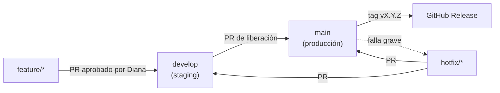

# 🚀 Proceso de liberación (release) · SHURI

Cómo se versiona, se prepara, se publica y, si hace falta, se revierte una versión de SHURI.
Responsable de aprobar cada liberación: **Diana Ochoa** (líder del proyecto).

---

## 1. Versionado (SemVer)

Se usa **Versionado Semántico** `MAYOR.MENOR.PARCHE`:

| Parte | Cuándo sube | Ejemplo |
|---|---|---|
| **MAYOR** | Cambio que rompe la compatibilidad (API o base de datos incompatibles) o la entrega final | `1.0.0` |
| **MENOR** | Funcionalidades nuevas compatibles; normalmente una por sprint | `0.3.0` |
| **PARCHE** | Solo correcciones de errores | `0.3.1` |

- Mientras el sistema esté en desarrollo, las versiones son `0.x.y`. La entrega final será **`v1.0.0`**.
- Cada versión se marca con una **etiqueta (tag)** de Git sobre el commit de `main`: `v0.3.0`, `v1.0.0`…
- La primera etiqueta, `v0.1.0-sprint2`, se creó antes de adoptar SemVer completo; desde la `v0.2.0` se usa el formato estándar.
- Los cambios de cada versión se documentan en el [`CHANGELOG.md`](../../CHANGELOG.md).

## 2. Ramas y flujo de liberación



| Rama | Ambiente | Quién combina |
|---|---|---|
| `feature/*`, `fix/*`, `docs/*` | Local | El autor, por PR hacia `develop` |
| `develop` | **Staging**: pruebas E2E y revisión | Diana aprueba los PR |
| `main` | **Producción** | Diana, por el PR de liberación `develop` → `main` |
| `hotfix/*` | Corrección urgente de producción | Sale de `main` y se combina en `main` **y** en `develop` |

## 3. Checklist de liberación

Se copia en la descripción del PR `develop` → `main`:

```markdown
## Checklist de liberación vX.Y.Z
### Antes de combinar
- [ ] Todos los PR del sprint están combinados en `develop`.
- [ ] GitHub Actions en verde: pruebas del backend y compilación del frontend.
- [ ] `php artisan test` → 100 % aprobadas.
- [ ] `ng build` sin errores.
- [ ] `php artisan migrate:fresh --seed` corre desde cero sin errores.
- [ ] Casos de prueba críticos y altos en ✅ (docs/pruebas/casos-de-prueba.md).
- [ ] Sin defectos abiertos de severidad crítica o alta.
- [ ] CHANGELOG.md actualizado con la nueva versión.
- [ ] README y documentación al día.
- [ ] Ningún secreto en el repositorio (.env fuera de Git).
- [ ] Respaldo de la base de datos de producción tomado.

### Después de combinar
- [ ] Etiqueta vX.Y.Z creada sobre el commit de main.
- [ ] GitHub Release publicado con las notas del CHANGELOG.
- [ ] Despliegue realizado y verificado (prueba de humo).
- [ ] Issues del sprint cerradas y milestone cerrado.
```

## 4. Pasos para liberar una versión

1. **Congelar `develop`**: no se combinan funcionalidades nuevas mientras se prepara la versión, solo correcciones.
2. **Actualizar el `CHANGELOG.md`**: mover lo de *Sin publicar* a la nueva versión, con fecha.
3. **Abrir el PR `develop` → `main`** con el título `release: vX.Y.Z` y el checklist del punto 3.
4. **Verificar** que GitHub Actions esté en verde y completar el checklist.
5. **Combinar** con *Create a merge commit*.
6. **Crear la etiqueta y el Release**: en GitHub, *Releases → Draft a new release → Choose a tag* → `vX.Y.Z` sobre `main`, con las notas del CHANGELOG.
7. **Desplegar** (punto 5) y hacer la **prueba de humo** (punto 6).

## 5. Estrategia de despliegue

| Componente | Plataforma propuesta | Qué se despliega |
|---|---|---|
| Frontend (Angular) | Vercel o Netlify (HTTPS automático) | `ng build` de `main` |
| Backend (Laravel API) | Railway o Render (HTTPS automático) | Rama `main`, carpeta `backend/` |
| Base de datos | MySQL 8 administrado de la misma plataforma | — |

**Pasos del despliegue del backend** (detallados en [`backend/README.md`](../../backend/README.md)):

```bash
composer install --no-dev --optimize-autoloader
php artisan migrate --force           # aplica solo las migraciones nuevas
php artisan config:cache
php artisan route:cache
php artisan view:cache
```

**Variables de entorno:** se configuran en el panel de la plataforma (`APP_KEY`, `DB_*`, `MAIL_*`, `FRONTEND_URL`, `APP_ENV=production`, `APP_DEBUG=false`). **Nunca** se suben al repositorio.

**Estrategia:** despliegue directo desde `main` (cada liberación etiquetada) con **migraciones hacia adelante**. Primero se despliega el backend y después el frontend, para que la API nueva esté disponible cuando el frontend la use.

## 6. Prueba de humo (después de cada despliegue)

| # | Verificación | Resultado esperado |
|---|---|---|
| 1 | Abrir la URL del frontend | Carga el login con candado de HTTPS |
| 2 | `GET /api/v1/portal/info` | 200 con la información del negocio |
| 3 | Iniciar sesión como administrador (con MFA) | Entra a su inicio |
| 4 | Abrir un módulo de cada rol | Sin errores en la consola del navegador |
| 5 | Revisar el log de errores del backend | Sin errores nuevos |

Si alguna falla, se aplica el **plan de reversión**.

## 7. Plan de reversión (rollback)

| Situación | Acción |
|---|---|
| **El frontend nuevo falla** | En Vercel o Netlify, *Deployments* → elegir el despliegue anterior → **Promote / Rollback**. Tarda segundos y no afecta la base de datos. |
| **El backend nuevo falla sin cambios en la BD** | Volver a desplegar la etiqueta anterior (`vX.Y.Z-1`) desde la plataforma, o hacer `git revert` del merge en `main` y redesplegar. |
| **El backend falla con migraciones nuevas** | 1. `php artisan migrate:rollback --step=N` (las N migraciones de la versión). 2. Desplegar la etiqueta anterior. 3. Si hubo pérdida de datos, restaurar el **respaldo tomado antes de liberar** (checklist). |
| **Error crítico que no se puede revertir rápido** | Activar el modo mantenimiento (`php artisan down`), crear `hotfix/descripcion` desde `main`, corregir, y liberar una versión de parche (`vX.Y.Z+1`). |

**Reglas para que la reversión sea posible:**
- Cada migración tiene su método `down()`.
- Se toma un respaldo de la base de datos de producción **antes** de cada liberación.
- Las etiquetas nunca se borran ni se mueven: siempre se puede regresar a cualquier versión.

## 8. Versiones publicadas

Ver el [`CHANGELOG.md`](../../CHANGELOG.md) y la sección **Releases** del repositorio.
