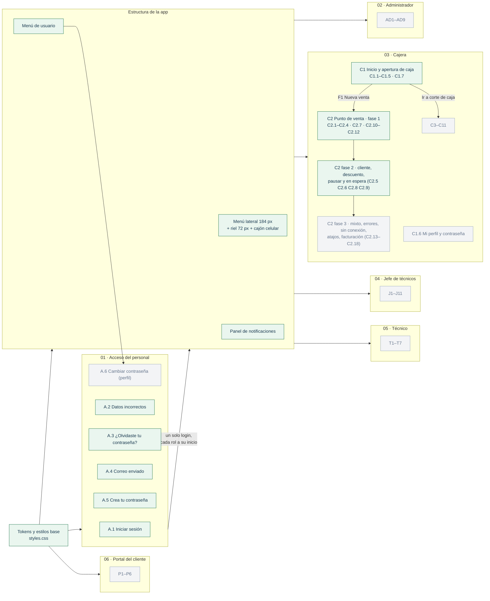
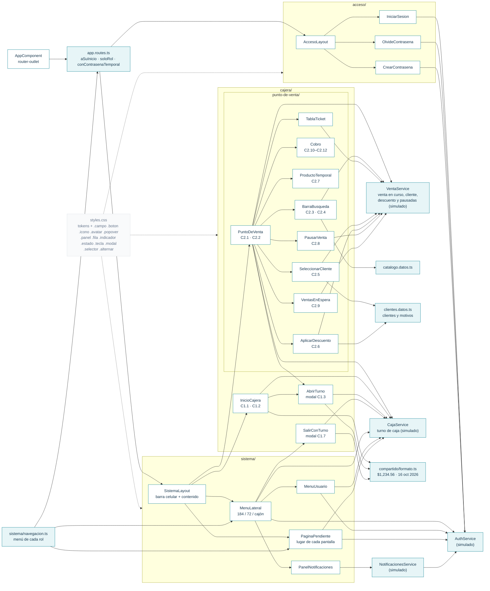

# Bitácora del frontend · SHURI

Registro vivo de lo que se construye en el frontend (Angular 17). Se actualiza **en cada avance** para no perder el contexto entre sesiones: qué está hecho, cómo está organizado, qué decisiones se tomaron y qué sigue.

- **Diseño fuente:** [Figma · SHURI](https://www.figma.com/design/wUFXid6RcC3a6H9iEdokWi/Untitled) (exportes en [`docs/diseno/`](../docs/diseno/README.md))
- **Rama de trabajo:** `feature/frontend-ui`
- **Última actualización:** 3 nov 2026

---

## 1. Grafo de avance por módulo

Cada nodo es una sección de Figma. Verde = hecho · amarillo = en curso · gris = pendiente.



## 2. Grafo de navegación (rutas actuales)


Cada rol tiene `inicio`, una ruta por cada destino de su menú, `perfil` y `cambiar-contrasena`. Las rutas se generan desde `sistema/navegacion.ts`, así que agregar un destino al menú crea también su ruta. Si un rol entra a una ruta de otro rol, `soloRol` lo regresa a su propio inicio.

## 3. Grafo de componentes



---

## 4. Cómo correrlo

```bash
cd frontend
npm install
npm start          # http://localhost:4200
npm run build      # compilación de producción
```

**Usuarios de prueba** (mientras no exista la API de Laravel), definidos en `src/app/acceso/auth.service.ts`:

| Usuario | Contraseña | Rol / resultado |
|---|---|---|
| `vcastillo` | `Shuri2026!` | Administradora → `/administrador/inicio` |
| `amartinez` | `Shuri2026!` | Cajera → `/cajera/inicio` |
| `jlopez` | `Shuri2026!` | Jefe de técnicos → `/jefe/inicio` |
| `cruiz` | `Shuri2026!` | Técnico → `/tecnico/inicio` |
| `nuevo` | `temporal123` | Simula primer ingreso → A.5 (técnico) |
| cualquier otro | — | A.2: “Te quedan N intentos”; al 3.º fallo la cuenta se bloquea |

Los nombres y puestos son los de las pantallas de Figma (Verónica Castillo, Ana Martínez, Jorge López, Carlos Ruiz).

**Caja de la cajera:**
- La primera vez entra con la **caja cerrada** (C1.2).
- Para abrirla se cuenta el fondo en el modal; con 2×$200, 3×$100, 4×$50 y 5×$20 coincide con el fondo asignado de $1,000.
- El turno se guarda en `localStorage` (`shuri.turno`). Para volver a probar la caja cerrada, borra esa clave o ejecuta `localStorage.clear()` en la consola.

**Punto de venta (`/cajera/punto-de-venta`, F1 desde el inicio):**
- Catálogo de prueba en `cajera/punto-de-venta/catalogo.datos.ts`. Se busca por nombre (“cargador”), SKU (`ACC-020`) o código de barras (`7501000000205`).
- Para armar la venta de Figma C2.1 (total $899.00): `ACC-001` ×2, `ACC-020` con 10 % de descuento, `ACC-014` y `ACC-052`.
- `ACC-030` no tiene disponibles: sale atenuado con “Vender como temporal”. Un código que no existe (`7501234567899`) muestra C2.4.
- Teclas:
  - F2: buscar
  - F4: cliente
  - F6: descuento
  - F7: producto temporal
  - F8: pausar la venta
  - F9: ventas en espera
  - F12 o Enter: cobrar
  - Esc: cancelar la venta (dentro de un modal, solo lo cierra)
  - En los resultados y en la lista de clientes, ↑/↓ y Enter para elegir
- Clientes de prueba en `cajera/punto-de-venta/clientes.datos.ts` (María Hernández, Martha Treviño, Raúl Ortiz…). Se buscan por nombre, teléfono o correo.
- Con la venta de Figma, un descuento del 10 % a toda la venta da $809.10. Arriba de 10 % el modal marca el error y no deja aplicar.
- Al entrar hay 2 ventas en espera de prueba (V-00864 y V-00863). Retomar una con el ticket lleno pausa primero la venta actual.
- Sin turno abierto, el punto de venta pide abrir caja (C1.3). Si se cierra el modal, regresa al inicio.

## 5. Estructura de carpetas

```
frontend/src/
├── index.html                 # lang="es", fuente Inter (Google Fonts)
├── styles.css                 # tokens de Figma + clases compartidas
├── assets/
│   ├── acceso/                # logo-shuri.png, elipses del panel de marca
│   ├── iconos/                # SVG de las pantallas de acceso
│   ├── menu/                  # SVG del menú lateral, usuario y notificaciones
│   └── cajera/                # SVG de las pantallas de la cajera
└── app/
    ├── app.routes.ts          # rutas + guardas; PANTALLAS = las ya construidas
    ├── compartido/
    │   └── formato.ts         # dinero, fechas, horas, duración, saludo
    ├── cajera/
    │   ├── caja.service.ts    # turno de caja abierto/cerrado (simulado)
    │   ├── inicio-cajera/     # C1.1 · C1.2 (+ .datos.ts con los datos de Figma)
    │   ├── abrir-turno/       # C1.3 modal de conteo del fondo
    │   ├── salir-con-turno/   # C1.7 modal al cerrar sesión con caja abierta
    │   └── punto-de-venta/    # C2
    │       ├── venta.service.ts      # líneas, totales, IVA, folio, cobrar (simulado)
    │       ├── catalogo.datos.ts     # productos de prueba de Figma
    │       ├── clientes.datos.ts     # clientes de prueba y motivos de descuento
    │       ├── barra-busqueda/       # buscador + resultados C2.3 + no encontrado C2.4 + reloj
    │       ├── tabla-ticket/         # líneas del ticket con −/+, descuento y quitar
    │       ├── cobro/                # C2.10 efectivo · C2.11 tarjeta · C2.12 transferencia
    │       ├── producto-temporal/    # C2.7
    │       ├── seleccionar-cliente/  # C2.5
    │       ├── aplicar-descuento/    # C2.6
    │       ├── pausar-venta/         # C2.8
    │       └── ventas-en-espera/     # C2.9
    ├── acceso/
    │   ├── auth.service.ts    # sesión, intentos, contraseña temporal (simulado)
    │   ├── acceso-layout/     # marco común A.1–A.5
    │   ├── iniciar-sesion/    # A.1 · A.2
    │   ├── olvide-contrasena/ # A.3 · A.4
    │   └── crear-contrasena/  # A.5 + indicador de seguridad
    └── sistema/
        ├── navegacion.ts            # menú de cada rol (fuente única de menú y rutas)
        ├── notificaciones.service.ts# avisos de la campana (simulado)
        ├── sistema-layout/          # menú + contenido; barra superior en celular
        ├── menu-lateral/            # 184 px · riel 72 px · cajón
        ├── menu-usuario/            # desplegable del avatar
        ├── panel-notificaciones/    # panel de la campana
        └── pagina-pendiente/        # lugar temporal de cada pantalla por construir
```

## 6. Convenciones

- **Componentes standalone**, `signal()` / `computed()` para estado, `input()` / `output()` de señales, **Reactive Forms** (`NonNullableFormBuilder`), control de flujo nuevo (`@if`, `@for`).
- **Nombres en español** (componentes, clases CSS, variables), igual que en Figma.
- **Colores:** siempre `var(--color-*)` de `styles.css`. Los nombres salen de las variables de Figma (`color/primario` → `--color-primario`).
- **Estilos compartidos en `styles.css`**, uno por componente de Figma:
  - Formularios: `.tarjeta`, `.campo`, `.campo__control--40` (modales), `.campo__control--fijo` (solo lectura), `.campo__select`, `.casilla`
  - Botones: `.boton--primario`, `.boton--contorno`, `.boton--secundario`, `.boton--peligro` (con su estado deshabilitado gris de Figma), `.boton--40`/`--44`, `.enlace`
  - Avisos y popovers: `.aviso--error`, `.aviso--advertencia`, `.aviso--exito`, `.popover`, `.modal-fondo`, `.modal`
  - Componentes de datos: `.panel`, `.fila`, `.indicador`, `.estado--<tono>`, `.tecla`
  - Selección: `.selector` / `.selector__opcion--elegida` (tarjetas de opción, como el método de pago) y `.alternar` (botones segmentados, como % / $)
  - Otros: `.icono`, `.avatar`, `.encabezado-pagina`, `.oculto` (texto solo para lectores de pantalla)
- **Si el CSS de un componente pasa de 4 kB** (límite que rompe `ng build`), se divide en componentes hijos, no se sube el límite. Ejemplo: el punto de venta se separó en `BarraBusqueda` y `TablaTicket`.
- **Rejillas con campos:** usar `repeat(n, minmax(0, 1fr))`, no `1fr`. Con `1fr` los inputs no se encogen y el modal se desborda.

  El presupuesto de CSS por componente es 2 kB de aviso y 4 kB de error, así que lo reutilizable va global y lo específico va en el componente.
- **Pantallas construidas:** se registran en `PANTALLAS` de `app.routes.ts` (`'cajera/inicio': InicioCajeraComponent`). Las que no están ahí usan `PaginaPendienteComponent`.
- **Datos de prueba de una pantalla:** en un archivo `<pantalla>.datos.ts` junto al componente, con los textos de Figma y la forma que tendrá la respuesta de la API.
- **Formatos:** siempre con `compartido/formato.ts` (`formatearDinero`, `formatearFechaLarga`, `formatearHora`, `formatearDuracion`, `saludoDelDia`).
- **Íconos:** se descargan de Figma, no se redibujan.
  - Con color fijo: `` con su `width`/`height` original.
  - Si cambian de color según el estado (menú): `<span class="icono" [style.--icono]="'url(assets/menu/x.svg)'">`, que usa el SVG como máscara y lo pinta con `color`.
- **Menú y rutas:** para agregar una pantalla, primero se añade el destino en `sistema/navegacion.ts`. Su ruta se crea sola con `PaginaPendienteComponent`. Al construirla, se cambia `component` en `rutasDeRol` (o se agrega una excepción para esa ruta).
- **Reglas de Figma aplicadas** (página “Componentes y tokens › Reglas de comportamiento”):
  - Campo en foco: borde 1.5 px `--color-primario`. Campo con error: borde 1.5 px `--color-peligro`.
  - Validación al salir del campo y al guardar; el mensaje va en rojo debajo del campo.
  - Campos obligatorios con `*`.
  - Base 1440 × 900 con menú de 184 px. En 1366 × 768 o menos, el menú se compacta a íconos (72 px) y se abre al pasar el mouse.
  - Un solo login: cada rol entra a su inicio.
- **Responsivo:** mínimo 360 px de ancho (lo exige el checklist de PR).
  - Acceso: debajo de 960 px se oculta el panel de marca.
  - Sistema: debajo de 768 px el menú pasa a un cajón que se abre desde una barra superior.

## 7. Flujo de trabajo del equipo

Reglas tomadas del [README principal](../README.md) (sección 12) y de [`.github/`](../.github/):

- Flujo de ramas: `feature/frontend-ui` → **PR a `develop`** → `develop` pasa a `main` al cierre de cada sprint. **Nunca abrir el PR directo a `main`.**
- **Diana** (`@dianaaochoa`, CODEOWNERS) revisa y aprueba todos los PR. Política de unión: *merge commit*.
- Checklist del PR ([plantilla](../.github/pull_request_template.md)):
  - rama actualizada con `develop`
  - commits `tipo(modulo): descripción`
  - `ng build` sin errores
  - sin `node_modules/`
  - vista adaptable a **360 px** y escritorio
- Antes de abrir un PR: traer `origin/develop` a esta rama (merge, no rebase) y volver a compilar.
- Sprint 3: 26 oct – 8 nov · Sprint 4: 9 – 22 nov 2026 (cierre del proyecto).

## 8. Decisiones y desviaciones del diseño

| Tema | Decisión | Motivo |
|---|---|---|
| Pastillas y círculos del panel de marca | Fondo blanco 8 % / borde 18 %; círculos con la opacidad de los SVG de A.5 | El exporte de Figma de A.1–A.3 pierde la transparencia (salían blancos). Se siguió el PNG de `docs/diseno` y A.5. |
| “Recordar este equipo” | Guarda la sesión en `localStorage` (si no, en `sessionStorage`) | El diseño no lo especifica. |
| Niveles del indicador de contraseña | 0–2 requisitos: Débil (rojo) · 3: Media (ámbar) · 4: Segura (verde) | Figma solo trae la variante “Segura”. |
| Requisito no cumplido | Círculo gris vacío | Figma solo muestra requisitos cumplidos. |
| Estilos | CSS propio con tokens de Figma, sin Tailwind ni Angular Material | `frontend/README.md` menciona “Tailwind CSS / Angular Material”, pero ninguno está instalado. Con CSS propio se copia el diseño de Figma tal cual. Pendiente acordarlo con el equipo. |
| Destino activo en el riel | Fondo `marino-activo` + ícono cian, igual que en el menú de 184 px | El componente “Navegación lateral · Ancho=72” usa fondo `primario`, pero las pantallas a 1366 px usan el mismo estilo que el menú ancho. Se siguieron las pantallas. |
| Fijar el riel abierto | Al pasar el mouse, el riel muestra “Fijar abierto”; en 184 px dice “Contraer”. La preferencia se guarda en `localStorage`. | Figma muestra “Contraer” pero no cómo volver a expandir. |
| Menú en celular | Cajón de 260 px con barra superior (☰ SHURI) | Figma solo tiene versión celular para el jefe (J10) y tablet para el técnico (T7); se hará cuando se construyan esas pantallas. |
| Avisos de la campana | Datos de prueba por rol; los del técnico son los de T1.2 | No hay API todavía. |
| Menú de usuario de la cajera | “Turno abierto desde HH:MM” como línea informativa (no clicable) | Así aparece en C1.5; Figma no indica a dónde lleva. |
| Pantallas no construidas | `PaginaPendiente` con título, saludo en Inicio y clave de Figma | Permite navegar todo el menú desde ya. |
| Estado inicial de la caja (demo) | La cajera entra con la caja cerrada (C1.2) | Así se puede probar todo el flujo C1.2 → C1.3 → C1.1. |
| Fondo contado distinto al asignado | Se permite abrir; el total se pinta en ámbar con “Faltan/Sobran $X” | Figma solo muestra el caso que coincide. |
| Centavos en el conteo | Se capturan como importe (0.00–0.99), no como cantidad | Figma muestra “—” en la cantidad de centavos. |
| Atajos F1–F5 | F1/F4 con la caja cerrada abren el modal de abrir turno. F5 no recarga la página mientras se está en el inicio. | Las teclas vienen de Figma; el comportamiento con la caja cerrada no está definido. |
| Cifras del inicio | Las de Figma (ventas, entregas, paneles). “Efectivo en caja” = $6,180 de ventas + el fondo contado. | No hay API todavía. |
| C1.7 · “Salir sin cerrar el turno” | Al elegir esa opción, el botón principal cambia a “Salir sin cerrar el turno” | Figma solo muestra el botón de la opción recomendada. |
| Notificaciones | Ícono de color por tipo (éxito, advertencia, info, neutro), como en C1.4 | El componente “Notificación” usa una campana fija; las pantallas reales no. |
| C2 por fases | Fase 1: C2.1–C2.4, C2.7 y C2.10–C2.12. Fase 2: C2.5, C2.6, C2.8 y C2.9. El cobro Mixto sigue deshabilitado con el tooltip “Próximamente” (fase 3). | Son 18 pantallas; así cada fase queda completa y probada. |
| Tabla del ticket | Las columnas ocupan todo el ancho | En Figma terminan en ~816 px y dejan vacío el lado derecho. |
| Barra de atajos | Alto natural (~35 px), sin “? Ver todos los atajos” (C2.17, fase 3) | En Figma mide 118 px por un marco vacío de 100 px. |
| Cancelar venta | Modal de confirmación “¿Cancelar la venta V-…?” | Figma no define confirmación y cancelar borra todo el ticket. |
| Venta cobrada | Aviso verde arriba del ticket: “Venta V-… cobrada · $… · entrega $… de cambio” | Figma no muestra qué pasa después de cobrar. |
| Impresión del ticket | La casilla se respeta, pero todavía no imprime | El ticket impreso es C11. |
| Tope de descuento | 10 % por línea y por venta (`DESCUENTO_MAXIMO`). El campo de la tabla no deja pasar de 10; el modal muestra “El máximo permitido es 10 %.” y deshabilita Aplicar. | Es la regla que muestra C2.6. Falta definir si un supervisor puede autorizar más. |
| Descuento en $ | Se escribe sobre el total con IVA y se guarda sin IVA, igual que el producto temporal | La cajera ve y cobra totales con IVA; el ticket muestra precios antes de IVA. |
| Motivo del descuento | Lista: Cliente frecuente, Producto con detalle, Promoción vigente, Ajuste de precio, Otro. Solo se pide para toda la venta. | Figma muestra el campo pero no las opciones. |
| Lista de clientes (C2.5) | “Público general” siempre va primero; “Crear cliente nuevo” lleva a `/cajera/clientes` | Figma no define qué abre ese botón; el alta de clientes es C9. |
| Totales de las ventas en espera | Se calculan con sus productos ($522.00 y $464.00) | Los $479 y $400 de Figma no salen de los artículos que lista. |
| Retomar con el ticket lleno | La venta actual se pausa sola y el subtítulo del modal lo avisa | Figma no define qué pasa con la venta en curso. |
| Esc dentro de un modal | Solo cierra el modal | Antes el mismo Esc llegaba al punto de venta y abría “¿Cancelar la venta?”. |
| Producto temporal | Se captura el precio con IVA (C2.7); en el ticket se guarda sin IVA para que el total coincida | El ticket muestra “Precios antes de IVA”. |
| Montos rápidos de efectivo | Siguiente centena, siguiente $500, siguiente $1,000 y +$500/+$1,000 (para $899: $900, $1,000, $1,500, $2,000) | Es la regla que reproduce los montos de Figma. |
| Ticket en celular | Se ocultan SKU, precio unitario y descuento | Con todas las columnas el navegador del celular alejaba la página. |
| Fondo de los modales | `marino-profundo` #0f172a al 50 % | Color de Figma “Fondo atenuado” (antes era un supuesto). |

## 9. Pendientes conocidos

- [ ] Conectar `AuthService` y `NotificacionesService` a la API de Laravel (Sanctum); quitar los datos de prueba.
- [ ] El texto de resumen bajo la marca (“Caja 01 · Turno abierto”, “14 órdenes abiertas”…) es fijo en `navegacion.ts`; debe venir de la API.
- [ ] El contador “2” de Mensajes del jefe es fijo; debe venir de la API.
- [ ] Optimizar `assets/acceso/logo-shuri.png` (1.2 MB para un logo de 36 px).
- [ ] Avisos de presupuesto de CSS en `acceso-layout` (2.9 kB) y `menu-lateral` (3.7 kB) contra 2 kB. No rompen la compilación; el límite de error es 4 kB.
- [ ] A.6 Cambiar contraseña y Mi perfil (ya tienen ruta en cada rol).
- [ ] “Ver todas las notificaciones” (pie del panel en Figma) cuando exista su pantalla.
- [ ] Versiones J10 celular (jefe) y T7 tablet (técnico).
- [ ] Bloqueo de sesión tras 30 min sin uso (regla general de Figma).
- [ ] Pantallas de cada rol: inicios de AD1, J1 y T1; resto de la cajera C3–C11.
- [ ] Las ventas en espera viven en memoria: se pierden al recargar y todavía no se descartan al cerrar el turno (lo dice el aviso de C2.9). Deben guardarse en la API.
- [ ] El panel “Ventas en espera” del inicio de la cajera (C1.1) sigue con datos fijos; debe leer `VentaService.pausadas`.
- [ ] “Crear cliente nuevo” (C2.5) debe abrir el alta de cliente con el nombre buscado cuando exista C9.
- [ ] C2 fase 3: cobro mixto (C2.13), tarjeta rechazada (C2.14), error de impresora (C2.15), sin conexión (C2.16), atajos de teclado (C2.17) y datos de facturación (C2.18).
- [ ] Las ventas cobradas no se guardan en ningún lado (solo avanza el folio); deben ir a la API y aparecer en C3 Ventas y en el inicio.
- [ ] El inventario no baja al vender; “disponibles” es fijo en el catálogo de prueba.
- [ ] El campo “Monto recibido” muestra 1000 en vez de $1,000.00 al usar un monto rápido.
- [ ] C1.6 Mi perfil y contraseña.
- [ ] El turno de caja simulado no está ligado a la cajera: si entra otra cajera, verá la caja abierta. La API debe decir de quién es el turno.
- [ ] Corte de caja (C10) debe llamar a `CajaService.cerrarTurno()`.

---

## 10. Registro de sesiones

### 2 nov 2026 · Acceso del personal (A.1–A.5)
- Se revisó todo el archivo de Figma: 3 páginas (Sistema del personal, Portal del cliente, Componentes y tokens) y las secciones de cada rol.
- Tokens de color de Figma pasados a `styles.css` y fuente Inter en `index.html`.
- Construidas A.1 Iniciar sesión, A.2 Datos incorrectos, A.3/A.4 ¿Olvidaste tu contraseña?, A.5 Crea tu contraseña, con su panel de marca compartido.
- `AuthService` simulado: 3 intentos y bloqueo, contraseña temporal, cambio obligatorio en el primer ingreso.
- Guardas de ruta: `conSesion` y `conContrasenaTemporal`.
- Verificado en el navegador a 1440×900 (posiciones iguales a Figma) y en ancho de celular.

### 2 nov 2026 · Rama al día con `develop`
- Se unió `origin/develop` a `feature/frontend-ui` sin conflictos. Llegaron solo cambios de documentación del equipo: README, `backend/README.md`, `frontend/README.md`, `.gitignore` y la plantilla de PR.
- Tras unirla: `ng build` correcto y login revisado a 360 px sin scroll horizontal.
- Se documentó el flujo de trabajo del equipo (sección 7).

### 2 nov 2026 · Estructura de la app con menú lateral
- Revisados en Figma los menús de los 4 roles, los componentes “Navegación lateral” (184 y 72 px), “Menú de usuario” y “Notificación”, y las pantallas C1.5 y T1.2.
- Nuevo `sistema/`:
  - layout con menú lateral
  - menú de cada rol en `navegacion.ts`
  - menú de usuario (Mi perfil, Cambiar contraseña, Cerrar sesión)
  - panel de notificaciones con pestañas Nuevas/Todas y “Marcar todo como leído”
- Login conectado: cada rol entra a `/<rol>/inicio`. La guarda `soloRol` impide entrar a secciones de otro rol. La guarda `conSesion` se reemplazó por `aSuInicio` y `soloRol`.
- Usuarios de prueba para los 4 roles.
- 27 íconos del menú descargados de Figma a `assets/menu/`.
- Verificado:
  - a 1440×900, con posiciones iguales a Figma
  - a 1366×768: riel de 72 px que se abre al pasar el mouse sin mover el contenido
  - a 360 px: cajón que se cierra al navegar, sin scroll horizontal
  - redirección por rol y cierre de sesión

### 2 nov 2026 · Cajera C1: inicio y apertura de caja
- Revisadas en Figma C1.1–C1.7.
- Construidas:
  - C1.1 inicio con turno abierto y C1.2 con caja cerrada (aviso marino, accesos atenuados, último corte)
  - C1.3 modal de conteo del fondo por denominación, con total en verde o ámbar
  - C1.7 modal al cerrar sesión con el turno abierto
- Integrado en lo existente:
  - C1.4: panel de notificaciones con íconos de color y los avisos de la cajera
  - C1.5: “Turno abierto desde HH:MM” en el menú de usuario
  - El estado del menú lateral cambia entre “Caja 01 · Turno abierto” y “Caja 01 · Caja cerrada” (en rojo claro)
- Nuevo `CajaService` (turno guardado en el navegador) y `compartido/formato.ts`.
- Pasaron a `styles.css` los componentes de Figma Panel, Fila, Indicador KPI, Estado, Tecla, Modal y Botón contorno. El CSS del inicio pasaba el límite de 4 kB.
- Verificado:
  - a 1440×900: posiciones iguales a Figma C1.2 (aviso en y=88, indicadores en y=290, pendientes en y=370)
  - flujo completo: abrir turno → C1.1 → F3 → notificaciones → cerrar sesión → C1.7 → salir sin cerrar → volver a entrar con la caja abierta
  - a 1366×768: cabe sin scroll
  - a 360 px: una columna, modal con scroll interno, sin scroll horizontal

### 2 nov 2026 · Cajera C2: punto de venta (fase 1)
- Revisadas en Figma las 18 pantallas de C2 y divididas en 3 fases.
- Construidas en esta fase:
  - C2.1 venta activa y C2.2 carrito vacío
  - C2.3 búsqueda por nombre, SKU o código de barras, con disponibilidad (verde, “Últimas N” en ámbar, sin disponibles)
  - C2.4 código no encontrado
  - C2.7 producto temporal, con cálculo de margen
  - C2.10–C2.12 cobro en efectivo (montos rápidos y cambio), tarjeta (débito/crédito, terminal, autorización) y transferencia (CLABE con Copiar, clave de rastreo y verificación)
- Nuevo `VentaService`: líneas, cantidades limitadas a lo disponible, descuento por línea, subtotal, IVA 16 % y total.
- El punto de venta se dividió en `BarraBusqueda` y `TablaTicket` porque su CSS pasaba de 4 kB. Pasaron a `styles.css` los botones secundario y de peligro y los campos de 40 px.
- Corregido en lo existente:
  - color del fondo de los modales (`marino-profundo` de Figma)
  - las rejillas de campos de los modales usan `minmax(0, 1fr)` para no desbordarse
- Verificado:
  - a 1440×900 la venta de Figma da subtotal $775.00, IVA $124.00 y total $899.00, con “Descuento aplicado: $25.00”
  - posiciones iguales a Figma: barra de 96 px, buscador de 1048×56, ticket en y=120, modal de cobro en 440,183 de 560×534
  - cobro en efectivo con $1,000: cambio de $101.00; montos rápidos $900, $1,000, $1,500 y $2,000
  - producto temporal: TMP-0013, $180.00 con IVA y margen 47 %
  - Esc pide confirmación y cancela; sin turno pide abrir caja
  - a 1366×768 cabe sin scroll de página
  - a 360 px la tabla cabe y no hay scroll horizontal

### 3 nov 2026 · Cajera C2: punto de venta (fase 2)
- Construidas:
  - C2.5 seleccionar cliente: búsqueda por nombre, teléfono o correo, estado del equipo en taller, ↑/↓ y Enter
  - C2.6 aplicar descuento a toda la venta o a un artículo, en % o en $, con equivalente, tope de 10 %, motivo y resumen del nuevo total
  - C2.8 pausar venta con nota opcional
  - C2.9 ventas en espera: retomar, descartar, hora y nota de cada una
- `VentaService` ahora guarda cliente, descuento de la venta y ventas pausadas; los totales salen de `calcularTotales()`.
- Los botones del encabezado del ticket y las teclas F4, F6, F8 y F9 ya funcionan. El botón muestra “Descuento (10 %)” y el nombre del cliente cuando se aplican.
- Pasaron a `styles.css` el selector de opciones y los botones segmentados (antes solo en el cobro).
- Corregido: Esc dentro de cualquier modal del punto de venta abría además “¿Cancelar la venta?”. El listener de teclas del punto de venta pasó de `window` a `document` para correr antes que los de los modales.
- Verificado:
  - a 1440×900, posiciones de los modales como en Figma: cliente en 420,203 (600×495), descuento en 460,166 (520×568)
  - venta de Figma con 10 % a toda la venta: subtotal $697.50, IVA $111.60, total $809.10; con 15 % marca el error
  - pausar V-00865 deja la caja en “Venta nueva” y “En espera (3)”; retomar con ticket lleno pausa la actual; descartar la quita
  - Esc cierra cada modal sin abrir la confirmación de cancelar
  - a 1366×768 y 360 px sin scroll horizontal
