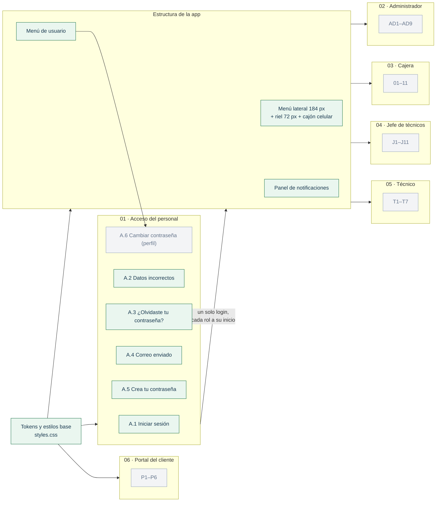
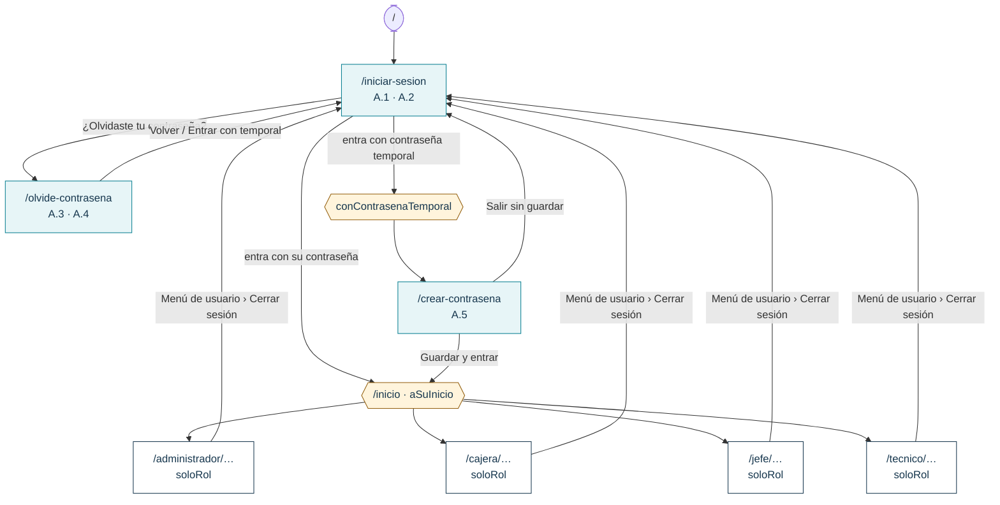
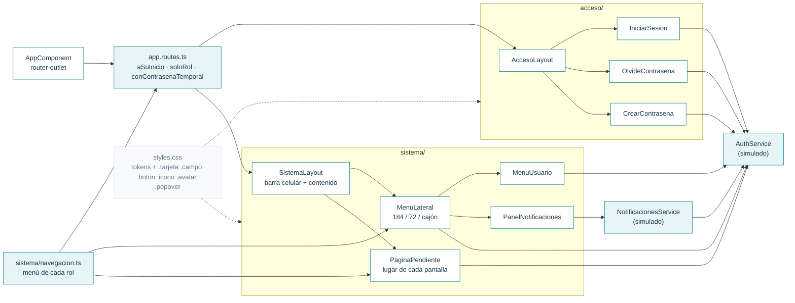

# Bitácora del frontend · SHURI

Registro vivo de lo que se construye en el frontend (Angular 17). Se actualiza **en cada avance** para no perder el contexto entre sesiones: qué está hecho, cómo está organizado, qué decisiones se tomaron y qué sigue.

- **Diseño fuente:** [Figma · SHURI](https://www.figma.com/design/wUFXid6RcC3a6H9iEdokWi/Untitled) (exportes en [`docs/diseno/`](../docs/diseno/README.md))
- **Rama de trabajo:** `feature/frontend-ui`
- **Última actualización:** 2 nov 2026

---

## 1. Grafo de avance por módulo

Cada nodo es una sección de Figma. Verde = hecho · amarillo = en curso · gris = pendiente.



## 2. Grafo de navegación (rutas actuales)



Cada rol tiene `inicio`, una ruta por cada destino de su menú, `perfil` y `cambiar-contrasena`. Las rutas se generan desde `sistema/navegacion.ts`, así que agregar un destino al menú crea también su ruta. Si un rol entra a una ruta de otro rol, `soloRol` lo regresa a su propio inicio.

## 3. Grafo de componentes



---

## 4. Cómo correrlo

```bash
cd frontend
npm install
npm start          # http://localhost:4200
npm run build      # compilación de producción
```

**Usuarios de prueba** (mientras no exista la API de Laravel), definidos en `src/app/acceso/auth.service.ts`:

| Usuario | Contraseña | Rol / resultado |
|---|---|---|
| `vcastillo` | `Shuri2026!` | Administradora → `/administrador/inicio` |
| `amartinez` | `Shuri2026!` | Cajera → `/cajera/inicio` |
| `jlopez` | `Shuri2026!` | Jefe de técnicos → `/jefe/inicio` |
| `cruiz` | `Shuri2026!` | Técnico → `/tecnico/inicio` |
| `nuevo` | `temporal123` | Simula primer ingreso → A.5 (técnico) |
| cualquier otro | — | A.2: “Te quedan N intentos”; al 3.º fallo la cuenta se bloquea |

Los nombres y puestos son los de las pantallas de Figma (Verónica Castillo, Ana Martínez, Jorge López, Carlos Ruiz).

## 5. Estructura de carpetas

```
frontend/src/
├── index.html                 # lang="es", fuente Inter (Google Fonts)
├── styles.css                 # tokens de Figma + clases compartidas
├── assets/
│   ├── acceso/                # logo-shuri.png, elipses del panel de marca
│   ├── iconos/                # SVG de las pantallas de acceso
│   └── menu/                  # SVG del menú lateral, usuario y notificaciones
└── app/
    ├── app.routes.ts          # rutas + guardas (las del sistema salen de navegacion.ts)
    ├── acceso/
    │   ├── auth.service.ts    # sesión, intentos, contraseña temporal (simulado)
    │   ├── acceso-layout/     # marco común A.1–A.5
    │   ├── iniciar-sesion/    # A.1 · A.2
    │   ├── olvide-contrasena/ # A.3 · A.4
    │   └── crear-contrasena/  # A.5 + indicador de seguridad
    └── sistema/
        ├── navegacion.ts            # menú de cada rol (fuente única de menú y rutas)
        ├── notificaciones.service.ts# avisos de la campana (simulado)
        ├── sistema-layout/          # menú + contenido; barra superior en celular
        ├── menu-lateral/            # 184 px · riel 72 px · cajón
        ├── menu-usuario/            # desplegable del avatar
        ├── panel-notificaciones/    # panel de la campana
        └── pagina-pendiente/        # lugar temporal de cada pantalla por construir
```

## 6. Convenciones

- **Componentes standalone**, `signal()` / `computed()` para estado, `input()` / `output()` de señales, **Reactive Forms** (`NonNullableFormBuilder`), control de flujo nuevo (`@if`, `@for`).
- **Nombres en español** (componentes, clases CSS, variables), igual que en Figma.
- **Colores:** siempre `var(--color-*)` de `styles.css`. Los nombres salen de las variables de Figma (`color/primario` → `--color-primario`).
- **Estilos compartidos en `styles.css`**: `.tarjeta`, `.campo`, `.boton--primario`, `.enlace`, `.aviso--error`, `.casilla`, `.icono`, `.avatar`, `.popover`, `.encabezado-pagina`. El presupuesto de CSS por componente es 2 kB de aviso y 4 kB de error, así que lo reutilizable va global y lo específico va en el componente.
- **Íconos:** se descargan de Figma, no se redibujan.
  - Con color fijo: `` con su `width`/`height` original.
  - Si cambian de color según el estado (menú): `<span class="icono" [style.--icono]="'url(assets/menu/x.svg)'">`, que usa el SVG como máscara y lo pinta con `color`.
- **Menú y rutas:** para agregar una pantalla, primero se añade el destino en `sistema/navegacion.ts`. Su ruta se crea sola con `PaginaPendienteComponent`. Al construirla, se cambia `component` en `rutasDeRol` (o se agrega una excepción para esa ruta).
- **Reglas de Figma aplicadas** (página “Componentes y tokens › Reglas de comportamiento”):
  - Campo en foco: borde 1.5 px `--color-primario`. Campo con error: borde 1.5 px `--color-peligro`.
  - Validación al salir del campo y al guardar; el mensaje va en rojo debajo del campo.
  - Campos obligatorios con `*`.
  - Base 1440 × 900 con menú de 184 px. En 1366 × 768 o menos, el menú se compacta a íconos (72 px) y se abre al pasar el mouse.
  - Un solo login: cada rol entra a su inicio.
- **Responsivo:** mínimo 360 px de ancho (lo exige el checklist de PR).
  - Acceso: debajo de 960 px se oculta el panel de marca.
  - Sistema: debajo de 768 px el menú pasa a un cajón que se abre desde una barra superior.

## 7. Flujo de trabajo del equipo

Reglas tomadas del [README principal](../README.md) (sección 12) y de [`.github/`](../.github/):

- Flujo de ramas: `feature/frontend-ui` → **PR a `develop`** → `develop` pasa a `main` al cierre de cada sprint. **Nunca abrir el PR directo a `main`.**
- **Diana** (`@dianaaochoa`, CODEOWNERS) revisa y aprueba todos los PR. Política de unión: *merge commit*.
- Checklist del PR ([plantilla](../.github/pull_request_template.md)):
  - rama actualizada con `develop`
  - commits `tipo(modulo): descripción`
  - `ng build` sin errores
  - sin `node_modules/`
  - vista adaptable a **360 px** y escritorio
- Antes de abrir un PR: traer `origin/develop` a esta rama (merge, no rebase) y volver a compilar.
- Sprint 3: 26 oct – 8 nov · Sprint 4: 9 – 22 nov 2026 (cierre del proyecto).

## 8. Decisiones y desviaciones del diseño

| Tema | Decisión | Motivo |
|---|---|---|
| Pastillas y círculos del panel de marca | Fondo blanco 8 % / borde 18 %; círculos con la opacidad de los SVG de A.5 | El exporte de Figma de A.1–A.3 pierde la transparencia (salían blancos). Se siguió el PNG de `docs/diseno` y A.5. |
| “Recordar este equipo” | Guarda la sesión en `localStorage` (si no, en `sessionStorage`) | El diseño no lo especifica. |
| Niveles del indicador de contraseña | 0–2 requisitos: Débil (rojo) · 3: Media (ámbar) · 4: Segura (verde) | Figma solo trae la variante “Segura”. |
| Requisito no cumplido | Círculo gris vacío | Figma solo muestra requisitos cumplidos. |
| Estilos | CSS propio con tokens de Figma, sin Tailwind ni Angular Material | `frontend/README.md` menciona “Tailwind CSS / Angular Material”, pero ninguno está instalado. Con CSS propio se copia el diseño de Figma tal cual. Pendiente acordarlo con el equipo. |
| Destino activo en el riel | Fondo `marino-activo` + ícono cian, igual que en el menú de 184 px | El componente “Navegación lateral · Ancho=72” usa fondo `primario`, pero las pantallas a 1366 px usan el mismo estilo que el menú ancho. Se siguieron las pantallas. |
| Fijar el riel abierto | Al pasar el mouse, el riel muestra “Fijar abierto”; en 184 px dice “Contraer”. La preferencia se guarda en `localStorage`. | Figma muestra “Contraer” pero no cómo volver a expandir. |
| Menú en celular | Cajón de 260 px con barra superior (☰ SHURI) | Figma solo tiene versión celular para el jefe (J10) y tablet para el técnico (T7); se hará cuando se construyan esas pantallas. |
| Avisos de la campana | Datos de prueba por rol; los del técnico son los de T1.2 | No hay API todavía. |
| Menú de usuario de la cajera | Sin la opción “Turno abierto desde 09:00” | Depende de la caja (C1), que aún no existe. |
| Pantallas no construidas | `PaginaPendiente` con título, saludo en Inicio y clave de Figma | Permite navegar todo el menú desde ya. |

## 9. Pendientes conocidos

- [ ] Conectar `AuthService` y `NotificacionesService` a la API de Laravel (Sanctum); quitar los datos de prueba.
- [ ] El texto de resumen bajo la marca (“Caja 01 · Turno abierto”, “14 órdenes abiertas”…) es fijo en `navegacion.ts`; debe venir de la API.
- [ ] El contador “2” de Mensajes del jefe es fijo; debe venir de la API.
- [ ] Optimizar `assets/acceso/logo-shuri.png` (1.2 MB para un logo de 36 px).
- [ ] Avisos de presupuesto de CSS en `acceso-layout` (2.9 kB) y `menu-lateral` (3.7 kB) contra 2 kB. No rompen la compilación; el límite de error es 4 kB.
- [ ] A.6 Cambiar contraseña y Mi perfil (ya tienen ruta en cada rol).
- [ ] “Ver todas las notificaciones” (pie del panel en Figma) cuando exista su pantalla.
- [ ] Versiones J10 celular (jefe) y T7 tablet (técnico).
- [ ] Bloqueo de sesión tras 30 min sin uso (regla general de Figma).
- [ ] Pantallas de cada rol (empezando por los inicios: AD1, C1, J1, T1).

---

## 10. Registro de sesiones

### 2 nov 2026 · Acceso del personal (A.1–A.5)
- Se revisó todo el archivo de Figma: 3 páginas (Sistema del personal, Portal del cliente, Componentes y tokens) y las secciones de cada rol.
- Tokens de color de Figma pasados a `styles.css` y fuente Inter en `index.html`.
- Construidas A.1 Iniciar sesión, A.2 Datos incorrectos, A.3/A.4 ¿Olvidaste tu contraseña?, A.5 Crea tu contraseña, con su panel de marca compartido.
- `AuthService` simulado: 3 intentos y bloqueo, contraseña temporal, cambio obligatorio en el primer ingreso.
- Guardas de ruta: `conSesion` y `conContrasenaTemporal`.
- Verificado en el navegador a 1440×900 (posiciones iguales a Figma) y en ancho de celular.

### 2 nov 2026 · Rama al día con `develop`
- Se unió `origin/develop` a `feature/frontend-ui` sin conflictos. Llegaron solo cambios de documentación del equipo: README, `backend/README.md`, `frontend/README.md`, `.gitignore` y la plantilla de PR.
- Tras unirla: `ng build` correcto y login revisado a 360 px sin scroll horizontal.
- Se documentó el flujo de trabajo del equipo (sección 7).

### 2 nov 2026 · Estructura de la app con menú lateral
- Revisados en Figma los menús de los 4 roles, los componentes “Navegación lateral” (184 y 72 px), “Menú de usuario” y “Notificación”, y las pantallas C1.5 y T1.2.
- Nuevo `sistema/`:
  - layout con menú lateral
  - menú de cada rol en `navegacion.ts`
  - menú de usuario (Mi perfil, Cambiar contraseña, Cerrar sesión)
  - panel de notificaciones con pestañas Nuevas/Todas y “Marcar todo como leído”
- Login conectado: cada rol entra a `/<rol>/inicio`. La guarda `soloRol` impide entrar a secciones de otro rol. La guarda `conSesion` se reemplazó por `aSuInicio` y `soloRol`.
- Usuarios de prueba para los 4 roles.
- 27 íconos del menú descargados de Figma a `assets/menu/`.
- Verificado:
  - a 1440×900, con posiciones iguales a Figma
  - a 1366×768: riel de 72 px que se abre al pasar el mouse sin mover el contenido
  - a 360 px: cajón que se cierra al navegar, sin scroll horizontal
  - redirección por rol y cierre de sesión
