# Bitácora del frontend · SHURI

Registro vivo de lo que se construye en el frontend (Angular 17). Se actualiza **en cada avance** para no perder el contexto entre sesiones: qué está hecho, cómo está organizado, qué decisiones se tomaron y qué sigue.

- **Diseño fuente:** [Figma · SHURI](https://www.figma.com/design/wUFXid6RcC3a6H9iEdokWi/Untitled) (exportes en [`docs/diseno/`](../docs/diseno/README.md))
- **Rama de trabajo:** `feature/frontend-ui`
- **Última actualización:** 8 nov 2026 (J7 Técnicos)

---

## 1. Grafo de avance por módulo

Cada nodo es una sección de Figma. Verde = hecho · amarillo = en curso · gris = pendiente.

```mermaid
flowchart LR
  classDef hecho fill:#eaf6ef,stroke:#187047,color:#17374e
  classDef curso fill:#fff4dc,stroke:#925d0b,color:#17374e
  classDef pendiente fill:#f3f4f6,stroke:#94a3b8,color:#64748b

  BASE["Tokens y estilos base<br/>styles.css"]:::hecho

  subgraph ACC["01 · Acceso del personal"]
    A1["A.1 Iniciar sesión"]:::hecho
    A2["A.2 Datos incorrectos"]:::hecho
    A3["A.3 ¿Olvidaste tu contraseña?"]:::hecho
    A4["A.4 Correo enviado"]:::hecho
    A5["A.5 Crea tu contraseña"]:::hecho
    A6["A.6 Cambiar contraseña<br/>(en Mi perfil, C1.6)"]:::hecho
  end

  subgraph SHELL["Estructura de la app"]
    MENU["Menú lateral 184 px<br/>+ riel 72 px + cajón celular"]:::hecho
    USR["Menú de usuario"]:::hecho
    NOT["Panel de notificaciones"]:::hecho
  end

  subgraph ADM["02 · Administrador"]
    AD["AD1–AD9"]:::pendiente
  end
  subgraph CAJ["03 · Cajera"]
    C1["C1 Inicio y apertura de caja<br/>C1.1–C1.5 · C1.7"]:::hecho
    C16["C1.6 Mi perfil y contraseña<br/>(la misma pantalla en todos los roles)"]:::hecho
    C2A["C2 Punto de venta · fase 1<br/>C2.1–C2.4 · C2.7 · C2.10–C2.12"]:::hecho
    C2B["C2 fase 2 · cliente, descuento,<br/>pausar y en espera (C2.5 C2.6 C2.8 C2.9)"]:::hecho
    C2C["C2 fase 3 · mixto, errores, sin conexión,<br/>atajos, facturación (C2.13–C2.18)"]:::hecho
    C3["C3 Ventas<br/>C3.1 historial · C3.2 sin resultados · C3.3 devolución"]:::hecho
    C4["C4 Órdenes de servicio<br/>C4.1–C4.9"]:::hecho
    C5["C5 Nueva orden<br/>C5.1 recepción · C5.2 cliente nuevo · C5.3 confirmación"]:::hecho
    C6["C6 Entrega de equipo<br/>C6.1 normal · C6.2 sin reparar · C6.3 garantía · C6.4 otra persona"]:::hecho
    C7["C7 Inventario<br/>C7.1 alta · C7.2 Excel · C7.3 entrada · C7.4 ajuste<br/>C7.5 pedido del jefe · C7.6 pago · C7.7 historial"]:::hecho
    C8["C8 Clientes<br/>C8.1 lista y ficha · C8.2 nuevo cliente<br/>C8.3 historial · C8.4 contraseña temporal"]:::hecho
    C9["C9 Estadísticas<br/>Hoy · Semana · Mes · Año"]:::hecho
    C10["C10 Corte de caja<br/>C10.1 turno · C10.2 historial · C10.3 retiro o ingreso<br/>C10.4 cerrar turno · C10.5 turno cerrado"]:::hecho
    C11["C11 Documentos impresos<br/>ticket de venta · orden (ticket y carta) · entrega<br/>devolución · garantía · corte · retiro"]:::hecho
  end
  subgraph JEF["04 · Jefe de técnicos"]
    J1["J1 Inicio<br/>J1.1 tablero de inicio · J1.2 notificaciones · J1.3 menú"]:::hecho
    J2["J2 Tablero de órdenes<br/>J2.1 tablero · J2.2 asignar técnico · J2.3 detalle<br/>J2.4 cargando · J2.5 sin conexión"]:::hecho
    J3["J3 Por cotizar<br/>J3.1 lista · J3.2 cotizar orden<br/>J3.3 sin reparación · J3.4 re-cotización"]:::hecho
    J4["J4 Garantías<br/>J4.1 lista por etapa · J4.2 dictamen"]:::hecho
    J5["J5 Refacciones<br/>J5.1 solicitudes · J5.2 pedir · J5.3 devolución<br/>J5.4 pedidos a proveedor · J5.5 nuevo pedido"]:::hecho
    J6["J6 Inventario del taller<br/>refacciones y consumibles con costos"]:::hecho
    J7["J7 Técnicos<br/>carga, desempeño del mes y órdenes por técnico"]:::hecho
    J["J8–J11"]:::pendiente
  end
  subgraph TEC["05 · Técnico"]
    T["T1–T7"]:::pendiente
  end
  subgraph POR["06 · Portal del cliente"]
    P["P1–P6"]:::pendiente
  end

  BASE --> ACC
  BASE --> SHELL
  ACC -->|"un solo login,<br/>cada rol a su inicio"| SHELL
  SHELL --> ADM & CAJ & JEF & TEC
  USR --> A6
  USR --> C16
  C1 -->|"F1 Nueva venta"| C2A
  C2A --> C2B --> C2C
  C2C -->|"cada venta cobrada<br/>entra al historial"| C3
  C5 -->|"la orden queda<br/>Por cotizar"| C4
  C4 -->|"Entregar equipo<br/>(con el folio)"| C6
  C6 -->|"la orden queda<br/>Terminado"| C4
  C7 -->|"llega la refacción:<br/>se aparta y la orden<br/>vuelve a En taller"| C4
  C8 -->|"Nueva orden para<br/>este cliente"| C5
  C5 & C4 & C3 -.->|"equipos y compras<br/>del cliente"| C8
  C3 & C4 -.->|"ventas, entregas<br/>y presupuestos"| C9
  C1 -->|"Ir a corte de caja"| C10
  C2C & C6 & C5 -.->|"lo cobrado en el turno"| C10
  C7 -.->|"pago a proveedor<br/>en efectivo"| C10
  C10 -->|"Abrir nuevo turno"| C1
  C4 & C5 -.->|"órdenes, técnicos<br/>y garantías"| J1
  J1 -->|"Ir al tablero · Asignar"| J2
  J1 & J2 -->|"Cotizar · Confirmar<br/>· Re-cotizar"| J3
  J3 -->|"presupuesto y re-cotización<br/>quedan Por aprobar"| C4
  J3 -->|"sin reparación:<br/>se entrega en C6.2"| C6
  J3 -.->|"aparta piezas<br/>en stock"| C7
  C4 -->|"recibir en garantía<br/>(C4.5)"| J4
  J1 & J2 -->|"Dictaminar"| J4
  J4 -->|"sin reparar: se entrega<br/>en C6.3"| C6
  J1 -->|"Pedir"| J5
  J5 -->|"pedidos por recibir"| C7
  C7 -.->|"llega: se aparta<br/>para la orden"| J5
  C7 -.->|"mismo catálogo<br/>y entrada de mercancía"| J6
  J6 -->|"Pedir · Ver pedido"| J5
  J7 -->|"Ver · Reasignar"| J2
  J1 -->|"cada pendiente abre<br/>su módulo"| J
  C2C & C3 & C4 & C5 & C6 & C10 -->|"imprimir"| C11
  BASE --> POR
```



## 2. Grafo de navegación (rutas actuales)


Cada rol tiene `inicio`, una ruta por cada destino de su menú, `perfil` y `cambiar-contrasena`. Las rutas se generan desde `sistema/navegacion.ts`, así que agregar un destino al menú crea también su ruta. Si un rol entra a una ruta de otro rol, `soloRol` lo regresa a su propio inicio.

## 3. Grafo de componentes

```mermaid
flowchart LR
  classDef comp fill:#ffffff,stroke:#087f91,color:#17374e
  classDef serv fill:#e7f5f7,stroke:#087f91,color:#17374e
  classDef css fill:#f9fafb,stroke:#dce2e8,color:#64748b

  APP["AppComponent<br/>router-outlet"]:::comp
  RUT["app.routes.ts<br/>aSuInicio · soloRol · conContrasenaTemporal<br/>pantallas con loadComponent"]:::serv
  NAV["sistema/navegacion.ts<br/>menú de cada rol"]:::serv

  subgraph ACCESO["acceso/"]
    LAY["AccesoLayout"]:::comp
    IS["IniciarSesion"]:::comp
    OC["OlvideContrasena"]:::comp
    CC["CrearContrasena"]:::comp
  end

  subgraph SISTEMA["sistema/"]
    SL["SistemaLayout<br/>barra celular + contenido"]:::comp
    ML["MenuLateral<br/>184 / 72 / cajón"]:::comp
    MU["MenuUsuario"]:::comp
    PN["PanelNotificaciones"]:::comp
    PP["PaginaPendiente<br/>lugar de cada pantalla"]:::comp
    PF["Perfil<br/>C1.6 · A.6 · todos los roles"]:::comp
  end

  subgraph JEFE["jefe/"]
    IJ["InicioJefe<br/>J1.1"]:::comp
    TB["Tablero<br/>J2.1 · J2.4 · J2.5"]:::comp
    AS["AsignarTecnico<br/>modal J2.2"]:::comp
    OJ["OrdenJefe<br/>J2.3"]:::comp
    PC["PorCotizar<br/>J3.1"]:::comp
    CO["CotizarOrden<br/>J3.2 conceptos"]:::comp
    RZ["ResumenCotizacion<br/>J3.2 total y envío"]:::comp
    AR["AgregarRefaccion<br/>modal J3.2"]:::comp
    SR["SinReparacion<br/>modal J3.3"]:::comp
    RE["Recotizacion<br/>modal J3.4"]:::comp
    RT["RegresarTecnico<br/>modal J3.2 · J3.3"]:::comp
    GA["Garantias<br/>J4.1"]:::comp
    DG["DictamenGarantia<br/>J4.2"]:::comp
    TD["TuDictamen<br/>J4.2 aplica · con costo · sin reparar"]:::comp
    GT["garantia.ts<br/>etapas y vencimiento"]:::serv
    RF["Refacciones<br/>J5.1 · J5.4"]:::comp
    PS["PedirSolicitud<br/>modal J5.2"]:::comp
    RD["RecibirDevolucion<br/>modal J5.3"]:::comp
    NP["NuevoPedido<br/>modal J5.5"]:::comp
    VP["VerPedido<br/>modal J5.4"]:::comp
    RS["RefaccionesService<br/>solicitudes, devoluciones<br/>e historial (simulado)"]:::serv
    IT["InventarioTaller<br/>J6"]:::comp
    VR["VerProducto<br/>modal J6"]:::comp
    TQ["Tecnicos<br/>J7"]:::comp
    CG["carga.ts · desempeno.ts<br/>estado del técnico y<br/>cifras del mes (prueba)"]:::serv
    ET["etapas.ts<br/>columnas y SLA de 24 h"]:::serv
    JD["jefe.datos.ts<br/>mensajes y preguntas"]:::serv
  end
  subgraph CAJERA["cajera/"]
    IC["InicioCajera<br/>C1.1 · C1.2"]:::comp
    AT["AbrirTurno<br/>modal C1.3"]:::comp
    ST["SalirConTurno<br/>modal C1.7"]:::comp
    subgraph PDVG["punto-de-venta/"]
      PDV["PuntoDeVenta<br/>C2.1 · C2.2"]:::comp
      BB["BarraBusqueda<br/>C2.3 · C2.4"]:::comp
      TT["TablaTicket"]:::comp
      CB["Cobro<br/>C2.10–C2.12"]:::comp
      PT["ProductoTemporal<br/>C2.7"]:::comp
      SC["SeleccionarCliente<br/>C2.5"]:::comp
      AD["AplicarDescuento<br/>C2.6"]:::comp
      PV["PausarVenta<br/>C2.8"]:::comp
      VE["VentasEnEspera<br/>C2.9"]:::comp
      PM["PagoMixto<br/>C2.13"]:::comp
      TR["TarjetaRechazada<br/>C2.14"]:::comp
      EI["ErrorImpresora<br/>C2.15"]:::comp
      SCX["AvisoSinConexion<br/>C2.16"]:::comp
      AK["AtajosTeclado<br/>C2.17"]:::comp
      DF["DatosFactura<br/>C2.18"]:::comp
    end
    subgraph VTG["ventas/"]
      VEN["Ventas<br/>C3.1 · C3.2"]:::comp
      DV["DetalleVenta<br/>panel del ticket"]:::comp
      DEV["Devolucion<br/>C3.3"]:::comp
    end
    subgraph ORG["ordenes/"]
      ORD["Ordenes<br/>C4.1 · C4.6 · C4.9"]:::comp
      DO["DetalleOrden<br/>C4.1 C4.3 C4.4 C4.6 C4.8"]:::comp
      SO["SeguimientoOrden<br/>6 pasos"]:::comp
      RC["RespuestaCliente<br/>C4.2 · adicional"]:::comp
      RG["RecibirGarantia<br/>C4.5"]:::comp
      EB["EnviarBodega<br/>C4.7"]:::comp
      NO["NuevaOrden<br/>C5.1"]:::comp
      NC["NuevoCliente<br/>C5.2"]:::comp
      OR["OrdenRegistrada<br/>C5.3"]:::comp
    end
    subgraph ENG["entrega/"]
      ENT["Entrega<br/>C6.1–C6.4"]:::comp
      QR["QuienRecoge<br/>titular u otra persona"]:::comp
      CE["CobroEntrega<br/>saldo y método"]:::comp
    end
    subgraph INVG["inventario/"]
      INV["Inventario<br/>encabezado, pestañas y modales"]:::comp
      CTL["Catalogo<br/>filtros, Excel y paginación"]:::comp
      AP["AltaProducto<br/>C7.1 (también edita)"]:::comp
      IE["ImportarExcel<br/>C7.2"]:::comp
      EN["Entrada<br/>C7.3 · C7.5"]:::comp
      PJ["PedidosJefe<br/>C7.5"]:::comp
      PP2["PagoProveedor<br/>C7.6"]:::comp
      HE["HistorialEntradas<br/>C7.7 y detalle"]:::comp
      AJ["AjusteInventario<br/>C7.4"]:::comp
      AJS["Ajustes<br/>registro de ajustes"]:::comp
      MOV["Movimientos<br/>historial del producto"]:::comp
      PAG["Paginacion"]:::comp
    end
    subgraph CLIG["clientes/"]
      CLS["Clientes<br/>C8.1 lista"]:::comp
      FC["FichaCliente<br/>portal, equipos y compras"]:::comp
      HC["HistorialCliente<br/>C8.3"]:::comp
      CT["ContrasenaTemporal<br/>C8.4"]:::comp
    end
    subgraph ESTG["estadisticas/"]
      EST["Estadisticas<br/>C9"]:::comp
      GI["GraficaIngresos<br/>barras con globo"]:::comp
    end
    subgraph CORG["corte/"]
      COR["Corte<br/>encabezado y pestañas"]:::comp
      TA["TurnoActual<br/>C10.1 y arqueo"]:::comp
      CTU["CerrarTurno<br/>C10.4 por denominación"]:::comp
      HCO["HistorialCortes<br/>C10.2"]:::comp
      ME["MovimientoEfectivo<br/>C10.3"]:::comp
      TC["TurnoCerrado<br/>C10.5"]:::comp
    end
    subgraph DOCG["documentos/"]
      VI["VistaImpresion<br/>en el layout · Imprimir"]:::comp
      TK["Ticket<br/>80 mm · 7 documentos"]:::comp
      OC["OrdenCarta<br/>hoja carta"]:::comp
    end
  end
  VS["VentaService<br/>venta en curso, cliente,<br/>descuento y pausadas (simulado)"]:::serv
  CAT["catalogo.datos.ts"]:::serv
  CLI["clientes.datos.ts<br/>clientes, motivos y catálogos del SAT"]:::serv
  DIS["DispositivosService<br/>conexión e impresora (simulado)"]:::serv
  HV["HistorialVentasService<br/>ventas, cancelaciones y<br/>devoluciones (simulado)"]:::serv
  OS["OrdenesService<br/>órdenes, respuestas, garantías<br/>y bodega (simulado)"]:::serv
  INS["InventarioService<br/>productos, entradas, pedidos<br/>y ajustes (simulado)"]:::serv
  DOS["DocumentosService<br/>qué se imprime y folios<br/>DEV- y NC-"]:::serv
  COS["CorteService<br/>movimientos y arqueo del turno,<br/>cortes anteriores (simulado)"]:::serv
  ESV["EstadisticasService<br/>historial de prueba por día<br/>+ ventas y órdenes de la app"]:::serv
  CLSV["ClientesService<br/>registro único: une clientes de<br/>caja, órdenes y ventas (simulado)"]:::serv

  AUTH["AuthService<br/>(simulado)"]:::serv
  NOTS["NotificacionesService<br/>(simulado)"]:::serv
  CAJA["CajaService<br/>turno, retiros, ingresos y<br/>pagos a proveedor (simulado)"]:::serv
  FMT["compartido/formato.ts<br/>$1,234.56 · 16 oct 2026"]:::serv
  GLB["styles.css<br/>tokens + .campo .boton .icono .avatar .popover<br/>.panel .fila .indicador .estado .tecla .modal<br/>.selector .alternar .boton-icono .sugerencias"]:::css

  APP --> RUT
  RUT --> LAY --> IS & OC & CC
  RUT --> SL --> ML --> MU & PN
  ML --> ST
  SL --> PP & IC & PDV & VEN
  VEN --> DV & DEV
  PDV & VEN & DEV --> HV
  VEN --> DIS & CAJA
  SL --> ORD
  ORD --> DO & RC & RG & EB & NO & OR
  NO --> NC
  NO & NC --> CLI
  DO --> SO
  ORD --> OS & DIS
  SL --> ENT
  ENT --> QR & CE & DF
  ENT --> OS & DIS
  SL --> INV
  INV --> CTL & AP & IE & EN & HE & AJ & AJS & MOV
  CTL --> PAG
  EN --> PJ & PP2
  INV & CTL & AP & IE & EN & HE & AJ & AJS & MOV --> INS
  EN --> OS & CAJA & DIS
  PP2 --> CAJA
  SL --> CLS
  CLS --> FC & HC & CT & NC
  CLS & FC & HC & NC & NO --> CLSV
  CLSV --> OS & HV & CLI
  HC & CT --> DIS
  SL --> EST
  EST --> GI
  EST --> ESV
  ESV --> HV & OS
  SL --> PF
  PF --> AUTH & CAJA
  SL --> COR
  COR --> TA & HCO & ME & TC & AT
  TA --> CTU
  COR & TA & HCO & ME --> COS
  COS --> CAJA & HV & OS
  EN & PP2 --> COS
  SL --> VI
  VI --> TK & OC
  VI --> DOS
  OC --> CLSV
  PDV & VEN & ORD & ENT & TA & HCO & ME & TC --> DOS
  DOS --> DIS & HV & OS
  IC --> AT
  PDV --> BB & TT & CB & PT & AT
  PDV --> SC & AD & PV & VE & EI & SCX & AK
  CB --> PM & TR & DF
  PDV & BB & CB & SCX --> DIS
  DF --> CLI
  PDV & BB & TT & SC & AD & PV & VE --> VS
  BB --> CAT
  SC & AD --> CLI
  PDV --> CAJA
  NAV --> RUT & ML & PP
  IS & OC & CC & ML & MU & PP --> AUTH
  PN --> NOTS --> AUTH
  IC & AT & ST & ML & MU & PP --> CAJA
  IC & AT & ST --> FMT
  SL --> IJ
  IJ --> OS & JD & AUTH
  IJ --> ET
  SL --> TB
  TB --> AS & OJ
  TB --> OS & ET & DIS
  OJ --> SO
  SL --> PC
  PC --> CO & SR & RE & RT
  CO --> RZ & AR
  PC & SR & RE --> OS
  CO & RZ & AR & RE --> INS
  SL --> GA
  GA --> DG --> TD
  GA & TD --> OS
  GA & DG --> GT
  SL --> RF
  RF --> PS & RD & NP & VP
  RF & PS & RD & NP --> RS
  RS --> INS & OS
  RF & PS & NP & VP --> INS
  IJ --> RS
  SL --> IT
  IT --> VR & NP & INS
  IT --> EN & PAG
  SL --> TQ
  TQ --> CG & OS & AS
  IJ --> CG
  GLB -.-> ACCESO & SISTEMA & CAJERA & JEFE
```

---

## 4. Cómo correrlo

```bash
cd frontend
npm install
npm start          # http://localhost:4200
npm run build      # compilación de producción
```

**Usuarios de prueba** (mientras no exista la API de Laravel), definidos en `src/app/acceso/auth.service.ts`:

| Usuario | Contraseña | Rol / resultado |
|---|---|---|
| `vcastillo` | `Shuri2026!` | Administradora → `/administrador/inicio` |
| `amartinez` | `Shuri2026!` | Cajera → `/cajera/inicio` |
| `jlopez` | `Shuri2026!` | Jefe de técnicos → `/jefe/inicio` |
| `cruiz` | `Shuri2026!` | Técnico → `/tecnico/inicio` |
| `nuevo` | `temporal123` | Simula primer ingreso → A.5 (técnico) |
| cualquier otro | — | A.2: “Te quedan N intentos”; al 3.º fallo la cuenta se bloquea |

Los nombres y puestos son los de las pantallas de Figma (Verónica Castillo, Ana Martínez, Jorge López, Carlos Ruiz).

**Caja de la cajera:**
- La primera vez entra con la **caja cerrada** (C1.2).
- Para abrirla se cuenta el fondo en el modal; con 2×$200, 3×$100, 4×$50 y 5×$20 coincide con el fondo asignado de $1,000.
- El turno se guarda en `localStorage` (`shuri.turno`). Para volver a probar la caja cerrada, borra esa clave o ejecuta `localStorage.clear()` en la consola.

**Punto de venta (`/cajera/punto-de-venta`, F1 desde el inicio):**
- Catálogo de prueba en `cajera/punto-de-venta/catalogo.datos.ts`. Se busca por nombre (“cargador”), SKU (`ACC-020`) o código de barras (`7501000000205`).
- Para armar la venta de Figma C2.1 (total $899.00): `ACC-001` ×2, `ACC-020` con 10 % de descuento, `ACC-014` y `ACC-052`.
- `ACC-030` no tiene disponibles: sale atenuado con “Vender como temporal”. Un código que no existe (`7501234567899`) muestra C2.4.
- Teclas:
  - F2: buscar
  - F4: cliente
  - F6: descuento
  - F7: producto temporal
  - F8: pausar la venta
  - F9: ventas en espera
  - F12 o Enter: cobrar
  - Esc: cancelar la venta (dentro de un modal, solo lo cierra)
  - En los resultados y en la lista de clientes, ↑/↓ y Enter para elegir
- Clientes de prueba en `cajera/punto-de-venta/clientes.datos.ts` (María Hernández, Martha Treviño, Raúl Ortiz…). Se buscan por nombre, teléfono o correo.
- Con la venta de Figma, un descuento del 10 % a toda la venta da $809.10. Arriba de 10 % el modal marca el error y no deja aplicar.
- Al entrar hay 2 ventas en espera de prueba (V-00864 y V-00863). Retomar una con el ticket lleno pausa primero la venta actual.
- Más teclas: `?` abre todos los atajos (C2.17), Supr quita la fila enfocada del ticket, Ctrl+P reimprime el último ticket, F3 va a Nueva orden y F5 a Ventas.
- Casos de error simulados (fase 3):
  - **Tarjeta rechazada (C2.14):** cobrar con tarjeta poniendo `0000` en “Últimos 4 dígitos”.
  - **Impresora sin papel (C2.15):** en la consola, `localStorage.setItem('shuri.demo.impresora', 'falla')`; para quitarlo, `localStorage.removeItem('shuri.demo.impresora')`.
  - **Sin conexión (C2.16):** DevTools › Network › Offline. Las ventas en efectivo o tarjeta se cuentan “por sincronizar” y se suben al volver la conexión.
- Factura (C2.18): casilla “Facturar” en el cobro. María Hernández ya tiene datos fiscales (HEMM850312QX4).

- Sin turno abierto, el punto de venta pide abrir caja (C1.3). Si se cierra el modal, regresa al inicio.

**Ventas (`/cajera/ventas`):**
- Hay 7 ventas de prueba (V-00856 a V-00862) con los folios, clientes, métodos y estados de Figma; las fechas son relativas a hoy (V-00862 es de hoy).
- Cada venta cobrada en el punto de venta aparece arriba del historial mientras no se recargue la página.
- V-00860 ya tiene una devolución parcial; V-00857 está cancelada; V-00856 es de otra cajera (Luis Pérez).
- Para ver C3.2, busca algo que no exista (“audífonos gamer”).

**Órdenes de servicio (`/cajera/ordenes-de-servicio`):**
- 13 órdenes de prueba con los folios, clientes y equipos de Figma, una por cada estado: #1043 por cotizar, #1035 por aprobar (C4.2), #1029 cargo adicional (C4.8), #1026 lista (C4.3), #0998 terminada con garantía (C4.4/C4.5), #1037 sin reparación, #0961/#0957/#0963 vencidas y #0954/#0948/#0939 en bodega (C4.6/C4.7).
- Los indicadores “Por aprobar”, “Listas” y “En bodega” filtran la lista; el chip “Bodega” cambia encabezado, indicadores y columnas a la vista C4.6.
- Se busca por folio, cliente, equipo, teléfono o IMEI (4 dígitos o más). “Samsung A15” muestra C4.9.
- “Entregar equipo” y “Sacar de bodega y entregar” abren `/cajera/entrega-de-equipo?folio=…` (C6 todavía es página pendiente).

**Nueva orden (`/cajera/nueva-orden`, o “Nueva orden” en Órdenes):**
- Es un modal sobre la lista de órdenes. Busca al cliente con Enter: `55 1234 5678` encuentra a María Hernández (con domicilio); un teléfono que no existe (`55 9876 5432`) abre “Nuevo cliente” con el teléfono ya puesto.
- Al registrar, la orden queda “Por cotizar” sin técnico (lo asigna el jefe de taller) y se ve la confirmación C5.3. “Ver en Órdenes” abre la lista con esa orden seleccionada (`?folio=1044`).

**Entrega de equipo (`/cajera/entrega-de-equipo`, o “Entregar equipo” en Órdenes):**
- Las tarjetas de arriba son lo que se puede entregar: #1026 y #1021 listas (C6.1/C6.4), #0991 garantía lista (C6.3), #1037 sin reparar (C6.2), vencidas y en bodega.
- Se busca por folio con Enter (`1026` o `#1026`); un folio que no existe o que aún no está listo muestra el motivo.
- Hay que marcar toda la verificación (y, si recoge otra persona, nombre completo, carta poder y copia de la identificación del titular) para habilitar “Cobrar y entregar”.

**Inventario (`/cajera/inventario`; la pestaña va en `?vista=entradas|historial|ajustes`):**
- Catálogo con 19 productos de prueba (los 12 de Figma y los del punto de venta). “Stock bajo” y “Sin existencias” filtran; la búsqueda acepta nombre, SKU o código de barras (`7501000000465`).
- “Añadir Producto” abre C7.1; el lápiz edita y el reloj muestra los movimientos del producto (con “Ajustar stock”).
- Importar: cualquier `.xlsx` muestra la vista previa de Figma (la lectura real de Excel llega con la API); un `.csv` con las columnas de la plantilla se lee de verdad. Exportar baja un CSV que abre Excel.
- Entradas: PED-0123 llega hoy y se paga con efectivo de caja (C7.5 → C7.6). Al registrarla, el kit de sellos queda apartado para #1028 y esa orden pasa de “Esperando refacción” a “En taller”.

**Clientes (`/cajera/clientes`):**
- La lista junta los clientes de Punto de venta, los de las órdenes y los de las ventas (se reconocen por teléfono o nombre). “Equipos activos”, “Última visita” y “Total gastado” se calculan con Órdenes y Ventas.
- María Hernández tiene el historial de Figma C8.3 (su equipo #1024 en taller y compras viejas de archivo).
- “Generar contraseña temporal” abre C8.4 y cambia la ficha a “Temporal · enviada hoy…”. “Nueva orden para este cliente” abre la recepción con el cliente ya buscado (`/cajera/nueva-orden?cliente=55 1234 5678`).
- Un teléfono o correo que ya tiene otro cliente no se puede registrar (prueba con `jorge.salinas@gmail.com`).

**Estadísticas (`/cajera/estadisticas`):**
- Hoy, Semana, Mes y Año. Los días anteriores salen de un historial de prueba de dos años (determinista, con la escala de Figma: ~$48,000 de mostrador y ~$32,000 de reparaciones al mes); a eso se suman las ventas de Ventas y las entregas y presupuestos de Órdenes, así que una venta cobrada en Punto de venta aparece en “Hoy”.
- “Reparaciones por estado” es lo que hay en el taller ahora mismo (no depende del periodo).
- “Exportar” baja un CSV con todo lo que se ve.

**Corte de caja (`/cajera/corte-de-caja`):**
- “Turno actual” solo trae lo que pasó desde que se abrió el turno: ventas cobradas, anticipos de órdenes nuevas, entregas cobradas, pagos a proveedor, retiros, ingresos y devoluciones. Para probarlo: abre turno, cobra una venta en Punto de venta, entrega #1026 en efectivo y registra un retiro.
- El efectivo esperado es fondo + lo cobrado en efectivo − retiros, pagos y devoluciones en efectivo. Lo mismo usan los retiros y el pago a proveedor de Inventario (C7.6): con la caja cerrada no se puede pagar en efectivo.
- “Cerrar turno e imprimir corte” abre el conteo por denominación (C10.4); si no cuentas por denominación se usa lo que escribiste en el arqueo. Con diferencia pide comentario. Al cerrar se ve C10.5 y la caja queda cerrada.
- “Historial de cortes” trae ~80 cortes de prueba (Ana Martínez matutino, Luis Peña vespertino) y los que cierres.

**Inicio del jefe de técnicos (`/jefe/inicio`, usuario `jlopez`):**
- Indicadores, “Requiere tu atención”, “Carga por técnico” y “Hoy en el taller” salen de las órdenes de la app; mensajes de clientes y preguntas de los técnicos son de prueba (`jefe/jefe.datos.ts`) hasta J11; las solicitudes de refacción salen de `RefaccionesService` (J5).
- Cada pendiente y cada indicador abre su módulo con el folio (`/jefe/por-cotizar?folio=1043`); salvo el tablero, esos módulos todavía son páginas pendientes.
- Las notificaciones de la campana (J1.2) son las de Figma.

**Tablero de órdenes (`/jefe/tablero-de-ordenes`, usuario `jlopez`):**
- Seis columnas: Recibido (sin técnico), Diagnóstico, Por cotizar (el técnico ya envió diagnóstico), Por aprobar, En taller (en curso, en pausa, adicional y garantía) y Listo. Las urgentes y altas van primero.
- Atrasada = más de 24 h desde que se recibió sin haberse cotizado (borde rojo). Los chips “1 atrasada” y “1 en pausa” filtran el tablero; también se filtra por texto, técnico y prioridad.
- Clic en una tarjeta sin técnico abre “Asignar técnico” (J2.2): recomienda al de la especialidad del equipo con menos carga; con 5 órdenes o más dice “carga alta”. Las demás abren el detalle (`?folio=1028`) con Reasignar, Cambiar prioridad y notas internas.
- Para ver J2.5 (sin conexión) apaga la red del navegador o, en consola, pon `enLinea` del `DispositivosService` en `false`; “Reintentar ahora” vuelve a revisar.

**Por cotizar (`/jefe/por-cotizar`, usuario `jlopez`):**
- Pestañas: Por cotizar (diagnóstico enviado; atrasadas primero), Re-cotización (daño adicional que reportó el técnico), Sin reparación (por confirmar) y Enviados (esperan respuesta del cliente). Los indicadores también cambian de pestaña.
- “Cotizar” (`?folio=1043`) abre J3.2 con lo que sugirió el técnico: se cambian cantidades y precios, se agregan refacciones del inventario o conceptos a mano, descuento, entrega estimada, vigencia y mensaje. Al enviar, la orden pasa a “Por aprobar” (la ve la cajera en Órdenes) y las piezas en stock quedan apartadas en Inventario.
- La utilidad estimada se calcula sin IVA (total ÷ 1.16 − costo de las piezas), igual que el margen de Inventario.
- “Revisar” (#1038) abre J3.3: cobrar o no la revisión de $300. Al confirmar, la orden queda “Sin reparación” y Entrega (C6.2) muestra el cobro o el anticipo a devolver.
- “Re-cotizar” (#1024) abre J3.4: al enviar, la orden queda “Cargo adicional” para que el cliente decida.
- “Regresar al técnico” deja la pregunta como nota interna y la orden vuelve a “Diagnóstico” en el tablero.

**Garantías (`/jefe/garantias`, usuario `jlopez`):**
- Etapas: En revisión (el técnico no manda su reporte), Por dictaminar (ya lo mandó), En reparación (ya dictaminaste y el equipo sigue en el taller) y Cerradas (lista para entregar o entregada). La tasa es garantías pedidas en 30 días entre equipos entregados en 30 días (con el historial de prueba de Estadísticas).
- “Dictaminar” (`?folio=0986`) abre J4.2. La opción sugerida es la que recomienda el técnico y el texto para el cliente se arma con su hallazgo (se puede editar).
- Aplica: el equipo pasa a “En reparación”. Con costo: queda en reparación esperando que el cliente acepte en su portal (P3.2). Sin reparar: queda “Garantía lista” y caja lo entrega en C6.3 como “No aplica · sin reparar”.

**Refacciones (`/jefe/refacciones`, usuario `jlopez`):**
- Solicitudes: lo que piden los técnicos. Con stock: “Entregar” (sale del inventario y se anota en la orden) o “Rechazar”. Sin stock: “Pedir a proveedor” (J5.2); si es de una re-cotización sin aprobar dice “Pedir si aprueba” y avisa antes de pedir. Las devoluciones (#1037) se reciben nuevas, abiertas o dañadas (J5.3).
- Al pedir, el pedido sale con folio PED (sigue a PED-0124), aparece en Inventario de la cajera como “Pedido del jefe” (C7.5) y, si la orden está en el taller, se pausa “Esperando refacción”.
- Pedidos a proveedor (J5.4): pendientes (Pedido, En camino si llega hoy, Atrasado) y recibidos por caja (Recibido o Recibido parcial con “Reclamar”). “Nuevo pedido” (J5.5) sirve para surtir stock o varias órdenes.
- Desde el Inicio, “Pedir” abre directo el pedido de esa solicitud (`?folio=1040`).

**Inventario del taller (`/jefe/inventario`, usuario `jlopez`):**
- El mismo catálogo de caja, solo Refacciones y Consumibles, con costo y precio. Lo que falta va primero: En camino (hay pedido), Sin stock, Stock bajo y OK. Se filtra por texto, categoría y marca (la marca sale del nombre).
- “Pedir” abre el nuevo pedido de J5.5 con la pieza ya agregada; “Ver pedido” lleva a Refacciones › Pedidos; “Ver” muestra apartados y movimientos.
- “Entrada de mercancía” (`?vista=entrada`) es la misma de caja (C7.3); si se paga en efectivo, necesita el turno de caja abierto.

**Técnicos (`/jefe/tecnicos`, usuario `jlopez`):**
- Una tarjeta por técnico: estado (Ocupado con 5 órdenes o más, En pausa, Disponible, la misma regla del Inicio), lo que trae en curso o en pausa y las cifras del mes elegido. Clic en la tarjeta filtra la tabla.
- La tabla muestra sus órdenes en el taller con etapa, tiempo en la etapa, fecha prometida y si va a tiempo. “Ver” abre el detalle del tablero; “Reasignar” (las que están en pausa) abre el modal de J2.2.
- Terminadas, promedio y % de garantías son de prueba (escala de Figma) más lo que la app entregó ese mes.

**Mi perfil (`/cajera/perfil` y `/cajera/cambiar-contrasena`; igual en `/jefe/…`, `/tecnico/…` y `/administrador/…`):**
- Se abre desde el menú de usuario. “Cambiar contraseña” lleva a la misma pantalla con el cursor en la contraseña actual.
- Para cambiarla: la actual (`Shuri2026!` en los usuarios de prueba), una nueva con 8 caracteres, mayúscula y número, y repetirla. El símbolo es opcional y sube la seguridad de “Buena” a “Segura”.

**Documentos impresos (C11):**
- Cada vez que la app imprime, se abre la vista de impresión con el documento real: ticket de venta (Punto de venta, Ventas › Reimprimir), orden de servicio en ticket o carta (Nueva orden, Órdenes › Reimprimir orden), comprobante de entrega (Entrega de equipo), devolución con nota de crédito (Ventas › Devolución), recepción en garantía (Órdenes), corte de caja y retiro o ingreso de efectivo (Corte de caja).
- “Imprimir” (o Enter) manda solo la hoja a la impresora del navegador, en rollo de 80 mm o en carta; Esc cierra sin tocar lo que está debajo.
- Para ver la orden de #1024 como en Figma: Órdenes › #1024 › Reimprimir orden › Carta.
- La impresora sigue simulada: con `localStorage.setItem('shuri.demo.impresora', 'falla')` no se abre la vista y aparecen los avisos de error de siempre.

## 5. Estructura de carpetas

```
frontend/src/
├── index.html                 # lang="es", fuente Inter (Google Fonts)
├── styles.css                 # tokens de Figma + clases compartidas
├── assets/
│   ├── acceso/                # logo-shuri.png, elipses del panel de marca
│   ├── iconos/                # SVG de las pantallas de acceso
│   ├── menu/                  # SVG del menú lateral, usuario y notificaciones
│   └── cajera/                # SVG de las pantallas de la cajera
└── app/
    ├── app.routes.ts          # rutas + guardas; PANTALLAS = las ya construidas
    ├── compartido/
    │   └── formato.ts         # dinero, fechas, horas, duración, saludo
    ├── jefe/                  # 04 · Jefe de técnicos
    │   ├── jefe.datos.ts      # mensajes de clientes y preguntas de técnicos (de prueba)
    │   ├── etapas.ts          # columnas del tablero, SLA de diagnóstico (24 h), atrasadas y tiempos
    │   ├── inicio-jefe/       # J1.1
    │   ├── tablero/           # J2.1 · J2.4 · J2.5
    │   │   ├── asignar-tecnico/   # J2.2 modal (también reasigna)
    │   │   └── orden-jefe/        # J2.3 detalle de la orden
    │   ├── por-cotizar/       # J3.1 lista con pestañas
    │   │   ├── existencia.ts      # "3 en stock · se aparta" / "Sin stock · llega 9 nov"
    │   │   ├── cotizar-orden/     # J3.2 diagnóstico y conceptos
    │   │   ├── resumen-cotizacion/  # J3.2 total, utilidad, entrega, vigencia y envío
    │   │   ├── agregar-refaccion/ # J3.2 buscar en el inventario
    │   │   ├── regresar-tecnico/  # J3.2 · J3.3 la orden vuelve a Diagnóstico
    │   │   ├── sin-reparacion/    # J3.3
    │   │   └── recotizacion/      # J3.4
    │   ├── lista-pagina.css   # indicadores, pestañas y tabla de J3.1, J4.1, J5, J6 y J7
    │   ├── garantias/         # J4.1 lista por etapa
    │   │   ├── garantia.ts        # etapa, vencimiento, días usados y recomendación
    │   │   ├── dictamen-garantia/ # J4.2 reparación original, cliente y reporte del técnico
    │   │   └── tu-dictamen/       # J4.2 aplica · con costo · sin reparar
    │   ├── refacciones/       # J5.1 solicitudes · J5.4 pedidos · devoluciones · historial
    │   │   ├── refacciones.service.ts  # solicitudes de los técnicos, devoluciones e historial (de prueba)
    │   │   ├── pedido.ts          # formas de pago, quién recibe y fechas de los pedidos
    │   │   ├── pedir-solicitud/   # J5.2
    │   │   ├── recibir-devolucion/  # J5.3
    │   │   ├── nuevo-pedido/      # J5.5
    │   │   └── ver-pedido/        # J5.4 "Ver"
    │   ├── inventario-taller/ # J6 (reusa paginación y entrada de mercancía de C7, y el nuevo pedido de J5.5)
    │   │   └── ver-producto/      # J6 "Ver": apartados y movimientos
    │   └── tecnicos/          # J7 (Reasignar usa el modal de J2.2)
    │       ├── carga.ts           # órdenes, en curso o en pausa y estado del técnico (también J1)
    │       └── desempeno.ts       # terminadas, promedio y % de garantías del mes (de prueba)
    ├── cajera/
    │   ├── caja.service.ts    # turno de caja abierto/cerrado (simulado)
    │   ├── inicio-cajera/     # C1.1 · C1.2 (+ .datos.ts con los datos de Figma)
    │   ├── abrir-turno/       # C1.3 modal de conteo del fondo
    │   ├── salir-con-turno/   # C1.7 modal al cerrar sesión con caja abierta
    │   ├── ordenes/           # C4
    │   │   ├── ordenes.service.ts          # órdenes, estados, respuestas, garantía y bodega (simulado)
    │   │   ├── ordenes.component.*         # C4.1 lista · C4.6 vista de bodega · C4.9 sin resultados
    │   │   ├── detalle-orden/              # panel según el estado (C4.1 C4.3 C4.4 C4.6 C4.8)
    │   │   ├── seguimiento-orden/          # los 6 pasos
    │   │   ├── respuesta-cliente/          # C4.2 (y respuesta al adicional)
    │   │   ├── recibir-garantia/           # C4.5
    │   │   ├── enviar-bodega/              # C4.7
    │   │   ├── nueva-orden/                # C5.1 recepción de taller
    │   │   ├── nuevo-cliente/              # C5.2 (también “Editar cliente”)
    │   │   └── orden-registrada/           # C5.3
    │   ├── entrega/           # C6
    │   │   ├── entrega.component.*         # tarjetas, datos de la orden y verificación
    │   │   ├── quien-recoge/               # titular u otra persona (C6.4)
    │   │   └── cobro-entrega/              # cobro, revisión (C6.2) o costo de garantía (C6.3)
    │   ├── inventario/        # C7
    │   │   ├── inventario.datos.ts         # productos, pedidos, entradas y ajustes de prueba
    │   │   ├── inventario.service.ts       # stock, costo promedio, apartados, ajustes (simulado)
    │   │   ├── inventario.component.*      # encabezado, pestañas y modales
    │   │   ├── catalogo/  paginacion/      # tabla del catálogo
    │   │   ├── alta-producto/              # C7.1 (también edita)
    │   │   ├── importar-excel/  csv.ts     # C7.2
    │   │   ├── entrada/  pedidos-jefe/     # C7.3 · C7.5
    │   │   ├── pago-proveedor/             # C7.6
    │   │   ├── historial-entradas/         # C7.7
    │   │   ├── ajuste-inventario/  ajustes/  # C7.4 y registro de ajustes
    │   │   └── movimientos/                # historial de un producto
    │   ├── clientes/          # C8
    │   │   ├── clientes.service.ts         # registro único, historial, resumen y contraseña temporal (simulado)
    │   │   ├── clientes.component.*        # C8.1 lista (el alta y la edición usan ordenes/nuevo-cliente)
    │   │   ├── ficha-cliente/              # panel derecho de C8.1
    │   │   ├── historial-cliente/          # C8.3
    │   │   └── contrasena-temporal/        # C8.4
    │   ├── estadisticas/      # C9
    │   │   ├── estadisticas.datos.ts       # historial de prueba por día (2 años)
    │   │   ├── estadisticas.service.ts     # suma por periodo, comparación y estados del taller
    │   │   ├── estadisticas.component.*    # indicadores, estados, productos y métodos de pago
    │   │   └── grafica-ingresos/           # barras de ventas y reparaciones
    │   ├── corte/             # C10
    │   │   ├── corte.service.ts            # movimientos y arqueo del turno, cerrar y cortes (simulado)
    │   │   ├── corte.component.*           # encabezado, pestañas, caja cerrada y modales
    │   │   ├── turno-actual/  cerrar-turno/  # C10.1 y C10.4
    │   │   ├── historial-cortes/           # C10.2
    │   │   ├── movimiento-efectivo/        # C10.3
    │   │   └── turno-cerrado/              # C10.5
    │   ├── documentos/        # C11
    │   │   ├── documentos.service.ts       # documento en la vista, folios DEV- y NC-, datos del negocio
    │   │   ├── ticket/                     # 7 tickets de 80 mm
    │   │   ├── orden-carta/                # orden de servicio en hoja carta
    │   │   └── vista-impresion/            # vista previa e Imprimir (marco oculto)
    │   ├── ventas/            # C3
    │   │   ├── historial-ventas.service.ts # ventas registradas, cancelar y devolver (simulado)
    │   │   ├── ventas.component.*          # C3.1 historial · C3.2 sin resultados
    │   │   ├── detalle-venta/              # panel del ticket seleccionado
    │   │   └── devolucion/                 # C3.3
    │   └── punto-de-venta/    # C2
    │       ├── venta.service.ts      # líneas, totales, IVA, folio, cobrar (simulado)
    │       ├── catalogo.datos.ts     # productos de prueba de Figma
    │       ├── clientes.datos.ts     # clientes de prueba y motivos de descuento
    │       ├── barra-busqueda/       # buscador + resultados C2.3 + no encontrado C2.4 + reloj
    │       ├── tabla-ticket/         # líneas del ticket con −/+, descuento y quitar
    │       ├── cobro/                # C2.10 efectivo · C2.11 tarjeta · C2.12 transferencia
    │       ├── producto-temporal/    # C2.7
    │       ├── seleccionar-cliente/  # C2.5
    │       ├── aplicar-descuento/    # C2.6
    │       ├── pausar-venta/         # C2.8
    │       ├── ventas-en-espera/     # C2.9
    │       ├── pago-mixto/           # C2.13 (dentro del cobro)
    │       ├── tarjeta-rechazada/    # C2.14 (dentro del cobro)
    │       ├── error-impresora/      # C2.15
    │       ├── aviso-sin-conexion/   # C2.16
    │       ├── atajos-teclado/       # C2.17
    │       ├── datos-factura/        # C2.18 (encima del cobro)
    │       └── dispositivos.service.ts # conexión, ventas por sincronizar, impresora y último ticket
    ├── acceso/
    │   ├── auth.service.ts    # sesión, intentos, contraseña temporal (simulado)
    │   ├── acceso-layout/     # marco común A.1–A.5
    │   ├── iniciar-sesion/    # A.1 · A.2
    │   ├── olvide-contrasena/ # A.3 · A.4
    │   └── crear-contrasena/  # A.5 + indicador de seguridad
    └── sistema/
        ├── navegacion.ts            # menú de cada rol (fuente única de menú y rutas)
        ├── notificaciones.service.ts# avisos de la campana (simulado)
        ├── sistema-layout/          # menú + contenido; barra superior en celular
        ├── menu-lateral/            # 184 px · riel 72 px · cajón
        ├── menu-usuario/            # desplegable del avatar
        ├── panel-notificaciones/    # panel de la campana
        ├── pagina-pendiente/        # lugar temporal de cada pantalla por construir
        └── perfil/                  # C1.6 Mi perfil y cambiar contraseña (todos los roles)
```

## 6. Convenciones

- **Componentes standalone**, `signal()` / `computed()` para estado, `input()` / `output()` de señales, **Reactive Forms** (`NonNullableFormBuilder`), control de flujo nuevo (`@if`, `@for`).
- **Nombres en español** (componentes, clases CSS, variables), igual que en Figma.
- **Colores:** siempre `var(--color-*)` de `styles.css`. Los nombres salen de las variables de Figma (`color/primario` → `--color-primario`).
- **Estilos compartidos en `styles.css`**, uno por componente de Figma:
  - Formularios: `.tarjeta`, `.campo`, `.campo__control--40` (modales), `.campo__control--fijo` (solo lectura), `.campo__select`, `.casilla`
  - Botones: `.boton--primario`, `.boton--contorno`, `.boton--secundario`, `.boton--peligro` (con su estado deshabilitado gris de Figma), `.boton--40`/`--44`, `.enlace`
  - Avisos y popovers: `.aviso--error`, `.aviso--advertencia`, `.aviso--exito`, `.popover`, `.modal-fondo`, `.modal`
  - Componentes de datos: `.panel`, `.fila`, `.indicador`, `.estado--<tono>`, `.tecla`
  - Selección: `.selector` / `.selector__opcion--elegida` (tarjetas de opción, como el método de pago) y `.alternar` (botones segmentados, como % / $)
  - Otros: `.icono`, `.avatar`, `.encabezado-pagina`, `.oculto` (texto solo para lectores de pantalla)
- **Si el CSS de un componente pasa de 4 kB** (límite que rompe `ng build`), se divide en componentes hijos, no se sube el límite. Ejemplo: el punto de venta se separó en `BarraBusqueda` y `TablaTicket`.
- **Rejillas con campos:** usar `repeat(n, minmax(0, 1fr))`, no `1fr`. Con `1fr` los inputs no se encogen y el modal se desborda.

  El presupuesto de CSS por componente es 2 kB de aviso y 4 kB de error, así que lo reutilizable va global y lo específico va en el componente.
- **Pantallas construidas:** se registran en `PANTALLAS` de `app.routes.ts` con carga bajo demanda: `'cajera/ventas': () => import('./cajera/ventas/ventas.component').then((m) => m.VentasComponent)`. Así cada pantalla baja en su propio archivo y el paquete inicial no crece. Las que no están ahí usan `PaginaPendienteComponent`.
- **Datos de prueba de una pantalla:** en un archivo `<pantalla>.datos.ts` junto al componente, con los textos de Figma y la forma que tendrá la respuesta de la API.
- **Formatos:** siempre con `compartido/formato.ts` (`formatearDinero`, `formatearFechaLarga`, `formatearHora`, `formatearDuracion`, `saludoDelDia`).
- **Íconos:** se descargan de Figma, no se redibujan.
  - Con color fijo: `` con su `width`/`height` original.
  - Si cambian de color según el estado (menú): `<span class="icono" [style.--icono]="'url(assets/menu/x.svg)'">`, que usa el SVG como máscara y lo pinta con `color`.
- **Menú y rutas:** para agregar una pantalla, primero se añade el destino en `sistema/navegacion.ts`. Su ruta se crea sola con `PaginaPendienteComponent`. Al construirla, se cambia `component` en `rutasDeRol` (o se agrega una excepción para esa ruta).
- **Reglas de Figma aplicadas** (página “Componentes y tokens › Reglas de comportamiento”):
  - Campo en foco: borde 1.5 px `--color-primario`. Campo con error: borde 1.5 px `--color-peligro`.
  - Validación al salir del campo y al guardar; el mensaje va en rojo debajo del campo.
  - Campos obligatorios con `*`.
  - Base 1440 × 900 con menú de 184 px. En 1366 × 768 o menos, el menú se compacta a íconos (72 px) y se abre al pasar el mouse.
  - Un solo login: cada rol entra a su inicio.
- **Responsivo:** mínimo 360 px de ancho (lo exige el checklist de PR).
  - Acceso: debajo de 960 px se oculta el panel de marca.
  - Sistema: debajo de 768 px el menú pasa a un cajón que se abre desde una barra superior.

## 7. Flujo de trabajo del equipo

Reglas tomadas del [README principal](../README.md) (sección 12) y de [`.github/`](../.github/):

- Flujo de ramas: `feature/frontend-ui` → **PR a `develop`** → `develop` pasa a `main` al cierre de cada sprint. **Nunca abrir el PR directo a `main`.**
- **Diana** (`@dianaaochoa`, CODEOWNERS) revisa y aprueba todos los PR. Política de unión: *merge commit*.
- Checklist del PR ([plantilla](../.github/pull_request_template.md)):
  - rama actualizada con `develop`
  - commits `tipo(modulo): descripción`
  - `ng build` sin errores
  - sin `node_modules/`
  - vista adaptable a **360 px** y escritorio
- Antes de abrir un PR: traer `origin/develop` a esta rama (merge, no rebase) y volver a compilar.
- Sprint 3: 26 oct – 8 nov · Sprint 4: 9 – 22 nov 2026 (cierre del proyecto).

## 8. Decisiones y desviaciones del diseño

| Tema | Decisión | Motivo |
|---|---|---|
| Pastillas y círculos del panel de marca | Fondo blanco 8 % / borde 18 %; círculos con la opacidad de los SVG de A.5 | El exporte de Figma de A.1–A.3 pierde la transparencia (salían blancos). Se siguió el PNG de `docs/diseno` y A.5. |
| “Recordar este equipo” | Guarda la sesión en `localStorage` (si no, en `sessionStorage`) | El diseño no lo especifica. |
| Niveles del indicador de contraseña | 0–2 requisitos: Débil (rojo) · 3: Media (ámbar) · 4: Segura (verde) | Figma solo trae la variante “Segura”. |
| Requisito no cumplido | Círculo gris vacío | Figma solo muestra requisitos cumplidos. |
| Estilos | CSS propio con tokens de Figma, sin Tailwind ni Angular Material | `frontend/README.md` menciona “Tailwind CSS / Angular Material”, pero ninguno está instalado. Con CSS propio se copia el diseño de Figma tal cual. Pendiente acordarlo con el equipo. |
| Destino activo en el riel | Fondo `marino-activo` + ícono cian, igual que en el menú de 184 px | El componente “Navegación lateral · Ancho=72” usa fondo `primario`, pero las pantallas a 1366 px usan el mismo estilo que el menú ancho. Se siguieron las pantallas. |
| Fijar el riel abierto | Al pasar el mouse, el riel muestra “Fijar abierto”; en 184 px dice “Contraer”. La preferencia se guarda en `localStorage`. | Figma muestra “Contraer” pero no cómo volver a expandir. |
| Menú en celular | Cajón de 260 px con barra superior (☰ SHURI) | Figma solo tiene versión celular para el jefe (J10) y tablet para el técnico (T7); se hará cuando se construyan esas pantallas. |
| Avisos de la campana | Datos de prueba por rol; los del técnico son los de T1.2 | No hay API todavía. |
| Menú de usuario de la cajera | “Turno abierto desde HH:MM” como línea informativa (no clicable) | Así aparece en C1.5; Figma no indica a dónde lleva. |
| Pantallas no construidas | `PaginaPendiente` con título, saludo en Inicio y clave de Figma | Permite navegar todo el menú desde ya. |
| Estado inicial de la caja (demo) | La cajera entra con la caja cerrada (C1.2) | Así se puede probar todo el flujo C1.2 → C1.3 → C1.1. |
| Fondo contado distinto al asignado | Se permite abrir; el total se pinta en ámbar con “Faltan/Sobran $X” | Figma solo muestra el caso que coincide. |
| Centavos en el conteo | Se capturan como importe (0.00–0.99), no como cantidad | Figma muestra “—” en la cantidad de centavos. |
| Atajos F1–F5 | F1/F4 con la caja cerrada abren el modal de abrir turno. F5 no recarga la página mientras se está en el inicio. | Las teclas vienen de Figma; el comportamiento con la caja cerrada no está definido. |
| Cifras del inicio | Las de Figma (ventas, entregas, paneles). “Efectivo en caja” = $6,180 de ventas + el fondo contado. | No hay API todavía. |
| C1.7 · “Salir sin cerrar el turno” | Al elegir esa opción, el botón principal cambia a “Salir sin cerrar el turno” | Figma solo muestra el botón de la opción recomendada. |
| Notificaciones | Ícono de color por tipo (éxito, advertencia, info, neutro), como en C1.4 | El componente “Notificación” usa una campana fija; las pantallas reales no. |
| C2 por fases | Fase 1: C2.1–C2.4, C2.7 y C2.10–C2.12. Fase 2: C2.5, C2.6, C2.8 y C2.9. Fase 3: C2.13–C2.18. | Son 18 pantallas; así cada fase queda completa y probada. |
| Tabla del ticket | Las columnas ocupan todo el ancho | En Figma terminan en ~816 px y dejan vacío el lado derecho. |
| Barra de atajos | Alto natural (~35 px), sin “? Ver todos los atajos” (C2.17, fase 3) | En Figma mide 118 px por un marco vacío de 100 px. |
| Cancelar venta | Modal de confirmación “¿Cancelar la venta V-…?” | Figma no define confirmación y cancelar borra todo el ticket. |
| Venta cobrada | Aviso verde arriba del ticket: “Venta V-… cobrada · $… · entrega $… de cambio” | Figma no muestra qué pasa después de cobrar. |
| Impresión del ticket | `DispositivosService.imprimir()` simula la impresora: siempre imprime salvo con la falla de prueba en `localStorage` | No hay impresora conectada; el ticket impreso es C11. |
| Cobro mixto (C2.13) | Cada parte tiene su monto; tarjeta pide autorización y transferencia clave de rastreo. Al entrar a un monto vacío se propone lo que falta. Solo el efectivo puede dar cambio. La tarjeta se llama “Tarjeta” (Figma: “Tarjeta de débito”). | Figma muestra el caso ya cuadrado, sin cómo se captura la autorización ni qué pasa si sobra. |
| “Agregar otro método de pago” | Muestra botones para Efectivo, Tarjeta y Transferencia (sin conexión, sin Transferencia) | Figma no muestra el menú. |
| Tarjeta rechazada (C2.14) | Terminal simulada: rechaza la tarjeta terminada en `0000` con “fondos insuficientes (código 51)”. Reintentar vuelve a los datos capturados, Otra tarjeta los limpia y Cambiar método pasa a efectivo. | Todavía no hay terminal real. |
| Error de impresora (C2.15) | “Reintentar” cuenta los intentos (“Sigue sin responder (2 intentos)”). “Enviar ticket por correo” se deshabilita si el cliente no tiene correo. | Figma solo muestra el primer intento. |
| Sin conexión (C2.16) | Se usa la conexión real del navegador. Sin conexión se deshabilitan Transferencia, Facturar y el botón de cliente. “Reintentar” vuelve a revisar la conexión. | Es lo que dice el aviso de Figma. |
| Atajos (C2.17) | Se abren con `?` y con “? Ver todos los atajos” en la barra. En el punto de venta: F1 enfoca el buscador, F3 va a Nueva orden, F5 a Ventas; F4 es Cliente (no Entrega de equipo). | Figma lista F4 dos veces: el modal aclara que la de Entrega es “fuera del POS”. |
| Factura (C2.18) | Casilla “Facturar” en el cobro que abre el modal encima. Valida RFC (12–13 caracteres), CP de 5 dígitos y razón social. Los datos se guardan en el cliente para la próxima vez; con Público general no se guardan. | Figma no muestra desde dónde se abre. |
| Régimen y uso del CFDI | Lista corta de los catálogos del SAT más usados en mostrador | El catálogo completo vendrá de la API (AD6). |
| Tope de descuento | 10 % por línea y por venta (`DESCUENTO_MAXIMO`). El campo de la tabla no deja pasar de 10; el modal muestra “El máximo permitido es 10 %.” y deshabilita Aplicar. | Es la regla que muestra C2.6. Falta definir si un supervisor puede autorizar más. |
| Descuento en $ | Se escribe sobre el total con IVA y se guarda sin IVA, igual que el producto temporal | La cajera ve y cobra totales con IVA; el ticket muestra precios antes de IVA. |
| Motivo del descuento | Lista: Cliente frecuente, Producto con detalle, Promoción vigente, Ajuste de precio, Otro. Solo se pide para toda la venta. | Figma muestra el campo pero no las opciones. |
| Lista de clientes (C2.5) | “Público general” siempre va primero; “Crear cliente nuevo” lleva a `/cajera/clientes` | Figma no define qué abre ese botón; el alta de clientes es C9. |
| Totales de las ventas en espera | Se calculan con sus productos ($522.00 y $464.00) | Los $479 y $400 de Figma no salen de los artículos que lista. |
| Retomar con el ticket lleno | La venta actual se pausa sola y el subtítulo del modal lo avisa | Figma no define qué pasa con la venta en curso. |
| Esc dentro de un modal | Solo cierra el modal | Antes el mismo Esc llegaba al punto de venta y abría “¿Cancelar la venta?”. |
| Producto temporal | Se captura el precio con IVA (C2.7); en el ticket se guarda sin IVA para que el total coincida | El ticket muestra “Precios antes de IVA”. |
| Montos rápidos de efectivo | Siguiente centena, siguiente $500, siguiente $1,000 y +$500/+$1,000 (para $899: $900, $1,000, $1,500, $2,000) | Es la regla que reproduce los montos de Figma. |
| Ticket en celular | Se ocultan SKU, precio unitario y descuento | Con todas las columnas el navegador del celular alejaba la página. |
| Fondo de los modales | `marino-profundo` #0f172a al 50 % | Color de Figma “Fondo atenuado” (antes era un supuesto). |
| Datos del historial (C3.1) | Folios, clientes, métodos y estados de Figma; totales calculados con los productos del catálogo (V-00862 sí da $899.00) y fechas relativas a hoy | Los totales de Figma no salen de productos del catálogo y sus fechas son de octubre. |
| Indicadores de Ventas | Se calculan con las ventas del periodo elegido (no con los filtros): cobradas y ticket promedio, total con IVA, número de devoluciones y lo reembolsado, canceladas | Figma muestra cifras de un mes completo (312 ventas). |
| Periodo | Turno actual (desde la apertura), Hoy, Semana (desde el lunes), Mes y Rango con fechas Desde/Hasta. “Ver todo el año” (C3.2) pone el año en curso. | Figma no muestra el selector de rango. |
| Importe a reembolsar (C3.3) | Con IVA y con la parte proporcional de los descuentos: el cargador de V-00862 reembolsa $261.00 | Figma muestra $225.00 (el precio antes de IVA), que es menos de lo que pagó el cliente. |
| Devolución | Solo hasta 7 días después de la compra; marcar un artículo elige todas sus piezas disponibles; “A la misma tarjeta” solo si se pagó con tarjeta; el estado del producto dice qué pasa con el inventario. Si se devuelve todo, la venta queda “Devuelta”. | Figma solo muestra el caso de 1 de 1. |
| Botón del modal de devolución | “Reembolsar e imprimir comprobante” | La capa de Figma se llama “Solicitar autorización y reembolsar”, pero el texto visible es el otro; la autorización de un superior queda pendiente con RF-14. |
| Cancelar venta | Solo ventas pagadas y sin devoluciones, con confirmación; regresa el total y los artículos | Figma dice “Antes de entregar mercancía” sin más detalle. |
| Pantallas bajo demanda | `loadComponent` en `PANTALLAS`: el paquete inicial bajó de 549 kB a 371 kB | Con Ventas el paquete pasaba el aviso de 500 kB. |
| Datos de órdenes (C4) | Folios, clientes, equipos y técnicos de Figma con fechas relativas a hoy; los conteos de chips e indicadores se calculan (13 órdenes, no 52) | Figma muestra cifras de un taller lleno. |
| Vista de bodega (C4.6) | Es el chip “Bodega” de la misma pantalla: cambia subtítulo, indicadores, la columna “Listo desde” y agrega “Enviar vencidos a bodega”. Se usa un solo juego de chips. | En Figma C4.6 tiene chips distintos a C4.1. |
| Vencidas | Las órdenes listas con 30 días o más sin recoger salen como “Vencido · por enviar”; en C4.7 van marcadas las de más de 30 días (como en Figma). Desde el panel, “Enviar a bodega” abre el modal solo con esa orden. | Figma no muestra el panel de una vencida. |
| Respuesta en mostrador (C4.2) | Aprobó: la orden pasa a “En taller”. Rechazó: pasa a “Sin reparación” y queda lista para recoger. En el adicional (C4.8) el mismo modal suma o no el monto al total. | Figma solo muestra “Aprobó”. |
| Garantía (C4.5) | Falla y condición física son obligatorias; el estado pasa a “En garantía” con el técnico elegido. El botón se deshabilita si la garantía ya venció. | Reglas del texto de Figma. |
| Panel según estado | Por cotizar, en taller y esperando refacción muestran un aviso y sin botón principal; las listas y vencidas, “Entregar equipo” | Figma solo dibuja 5 de los estados. |
| Columna “Días” | Desde la recepción; en la vista de bodega, desde el aviso de “Listo” | Así coinciden los números de C4.1 y C4.6. |
| Nueva orden (C5) | Es un modal sobre Órdenes. La ruta `/cajera/nueva-orden` carga la misma pantalla y lo abre; al cerrarlo regresa a `/cajera/ordenes-de-servicio`. | Figma la dibuja encima de la lista y el menú tiene su propio destino “Nueva orden”. |
| Búsqueda del cliente (C5.1) | Con Enter: teléfono (4 dígitos o más), nombre o correo. Si hay varios, se elige de una lista; si no hay ninguno se abre “Nuevo cliente” con el dato ya puesto. | Figma solo muestra “encontrado” y “sin resultados”. |
| Nuevo cliente (C5.2) | Nombre (nombre y apellido), teléfono de 10 dígitos y correo son obligatorios (el correo es el usuario del portal). País México con lista de estados; Coahuila y Torreón de inicio. El mismo modal sirve para “Editar cliente”. | Así lo marca Figma; la lista de estados no viene en Figma. |
| Contraseña temporal | 3 + 3 caracteres sin 0/O ni 1/I (p. ej. K7M-4Q2), con “Regenerar” | Para que no se confundan al dictarla. |
| Técnico de la orden nueva | “Por asignar (jefe de taller)”; diagnóstico estimado al día hábil siguiente a las 18:00 | Así lo dice C5.3. |
| Entrega (C6) | Una sola pantalla con 4 variantes según el estado: lista (cobra el saldo e inicia la garantía de 30 días), sin reparar (sin saldo, sin garantía), garantía lista (sin costo; la garantía original no se reinicia) y otra persona. Las vencidas y en bodega se entregan como una lista. | Figma dibuja las 4 variantes por separado. |
| Verificación de entrega | Empieza sin marcar y el botón se habilita hasta marcar todo; abajo se dice qué falta | En Figma vienen marcados los dos primeros puntos y el botón siempre activo. |
| Tarjetas de “por entregar” | Todas las entregables, con desplazamiento horizontal (3 visibles a 1440 px) | Figma muestra solo 3. |
| Garantía lista (C6.3) | Nuevo estado “Garantía lista” en Órdenes; dato de prueba #0991 (Paola Cruz) | #0998 sigue mostrando C4.4/C4.5. |
| Factura en la entrega | La casilla abre el mismo modal de datos fiscales del punto de venta (C2.18) | Figma solo muestra la casilla. |
| Inventario (C7) | Una sola pantalla con 3 pestañas; el encabezado cambia con la pestaña (“Inventario y Catálogo”, “Inventario”, “Historial de entradas”, “Ajustes de inventario”). El historial se abre con “Historial de entradas” dentro de la pestaña Entradas. | En Figma el catálogo (C7.1) no tiene pestañas y la pestaña “Ajustes” no tiene diseño propio (solo el modal C7.4): se hizo un registro de ajustes con filtro por tipo. |
| Cifras del catálogo | Conteos reales de los datos de prueba (19 productos, stock bajo 4, sin existencias 4) y paginación real (25/50/100 por página) | Figma muestra 3,450 productos y 69 páginas. |
| Pastilla de stock | Sin disponibles = advertencia; en el mínimo o debajo = peligro; hasta el doble del mínimo = neutro; si no, éxito | Figma no explica la regla; se dedujo de sus 12 filas. |
| Totales de entradas | Se calculan (ENT-0055 da $9,275.00 + IVA = $10,759.00) | Figma suma $9,725.00 / $11,281.00 con las mismas líneas. |
| Resultado de importar | Dice qué cambia (“Actualiza costo y nombre”) | Figma dice “Actualiza precio” en ACC-001 aunque el precio no cambia. |
| Entrada de mercancía | Se agregaron “Forma de pago” también en compra directa (el historial C7.7 muestra Crédito y Transferencia), “Diferencia con la factura” (alimenta el aviso del historial) y la opción “Registrar compra directa” para soltar un pedido | En C7.3 no aparecen. |
| Diseño de C8 | Se tomó de `docs/diseno/03-cajera/08-clientes.png` (recortado por pantalla) porque el MCP de Figma seguía sin llamadas disponibles | Medidas comprobadas contra el PNG: buscador 420 px, filtro 200 px, tabla 792 px, ficha 400 px, filas de 52 px. |
| Clientes de C8 | Los de Figma C8 (Lucía Torres, Elena Díaz, Pedro Ruiz) no se agregaron: sus teléfonos ya son de Laura Medina y Pedro Núñez en las órdenes. La lista sale de los datos que ya existen y sus cifras se calculan | En Figma, María tiene 6 compras y $3,240 gastados; aquí 4 compras y $2,938 (lo que suman sus ventas y pagos de prueba). |
| Orden #1024 | Se agregó a Órdenes (María, Samsung S22 Ultra, en taller) para que su ficha muestre el equipo de Figma | Órdenes tiene ahora 16 órdenes de prueba. |
| Correo en el alta | Sigue obligatorio, como en Nueva orden (C5.2): es el usuario del portal | En C8.2 la etiqueta no lleva asterisco. Sin correo, la ficha dice que no puede entrar al portal. |
| Teléfono o correo repetido | El formulario de cliente (C5.2 y C8.2) no deja guardar un teléfono o correo de otro cliente | Figma no lo muestra. |
| Diseño de C9 | Se tomó de `docs/diseno/03-cajera/09-estadisticas.png` (una sola pantalla, Mes) porque el MCP de Figma seguía sin llamadas | Hoy, Semana y Año no tienen diseño: la gráfica cambia a “por hora” (bloques de 2 h), “por día” y “por mes”. |
| Cifras de C9 | Se calculan; el mes actual (noviembre) va en su día 7, así que es menor que el octubre de Figma. La comparación es contra el mismo tramo del periodo anterior (“+25 % vs octubre (1–7)”) | Figma: “+12 % vs septiembre”. |
| Reparaciones por estado | Renglones según los estados reales de Órdenes: Por cotizar, Por aprobar, En taller, Listo para entregar, Vencidos y en bodega, En garantía | Figma tiene “Recibido” y “Diagnóstico”, que no existen como estados de la orden. |
| Colores de la gráfica | Los de Figma (#087F91 y #33B1BD). El validador de la guía de gráficas dice que el par se distingue con daltonismo (ΔE 15) pero el turquesa claro tiene contraste 2.5:1 y los 3 colores de “Métodos de pago” quedan muy cerca: por eso hay leyenda, total bajo cada grupo, globo al pasar o enfocar, 2–4 px entre barras y los montos en lista junto a la barra apilada | Figma no tiene globo ni separación entre los segmentos. |
| Diseño de C10 | Se tomó de `docs/diseno/03-cajera/10-corte-de-caja.png` (5 pantallas) porque el MCP de Figma seguía sin llamadas | — |
| Cifras del turno | Se calculan con lo que pasó desde que se abrió el turno; recién abierto solo aparece la apertura | Figma muestra un turno con 23 ventas, 4 entregas y 3 anticipos. |
| Turno cerrado (C10.5) | Aparece sobre Corte de caja al cerrar, con “Abrir nuevo turno” (C1.3), “Cerrar sesión” y “Ver el corte en el historial” | En Figma aparece sobre Punto de venta. |
| Caja cerrada | “Turno actual” muestra un aviso con “Abrir turno” y “Ver historial”; los botones de retiro e ingreso se ocultan | Figma no lo muestra. |
| Orden: anticipo y entrega | La orden guarda cómo se pagó el anticipo y cuánto y cómo se cobró al entregar (para el corte) | Antes solo guardaba el total. |
| Diseño de C11 | Se tomó de `docs/diseno/03-cajera/11-documentos-impresos.png` (8 documentos) porque el MCP de Figma seguía sin llamadas | — |
| Cuándo se ve un documento | Al imprimir se abre una vista previa con “Imprimir”; el navegador no puede mandar a una impresora térmica sin preguntar (salvo Chrome con `--kiosk-printing`) | Figma solo dibuja los documentos. |
| QR | Recuadro con la palabra QR, como en Figma | Falta generar el QR de verdad (enlace al portal o a la factura). |
| Devolución | El importe devuelto incluye IVA, igual que el total (C3.3) | Figma pone $225.00 en el renglón (sin IVA) y $225.00 de total. |
| Corte impreso | Los cortes cerrados en la app traen el desglose (entregas, anticipos, devoluciones, retiros, pagos e ingresos); los de prueba solo los totales | Figma muestra el desglose completo. |
| Orden #1024 | Se le pusieron los datos de recepción de Figma (tipo, color, condición, anticipo de $300 en efectivo, contraseña K7M-4Q2) | Antes tenía $500 de anticipo. |
| Mi perfil (C1.6) | Una sola pantalla para todos los roles; también resuelve A.6 (“Cambiar contraseña” del menú). Las filas de datos dependen del rol (el descuento máximo solo sale a la cajera) y la etiqueta suma el turno si la caja está abierta | Figma solo dibuja la de la cajera. |
| Requisitos de contraseña | En Mi perfil son obligatorios 8 caracteres, mayúscula y número (como dice su aviso); el símbolo es opcional. En A.5 (primer ingreso) siguen siendo obligatorios los cuatro. Las reglas viven en `acceso/contrasena.ts` | Los dos diseños piden cosas distintas. |
| Inicio del jefe (J1) | Hecho con Figma (J1.1) y el PNG (J1.2) cuando se volvieron a acabar las llamadas. Las cifras se calculan con las órdenes de prueba: 12 abiertas, 2 por cotizar (1 fuera de tiempo), 1 garantía, 3 listos | Figma: 14, 2, 2, 2 y 2. |
| Órdenes nuevas de prueba | #1041 (sin técnico), #1034 (por cotizar fuera de tiempo) y #0986 (garantía por dictaminar) para que J1 tenga sus casos | Aparecen también en Órdenes, Entrega y Clientes de la cajera. |
| “Sin reparación · Confirmar” | Con J3.3 ya existe el paso: el técnico reporta (`sinReparacion`) y el jefe confirma. Aparece en el Inicio (J1), en el tablero (columna Diagnóstico, “Confirmar”) y en Por cotizar | La orden de prueba es #1038 (Xiaomi Mi 11 Lite); #1037 sigue como la ya confirmada que usa la cajera en C6.2. |
| Tablero del jefe (J2) | Hecho con los PNG de `docs/diseno/04-jefe-de-tecnicos` (Figma sin llamadas). Las columnas salen del estado de la orden: “Por cotizar” de la app se parte en Recibido (sin técnico), Diagnóstico y Por cotizar (con diagnóstico) | El tiempo de cada tarjeta es el de su etapa; en las atrasadas, las horas desde que se recibió (“32 h”). |
| Campos nuevos de la orden | `prioridad`, `prometida`, `diagnostico`, `pausa` y `notas` (internas) en `Orden`; `especialidad` en `Tecnico` | Los usará también el técnico (T1–T7). Las notas internas no las ve el cliente. |
| Órdenes nuevas de prueba (J2) | #1040 Moto G84 y #1039 Redmi Note 12 en diagnóstico con Luis | Con ellas J1 marca 14 órdenes abiertas, como Figma. |
| “Técnica: Mariana Vega” | El detalle dice “A cargo de: …” | No se adivina el género por el nombre. |
| Tiempo trabajado y fotos | El resumen muestra prioridad en lugar de “Tiempo trabajado” y las fotos son espacios vacíos | No hay registro de tiempos ni fotos hasta que el técnico (T) y la API existan. |
| Por cotizar (J3) | Hecho con los PNG de `docs/diseno/04-jefe-de-tecnicos/j3-cotizar.png` (Figma sin llamadas) | Figma usa #1029 para la re-cotización; aquí es #1024 porque #1029 ya está enviada (la usa la cajera en C4.8). |
| Conceptos del presupuesto | `Concepto` (refacción, mano de obra u otro) con costo interno y precio al público con IVA. El presupuesto guarda conceptos, descuento y vigencia; `refacciones` y `manoObra` se siguen guardando sin IVA para C4 y los documentos | El técnico sugiere los conceptos en su diagnóstico (`diagnostico.conceptos`, `danoAdicional.conceptos`). |
| Cobro de revisión | $300 fijo (`COBRO_REVISION`) hasta que exista Configuración (J9). La orden guarda `revision` y `saldo()` la cobra al entregar si el anticipo no alcanza | Las órdenes sin reparación anteriores siguen cobrando el anticipo como revisión. |
| Precios del flex de iPhone 14 | Inventario: costo $180 y precio $400, como Figma J3.2 | Antes $95 y $240. |
| Garantías (J4) | Hecho con el PNG `docs/diseno/04-jefe-de-tecnicos/j4-garantias.png` (Figma sin llamadas). Figma usa #1024 y #1002; aquí #0986 (la de J1) y #1002 | #1006 queda en revisión y #1010 en reparación para llenar las pestañas. |
| Reporte y dictamen de garantía | `garantia.reporte` (lo que manda el técnico) y `garantia.decision` (aplica, con costo o sin reparar); `garantia.dictamen` sigue siendo el texto corto que usan Entrega (C6.3) y el Inicio | Sin `recibio` se entiende que el cliente la pidió desde el portal. |
| Órdenes abiertas en el Inicio | Con las garantías de prueba nuevas el Inicio marca 18 órdenes abiertas | Figma: 14. |
| CSS compartido de listas | `jefe/lista-pagina.css` lo usan Por cotizar y Garantías | Antes era `por-cotizar.component.css`. |
| Refacciones (J5) | Hecho con el PNG `docs/diseno/04-jefe-de-tecnicos/j5-refacciones.png` (Figma sin llamadas). Figma pide el flex del iPhone 14 en R-213, pero ese ya está pedido en PED-0124; aquí R-213 es el conector de carga del Moto G84 (#1040) y R-215 el flex de cámara de #1024 | Productos nuevos de prueba: conector Moto G84, flex de cámara S22 Ultra y batería Huawei P30 (la devolución de #1037). |
| Pedidos del jefe | Siguen en `InventarioService.pedidos` (los mismos que recibe caja en C7.5) con `recibe`, `nota` y `creado`; los recibidos se leen de las entradas con pedido. `Entrada.faltan` marca el recibido parcial | Las solicitudes de J1 (`SOLICITUDES_REFACCION`) se movieron a `RefaccionesService`. |
| Indicadores del Inicio | “Refacciones” cuenta las 3 solicitudes pendientes | Figma: 2. |
| Inventario del taller (J6) | Hecho con el PNG `docs/diseno/04-jefe-de-tecnicos/j6-inventario.png` (Figma sin llamadas). Las cifras salen del inventario de prueba: 13 refacciones y consumibles de 22 productos | Figma: 286 de 3,450. La paginación es la de C7 (25, 50 o 100 por página). |
| Técnicos (J7) | Hecho con el PNG `docs/diseno/04-jefe-de-tecnicos/j7-tecnicos.png` (Figma sin llamadas). Carga y tabla salen de las órdenes; el desempeño del mes es de prueba (`desempeno.ts`) porque aún no hay registro de tiempos | Con las órdenes de prueba de J3–J5, Carlos y Luis salen “Ocupado” con 7 órdenes y Mariana “Disponible”; Figma: 5, 4 y 3. |
| Clase `.fila` | Las filas del panel de órdenes pasaron a `.dato` y las rejillas de la recepción a `.rejilla` | Chocaban con la clase global `.fila` (filas de los paneles de C1) y les agregaba relleno y borde. |

## 9. Pendientes conocidos

- [ ] Conectar `AuthService` y `NotificacionesService` a la API de Laravel (Sanctum); quitar los datos de prueba.
- [ ] El texto de resumen bajo la marca (“Caja 01 · Turno abierto”, “14 órdenes abiertas”…) es fijo en `navegacion.ts`; debe venir de la API.
- [ ] El contador “2” de Mensajes del jefe es fijo; debe venir de la API.
- [ ] Optimizar `assets/acceso/logo-shuri.png` (1.2 MB para un logo de 36 px).
- [ ] Avisos de presupuesto de CSS en `acceso-layout` (2.9 kB) y `menu-lateral` (3.7 kB) contra 2 kB. No rompen la compilación; el límite de error es 4 kB.
- [ ] “Ver todas las notificaciones” (pie del panel en Figma) cuando exista su pantalla.
- [ ] Versiones J10 celular (jefe) y T7 tablet (técnico).
- [ ] Bloqueo de sesión tras 30 min sin uso (regla general de Figma).
- [ ] Pantallas de cada rol: inicios de AD1 y T1; jefe J8–J11. La cajera (C1–C11 y C1.6), J1 a J7 quedaron completos.
- [ ] Técnicos: el turno (9:00–18:00), el tiempo promedio y las terminadas deben venir de la API (registro de tiempos del técnico, T).
- [ ] Refacciones: los avisos al técnico y el reclamo al proveedor solo se anotan; las solicitudes las mandarán los técnicos desde T (por ahora son de prueba).
- [ ] Garantía con costo: falta la respuesta del cliente (portal P3.2 o en sucursal) y cobrar el costo extra al entregar en C6.3.
- [ ] Por cotizar: el aviso a caja y al portal solo se anota en el historial; las piezas sin stock no generan pedido solo (se pedirán desde Refacciones, J5). El anticipo a devolver en C6.2 todavía no sale de la caja en el corte.
- [ ] Tablero: fotos reales, tiempo trabajado sin pausas y “Ver solicitud” (lleva a Refacciones, J11, aún pendiente). La prioridad y las asignaciones viven en memoria.
- [ ] El resumen del menú del jefe (“14 órdenes abiertas”) sigue fijo; debe usar el mismo conteo que J1.
- [ ] Cambiar la contraseña en Mi perfil solo cambia la del usuario de prueba en memoria (al recargar vuelve a `Shuri2026!`); cerrar las sesiones en otros equipos le toca a la API.
- [ ] Documentos: generar el QR real, imprimir el comprobante de las entradas de mercancía (C7) y el historial del cliente (C8) con su propio formato, y conectar una impresora térmica de verdad.
- [ ] Estadísticas usa un historial de prueba generado; la API de reportes debe dar las cifras por periodo (y sus ventas reales por hora para “Hoy”).
- [ ] Las órdenes viven en memoria (`OrdenesService`): respuestas, garantías y envíos a bodega se pierden al recargar. El aviso al portal y el correo solo se anotan en el historial.
- [ ] Una orden lista no pasa sola a “Vencido” al cumplir 30 días: el estado viene de los datos de prueba; debe calcularlo la API.
- [ ] El anticipo de la orden nueva no entra todavía a la caja ni al corte; el PIN del equipo no se guarda (no se imprime, como pide Figma, pero tampoco llega al técnico).
- [ ] Los clientes viven en memoria (`ClientesService`): altas, ediciones y contraseñas temporales se pierden al recargar. La contraseña temporal no se envía de verdad.
- [ ] Algunos clientes de prueba tienen un teléfono en Punto de venta y otro en Órdenes (Laura Medina, Raúl Ortiz, Andrés Vega, Pedro Núñez): se unen por nombre. La API debe tener un solo registro con un id.
- [ ] Editar un cliente no cambia los datos ya guardados en sus órdenes.
- [ ] El cobro de la entrega no entra a la caja ni al historial de Ventas; la tarjeta no pide autorización de la terminal. “Tomar foto de la carta poder” solo marca que se adjuntó.
- [ ] “Entregar equipo” abre C6 con `?folio=`; C6 debe leerlo y marcar la orden como terminada al cobrar el saldo.
- [ ] Las ventas en espera viven en memoria: se pierden al recargar y todavía no se descartan al cerrar el turno (lo dice el aviso de C2.9). Deben guardarse en la API.
- [ ] El panel “Ventas en espera” del inicio de la cajera (C1.1) sigue con datos fijos; debe leer `VentaService.pausadas`.
- [ ] “Crear cliente nuevo” (C2.5) debe abrir el alta de cliente con el nombre buscado cuando exista C9.
- [ ] Terminal bancaria, impresora térmica y timbrado de facturas son simulados: falta conectarlos (la factura no se timbra ni se envía).
- [ ] Las ventas cobradas sin conexión solo se cuentan; no se guardan en el equipo ni se suben de verdad.
- [ ] Los montos del cobro (efectivo, mixto) se ven como 500 en vez de $500.00 mientras se escriben.
- [ ] Las ventas cobradas, cancelaciones y devoluciones viven en memoria (`HistorialVentasService`): se pierden al recargar. Deben ir a la API.
- [ ] El panel “Ventas recientes” y “Vendido en el turno” del inicio de la cajera siguen fijos; deben leer el historial.
- [ ] Cancelar y devolver no mueven inventario ni la caja todavía (el efectivo reembolsado debe restarse en el corte, C10).
- [ ] La nota de crédito y el “cambio por otro” solo se registran; falta su flujo (saldo del cliente y nueva venta).
- [ ] El inventario no baja al vender; “disponibles” es fijo en el catálogo de prueba.
- [ ] El campo “Monto recibido” muestra 1000 en vez de $1,000.00 al usar un monto rápido.
- [ ] El turno de caja simulado no está ligado a la cajera: si entra otra cajera, verá la caja abierta. La API debe decir de quién es el turno.
- [ ] El corte cierra el turno de la caja, pero no revisa que la cajera que cierra sea la que abrió.
- [ ] El inventario (C7) vive en memoria: productos, entradas, ajustes y pedidos se pierden al recargar. El punto de venta todavía usa su propio catálogo (`catalogo.datos.ts`, precios sin IVA); debe leer el inventario cuando exista la API.
- [ ] Importar `.xlsx` usa la vista previa de Figma; leer Excel de verdad (y exportar `.xlsx` en vez de CSV) le toca a la API o a una librería.
- [ ] Retiros, ingresos, pagos a proveedor y cortes viven en memoria (el turno abierto sí queda en el navegador): al recargar con el turno abierto, el arqueo pierde esos movimientos.
- [ ] Los pedidos del jefe son datos de prueba; deben venir de su módulo (J6). Avisar al técnico y al jefe solo se anota en el historial de la orden.
- [ ] La foto del producto y la de la factura no se suben a ningún lado (la del producto solo se ve mientras dura la sesión).

---

## 10. Registro de sesiones

### 2 nov 2026 · Acceso del personal (A.1–A.5)
- Se revisó todo el archivo de Figma: 3 páginas (Sistema del personal, Portal del cliente, Componentes y tokens) y las secciones de cada rol.
- Tokens de color de Figma pasados a `styles.css` y fuente Inter en `index.html`.
- Construidas A.1 Iniciar sesión, A.2 Datos incorrectos, A.3/A.4 ¿Olvidaste tu contraseña?, A.5 Crea tu contraseña, con su panel de marca compartido.
- `AuthService` simulado: 3 intentos y bloqueo, contraseña temporal, cambio obligatorio en el primer ingreso.
- Guardas de ruta: `conSesion` y `conContrasenaTemporal`.
- Verificado en el navegador a 1440×900 (posiciones iguales a Figma) y en ancho de celular.

### 2 nov 2026 · Rama al día con `develop`
- Se unió `origin/develop` a `feature/frontend-ui` sin conflictos. Llegaron solo cambios de documentación del equipo: README, `backend/README.md`, `frontend/README.md`, `.gitignore` y la plantilla de PR.
- Tras unirla: `ng build` correcto y login revisado a 360 px sin scroll horizontal.
- Se documentó el flujo de trabajo del equipo (sección 7).

### 2 nov 2026 · Estructura de la app con menú lateral
- Revisados en Figma los menús de los 4 roles, los componentes “Navegación lateral” (184 y 72 px), “Menú de usuario” y “Notificación”, y las pantallas C1.5 y T1.2.
- Nuevo `sistema/`:
  - layout con menú lateral
  - menú de cada rol en `navegacion.ts`
  - menú de usuario (Mi perfil, Cambiar contraseña, Cerrar sesión)
  - panel de notificaciones con pestañas Nuevas/Todas y “Marcar todo como leído”
- Login conectado: cada rol entra a `/<rol>/inicio`. La guarda `soloRol` impide entrar a secciones de otro rol. La guarda `conSesion` se reemplazó por `aSuInicio` y `soloRol`.
- Usuarios de prueba para los 4 roles.
- 27 íconos del menú descargados de Figma a `assets/menu/`.
- Verificado:
  - a 1440×900, con posiciones iguales a Figma
  - a 1366×768: riel de 72 px que se abre al pasar el mouse sin mover el contenido
  - a 360 px: cajón que se cierra al navegar, sin scroll horizontal
  - redirección por rol y cierre de sesión

### 2 nov 2026 · Cajera C1: inicio y apertura de caja
- Revisadas en Figma C1.1–C1.7.
- Construidas:
  - C1.1 inicio con turno abierto y C1.2 con caja cerrada (aviso marino, accesos atenuados, último corte)
  - C1.3 modal de conteo del fondo por denominación, con total en verde o ámbar
  - C1.7 modal al cerrar sesión con el turno abierto
- Integrado en lo existente:
  - C1.4: panel de notificaciones con íconos de color y los avisos de la cajera
  - C1.5: “Turno abierto desde HH:MM” en el menú de usuario
  - El estado del menú lateral cambia entre “Caja 01 · Turno abierto” y “Caja 01 · Caja cerrada” (en rojo claro)
- Nuevo `CajaService` (turno guardado en el navegador) y `compartido/formato.ts`.
- Pasaron a `styles.css` los componentes de Figma Panel, Fila, Indicador KPI, Estado, Tecla, Modal y Botón contorno. El CSS del inicio pasaba el límite de 4 kB.
- Verificado:
  - a 1440×900: posiciones iguales a Figma C1.2 (aviso en y=88, indicadores en y=290, pendientes en y=370)
  - flujo completo: abrir turno → C1.1 → F3 → notificaciones → cerrar sesión → C1.7 → salir sin cerrar → volver a entrar con la caja abierta
  - a 1366×768: cabe sin scroll
  - a 360 px: una columna, modal con scroll interno, sin scroll horizontal

### 2 nov 2026 · Cajera C2: punto de venta (fase 1)
- Revisadas en Figma las 18 pantallas de C2 y divididas en 3 fases.
- Construidas en esta fase:
  - C2.1 venta activa y C2.2 carrito vacío
  - C2.3 búsqueda por nombre, SKU o código de barras, con disponibilidad (verde, “Últimas N” en ámbar, sin disponibles)
  - C2.4 código no encontrado
  - C2.7 producto temporal, con cálculo de margen
  - C2.10–C2.12 cobro en efectivo (montos rápidos y cambio), tarjeta (débito/crédito, terminal, autorización) y transferencia (CLABE con Copiar, clave de rastreo y verificación)
- Nuevo `VentaService`: líneas, cantidades limitadas a lo disponible, descuento por línea, subtotal, IVA 16 % y total.
- El punto de venta se dividió en `BarraBusqueda` y `TablaTicket` porque su CSS pasaba de 4 kB. Pasaron a `styles.css` los botones secundario y de peligro y los campos de 40 px.
- Corregido en lo existente:
  - color del fondo de los modales (`marino-profundo` de Figma)
  - las rejillas de campos de los modales usan `minmax(0, 1fr)` para no desbordarse
- Verificado:
  - a 1440×900 la venta de Figma da subtotal $775.00, IVA $124.00 y total $899.00, con “Descuento aplicado: $25.00”
  - posiciones iguales a Figma: barra de 96 px, buscador de 1048×56, ticket en y=120, modal de cobro en 440,183 de 560×534
  - cobro en efectivo con $1,000: cambio de $101.00; montos rápidos $900, $1,000, $1,500 y $2,000
  - producto temporal: TMP-0013, $180.00 con IVA y margen 47 %
  - Esc pide confirmación y cancela; sin turno pide abrir caja
  - a 1366×768 cabe sin scroll de página
  - a 360 px la tabla cabe y no hay scroll horizontal

### 3 nov 2026 · Cajera C2: punto de venta (fase 2)
- Construidas:
  - C2.5 seleccionar cliente: búsqueda por nombre, teléfono o correo, estado del equipo en taller, ↑/↓ y Enter
  - C2.6 aplicar descuento a toda la venta o a un artículo, en % o en $, con equivalente, tope de 10 %, motivo y resumen del nuevo total
  - C2.8 pausar venta con nota opcional
  - C2.9 ventas en espera: retomar, descartar, hora y nota de cada una
- `VentaService` ahora guarda cliente, descuento de la venta y ventas pausadas; los totales salen de `calcularTotales()`.
- Los botones del encabezado del ticket y las teclas F4, F6, F8 y F9 ya funcionan. El botón muestra “Descuento (10 %)” y el nombre del cliente cuando se aplican.
- Pasaron a `styles.css` el selector de opciones y los botones segmentados (antes solo en el cobro).
- Corregido: Esc dentro de cualquier modal del punto de venta abría además “¿Cancelar la venta?”. El listener de teclas del punto de venta pasó de `window` a `document` para correr antes que los de los modales.
- Verificado:
  - a 1440×900, posiciones de los modales como en Figma: cliente en 420,203 (600×495), descuento en 460,166 (520×568)
  - venta de Figma con 10 % a toda la venta: subtotal $697.50, IVA $111.60, total $809.10; con 15 % marca el error
  - pausar V-00865 deja la caja en “Venta nueva” y “En espera (3)”; retomar con ticket lleno pausa la actual; descartar la quita
  - Esc cierra cada modal sin abrir la confirmación de cancelar
  - a 1366×768 y 360 px sin scroll horizontal

### 3 nov 2026 · Cajera C2: punto de venta (fase 3) · C2 completo
- El PR #6 (`feature/frontend-ui` → `develop`) quedó abierto con las fases 1 y 2; esta fase se suma al mismo PR.
- Construidas:
  - C2.13 cobro mixto: partes con monto, autorización o clave de rastreo, agregar y quitar métodos, resumen pagado / restante / cambio
  - C2.14 tarjeta rechazada: Reintentar, Otra tarjeta, Cambiar método y Cancelar cobro
  - C2.15 error de impresora: reintentar, enviar ticket por correo o continuar; Ctrl+P reimprime el último ticket
  - C2.16 sin conexión: aviso con Reintentar, estado “Sin conexión · N por sincronizar” y aviso al sincronizar
  - C2.17 atajos de teclado (`?`), Supr para quitar la fila enfocada, F1, F3 y F5
  - C2.18 datos de facturación con validación de RFC, código postal y razón social
- Nuevo `DispositivosService` (conexión, ventas por sincronizar, impresora y último ticket). La barra de búsqueda ya no escucha la conexión por su cuenta.
- Corregido: con el aviso sin conexión y el aviso verde a la vez, el carrito vacío cortaba el total a 1366×768.
- Verificado:
  - a 1440×900, posiciones como en Figma: cobro mixto en 440,113 (560×675), tarjeta rechazada en 440,170 (560×560), impresora en 480,239 (480×421), atajos en 360,189 (720×522), factura en 420,162 (600×577)
  - venta de Figma ($899.00) cobrada con $500 en efectivo y $399 con tarjeta, con factura de María Hernández; aviso “pagada con efectivo y tarjeta · factura enviada por correo”
  - impresora: 2 intentos fallidos y luego impreso; Ctrl+P reimprime
  - sin conexión: venta en efectivo queda “1 por sincronizar” y al reconectar “1 venta sincronizada”
  - a 360 px los 6 modales y el aviso caben sin scroll horizontal (la factura se desbordaba: sus rejillas pasaron a `minmax(0, 1fr)`)

### 3 nov 2026 · Cajera C3: Ventas
- Revisadas en Figma C3.1 historial, C3.2 sin resultados y C3.3 devolución.
- Construidas:
  - C3.1: periodo (Turno actual, Hoy, Semana, Mes, Rango), 4 indicadores, búsqueda por folio, cliente o producto, filtros de cajera, método y estado, tabla con selección (clic, Enter, ↑/↓) y panel del ticket con Reimprimir, Enviar, Cancelar venta y Devolución
  - C3.2: sin resultados con “Limpiar filtros” y “Ver todo el año”
  - C3.3: devolución por artículo y cantidad, motivo, estado del producto, forma de reembolso y resumen
- Nuevo `HistorialVentasService`; el punto de venta registra ahí cada venta cobrada.
- Las pantallas construidas se cargan bajo demanda (`loadComponent`): el paquete inicial pasó de 549 kB a 371 kB.
- Verificado:
  - a 1440×900, posiciones como en Figma: encabezado y=24, indicadores y=88, filtros y=167, columnas y=223 (1208×653), tabla 792 px y panel 400 px; modal de devolución en 360,92 (720×717)
  - devolución del cargador de V-00862: $261.00 en efectivo, la venta queda “Devolución parcial” y los indicadores suben a 2 devoluciones
  - “audífonos gamer” muestra C3.2; Limpiar filtros, Turno actual y un rango del 1 oct funcionan
  - cancelar V-00861 pide confirmación y la deja “Cancelada” con Devolución deshabilitada
  - una venta cobrada con tarjeta en el punto de venta aparece primera en el historial
  - a 1366×768 cabe sin scroll; a 360 px todo se apila sin scroll horizontal (la tabla tenía alto cero al apilarse; corregido)

### 6 nov 2026 · Cajera C4: Órdenes de servicio
- Revisadas en Figma las 9 pantallas de C4.
- Construidas:
  - C4.1 lista con filtros por estado, búsqueda (folio, cliente, equipo, teléfono o IMEI), indicadores que filtran y panel con el seguimiento de 6 pasos
  - C4.2 registrar respuesta en mostrador (aprobó / rechazó con nota) y la misma respuesta para el cargo adicional de C4.8
  - C4.3 orden lista (entregar, avisar al cliente) · C4.4 terminada con días de garantía · C4.5 recibir en garantía
  - C4.6 vista de bodega · C4.7 enviar equipos a bodega · C4.9 sin resultados
- Nuevo `OrdenesService`. En `styles.css`: `.boton--32`, `.indicador--boton` (indicador que filtra) y `.indicador__valor--advertencia`.
- Íconos exportados de Figma a `assets/ordenes/`.
- Verificado:
  - a 1440×900, posiciones como en Figma: columnas en y=223 con lista de 762 px y panel de 430 px; respuesta en 420,182 (600×536); garantía 680×498; bodega en 400,193 (640×513) con #0961 y #0957 marcados y estante B-4
  - #1035 aprobado pasa a “En taller” con la nota en el historial; el adicional de #1029 rechazado sigue con $1,180.00
  - la garantía de #0998 pide falla y condición, y queda “En garantía”
  - enviar 2 equipos a bodega actualiza estados e indicadores; “Samsung A15” muestra C4.9; teléfono e IMEI encuentran su orden
  - “Entregar equipo” abre `/cajera/entrega-de-equipo?folio=1026`
  - a 1366×768 cabe sin scroll; a 360 px se apila sin scroll horizontal (la tabla se desliza dentro de su caja) y los tres modales caben

### 6 nov 2026 · Cajera C5: Nueva orden
- Revisadas en Figma C5.1 recepción con cliente encontrado, C5.2 cliente nuevo y C5.3 orden registrada.
- Construidas:
  - C5.1: búsqueda del cliente con Enter, resumen con domicilio y “Editar cliente”; equipo con sugerencias de tipo, marca y modelo; IMEI, PIN, accesorios, falla y condición física; anticipo, método y contraseña temporal del portal con “Regenerar”
  - C5.2: alta de cliente con teléfono, correo y domicilio; se abre sola cuando la búsqueda no encuentra nada
  - C5.3: confirmación con técnico, diagnóstico estimado, usuario y contraseña del portal; Reimprimir, Reenviar por correo, Ver en Órdenes y Registrar otra orden
- `/cajera/nueva-orden` ya es pantalla construida (abre el modal sobre Órdenes). `OrdenesService.crear()` agrega la orden y calcula el siguiente folio.
- Corregido: las filas del panel de órdenes (C4) heredaban relleno y borde de la clase global `.fila`.
- Corregido: el Enter que abría “Nuevo cliente” llegaba también al modal nuevo y lo intentaba guardar vacío.
- Verificado:
  - a 1440×900, posiciones como en Figma: recepción en 200,67 (1040×767), nuevo cliente en 380,173 (680×554), confirmación en 440,201 (560×498)
  - guardar vacío marca los campos obligatorios y enfoca el primero
  - María Hernández → orden #1044 “Por cotizar” con anticipo de $300.00; `55 9876 5432` → alta de Jorge Alberto Salinas Ruiz y su orden
  - “Ver en Órdenes” deja la orden seleccionada; Esc regresa a la lista
  - a 360 px los tres modales caben sin scroll horizontal

### 7 nov 2026 · Cajera C6: Entrega de equipo
- Revisadas en Figma C6.1 entrega normal, C6.2 equipo sin reparar, C6.3 regreso de garantía y C6.4 recoge otra persona.
- Construida una sola pantalla con las 4 variantes: búsqueda por folio (también llega con `?folio=` desde Órdenes), tarjetas de equipos por entregar, datos de la orden, quién recoge, verificación y panel de cobro con método de pago, factura y comprobante.
- `OrdenesService.entregar()`: lista → “Terminado” con garantía desde hoy; sin reparar → “Entregado sin reparar”; garantía lista → “Terminado” sin reiniciar la garantía. Nuevo estado “Garantía lista” y campos de accesorios, trabajo realizado, rechazo y garantía en la orden.
- Corregido: el aviso de una entrega sin reparar decía “garantía hasta…” porque se leía el tipo después de entregar.
- Verificado:
  - a 1440×900, columnas como en Figma: datos de la orden de 792 px y cobro de 400 px
  - #1026 entregado con tarjeta ($890.00) y garantía hasta 30 días después; #1021 recogido por Ana Núñez Ruiz con carta poder; #1037 sin reparar; #0991 tras garantía; en Órdenes aparecen “Entregado sin reparar” y “Terminado · garantía”
  - folio `1035` avisa que está “Por aprobar”; `9999` que no existe
  - a 1366×768 y 360 px sin scroll horizontal (el botón “Escanear folio” baja a su propia fila en celular)

### 7 nov 2026 · Cajera C7: Inventario
- Revisadas en Figma C7.1 alta de producto, C7.2 importar desde Excel, C7.3 entrada de mercancía, C7.4 ajuste, C7.5 entrada contra pedido del jefe, C7.6 pago al proveedor y C7.7 historial de entradas. A media revisión se agotaron las llamadas al MCP de Figma (plan Starter); los íconos se bajaron de las URL de los recursos que ya había dado.
- Construido `InventarioService`: disponible = stock − apartadas, costo promedio ponderado al recibir, apartado automático para la orden del pedido, ajustes con valor a costo y movimientos por producto. `CajaService` lleva los pagos a proveedor y `OrdenesService.refaccionRecibida()` regresa la orden a “En taller”.
- Componentes nuevos: catálogo con filtros y paginación reutilizable, alta/edición, importar (CSV real + vista previa de `.xlsx`), entrada, pedidos del jefe, pago al proveedor, historial con detalle, ajuste, registro de ajustes y movimientos. Globales nuevos: `.boton-icono`, `.aviso--info` y `.sugerencias`.
- Corregido durante la prueba:
  - los `<select>` con `[value]` mostraban la primera opción (“25 por página”): ahora cada opción lleva `[selected]`
  - `??` dentro del `track` de un `@for` rompe Angular 17 (`tmp_191_0 is not defined`): la clave pasó a un método
  - el aviso de entrada registrada se borraba al cambiar de pestaña; el resumen de importar salía vacío porque se contaba después de importar
- Verificado:
  - a 1440×900: barra de herramientas de 384/208 px, filas de 48 px y tabla hasta 24 px del borde como en Figma; modales de 720, 820, 600 y 540 px
  - alta de ACC-047 con margen “62 % · $74.83”, código de barras repetido rechazado; filtros, chips, orden por nombre y búsqueda por código de barras
  - PED-0123: $340.00 + $54.40 = $394.40, entregado $400.00, cambio $5.60, caja de $7,180.00 a $6,785.60; ENT-0056 en el historial y #1028 “En taller”; la misma remisión no se puede registrar dos veces
  - importar `.csv` (comillas, `$80.00`, categoría inválida); ajustes de merma (−$1,208.00) y conteo físico (+2) con lector de código
  - a 1366×768 y 360 px sin scroll horizontal (en celular la tabla oculta foto, SKU, categoría, apartadas y stock; los cinco modales caben en 328 px)

### 7 nov 2026 · Cajera C8: Clientes
- El MCP de Figma siguió sin llamadas (plan Starter), así que C8 se construyó desde `docs/diseno/03-cajera/08-clientes.png`, recortado en sus 4 pantallas: C8.1 lista con ficha, C8.2 nuevo cliente, C8.3 historial y C8.4 contraseña temporal enviada.
- `ClientesService`: un solo registro que une los clientes de Punto de venta, de las órdenes y de las ventas; calcula equipos activos (“1 en taller”, “1 listo”, “1 por aprobar”, “1 por devolver”…), última visita, visitas y total gastado, y arma el historial (compras, equipos y garantías). Nueva orden ahora busca en ese registro y guarda ahí sus clientes nuevos.
- El formulario de cliente de C5.2 se reutilizó para C8.2 y para editar (con el texto de Clientes) y ahora rechaza teléfonos o correos que ya tiene otro cliente.
- Nueva orden acepta `?cliente=` para abrir la recepción con el cliente ya buscado (“Nueva orden para este cliente”).
- Verificado:
  - a 1440×900, medidas como en el PNG (buscador 420 px, filtro 200 px, tabla 792 px, ficha 400 px, filas de 52 px, botón principal en y 815); historial de 860×695 (Figma 860×698) con las 8 filas de María
  - contraseña temporal: modal C8.4 y la ficha cambia a “Temporal · enviada hoy…”; “Enviar por correo” avisa a dónde se mandó
  - alta de Jorge Alberto Salinas Ruiz (datos de C8.2): con `jorge.salinas@gmail.com` avisa que ya es el usuario de Jorge Salinas; con otro correo se guarda y queda primero en la lista
  - filtros por equipo listo, por aprobar y sin equipos; búsqueda por teléfono (4 dígitos o más)
  - “Nueva orden para este cliente” abre la recepción con María elegida
  - a 1366×768 y 360 px sin scroll horizontal; en celular la tabla oculta teléfono y última visita y, al tocar un cliente, baja a su ficha

### 7 nov 2026 · Cajera C9: Estadísticas
- Figma seguía sin llamadas; C9 se hizo con `docs/diseno/03-cajera/09-estadisticas.png` (una pantalla).
- `EstadisticasService` suma por periodo un historial de prueba por día (2 años, determinista) más lo que ya registra la app: ventas cobradas (sin canceladas ni lo devuelto), entregas de equipos y presupuestos aprobados o rechazados. Compara contra el mismo tramo del periodo anterior.
- Pantalla con selector Hoy/Semana/Mes/Año, 4 indicadores, gráfica de ventas y reparaciones (componente aparte por el límite de CSS), reparaciones por estado del taller, productos más vendidos y métodos de pago. “Exportar” baja un CSV.
- Antes de la gráfica se cargó la guía de gráficas y se corrió su validador de colores (resultado en Decisiones).
- Corregido durante la prueba:
  - la mica salía dos veces: el historial y el catálogo del punto de venta la escriben distinto; las ventas de la app se agrupan por SKU
  - con 400 días de historial, 2025 salía incompleto y “Año” daba +859 %: ahora son 760 días (+7 %)
  - en “Año” las 12 barras dobles no cabían: el ancho se ajusta al grupo (36 px como en Figma, 24 px con 12 meses) y en celular el total pasa al globo
  - las semanas o días futuros dibujaban un trazo; un estado con 0 equipos dibujaba un punto rojo
- Verificado:
  - a 1440×900, gráfica de 812 px y estados de 380 px como en el PNG; barras de 36 px
  - Mes: $11,848 + $7,650 = $19,498 (lo que muestra Sem 1); Hoy usa las ventas reales de la app por bloque de horas
  - a 1366×768 y 360 px sin scroll horizontal en los cuatro periodos; sin errores en consola

### 8 nov 2026 · Cajera C10: Corte de caja
- Figma seguía sin llamadas; C10 se hizo con `docs/diseno/03-cajera/10-corte-de-caja.png`, recortado en sus 5 pantallas (C10.1 turno actual, C10.2 historial, C10.3 movimiento de efectivo, C10.4 cerrar turno, C10.5 turno cerrado).
- `CorteService` arma los movimientos del turno abierto desde Ventas, Órdenes y la caja, separa efectivo, tarjeta y transferencia (los cobros mixtos por sus partes) y cierra el turno guardando el corte. `CajaService` ahora lleva retiros e ingresos además de los pagos a proveedor; el efectivo fijo de prueba ($7,180.00) que usaba C7.6 se quitó.
- `OrdenesService` guarda el método del anticipo y lo cobrado al entregar, con su método.
- Corregido durante la prueba: el aviso del retiro decía “quedan $2,289.00” (restaba dos veces porque leía el saldo después de registrar).
- Verificado:
  - a 1440×900, tabla de 772 px y arqueo de 420 px (C10.1), tabla de 812 px y detalle de 380 px (C10.2) como en el PNG; modales de 560, 760 y 520 px
  - turno con fondo de $1,000.00, venta en efectivo de $899.00, venta mixta de $1,403.60 ($500.00 en efectivo), entrega de #1026 por $890.00 en efectivo y anticipo de $300.00 con tarjeta: efectivo esperado $3,289.00 y tarjeta $1,203.60, cuadrados a mano
  - retiro de $500.00: con $5,000.00 avisa que en caja solo hay $3,289.00; registrado deja $2,789.00
  - cierre contando $2,759.00 por denominación: faltante de −$30.00, pide comentario, a gerencia $1,759.00; C10.5 con corte #C-0412, el menú pasa a “Caja cerrada” y el corte queda primero en el historial
  - con la caja cerrada, la entrada de PED-0123 pagada en efectivo pide abrir el turno
  - a 1366×768 y 360 px sin scroll horizontal; sin errores en consola

### 8 nov 2026 · Cajera C11: Documentos impresos
- Figma seguía sin llamadas; C11 se hizo con `docs/diseno/03-cajera/11-documentos-impresos.png`, recortado en sus 8 documentos.
- `DocumentosService` decide qué se imprime (pasa por la impresora simulada) y abre la vista de impresión, montada en el layout. Siete tickets de 80 mm (302 px) en un solo componente y la orden en hoja carta (816 × 1056 px) en otro. “Imprimir” copia la hoja con los estilos de la app a un marco oculto con `@page` de 80 mm o carta y lo imprime.
- Las órdenes guardan su ficha de recepción (tipo, marca, modelo, color, condición, quién recibió y la contraseña temporal) y la garantía su condición al reingresar; los retiros e ingresos llevan folio (RET-0031, ING-0005…) y el corte su desglose.
- Se cambiaron a documentos reales las impresiones de Punto de venta, Ventas, Órdenes, Nueva orden, Entrega y Corte de caja.
- Verificado:
  - ticket de V-00862 igual a Figma: subtotal $775.00, ahorro $25.00, IVA $124.00, total $899.00, cambio $101.00
  - orden #1024 en ticket y en carta (816 × 1056, una hoja) con la contraseña K7M-4Q2; comprobante de entrega con $1,508.00 − $300.00 = $1,208.00 pagado hoy con tarjeta; recepción en garantía de #0998 con “20 días restantes”; devolución DEV-0013 con nota NC-0007; retiro RET-0031; corte C-0412 con su desglose
  - “Imprimir” manda un marco con solo la hoja (302 px, fuentes de la app, `@page` de 80 mm o carta); Esc cierra la vista y deja abierto el modal de abajo
  - a 360 px el ticket cabe y la carta se desplaza dentro de la vista; sin errores en consola

### 8 nov 2026 · Cajera C1.6: Mi perfil · cajera completa
- Hecho con `docs/diseno/03-cajera/01-inicio-y-apertura-de-caja.png` (pantalla 6), porque Figma seguía sin llamadas.
- `PerfilComponent` en `sistema/perfil/`: “Mis datos” (usuario, teléfono, correo, descuento máximo, último acceso) y “Cambiar contraseña” con barras de seguridad y requisitos. Se usa para `perfil` y `cambiar-contrasena` en los cuatro roles, así que también quedó A.6.
- `AuthService`: guarda la hora de inicio de sesión, da los datos del perfil y cambia la contraseña pidiendo la actual. Las reglas de contraseña pasaron a `acceso/contrasena.ts` y las comparte A.5.
- Verificado:
  - a 1440×900, dos tarjetas de 596 px en x 208 y 820 como en el PNG
  - campos vacíos, contraseña débil (“Muy débil”), repetida distinta y actual incorrecta dan su error; “Shuri2027” da “Buena” con 3 barras y el símbolo pendiente; al guardar se limpian los campos y la contraseña anterior ya no sirve
  - “Cambiar contraseña” enfoca la contraseña actual; con el jefe de técnicos (`jlopez`) la pantalla sale sin descuento; A.5 sigue funcionando con las reglas compartidas
  - a 360 px las tarjetas se apilan sin scroll horizontal; sin errores en consola

### 8 nov 2026 · Jefe de técnicos J1: Inicio
- Figma volvió a responder y J1.1 se tomó de su código de diseño; para J1.2 se agotaron otra vez las llamadas y se usó `docs/diseno/04-jefe-de-tecnicos/j1-inicio.png`. J1.3 (menú de usuario) ya existía.
- `InicioJefeComponent`: saludo con la fecha, 5 indicadores que abren su módulo, “Requiere tu atención” (mensajes, preguntas de técnicos, por cotizar a tiempo y fuera de las 24 h, garantías por dictaminar, órdenes sin técnico y la primera refacción por pedir), carga por técnico (órdenes en el taller, en curso o en pausa) y “Hoy en el taller”.
- Notificaciones del jefe actualizadas a las de Figma J1.2.
- Verificado:
  - a 1440×900, indicadores de 229 × 64, columnas de 772 y 420 px, panel de carga de 216 px y filas de 58 px como en Figma
  - “#1034 · Samsung A54 · Por cotizar · fuera de tiempo: 31 h de 24 h”; Carlos “Ocupado” con 6 órdenes, Mariana “En pausa #1028”, Luis “Disponible”
  - un pendiente lleva a `/jefe/por-cotizar?folio=1043`; la campana muestra las 4 nuevas de Figma
  - a 1366×768 y 360 px sin scroll horizontal (en celular los indicadores van de dos en dos); sin errores en consola

### 8 nov 2026 · Jefe de técnicos J2: Tablero de órdenes
- Figma sin llamadas disponibles: J2.1–J2.5 se tomaron de los PNG de `docs/diseno/04-jefe-de-tecnicos`.
- `jefe/etapas.ts` reúne columnas, SLA de 24 h, atrasadas y tiempos; Inicio (J1) ahora lo usa también.
- `TableroComponent` (J2.1 con filtros y chips, J2.4 tarjetas fantasma al cargar, J2.5 aviso sin conexión con el tablero atenuado), `AsignarTecnicoComponent` (J2.2, también para reasignar) y `OrdenJefeComponent` (J2.3, reutiliza el seguimiento de 6 pasos de la cajera).
- `OrdenesService`: `asignar`, `cambiarPrioridad` y `agregarNota`; datos de prueba con diagnóstico, pausa (#1028, R-211) y fechas prometidas.
- Verificado:
  - a 1440×900, seis columnas como en Figma; #1034 con borde rojo y “32 h”, #1041 “Sin asignar · Asignar”
  - asignar #1041 a Mariana con nota: pasa a Diagnóstico con “MV”, aviso de confirmación y la nota en el historial; desde `?folio=1041` se abre directo la asignación
  - detalle #1028: “En pausa desde hace 3 h · Esperando refacción”, prioridad a Urgente y nota interna arriba del historial
  - J2.5 a 1366×768: aviso rojo y “Reintentar ahora” lo quita al volver la red
  - a 360 px sin scroll horizontal (las columnas se recorren de lado dentro del tablero); sin errores en consola

### 8 nov 2026 · Jefe de técnicos J3: Por cotizar
- Figma sin llamadas: J3.1–J3.4 se tomaron del PNG `docs/diseno/04-jefe-de-tecnicos/j3-cotizar.png` recortado en cuatro marcos.
- `PorCotizarComponent` (J3.1) con indicadores, pestañas y tabla; abre por `?folio=` la página de cotizar (J3.2) o los modales de sin reparación (J3.3) y re-cotización (J3.4). “Regresar al técnico” es un modal compartido.
- `OrdenesService`: `Concepto`, `importeConceptos`, `enviarPresupuesto`, `regresarAlTecnico`, `confirmarSinReparacion` y `enviarRecotizacion`; nuevos campos `sinReparacion`, `danoAdicional` y `revision`, y diagnóstico con resumen, causa, dificultad, nota y conceptos. `InventarioService`: `apartar`, `paraOrden` y `llegada`.
- El tablero (J2) y el Inicio (J1) muestran “Confirmar” y “Re-cotizar”, y llevan a Por cotizar. Entrega (C6.2) respeta el cobro de revisión.
- Verificado:
  - a 1440×900, J3.1 como Figma: 2 por cotizar (1 fuera de tiempo), 1 re-cotización, 1 sin reparación, 2 enviados; #1034 “Atrasada”, #1043 “Nueva”
  - cotizar #1043: batería “3 en stock · se aparta”, flex “Sin stock · llega 9 nov”; al agregar el adhesivo del inventario el total sube a $1,890.00; al enviar queda “Por aprobar”, 2 piezas apartadas y la pestaña Enviados pasa a 3
  - #1038 sin cobrar revisión: “Sin reparación” y en Entrega “Sin costo · Anticipo a devolver $300.00”; #1024 re-cotizada por $530.00 queda “Cargo adicional”; #1034 regresada a Luis con la pregunta como nota
  - a 1366×768 y 360 px sin scroll horizontal (la tabla de conceptos se recorre dentro de su caja); sin errores en consola

### 8 nov 2026 · Jefe de técnicos J4: Garantías
- Figma sin llamadas: J4.1 y J4.2 se tomaron del PNG `docs/diseno/04-jefe-de-tecnicos/j4-garantias.png` recortado en dos marcos.
- `GarantiasComponent` (J4.1) con indicadores, pestañas por etapa y tabla; `DictamenGarantiaComponent` (J4.2) y `TuDictamenComponent` (las tres opciones y la publicación). Los estilos de lista se comparten con Por cotizar.
- `OrdenesService`: `ReporteGarantia`, `DecisionGarantia` y `dictaminarGarantia`; #0986 trae el reporte de Figma y se agregaron #1002, #1006 y #1010.
- El Inicio (J1) cuenta solo las garantías por dictaminar y dice qué recomienda el técnico; el tablero marca “Dictaminar” y lleva a J4.2. Entrega (C6.3) muestra “No aplica · sin reparar” cuando corresponde.
- Verificado:
  - a 1440×900, J4.1: 2 por dictaminar, 1 en revisión, 1 en reparación y tasa de 7 % (Figma 8 %); #0986 “No aplica · humedad posterior”, #1002 “Aplica · pieza defectuosa”
  - J4.2 de #0986 como Figma (“23 de 30 días”, reporte y costo de $450.00); al publicar con costo pasa a En reparación
  - #1002 devuelto sin reparar: “Garantía lista” y aparece en Cerradas junto a #0991
  - a 1366×768 y 360 px sin scroll horizontal; Por cotizar sigue igual con el CSS compartido; sin errores en consola

### 8 nov 2026 · Jefe de técnicos J5: Refacciones
- Figma sin llamadas: J5.1–J5.5 se tomaron del PNG `docs/diseno/04-jefe-de-tecnicos/j5-refacciones.png` recortado en cinco marcos.
- `RefaccionesService` (solicitudes, devoluciones, historial y reclamos) sobre `InventarioService` (nuevos `siguientePedido`, `registrarPedido`, `surtir` y `devolver`) y `OrdenesService` (`anotar` y `esperarRefaccion`).
- `RefaccionesComponent` con cuatro pestañas y sus indicadores (cambian en Pedidos a proveedor), y los modales `PedirSolicitud` (J5.2), `RecibirDevolucion` (J5.3), `NuevoPedido` (J5.5) y `VerPedido`.
- El Inicio (J1) cuenta las solicitudes pendientes y su “Pedir” abre el pedido de esa solicitud.
- Verificado:
  - a 1440×900, J5.1 como Figma: 1 por entregar, 2 por pedir, 2 en camino, 1 devolución; R-214 “12 en stock”, R-213 “Hoy”, R-215 “Pedir si aprueba”, R-205 “Nueva, sin abrir”
  - pedir R-213: PED-0125 con 1 pieza para #1040 y 1 extra para stock ($190.00); entregar R-214 baja el adhesivo de 12 a 11; recibir R-205 sube la batería P30 a 1
  - J5.4: PED-0121 “Recibido parcial” → “Reclamar”; “Ver” muestra piezas y total; un nuevo pedido de stock por $1,540.00 aparece arriba como “Pedido”
  - a 1366×768 y 360 px sin scroll horizontal; sin errores en consola

### 8 nov 2026 · Jefe de técnicos J6: Inventario del taller
- Figma sin llamadas: J6 se tomó del PNG `docs/diseno/04-jefe-de-tecnicos/j6-inventario.png`.
- `InventarioTallerComponent`: indicadores, filtros por texto, categoría y marca, tabla con apartadas, disponible, costo y estado, y paginación de C7. Reusa `EntradaComponent` (C7.3) en `?vista=entrada` y `NuevoPedidoComponent` (J5.5, ahora acepta un producto inicial). `VerProductoComponent` muestra apartados y movimientos.
- Verificado:
  - a 1440×900, como Figma: REF-IP14-FLX y REF-IP11-SEL “En camino · Ver pedido”, REF-G84-USB “Sin stock · Pedir”, REF-IP12-PAN “1 · #1035” y disponible 0 en rojo, REF-IP14-BAT “1 · #1043”
  - “Pedir” del conector Moto G84 abre el pedido con Distribuidora MovilTec y 2 piezas ($190.00); “Ver” del adhesivo muestra su ajuste AJ-0016; “Ver pedido” lleva a Refacciones › Pedidos
  - la entrada de mercancía abre con “Recibió: Jorge López”
  - a 1366×768 y 360 px sin scroll horizontal; sin errores en consola

### 8 nov 2026 · Jefe de técnicos J7: Técnicos
- Figma sin llamadas: J7 se tomó del PNG `docs/diseno/04-jefe-de-tecnicos/j7-tecnicos.png`.
- `jefe/tecnicos/carga.ts` saca del Inicio (J1) la regla de estado del técnico; J1 y J7 la usan. `desempeno.ts` da las cifras del mes (prueba con la escala de Figma, el mes en curso proporcional a los días).
- `TecnicosComponent`: selector de mes (los últimos 6), tarjetas que filtran la tabla y tabla de órdenes en el taller; “Reasignar” reusa `AsignarTecnicoComponent`.
- Verificado:
  - a 1440×900, tres tarjetas con estado, orden en curso y cuatro cifras; la tabla marca #1034 “Atrasada” y #1028 “En pausa · Reasignar”
  - clic en Mariana deja solo #1010 (Garantía) y #1028; octubre cambia el subtítulo y las cifras; reasignar #1028 a Luis la quita de Mariana
  - el Inicio sigue igual con la regla compartida; a 1366×768 y 360 px sin scroll horizontal; sin errores en consola
