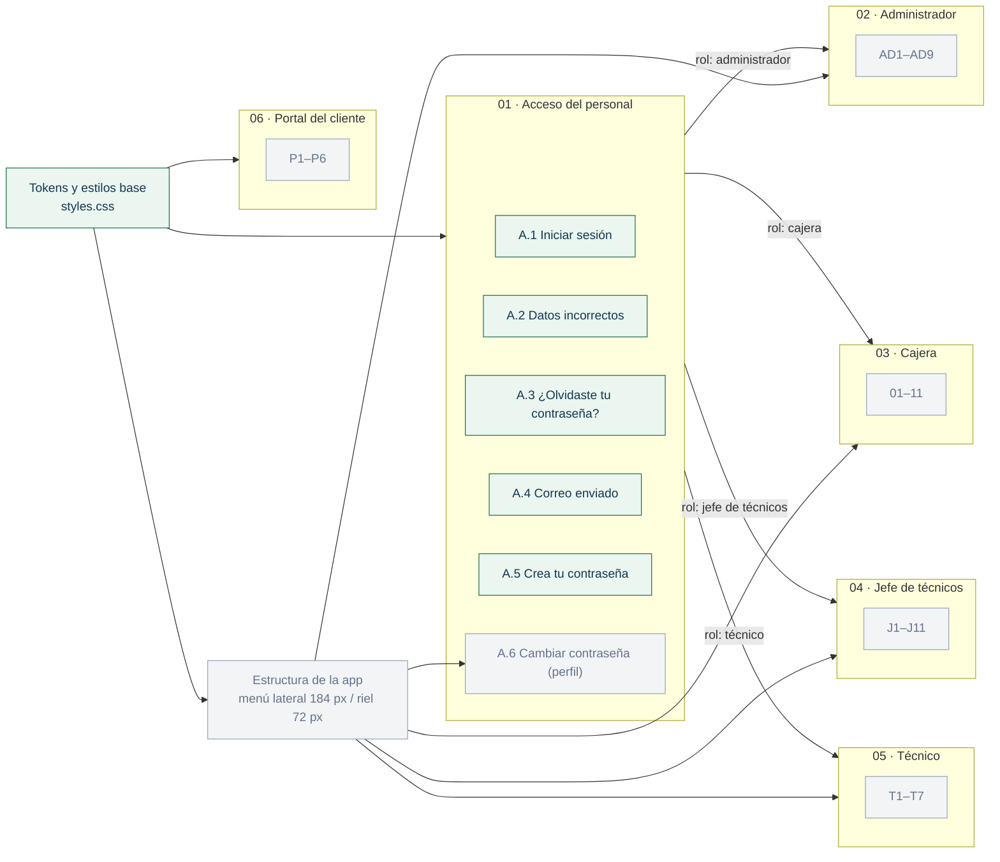
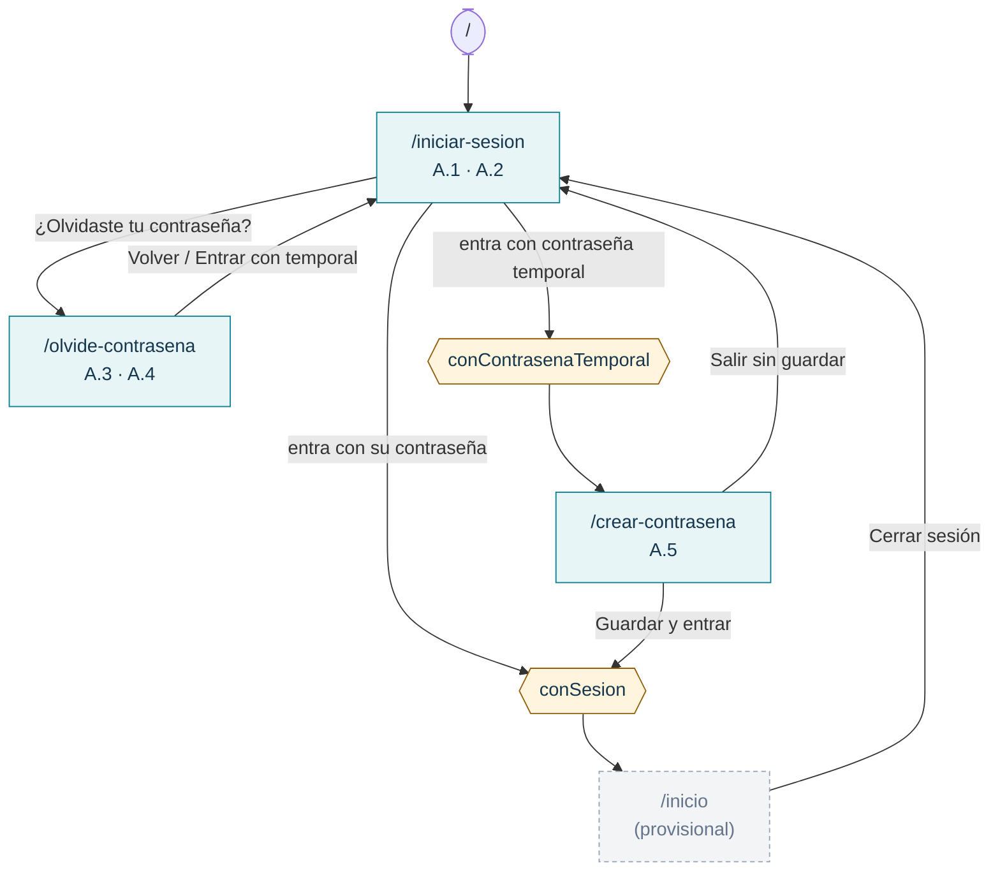
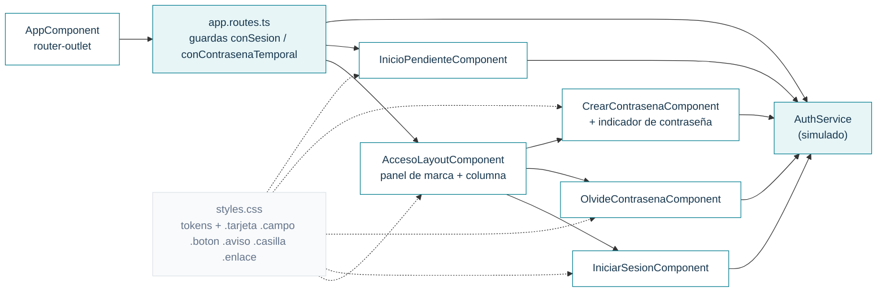

# Bitácora del frontend · SHURI

Registro vivo de lo que se construye en el frontend (Angular 17). Se actualiza **en cada avance** para no perder el contexto entre sesiones: qué está hecho, cómo está organizado, qué decisiones se tomaron y qué sigue.

- **Diseño fuente:** [Figma · SHURI](https://www.figma.com/design/wUFXid6RcC3a6H9iEdokWi/Untitled) (exportes en [`docs/diseno/`](../docs/diseno/README.md))
- **Rama de trabajo:** `feature/frontend-ui`
- **Última actualización:** 2 nov 2026

---

## 1. Grafo de avance por módulo

Cada nodo es una sección de Figma. Verde = hecho · amarillo = en curso · gris = pendiente.



## 2. Grafo de navegación (rutas actuales)



## 3. Grafo de componentes



---

## 4. Cómo correrlo

```bash
cd frontend
npm install
npm start          # http://localhost:4200
npm run build      # compilación de producción
```

**Usuarios de prueba** (mientras no exista la API de Laravel), definidos en `src/app/acceso/auth.service.ts`:

| Usuario | Contraseña | Resultado |
|---|---|---|
| `amartinez` | `Shuri2026!` | Entra directo (rol cajera) |
| `nuevo` | `temporal123` | Simula primer ingreso → A.5 (rol técnico) |
| cualquier otro | — | A.2: “Te quedan N intentos”; al 3.º fallo la cuenta se bloquea |

## 5. Estructura de carpetas

```
frontend/src/
├── index.html                 # lang="es", fuente Inter (Google Fonts)
├── styles.css                 # tokens de Figma + clases compartidas
├── assets/
│   ├── acceso/                # logo-shuri.png, elipses del panel de marca
│   └── iconos/                # SVG exportados de Figma (nombre = ícono de Figma)
└── app/
    ├── app.routes.ts          # rutas + guardas
    ├── acceso/
    │   ├── auth.service.ts    # sesión, intentos, contraseña temporal (simulado)
    │   ├── acceso-layout/     # marco común A.1–A.5
    │   ├── iniciar-sesion/    # A.1 · A.2
    │   ├── olvide-contrasena/ # A.3 · A.4
    │   └── crear-contrasena/  # A.5 + indicador de seguridad
    └── inicio/
        └── inicio-pendiente.component.ts   # destino temporal tras login
```

## 6. Convenciones

- **Componentes standalone**, `signal()` para estado local, **Reactive Forms** (`NonNullableFormBuilder`), control de flujo nuevo (`@if`, `@for`).
- **Nombres en español** (componentes, clases CSS, variables), igual que en Figma.
- **Colores:** siempre `var(--color-*)` de `styles.css`. Los nombres salen de las variables de Figma (`color/primario` → `--color-primario`).
- **Estilos compartidos en `styles.css`** (`.tarjeta`, `.campo`, `.campo__control`, `.boton--primario`, `.enlace`, `.aviso--error`, `.casilla`). El presupuesto de CSS por componente es 2 kB, así que lo reutilizable va global y lo específico va en el componente.
- **Íconos:** se descargan de Figma a `assets/iconos/` y se usan como `` con su `width`/`height` original. No se redibujan.
- **Reglas de Figma aplicadas** (página “Componentes y tokens › Reglas de comportamiento”):
  - Campo en foco: borde 1.5 px `--color-primario`. Campo con error: borde 1.5 px `--color-peligro`.
  - Validación al salir del campo y al guardar; el mensaje va en rojo debajo del campo.
  - Campos obligatorios con `*`.
- **Responsivo:** base 1440×900, mínimo 360 px de ancho (lo exige el checklist de PR). Debajo de 960 px de ancho se oculta el panel de marca y aparece el logo arriba del formulario. Con menos de 760 px de alto se ocultan las tarjetas flotantes del panel.

## 7. Flujo de trabajo del equipo

Reglas tomadas del [README principal](../README.md) (sección 12) y de [`.github/`](../.github/):

- Flujo de ramas: `feature/frontend-ui` → **PR a `develop`** → `develop` pasa a `main` al cierre de cada sprint. **Nunca abrir el PR directo a `main`.**
- **Diana** (`@dianaaochoa`, CODEOWNERS) revisa y aprueba todos los PR. Política de unión: *merge commit*.
- Checklist del PR ([plantilla](../.github/pull_request_template.md)):
  - rama actualizada con `develop`
  - commits `tipo(modulo): descripción`
  - `ng build` sin errores
  - sin `node_modules/`
  - vista adaptable a **360 px** y escritorio
- Antes de abrir un PR: traer `origin/develop` a esta rama (merge, no rebase) y volver a compilar.
- Sprint 3: 26 oct – 8 nov · Sprint 4: 9 – 22 nov 2026 (cierre del proyecto).

## 8. Decisiones y desviaciones del diseño

| Tema | Decisión | Motivo |
|---|---|---|
| Pastillas y círculos del panel de marca | Fondo blanco 8 % / borde 18 %; círculos con la opacidad de los SVG de A.5 | El exporte de Figma de A.1–A.3 pierde la transparencia (salían blancos). Se siguió el PNG de `docs/diseno` y A.5. |
| “Recordar este equipo” | Guarda la sesión en `localStorage` (si no, en `sessionStorage`) | El diseño no lo especifica. |
| Niveles del indicador de contraseña | 0–2 requisitos: Débil (rojo) · 3: Media (ámbar) · 4: Segura (verde) | Figma solo trae la variante “Segura”. |
| Requisito no cumplido | Círculo gris vacío | Figma solo muestra requisitos cumplidos. |
| Destino tras iniciar sesión | `/inicio` provisional que muestra el rol | Los inicios por rol (AD1.1, C1.1, J1.1, T1.1) aún no existen. |
| Estilos | CSS propio con tokens de Figma, sin Tailwind ni Angular Material | `frontend/README.md` menciona “Tailwind CSS / Angular Material”, pero ninguno está instalado. Con CSS propio se copia el diseño de Figma tal cual. Pendiente acordarlo con el equipo. |

## 9. Pendientes conocidos

- [ ] Conectar `AuthService` a la API de Laravel (Sanctum) cuando exista; quitar los usuarios de prueba.
- [ ] Optimizar `assets/acceso/logo-shuri.png` (1.2 MB para un logo de 48 px).
- [ ] Aviso de presupuesto en `acceso-layout.component.css` (2.9 kB contra 2 kB). No rompe la compilación.
- [ ] Estructura de la app con menú lateral (184 px; riel de 72 px en 1366×768).
- [ ] A.6 Cambiar contraseña (va dentro del sistema, desde el perfil).
- [ ] Redirección por rol: administrador → AD1.1, cajera → C1.1 (o C1.2 sin turno), jefe → J1.1 / J10.1 en celular, técnico → T1.1 / T7.1 en tablet.
- [ ] Bloqueo de sesión tras 30 min sin uso (regla general de Figma).

---

## 10. Registro de sesiones

### 2 nov 2026 · Acceso del personal (A.1–A.5)
- Se revisó todo el archivo de Figma: 3 páginas (Sistema del personal, Portal del cliente, Componentes y tokens) y las secciones de cada rol.
- Tokens de color de Figma pasados a `styles.css` y fuente Inter en `index.html`.
- Construidas A.1 Iniciar sesión, A.2 Datos incorrectos, A.3/A.4 ¿Olvidaste tu contraseña?, A.5 Crea tu contraseña, con su panel de marca compartido.
- `AuthService` simulado: 3 intentos y bloqueo, contraseña temporal, cambio obligatorio en el primer ingreso.
- Guardas de ruta: `conSesion` y `conContrasenaTemporal`.
- Verificado en el navegador a 1440×900 (posiciones iguales a Figma) y en ancho de celular.

### 2 nov 2026 · Rama al día con `develop`
- Se unió `origin/develop` a `feature/frontend-ui` sin conflictos. Llegaron solo cambios de documentación del equipo: README, `backend/README.md`, `frontend/README.md`, `.gitignore` y la plantilla de PR.
- Tras unirla: `ng build` correcto y login revisado a 360 px sin scroll horizontal.
- Se documentó el flujo de trabajo del equipo (sección 7).
