# 🎨 SHURI · Frontend (SPA)

**Angular 17 · TypeScript · Tailwind CSS / Angular Material**

Documentación del frontend: prototipo, navegación, pantallas por rol, sistema de diseño e instalación.
Responsable: **Félix Martínez** (Frontend & UX/UI). ← [Volver al README principal](../README.md)

## Índice

1. [Prototipo](#1-prototipo)
2. [Mapa de navegación](#2-mapa-de-navegación)
3. [Pantallas por rol](#3-pantallas-por-rol)
4. [Sistema de diseño](#4-sistema-de-diseño)
5. [Instalación](#5-instalación)

---

## 1. Prototipo

Prototipo de alta fidelidad en **Figma**: [abrir en Figma](https://www.figma.com/design/wUFXid6RcC3a6H9iEdokWi/Untitled?node-id=62-22047&t=5qUdxVh60Zgiw0Ah-0).
La exportación completa está en [`docs/diseno/`](../docs/diseno/). Cada imagen es una sección de Figma con todas sus pantallas en orden.

| Dispositivo | Tamaño base | Uso |
|---|---|---|
| Escritorio | 1440 × 900 (menú lateral de 184 px) | Administrador, Cajera, Jefe de Técnicos, Técnico |
| Escritorio compacto | 1366 × 768 (riel de 72 px) | Monitores de mostrador |
| Tablet | 1180 × 820 | Técnico en el banco de trabajo |
| Celular | 390 × 844 | Portal del cliente y Jefe de Técnicos en movimiento |

---

## 2. Mapa de navegación

```mermaid
flowchart TD
    Login["🔐 Acceso del personal<br/>(usuario + contraseña;<br/>temporal la primera vez)"] --> RBAC{"¿Rol?"}

    RBAC -->|Administrador| AD1["AD1 Inicio"]
    AD1 --> AD2["AD2 Reportes"] & AD3["AD3 Cortes de caja"] & AD4["AD4 Catálogo y precios"]
    AD1 --> AD5["AD5 Proveedores"] & AD6["AD6 Facturación"] & AD7["AD7 Usuarios y permisos"]
    AD1 --> AD8["AD8 Bitácora"] & AD9["AD9 Configuración"]

    RBAC -->|Cajera| C1["01 Inicio y apertura de caja"]
    C1 --> C2["02 Punto de venta"] & C3["03 Ventas"] & C4["04 Órdenes de servicio"]
    C4 --> C5["05 Nueva orden"] & C6["06 Entrega de equipo"]
    C1 --> C7["07 Inventario"] & C8["08 Clientes"] & C9["09 Estadísticas"]
    C1 --> C10["10 Corte de caja"] --> C11["11 Documentos impresos"]

    RBAC -->|Jefe de Técnicos| J1["J1 Inicio"]
    J1 --> J2["J2 Tablero de órdenes"] --> J3["J3 Cotizar"]
    J1 --> J4["J4 Garantías"] & J5["J5 Refacciones"] & J6["J6 Inventario"]
    J1 --> J7["J7 Técnicos"] & J8["J8 Equipos terminados"] & J11["J11 Mensajes de clientes"]

    RBAC -->|Técnico| T1["T1 Inicio"]
    T1 --> T2["T2 Equipos asignados"] --> T3["T3 Banco de trabajo"]
    T1 --> T4["T4 Garantías"] & T5["T5 Refacciones"] & T6["T6 Mi historial"]

    Portal["🌐 Portal del cliente<br/>(correo + contraseña)"] --> P1["P1 Acceso y mis equipos"]
    P1 --> P2["P2 Seguimiento de la reparación"]
    P1 --> P3["P3 Garantía"] & P4["P4 Información"] & P5["P5 Chat con el jefe"]
    J11 -. chat .- P5
```



---

## 3. Pantallas por rol

| Entorno | Pantallas | Versiones |
|---|---|---|
| **Acceso** | A.1–A.6: inicio de sesión, datos incorrectos, olvidé mi contraseña, crear y cambiar contraseña. | Escritorio |
| **Administrador** | AD1 Inicio · AD2 Reportes · AD3 Cortes de caja · AD4 Catálogo y precios · AD5 Proveedores · AD6 Facturación · AD7 Usuarios y permisos (asignar contraseña temporal) · AD8 Bitácora · AD9 Configuración (negocio, marca y correo). | Escritorio |
| **Cajera** | 01 Inicio y apertura de caja · 02 Punto de venta · 03 Ventas · 04 Órdenes de servicio · 05 Nueva orden · 06 Entrega de equipo · 07 Inventario · 08 Clientes · 09 Estadísticas · 10 Corte de caja · 11 Documentos impresos. | Escritorio |
| **Jefe de Técnicos** | J1 Inicio · J2 Tablero de órdenes · J3 Cotizar · J4 Garantías · J5 Refacciones · J6 Inventario · J7 Técnicos · J8 Equipos terminados · J9 Configuración · J11 Mensajes de clientes. | Escritorio + J10 celular |
| **Técnico** | T1 Inicio · T2 Equipos asignados · T3 Banco de trabajo · T4 Garantías · T5 Refacciones · T6 Mi historial. | Escritorio + T7 tablet |
| **Portal del cliente** | P1 Acceso y mis equipos · P2 Seguimiento de la reparación · P3 Garantía (solo si se solicita) · P4 Información · P5 Chat con el Jefe de Técnicos · P6 Correos que recibe el cliente. | Celular |
| **Sistema de diseño** | Componentes, tokens (color, espaciado, radios, sombras), iconos, reglas de comportamiento y versión a 1366 px. | — |

<details>
<summary><b>Ver todas las pantallas</b></summary>

| Módulo | Archivos |
|---|---|
| Acceso | [00 Acceso del personal](../docs/diseno/01-acceso/00-acceso-del-personal.png) |
| Administrador | [AD1](../docs/diseno/02-administrador/ad1-inicio.png) · [AD2](../docs/diseno/02-administrador/ad2-reportes.png) · [AD3](../docs/diseno/02-administrador/ad3-cortes-de-caja.png) · [AD4](../docs/diseno/02-administrador/ad4-catalogo-y-precios.png) · [AD5](../docs/diseno/02-administrador/ad5-proveedores.png) · [AD6](../docs/diseno/02-administrador/ad6-facturacion.png) · [AD7](../docs/diseno/02-administrador/ad7-usuarios-y-permisos.png) · [AD8](../docs/diseno/02-administrador/ad8-bitacora.png) · [AD9](../docs/diseno/02-administrador/ad9-configuracion.png) |
| Cajera | [01](../docs/diseno/03-cajera/01-inicio-y-apertura-de-caja.png) · [02](../docs/diseno/03-cajera/02-punto-de-venta.png) · [03](../docs/diseno/03-cajera/03-ventas.png) · [04](../docs/diseno/03-cajera/04-ordenes-de-servicio.png) · [05](../docs/diseno/03-cajera/05-nueva-orden-de-servicio.png) · [06](../docs/diseno/03-cajera/06-entrega-de-equipo.png) · [07](../docs/diseno/03-cajera/07-inventario.png) · [08](../docs/diseno/03-cajera/08-clientes.png) · [09](../docs/diseno/03-cajera/09-estadisticas.png) · [10](../docs/diseno/03-cajera/10-corte-de-caja.png) · [11](../docs/diseno/03-cajera/11-documentos-impresos.png) |
| Jefe de Técnicos | [J1](../docs/diseno/04-jefe-de-tecnicos/j1-inicio.png) · [J2](../docs/diseno/04-jefe-de-tecnicos/j2-tablero-de-ordenes.png) · [J3](../docs/diseno/04-jefe-de-tecnicos/j3-cotizar.png) · [J4](../docs/diseno/04-jefe-de-tecnicos/j4-garantias.png) · [J5](../docs/diseno/04-jefe-de-tecnicos/j5-refacciones.png) · [J6](../docs/diseno/04-jefe-de-tecnicos/j6-inventario.png) · [J7](../docs/diseno/04-jefe-de-tecnicos/j7-tecnicos.png) · [J8](../docs/diseno/04-jefe-de-tecnicos/j8-equipos-terminados.png) · [J9](../docs/diseno/04-jefe-de-tecnicos/j9-configuracion.png) · [J10](../docs/diseno/04-jefe-de-tecnicos/j10-version-celular.png) · [J11](../docs/diseno/04-jefe-de-tecnicos/j11-mensajes-de-clientes.png) |
| Técnico | [T1](../docs/diseno/05-tecnico/t1-inicio.png) · [T2](../docs/diseno/05-tecnico/t2-equipos-asignados.png) · [T3](../docs/diseno/05-tecnico/t3-banco-de-trabajo.png) · [T4](../docs/diseno/05-tecnico/t4-garantias.png) · [T5](../docs/diseno/05-tecnico/t5-refacciones.png) · [T6](../docs/diseno/05-tecnico/t6-mi-historial.png) · [T7](../docs/diseno/05-tecnico/t7-version-tablet.png) |
| Portal del cliente | [P1](../docs/diseno/06-portal-cliente/p1-acceso-y-mis-equipos.png) · [P2](../docs/diseno/06-portal-cliente/p2-seguimiento-de-la-reparacion.png) · [P3](../docs/diseno/06-portal-cliente/p3-garantia-solo-si-se-solicita.png) · [P4](../docs/diseno/06-portal-cliente/p4-informacion.png) · [P5](../docs/diseno/06-portal-cliente/p5-chat-con-el-jefe-de-tecnicos.png) · [P6](../docs/diseno/06-portal-cliente/p6-correos-que-recibe-el-cliente.png) |
| Componentes | [Componentes y tokens](../docs/diseno/07-componentes/componentes-y-tokens.png) · [Iconos y navegación](../docs/diseno/07-componentes/componentes-parte-2-iconos-navegacion-portal.png) · [Chat, marca y celular](../docs/diseno/07-componentes/componentes-parte-3-chat-marca-y-celular.png) · [Reglas de comportamiento](../docs/diseno/07-componentes/reglas-de-comportamiento-para-desarrollo.png) · [Versión 1366 px](../docs/diseno/07-componentes/comportamiento-a-1366-px-menu-compacto.png) |

</details>

---

## 4. Sistema de diseño

| Recurso | Contenido |
|---|---|
| [Componentes y tokens](../docs/diseno/07-componentes/componentes-y-tokens.png) | Colores, tipografía, espaciado, radios y sombras. |
| [Iconos y navegación](../docs/diseno/07-componentes/componentes-parte-2-iconos-navegacion-portal.png) | Iconografía y navegación del portal. |
| [Chat, marca y celular](../docs/diseno/07-componentes/componentes-parte-3-chat-marca-y-celular.png) | Componentes del chat y adaptación a celular. |
| [Reglas de comportamiento](../docs/diseno/07-componentes/reglas-de-comportamiento-para-desarrollo.png) | Cómo deben comportarse los componentes al programarlos. |
| [Versión 1366 px](../docs/diseno/07-componentes/comportamiento-a-1366-px-menu-compacto.png) | Menú compacto para pantallas pequeñas. |

**Colores por estado de la orden:** azul (recibido / asignado) · amarillo y naranja (diagnóstico / presupuesto pendiente) · verde (listo / aprobado) · rojo y gris (rechazado / en abandono).
**Tipografía:** sans-serif moderna (Inter / Roboto).

---

## 5. Instalación

**Requisitos:** Node.js 18+, Angular CLI 17 (`npm install -g @angular/cli@17`).

```bash
cd frontend
npm install
ng serve                      # http://localhost:4200
```

| Comando | Uso |
|---|---|
| `ng serve` | Servidor de desarrollo con recarga automática. |
| `ng build` | Compila el proyecto en `dist/`. |
| `ng test` | Ejecuta las pruebas unitarias. |
| `ng generate component <nombre>` | Crea un componente nuevo. |
